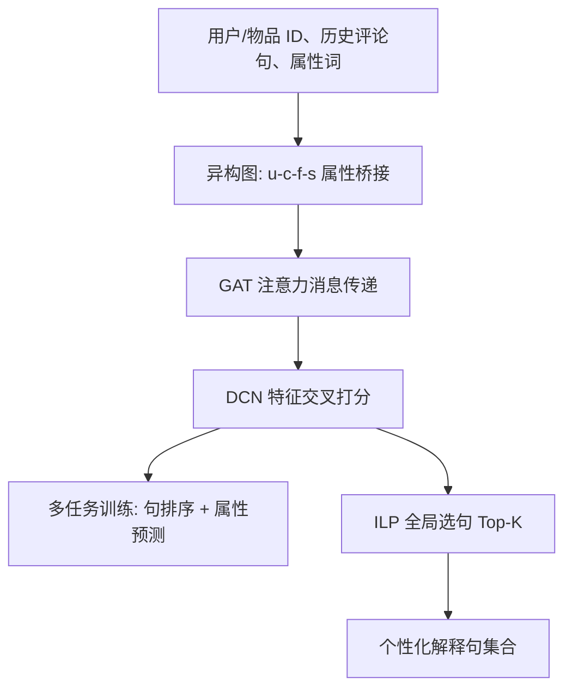
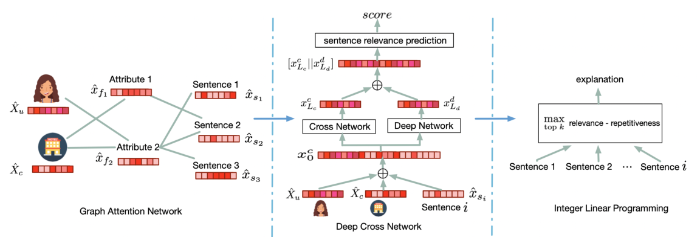

# Graph-based Extractive Explainer for Recommendations (面向推荐的图抽取式解释器)

- **会议/期刊**: WWW 2022
- **作者与机构**: Peng Wang, Renqin Cai, Hongning Wang（University of Virginia）
- **推荐链路定位**: 重排/推荐后置解释生成（Explainable Recommendation）
- **研究方向**: 对话推荐与智能体仿真（可解释推荐理由生成） / 图神经网络与知识图谱推荐
- **论文原文**: [https://arxiv.org/abs/2202.09730v1](https://arxiv.org/abs/2202.09730v1)
- **开源代码**: 暂未开源

## TL;DR (1分钟核心速览)

模板式解释（EFM）通顺但机械、缺乏多样性；生成式解释（NRT/SAER）多样但内容泛化、难以个性化。本文提出 GREENer：以物品属性为中介，把用户、物品、属性、候选评论句构建为异构图，用 GAT + DCN 评估"该句对这对用户-物品是否相关"，再用整数线性规划（ILP）在相关性、属性覆盖与冗余度间做全局取舍。在 Ratebeer/TripAdvisor 的 70/15/15 划分、Top-5 抽取协议下，BLEU-1 相对 SOTA 提升 26.2%–28.8%，BLEU-4 最高 +73.2%。

## Background & Motivation (背景与核心矛盾)

- **主流范式**: 观点文本解释分三派——模板式（EFM/MTER/EX3 抽属性-观点对填槽）、生成式（NRT/NETE/SAER 用神经语言模型合成句子）、抽取式（NARRE/CARP 从既有评论中挑句子）。
- **前人局限**: ①模板式格式僵化、句式"机器人化"，跨物品仅换关键词，可信度低；②生成式缺乏细粒度内容控制、依赖大规模数据，输出趋于语料分布的"最大公约数"，对具体用户/物品缺乏特异性；③抽取式直接在稀疏的 user-item-句子 关联上建模，用户通常只写少量评论，难以个性化。
- **核心洞察 (Key Insight)**: 物品属性是用户与物品之间的天然"中介物"——用户历史评论透露其关注的属性，物品评论透露其被讨论的属性；通过属性共现即可把稀疏的用户-句子关联转成稠密的属性桥接，同时自动过滤"我喝了两瓶啤酒"这类个人体验句。
- **本文切入点**: 异构图编码（直接共现依赖）+ 特征交叉（表征级间接依赖）双视角打分，再用 ILP 把"逐句独立打分"升级为"集合级联合选择"。

## Method (核心方法设计)

### 1. 整体框架 (Overall Architecture)

对每个 (u,c) 对构建一张子图：节点含用户节点 $u$、物品节点$c$、候选句节点集合$S_g=S_u\cup S_c$（该用户写过的所有句子 ∪ 描述该物品的所有句子）、以及这些句子中出现的属性节点$f$；边仅有三类二值无向边$e_{uf}$（用户用过该属性）、$e_{cf}$（该属性描述过该物品）、$e_{fs}$（句子含该属性词）。用户/物品用可学习 ID 嵌入，属性用 GloVe、句子用微调后的 Sentence-BERT 初始化，经 2 层 GAT 消息传递得到上下文表征，再由 DCN 做用户-物品-句子三方的显式特征交叉，输出句子相关性打分；训练时辅以属性预测多任务；推理时先取 Top-100 候选，再用 Gurobi 解 ILP 选出 Top-5 作为最终解释。

<figure class="paper-figure" markdown="span">
  <figcaption>图1：GRaph Extractive ExplaiNer（GREENer）示意图。对于一对用户和物品，GREENer 利用图注意力网络和深度交叉网络编码用户过去写的句子以及描述该物品的过去句子。然后，它利用整数线性规划选择句子作为解释。</figcaption>
</figure>

### 2. 关键设计拆解 (Key Designs)

1. **属性桥接的异构图注意力（解决稀疏 + 过滤噪声句）**：痛点是不相关句子（个人体验）与 user-item 观测稀疏。做法是把属性作为唯一跨类型枢纽，使"用户—属性—句子"与"物品—属性—句子"两条路径连通，句子表征因此同时吸收该用户的偏好视角与该物品的固有属性视角；不含任何物品属性的句子在构图阶段即被剔除。注意力权重沿用标准 GAT 形式 $\alpha^l_{ij}=\mathrm{softmax}_j\big(\mathrm{LeakyReLU}(\boldsymbol{W}^l_a[\boldsymbol{W}^l_q\boldsymbol{h}^l_i\|\boldsymbol{W}^l_k\boldsymbol{h}^l_j])\big)$，$L=2$ 层、首层 4 头。直觉：属性节点充当"信息路由器"，把同一用户在别的物品上表达过的偏好迁移到当前物品的候选句上，从而在稀疏条件下仍能个性化。

2. **DCN 特征交叉补足表征级间接依赖（解决共现图覆盖不到的相关性）**：图只编码"共现过"的直接依赖，若某句与用户偏好语义相近但无共享属性词，图结构无能为力。故将 $\boldsymbol{x}^c_0=\boldsymbol{x}^d_0=[\hat{\boldsymbol{X}}_u\|\hat{\boldsymbol{X}}_c\|\hat{\boldsymbol{x}}_{s_i}]$同时送入 cross 网络$\boldsymbol{x}^c_{l+1}=\boldsymbol{x}^c_0{\boldsymbol{x}^c_l}^{\top}\boldsymbol{w}^c_l+\boldsymbol{b}^c_l+\boldsymbol{x}^c_l$与 2 层 MLP，拼接输出$\boldsymbol{x}^{cd}_{s_i}=[\boldsymbol{x}^c_{L_c}\|\boldsymbol{x}^d_{L_d}]$作为最终句子表征。物理直觉：交叉层显式枚举$u$、$c$、$s$ 特征域的乘性交互，等价于学习"哪类用户 × 哪类物品 × 哪类句子"三元匹配模式。

3. **多任务排序训练 + ILP 集合级选句（解决冗余与覆盖）**：单句打分天然导致 Top-K 内部语义重复。训练目标为 $\mathcal{L}=\lambda\mathcal{L}_s+(1-\lambda)\mathcal{L}_f$，其中句排序用 BLEU 软相关性$r_i=\max_{s^j_{uc}\in S_{uc}}\mathrm{sim}(s_i,s^j_{uc})$构造成对损失$\mathcal{L}_s=-\sum_{s_i,s_j\in S_g}\mathrm{sign}(r_i-r_j)\log\sigma\big(g(s_i)-g(s_j)\big)$，$g(s_i)=\langle\boldsymbol{W}^o_s,\boldsymbol{x}^{cd}_i\rangle$；属性侧用交叉熵$\mathcal{L}_f$约束属性节点表征可预测真实属性（$\lambda=0.5$）。选句阶段求解
$$\max\ \sum_{i}x_i g(s_i)-\alpha\sum_{i\neq j}y_{ij}\,\mathrm{sim}(s_i,s_j)\quad \text{s.t.}\ \sum_i x_i=K,\ \sum_{i\neq j}y_{ij}=K(K-1),\ x_i+x_j\le y_{ij}+1$$
其中 $\mathrm{sim}$为 tf-idf 余弦、$\alpha=2.0$、$K=5$。该式把"高相关且两两不相似"写成可并行求解的 0-1 规划，从根本上抑制近重复句。训练用 batch 16、Adam、lr 2e-4，全流程无负采样（负例来自图内其他候选句的自然成对比较），推理开销主要是 Gurobi 对 100 个候选的 ILP（每对独立、可并行）。

## Experimental Setup & Evaluation Protocol (实验设置与评估协议)

- **数据集与预处理**: 仅保留正反馈（Ratebeer 评分 >10 于 1–20 区间，TripAdvisor >3 于 1–5 区间）；过滤评论数 <15 的冷门用户与物品；用 Sentires 抽属性词并人工清洗，仅保留至少含 1 个属性的句子作候选解释。

| 数据集 | #Users | #Items | #Reviews | #Sentences | 特征/场景说明 |
| :--- | :---: | :---: | :---: | :---: | :--- |
| Ratebeer | 1,664 | 1,487 | 109,746 | 519,353 | 572 属性；啤酒评论，长文本、风味词密集 |
| TripAdvisor | 4,948 | 4,487 | 159,834 | 560,367 | 503 属性；酒店评论，属性跨度大 |

- **数据划分与防穿越 (Splitting Strategy)**: 按 $70\%/15\%/15\%$比例随机划分训练/验证/测试；用户与物品的图结构、属性共现统计仅在训练集上构建，验证集用于选模型与调$\alpha$。
- **排名评测协议 (Ranking Protocol)**: 非传统 Full-Ranking 召回评测，而是**生成质量评测**——在测试 (u,c) 对上先取 Top-100 候选句，ILP 选 Top-5，与真实评论句比对：词级用 BLEU-{1,2,4} 与 ROUGE-{1,2,L} F1，属性级用 Precision/Recall/F1；不涉及采样负例排序。
- **对比基线与超参设置**: 生成式 NRT、SAER；抽取式 NARRE、SEER、ESCOFILT。句/属性嵌入 256 维，GAT 2 层（4 头 + 1 头）、隐层 256，DCN 为 2 层 cross + 2 层 MLP（隐层与输出均 128）。

## Key Experimental Results (实验关键数据)

### 1. 主实验对比 (Main Results)

| 模型 | Rb BLEU-1 | Rb BLEU-4 | Rb ROUGE-L | TA BLEU-1 | TA BLEU-4 | TA ROUGE-L |
| :--- | :---: | :---: | :---: | :---: | :---: | :---: |
| NRT (生成式) | 27.03 | 2.50 | 24.63 | 20.30 | 1.70 | 18.86 |
| SAER (生成式) | 28.40 | 2.66 | 25.29 | 20.94 | 1.90 | 19.23 |
| NARRE (抽取式) | 24.67 | 1.41 | 20.04 | 22.22 | 1.67 | 19.52 |
| SEER (抽取式+ILP) | 14.24 | 1.03 | 21.08 | 21.84 | 1.89 | 20.44 |
| ESCOFILT (抽取式) | 26.36 | 3.55 | 24.62 | 22.81 | 2.39 | 20.42 |
| **GREENer** | **36.59** | **6.15** | **29.84** | **28.78** | **4.38** | **22.33** |
| Improv.% (vs 最优基线) | +28.8% | +73.2% | +18.0% | +26.2% | +83.3% | +9.2% |

属性级（F1）：Ratebeer **32.74** vs 最优基线 24.76（+32.2%），召回 40.02 vs 32.99；TripAdvisor **23.46** vs 19.26（+21.8%），召回 33.68 vs 28.21，精确率基本持平（20.92 vs 22.66）。

### 2. 消融实验 (Ablation Study)

| 变体 (Ratebeer) | BLEU-1 | BLEU-2 | BLEU-4 | ROUGE-L |
| :--- | :---: | :---: | :---: | :---: |
| GREENer 完整 | **36.59** | **19.14** | **6.15** | **29.84** |
| w/o GAT（改拼接+池化） | 33.95 | 17.74 | 5.88 | 28.23 |
| w/o BERT（词向量均值） | 33.26 | 16.59 | 4.96 | 28.88 |
| w/o DCN（单线性层） | 35.13 | 17.63 | 5.35 | 29.08 |
| w/o ILP（按分数贪心） | 27.73 | 14.79 | 5.75 | 26.01 |

### 3. 关键实验发现 (Key Findings)

1. **ILP 是最大贡献项，也是"抽取式"性能的分水岭**：去掉 ILP 后 BLEU-1 从 36.59 崩至 27.73（−24.2%），甚至低于生成式 SAER 的 28.40；输出中 Top 句高度互似、属性覆盖窄。这说明句级相关性模型必须配集合级去冗，否则抽取式相对生成式无优势。
2. **异构图 > 特征交叉 > 预训练编码，但三者互补**：去 GAT 使 BLEU-4 降 0.27、ROUGE-L 降 1.61；去 DCN 影响最小（BLEU-1 −1.46），但 DCN 与 GAT 叠加仍优于任一单独；去 BERT 对 BLEU-4 打击最大（6.15→4.96），表明句表征语义质量决定长片段匹配。
3. **抽取式模型普遍"高精度低召回"，GREENer 反转为"召回驱动"**：TripAdvisor 上 GREENer 精确率 20.92 低于 SEER 的 22.66，但召回 33.68 远超 26.15，最终 F1 仍 +6.9%；且 BLEU-4 的增益（+73%）远大于 BLEU-1（+29%），说明其优势在于命中更长的连续语义片段（连贯性），而非单词级巧合匹配。

## Highlights & Limitations (亮点、对比与审稿批判)

- **与代表作对比 (vs. Prior Work)**: 与 NARRE 同为抽取式，但 NARRE 复用"推荐注意力"，句子间无依赖；GREENer 用属性图显式建模四类实体依赖。与 SEER 同为 ILP 选句，但 SEER 的权重来自 EFM 预先算出的用户情感分数，GREENer 端到端学习句相关性并将打分函数直接嵌入 ILP 目标。与 SAER 相比，避免了生成模型的"语料均值化"泛化问题。
- **可迁移亮点**: ①"属性作中介"是缓解 user-item 观测稀疏的通用图构造范式，可移植到评论增强的 CTR/序列推荐中；②把逐项打分升级为带冗余惩罚的 ILP 集合选择，可直接迁移到多样化重排（diversified re-ranking）与评论摘要任务。
- **审稿级局限批判**: ①**冷启动硬伤**：抽取式严格受限于物品已有评论，新物品无任何可抽内容，作者亦承认；②**推理成本与超参敏感**：每对需解一次含 $O(|S_g|^2)$个 0-1 变量的 ILP（虽截断至 100 候选），且$\alpha=2.0$、$K$、$\lambda$均为人工设定，缺少对$\alpha$ 的敏感性分析；③**评测与"可信度"存在 gap**：BLEU/ROUGE 度量的是与真实评论的字面重叠，但论文核心主张是"可信、个性化"，全文未做任何用户研究或人工偏好打分，Case Study 仅两例，说服力有限；④图边权全为二值，未考虑属性重要度或情感极性。

## Rating (四维评分)

- **方法创新性 (Novelty)**: ⭐⭐⭐⭐ （属性中介异构图 + DCN 双视角打分 + ILP 集合选句的组合较完整，但 GAT/DCN/ILP 均为成熟组件，创新在"拼装范式"而非新算子）
- **评估协议与实验扎实度 (Protocol & Experiments)**: ⭐⭐⭐ （两数据集 + 5 基线 + 4 组消融较规范，但仅 70/15/15 单次划分、无显著性检验、无人工评测，且未报告方差）
- **写作与数学规范度 (Clarity & Rigor)**: ⭐⭐⭐⭐ （问题分解与动机链条清晰，ILP 约束写法略显冗余，命名大小写混乱（NRT 误作 NR T）为排版瑕疵）
- **工业落地与复现价值 (Industrial & Practical Value)**: ⭐⭐⭐ （解释对线上体验有直接价值、可并行求解，但依赖 Gurobi 商业求解器、无开源代码，新物品场景不可用限制了普适性）

