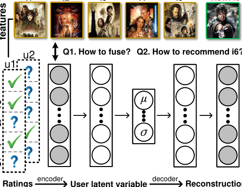
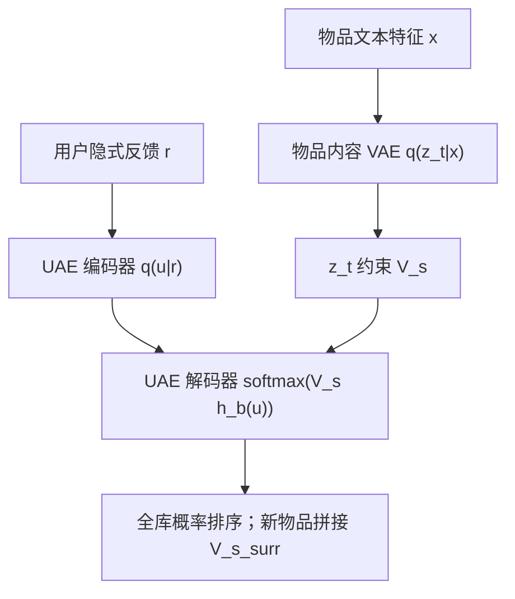
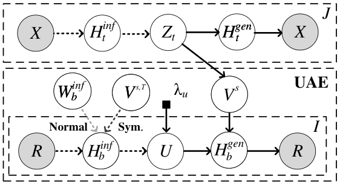

# Mutually-Regularized Dual Collaborative Variational Auto-encoder for Recommendation Systems (互正则化双协同变分自编码器推荐系统)

- **会议/期刊**: WWW 2022
- **作者与机构**: Yaochen Zhu, Zhenzhong Chen；武汉大学遥感信息工程学院、腾讯 Media Lab
- **推荐链路定位**: 召回（全库排序打分）
- **研究方向**: 冷启动与长尾推荐 / 协同过滤
- **论文原文**: [https://arxiv.org/abs/2211.11662v1](https://arxiv.org/abs/2211.11662v1)
- **开源代码**: [https://github.com/yaochenzhu/MD-CVAE](https://github.com/yaochenzhu/MD-CVAE)

## TL;DR (1分钟核心速览)

针对用户导向 UAE 无法利用物品内容、且新物品需全量重训两大痛点，MD-CVAE 把 UAE 解码器末层权重显式视为物品协同嵌入，并用物品内容 VAE 做互正则；MDsym-CVAE 再绑定编码器首层，使新物品以内容嵌入作代理直接排序。三数据集全库排序下，Recall@20 相对 CVAE/CoVAE 等最高提升约 10.8%，冷启物品 NDCG@100 最高提升约 14.6%。

## Background & Motivation (背景与核心矛盾)

- **主流范式**: Multi-VAE 等用户导向自编码器从用户历史评分学习隐变量，再直接重建评分；混合推荐则尝试用 FM、CTR/CDL/CVAE 或 CoVAE 引入物品内容。
- **前人局限**: UAE 不显式建模物品隐因子，物品内容难以在稀疏评分下约束模型；新物品到达后必须等交互并重训。CoVAE 只把特征共现当额外样本，协同/内容模块耦合松散，仍不能做 out-of-matrix 推荐。
- **核心洞察 (Key Insight)**: 二值隐式反馈下，UAE 解码器末层权重可解释为堆叠物品嵌入，编码器首层权重也可解释为物品嵌入；因此可用内容 VAE 正则化这些权重。
- **本文切入点**: 将 UAE 与物品内容 VAE 放入同一层次贝叶斯框架，并令编码器首层与解码器末层对称绑定。

<figure class="paper-figure" markdown="span">
  <figcaption>图1：基于UAE的推荐器概述及两个关键问题。问题1. 在未显式建模物品潜在变量的情况下，如何利用物品内容信息？问题2. 如何使UAE能够推荐像i6这样的冷启动物品？</figcaption>
</figure>
图 1：UAE 推荐器的两大痛点：物品内容难融合，新物品需重训。

## Method (核心方法设计)

### 1. 整体框架 (Overall Architecture)

输入为用户隐式反馈矩阵 $R$与物品内容矩阵$X$。UAE 编码$q(u|r)$推断用户隐变量，物品内容 VAE 编码$q(z_t|x)$得到内容隐变量；二者通过$v=z_b+z_t$与 UAE 末层权重$V_s$耦合。训练采用 EM 式交替 MAP：先固定内容嵌入更新 UAE，再固定 UAE 权重更新物品内容 VAE。推理时用$V_s$与用户隐变量做全库 softmax 打分；新物品则把内容 VAE 推断的$\mu_{z_t}$拼入$V_s$，无需重训。

<figure class="paper-figure" markdown="span">
  <figcaption>图2：MD- CVAE的概率图模型（PGM）。实线表示生成过程，虚线表示推断过程。</figcaption>
</figure>
图 2：MD-CVAE 的概率图模型：实线为生成，虚线为推断。

### 2. 关键设计拆解 (Key Designs)

1. **双协同生成与物品嵌入权重化**：UAE 丢弃物品隐因子，导致内容无法约束评分生成。本文令 $v_j=z_{b,j}+z_{t,j}$，其中$z_b\sim\mathcal N(0,\lambda_v^{-1}I)$、$z_t\sim\mathcal N(0,I)$，并把解码器末层权重设为$V_s=[v_1;\dots;v_J]$，评分生成为$r_i\sim\mathrm{Multi}(\mathrm{softmax}(V_s h_b^{gen}(u_i)),\#\mathrm{Int}_i)$。直觉是物品内容经$z_t$ 直接塑造协同打分方向，稀疏时避免解退化。

2. **互正则 EM-MAP 目标**：联合训练易偏向单一信息源，故交替优化。UAE 步为
$\mathcal L_b=\mathbb E_{q(u|r)}[\log p(r|u)]-\frac{\lambda_v}{2}\lVert V_s-\hat Z_t^s\rVert_F^2-\mathrm{KL}(q(u|r)\lVert p(u))-\frac{\lambda_W}{2}\sum_l\lVert W_b^{(l)}\rVert_F^2$；
物品内容步对称地以 $\hat V$约束$z_t$，并重建$x$。这样内容正则 UAE 权重，评分又反向约束内容嵌入更“推荐导向”。

3. **对称推断、冷启代理与训练效率**：UAE 首层可写为 $h_b^{inf}=W_b^{inf}r_i=\sum_j\mathbb I(r_{ij}=1)w_{b,j}^{inf}$，本文取$W_b^{inf}=V_s^\top$，形成编码器-解码器对称结构。新物品到达时用$V_s^{surr}=[V_s^{old}\Vert V_s^{new}]$，其中$V_s^{new}$为新品内容嵌入，直接参与打分。训练无显式负采样，多项 softmax 在全物品上归一化；推理一次前向$O(JK_v)$，新品仅追加代理权重。

## Experimental Setup & Evaluation Protocol (实验设置与评估协议)

- **数据集与预处理**:

| 数据集 | #Users | #Items | #Interactions | 密度 | 特征/场景说明 |
| :--- | :---: | :---: | :---: | :---: | :--- |
| citeulike-a | 5,551 | 16,980 | ≈2.05e5 | 0.217% | 论文标题+摘要，8,000 维 |
| movielen-sub | 10,881 | 7,701 | ≈7.73e5 | 0.922% | IMDB 剧情文本，8,000 维 |
| toys & games | 14,706 | 11,722 | ≈1.24e5 | 0.072% | Amazon 评论拼接，8,000 维 |

- **数据划分与防穿越**: 用户随机按 8:1:1 划分训练/验证/测试；每个用户 20% 交互留作测试；重复 10 次随机划分并取均值。未采用全局时间戳切分。
- **排名评测协议**: 对留出物品按全物品 softmax 概率排序，属无偏 `Full-Ranking (全库未交互排序)`；指标 Recall@20/40、NDCG@100。未使用采样排序。
- **对比基线与超参**: 基线含 FM、CTR、CDL、CVAE、Multi-VAE、CoVAE、CondVAE、DICER、DAVE。UAE 隐层 $\{0,1,2\}$、隐维$\{50,100,150,200,250\}$；$\lambda_v\in\{0.1,1,2,5,10\}$；冷启实验取$\lambda_v=50,50,10$（三数据集）。论文未报告显著性检验。

## Key Experimental Results (实验关键数据)

### 1. 主实验对比 (Main Results)

| 模型 | cite R@20 | cite R@40 | cite N@100 | mov R@20 | mov R@40 | mov N@100 | toys R@20 | toys R@40 | toys N@100 |
| :--- | ---: | ---: | ---: | ---: | ---: | ---: | ---: | ---: | ---: |
| MD-CVAE | **0.303** | **0.377** | **0.301** | **0.353** | **0.452** | **0.381** | 0.141 | 0.188 | 0.102 |
| MDsym-CVAE | 0.295 | 0.374 | 0.297 | 0.347 | 0.449 | 0.377 | **0.147** | **0.191** | **0.106** |
| FM | 0.231 | 0.312 | 0.238 | 0.324 | 0.421 | 0.357 | 0.088 | 0.121 | 0.062 |
| CTR | 0.169 | 0.250 | 0.190 | 0.285 | 0.398 | 0.312 | 0.124 | 0.179 | 0.089 |
| CVAE | 0.236 | 0.334 | 0.247 | 0.304 | 0.422 | 0.355 | 0.139 | 0.188 | 0.094 |
| Multi-VAE | 0.269 | 0.346 | 0.274 | 0.326 | 0.423 | 0.357 | 0.114 | 0.157 | 0.082 |
| CoVAE | 0.247 | 0.338 | 0.260 | 0.338 | 0.436 | 0.367 | 0.120 | 0.174 | 0.085 |
| DAVE | 0.281 | 0.362 | 0.283 | 0.340 | 0.432 | 0.371 | 0.125 | 0.177 | 0.086 |

相对表中最强非本文基线：citeulike-a 约 +7.8%/+4.1%/+6.4%，movielen-sub 约 +3.8%/+3.4%/+2.7%，toys & games 约 +5.8%/+1.6%/+12.8%。

### 2. 消融实验 (Ablation Study)

| 设置 | cite R@20 | cite N@100 | mov R@20 | mov N@100 | toys R@20 | toys N@100 |
| :--- | ---: | ---: | ---: | ---: | ---: | ---: |
| Multi-VAE（无内容） | 0.269 | 0.274 | 0.326 | 0.357 | 0.114 | 0.082 |
| MD-CVAE（内容互正则） | **0.303** | **0.301** | **0.353** | **0.381** | 0.141 | 0.102 |
| MDsym-CVAE（+对称绑定） | 0.295 | 0.297 | 0.347 | 0.377 | **0.147** | **0.106** |
| CVAE（冷启物品） | 0.235 | 0.232 | 0.279 | 0.240 | 0.094 | 0.080 |
| MDsym（冷启物品） | **0.251** | **0.249** | **0.309** | **0.275** | **0.099** | **0.082** |

### 3. 关键实验发现 (Key Findings)

1. 内容互正则对稀疏数据收益显著：citeulike-a 上 MD-CVAE 较 Multi-VAE 的 R@20 从 0.269 升至 0.303（+12.6%），movielen-sub 从 0.326 升至 0.353（+8.3%）。
2. 对称绑定存在容量-冷启权衡：MDsym 在更稀疏的 toys & games 上 R@20/NDCG 达 0.147/0.106，优于 MD-CVAE 的 0.141/0.102；但密集数据略降，说明结构正则限制拟合容量。
3. 冷启物品上新物品代理有效：movielen-sub 冷启 R@20 从 CVAE 的 0.279 提至 0.309（+10.8%），NDCG@100 从 0.240 提至 0.275（+14.6%）；$\lambda_v$ 过大伤正常物品、过小冷启不足。

## Highlights & Limitations (亮点、对比与审稿批判)

- **与代表作对比 (vs. Prior Work)**: Multi-VAE 无物品因子；CVAE 以线性 MF 为协同骨架，内容与协同耦合有限；CoVAE 仅把特征共现当伪样本、松散耦合。本文把 UAE 末层权重直接物品化并做双向正则，MDsym 进一步首末层绑定，冷启无需重训。
- **可迁移亮点**: “末层权重即物品嵌入”可作为轻量混合推荐接口；新物品内容嵌入拼接旧权重即可代理排序，适合增量物品场景；EM 交替训练可缓解多源联合优化偏向。
- **审稿级局限批判**: 依赖 8,000 维文本特征，特征噪声会直接传导到冷启排序；$\lambda_v$ 敏感，正常/冷启需折中；对称绑定降低密集数据容量；仅离线全库排序，无线上 A/B、延迟与显著性检验，工业收益仍需验证。

## Rating (四维评分)

- **方法创新性 (Novelty)**: ⭐⭐⭐⭐ （把 UAE 末层权重解释为物品嵌入并做互正则，视角新且 PGM/ELBO 支撑清晰）
- **评估协议与实验扎实度 (Protocol & Experiments)**: ⭐⭐⭐ （三数据集、十次划分、全库排序较完整，但无显著性检验与线上实验，冷启仅离线）
- **写作与数学规范度 (Clarity & Rigor)**: ⭐⭐⭐⭐ （生成/推断/EM 步骤完整，公式清楚；符号较密，部分推导需对照 PGM）
- **工业落地与复现价值 (Industrial & Practical Value)**: ⭐⭐⭐⭐ （代码开源，新物品免重训有吸引力；但 8000 维特征、$\lambda_v$ 调参与全库 softmax 开销需工程优化）

