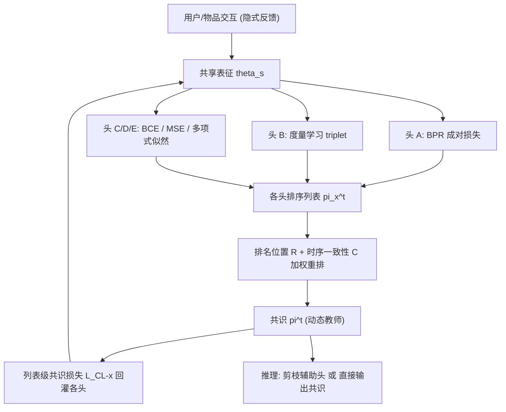
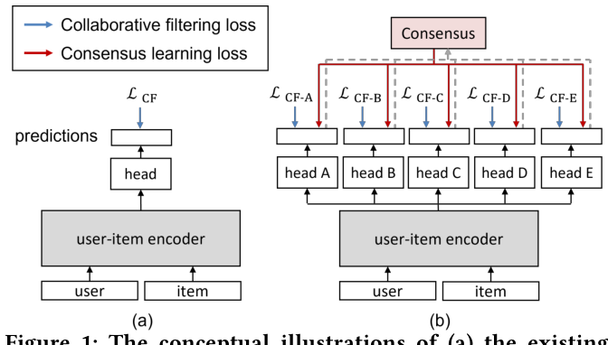

# Consensus Learning from Heterogeneous Objectives for One-Class Collaborative Filtering (面向单类协同过滤的异构目标共识学习)

- **会议/期刊**: WWW 2022 (The Web Conference)
- **作者与机构**: SeongKu Kang, Dongha Lee, Wonbin Kweon, Junyoung Hwang, Hwanjo Yu (POSTECH; UIUC)
- **推荐链路定位**: 召回（OCCF 表征学习与训练范式，可插拔到任意骨干）
- **研究方向**: 协同过滤与双塔召回 / 多任务学习与列表级重排
- **论文原文**: [https://arxiv.org/abs/2202.13140v1](https://arxiv.org/abs/2202.13140v1)
- **开源代码**: [https://github.com/SeongKu-Kang/ConCF_WWW22](https://github.com/SeongKu-Kang/ConCF_WWW22)

## TL;DR (1分钟核心速览)

OCCF 的损失函数（BPR / 度量学习 / BCE / MSE / 多项式似然）没有绝对赢家，但绝大多数工作只挑一个用。本文实证发现不同目标正确命中的测试交互**高度互补**（PER 高达 0.35），于是提出 ConCF：给目标模型并行挂多个异构目标辅助头，用「排名位置 × 时序一致性」构建共识并对各头做列表级在线蒸馏，训练后裁掉辅助头。在 60%/20%/20% 用户内划分、全库排序协议下，三个数据集的 R@20 相对最优单目标模型提升 10.7%–24.8%，集成共识再提升至 30.7%，且部署时**零额外推理开销**。

## Background & Motivation (背景与核心矛盾)

- **主流范式**: 给定用户-物品隐式交互，绝大多数 OCCF 工作沿用单一目标（BPR 成对排序、CML 度量学习、BCE、MSE、多项分布似然）优化同一骨干。
- **前人局限**: ①目标优劣随数据集/骨干/指标漂移，全量网格搜索代价过高，实际只能"随便挑一个还行"的；②不同目标注入不同归纳偏置，单一目标只覆盖用户-物品关系的一个侧面，长尾用户信息本就不足时更吃亏。
- **核心洞察 (Key Insight)**: 作者用两项统计量验证互补性——PER（模型 $x$正确而$y$ 错误的命中占比）与 CHR（需借助其他模型才能覆盖的命中占比）。同一骨干仅换损失函数，CHR 在 CiteULike 达 0.56，比换初始化（0.30）、换模型容量（0.32）高得多；且多数用户 CHR>0.4，说明单目标仅覆盖不到 60% 的可命中集合。
- **本文切入点**: 把"选损失函数"变成"让多个损失函数在训练中互相协商"，用共识把异构目标的知识直接蒸馏进共享表征。

## Method (核心方法设计)

### 1. 整体框架 (Overall Architecture)

以任意目标模型 $f_\theta$为骨干，复制出$|\mathcal{F}|$个预测头共享同一用户/物品表征$\theta_s$，每头$x$用不同 CF 目标训练；每轮前向得到各头排序列表$\pi_x^t$，据"排名位置 + 最近$W$轮排名一致性"重排生成共识$\pi^t$，再把共识作为**动态教师**回灌到每个头（列表级 Plackett-Luce 损失）；同时用梯度归一化动态调$\lambda_x^t$ 防止某些头主导共享参数。推理时删除辅助头，仅保留单分支，或在高算力场景直接使用共识列表。

<figure class="paper-figure" markdown="span">
  <figcaption>图 1：(a) 现有学习方案与 (b) 所提出框架的概念示意图。不同于 (a) 使用给定目标函数，(b) 利用由异构学习目标诱导的多方面知识，从而能够训练出更具泛化能力的模型。</figcaption>
</figure>

### 2. 关键设计拆解 (Key Designs)

1. **排名空间的知识交换（绕开分数语义不一致）**：BPR 的分数无界且越大越好，CML 的分数是 $[0,2]$的欧氏距离越小越好，直接对齐打分（如 FitNet 式回归/软标签）会把语义搞反。ConCF 只交换**相对序关系**：对第$x$头第$t$轮，物品$i$ 的重要性由排名位置与一致性相乘得到
$RC_{x,i}^{t}=f(\mathrm{rank}_x^t(i))+f\big(\mathrm{std}[\mathrm{rank}_{x}^{t-W}(i),\dots,\mathrm{rank}_x^t(i)]\big),\quad f(k)=e^{-k/T}$再跨头平均得到$I_i^t=\mathbb{E}_{x\in\mathcal{F}}[RC_{x,i}^t]$并重排为共识。直觉：训练中反复跳变位置的预测多为噪声，被$f(\mathrm{std}[\cdot])$ 自动降权，因此共识只吸收"各头都稳定且靠前"的物品——这与半监督学习中一致性正则的可靠性假设同源。
2. **Top-$N$列表级共识蒸馏（把共识变成可微监督）**：若只做分数级对齐，梯度会被大量尾部物品稀释。作者用 Plackett-Luce 只对共识前$N$ 位建模：
$p(\pi_{0:N}^t\mid\theta)=\prod_{k=1}^{N}\frac{\exp(\hat{r}_{u,\pi^t(k)})}{\sum_{i=k}^{|\pi^t|}\exp(\hat{r}_{u,\pi^t(i)})},\qquad \mathcal{L}_{CL\text{-}x}^t=-\sum_{u\in\mathcal{B}}\log p(\pi_{0:N}^{t,u}\mid\theta)$该损失只约束"共识头部物品应排在其余物品之前"，与 top-$N$ 评测目标严格一致，且天然支持各头输出分布差异。
3. **无超参的异构目标平衡（梯度归一化）**：五个目标收敛速度差异极大（MSE 初期梯度大、BPR 平缓），固定权重会让共享参数被某一头绑架。定义相对训练比 $\gamma_x^t=\frac{\mathcal{L}_x^t/\mathcal{L}_x^0}{\mathbb{E}_{x}[\mathcal{L}_x^t/\mathcal{L}_x^0]}$，令各头梯度尺度$G_x^t=\|\nabla_{\theta_s}\lambda_x^t\mathcal{L}_x^t\|_2$逼近$\mathbb{E}_x[G_x^t]\cdot\gamma_x^t$：
$\mathcal{L}_b^t=\sum_{x\in\mathcal{F}}\big|G_x^t-\mathbb{E}_{x\in\mathcal{F}}[G_x^t]\cdot\gamma_x^t\big|$
$\mathcal{L}_b$只对$\lambda_x^t$求导并归一化$\sum_x\lambda_x^{t+1}=1$，把"调权重"变成一次梯度下降，无需额外超参。
4. **训练目标与推理效率**：总损失 $\mathcal{L}^t=\sum_{x}\lambda_x^t(\mathcal{L}_{CF\text{-}x}^t+\alpha\mathcal{L}_{CL\text{-}x}^t)$，负采样沿用各目标原生方式（BPR/triplet 用$(u,i,j)\in\tilde{\mathcal{O}}$三元组；BCE/MSE/多项式用$\mathcal{O}^+\cup\mathcal{O}^-$全对）。训练成本约为单模型的$|\mathcal{F}|$ 倍，但**推理完全等同单模型**；额外开销只在训练期。

## Experimental Setup & Evaluation Protocol (实验设置与评估协议)

- **数据集与预处理**: 三个公开数据集，规模为文献通用版本（统计量见原文附录 A.1）：

| 数据集 | #Users | #Items | #Interactions | 稀疏度/密度 | 特征/场景说明 |
| :--- | :---: | :---: | :---: | :---: | :--- |
| CiteULike | ≈5.5K | ≈17K | ≈205K | ≈0.22% | 论文引用/收藏，学术社交 |
| Ciao | ≈7.4K | ≈107K | ≈2.85M | ≈0.36% | 商品点评评分，物品极稀疏 |
| Foursquare | ≈2.3K | ≈62K | ≈1.05M | ≈0.74% | POI 签到，地理隐式反馈 |

- **数据划分与防穿越 (Splitting Strategy)**: 对每个用户的历史交互做 **60%/20%/20% 比例划分**（非 Leave-One-Out），重复 5 次独立划分取均值，避免单次划分的偶然性。
- **排名评测协议 (Ranking Protocol)**: 无偏 **Full-Ranking**，对全部未交互物品打分排序，报告 Recall@{20,50} 与 NDCG@{20,50}；显著性用配对 t 检验（$p<0.05$，文中所有 Gain 均显著）。
- **对比基线与超参设置**: SingleCF（CF-A~E 五个单目标）、PCL（图像领域 SOTA 在线 KD）、同构目标变体 ConCF (w/o Het)、两阶段 KD、Ensemble；嵌入维度 $d=64$（附录另有$\{32,\dots,96\}$敏感性），$T$、$W=20$、$\alpha$ 为仅有的三个额外超参。

## Key Experimental Results (实验关键数据)

### 1. 主实验对比 (Main Results)

R@20 / R@50（加粗为最优，`Improv.` 相对该数据集最优 SingleCF 模型）：

| 训练方案 | 目标 | CiteULike R@20 | CiteULike R@50 | Ciao R@20 | Ciao R@50 | Foursquare R@20 | Foursquare R@50 |
| :--- | :---: | :---: | :---: | :---: | :---: | :---: | :---: |
| SingleCF | CF-A (BPR) | 0.1411 | 0.2513 | 0.1151 | 0.1797 | 0.1207 | 0.1987 |
| SingleCF | CF-B (Metric) | 0.1551 | 0.2851 | 0.0645 | 0.1547 | 0.0897 | 0.1746 |
| SingleCF | CF-C (BCE) | 0.1483 | 0.2652 | 0.1182 | 0.1814 | 0.1123 | 0.1939 |
| SingleCF | CF-D (MSE) | 0.1739 | 0.3132 | 0.1042 | 0.1755 | 0.1026 | 0.1948 |
| SingleCF | CF-E (Multinomial) | 0.1938 | 0.3179 | 0.0975 | 0.1853 | 0.1548 | 0.2542 |
| **ConCF** | 最佳单头 | **0.2418** | **0.3763** | **0.1367** | **0.2266** | **0.1757** | **0.2876** |
| **ConCF** | **共识** | **0.2533** | **0.3896** | **0.1420** | **0.2303** | **0.1749** | **0.2877** |
| | `Improv.`(最佳头) | +24.77% | +17.05% | +12.86% | +21.32% | +10.72% | +8.54% |
| | `Improv.`(共识) | +30.70% | +22.55% | +20.14% | +24.28% | +12.98% | +13.18% |

### 2. 消融实验 (Ablation Study)

CiteULike，R@50 / N@50 与互补度 CHR（越低表示头已吸收其他目标的知识）：

| 变体 | R@50 | N@50 | CHR |
| :--- | :---: | :---: | :---: |
| SingleCF (CF-E，最强单目标) | 0.3179 | 0.1451 | 0.56 |
| PCL（同构目标在线 KD，5 头） | 0.3383 | 0.1635 | — |
| ConCF (w/o Het)（同构目标 + 共识） | 0.3521 | 0.1731 | — |
| ConCF (w/o CL)（仅多任务共享参数） | 低于 ConCF | — | 0.42 |
| 两阶段 KD（静态教师 T2） | 0.3672 | — | — |
| **ConCF（最佳单头 / 共识）** | **0.3763 / 0.3896** | **0.1756 / 0.1836** | **0.18** |

### 3. 关键实验发现 (Key Findings)

1. **提升来自"异构"而非"多头"**：把五个头全换成同一目标（w/o Het）R@50 仅 0.3521，明显低于异构的 0.3896；而单目标同构在线 KD（PCL）只有 0.3383，证明收益主体是目标多样性 + 排名级共识，而非参数量或集成效应。
2. **共识必须"一致性加权"，否则不如单模型**：仅按排名的 R-consensus 在 Foursquare 上甚至退化为弱于最佳单头，加入时序一致性后的 RC-consensus 相对 R-consensus 最高提升 16%（多目标场景），且共识的 Recall@50 在每个训练轮次都高于所有头。
3. **共识学习真正抹平了互补缺口**：CHR 从 SingleCF 的 0.56 降到 ConCF 的 0.18（w/o CL 仅降到 0.42），说明共享参数无法传递的知识必须靠显式预测级监督；同时稀疏用户组 G-4（交互最少 25%）的 `Gain.Best` 高于 G-1，对冷启动/低活用户收益更大。

## Highlights & Limitations (亮点、对比与审稿批判)

- **与代表作对比 (vs. Prior Work)**: 相比 BPR/CML/BCE 等单目标方案，ConCF 不改骨干、不改打分函数，只在训练期注入多视角监督；相比 PCL / [25] 等在线 KD，它显式利用**异构目标 + 排名信息**而非仅初始化差异；相比两阶段 KD，教师是随训练共同进化的动态共识（0.3896 vs 0.3672），且只需单阶段训练。
- **可迁移亮点**: ①"用相对排名而非绝对分数做多模型/多目标对齐"可直接搬到多场景、多模态融合的分数尺度不一致问题；②梯度归一化把 $\lambda_x$ 变成可学习参数，免调多任务权重，适合工业级多目标精排。
- **审稿级局限批判**: ①训练开销约为单模型的 $|\mathcal{F}|$倍且需同步维护$W$轮的排名历史，大规模工业训练成本不可忽略；②只验证了 MLP/度量学习类浅层骨干（$d=64$），未在 LightGCN/序列模型上验证，共识是否仍然必要尚存疑；③$T$、$W$、$\alpha$ 三个超参的交互敏感性主要在附录，正文缺乏稳健性分析，且所有数据集规模偏小（≤2.3K 用户级）。

## Rating (四维评分)

- **方法创新性 (Novelty)**: ⭐⭐⭐⭐ （把"损失函数选择"重构为异构目标协商，排名级共识 + 一致性可靠性度量是清晰的新增算子，虽依赖成熟的在线 KD 框架但动机与实证扎实）
- **评估协议与实验扎实度 (Protocol & Experiments)**: ⭐⭐⭐⭐ （三数据集 × 5 次划分 × 全库排序 + 配对 t 检验，PER/CHR 分析、同构消融、两阶段 KD 对比、稀疏分桶齐全；缺大规模数据与图/序列骨干）
- **写作与数学规范度 (Clarity & Rigor)**: ⭐⭐⭐⭐ （五个 CF 目标的形式化与三类挑战 C1–C3 对应三个模块，符号统一；共识生成中 `combine(·,·)` 直接用加法，缺少权重推导）
- **工业落地与复现价值 (Industrial & Practical Value)**: ⭐⭐⭐⭐⭐ （代码开源，训练后剪枝辅助头使线上推理与单模型完全一致，属于"白拿收益"的训练期增强，工程迁移门槛极低）

