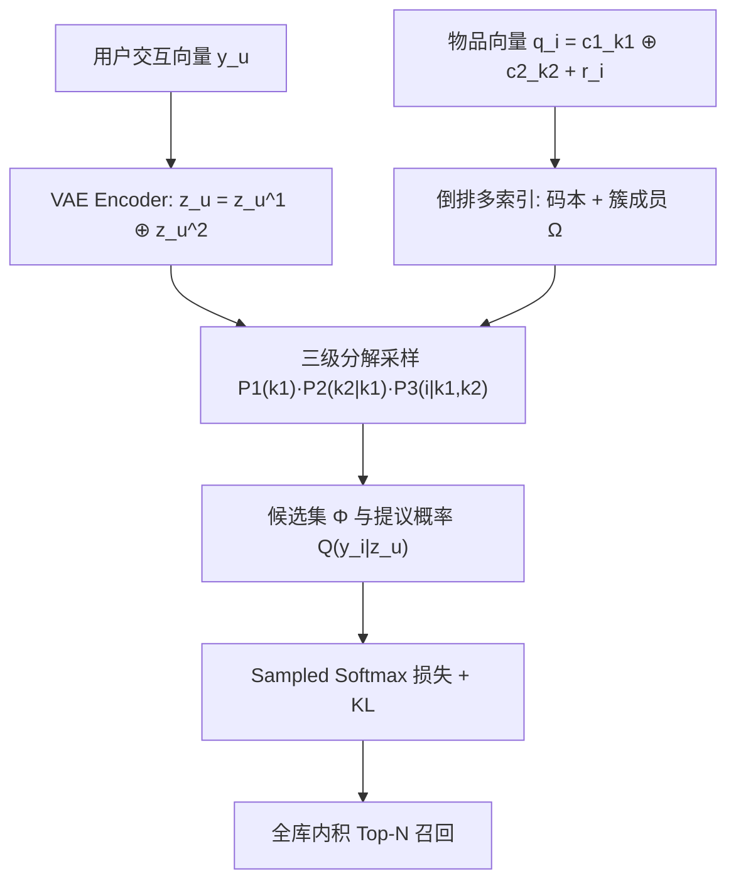
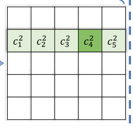
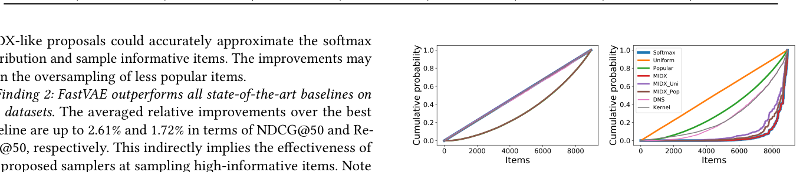

# Fast Variational AutoEncoder with Inverted Multi-Index for Collaborative Filtering (基于倒排多索引的快速变分自编码器协同过滤)

- **会议/期刊**: WWW 2022 (The Web Conference)
- **作者与机构**: Jin Chen, Defu Lian, Binbin Jin, Xu Huang, Kai Zheng, Enhong Chen（电子科技大学、中国科学技术大学、华为云）
- **推荐链路定位**: 召回（隐式反馈用户表征学习与全库打分）
- **研究方向**: 协同过滤与双塔召回 / 生成式推荐
- **论文原文**: [https://arxiv.org/abs/2109.05773v2](https://arxiv.org/abs/2109.05773v2)
- **开源代码**: [https://github.com/HERECJ/FastVae_Gpu](https://github.com/HERECJ/FastVae_Gpu)

## TL;DR (1分钟核心速览)

Mult-VAE 的多项式似然需要对全物品做 softmax，单步损失与梯度耗时随物品数 $M$线性增长；而现有 sampled softmax 的提议分布（Uniform/Popularity/二次核）与 softmax 分布偏差大、梯度估计噪声高。本文基于倒排多索引（乘积量化 + 残差）把 softmax 概率**精确分解**为三级多项分布，并给出两条亚线性近似采样器 `MIDX_Uni` / `MIDX_Pop`（$O(KD+K^2+T)$）。在 ML10M/Gowalla/Netflix/Amazon 上按 NDCG@50、Recall@50 评估，FastVAE 相对最优基线平均提升 2.61% / 1.72%，物品数 150 万时训练加速 6× 以上。

## Background & Motivation (背景与核心矛盾)

- **主流范式**: Mult-VAE 用高斯隐变量编码用户交互向量、解码为全物品上的多项分布，比高斯/逻辑似然更契合隐式反馈，是协同过滤的代表性非线性方法。
- **前人局限**: ① 精确梯度含 $\mathbb{E}_{j\sim P}\nabla_\theta o_j$，计算量$O(MD)$，百万级物品不可行；② sampled softmax 只有在**提议分布等于 softmax 分布**时才无偏，而 uniform/popularity 与目标分布差异巨大；③ 二次核（kernel）采样虽更接近，但特征映射内存开销大且对长尾物品过度采样；④ 直接用 MIPS 索引只能返回确定性 Top-k，无法"按概率独立采样"，在扰动库上建索引又会引入相关性且模型更新即需重建索引。
- **核心洞察 (Key Insight)**: softmax 的内积 logit 在向量被**分段量化为码字 + 残差**后，概率本身可以沿码本层级做链式分解——于是"从 softmax 采样"退化成了"分层从 $K$个码字中采样，最后只在同簇小集合$\Omega_{k_1,k_2}$ 内采样"。
- **本文切入点**: 把 ANNs 里的倒排多索引（IMI）从"检索结构"改造成"采样结构"，用码本层级近似替代全物品归一化。

## Method (核心方法设计)

### 1. 整体框架 (Overall Architecture)

物品向量 $\boldsymbol{q}_i\in\mathbb{R}^D$被均分为两段，各用$K$类 K-means 量化得到码本$\mathcal{C}^1,\mathcal{C}^2$，并保留残差$\tilde{\boldsymbol{q}}_i=\boldsymbol{q}_i-(\boldsymbol{c}^1_{k_1}\oplus\boldsymbol{c}^2_{k_2})$。用户向量$\boldsymbol{z}_u$同构切分后，采样分三步：先抽$k_1\sim P^1_u(\cdot)$，再抽$k_2\sim P^2_u(\cdot|k_1)$，最后在簇$\Omega_{k_1,k_2}$内抽物品。把抽到的$(i, Q(y_i|\boldsymbol{z}_u))$ 送入 sampled softmax 估计 ELBO 的第一项，KL 项保持闭式。由于采样与用户无关的部分（码本、簇成员、alias 表）只初始化一次，整个采样可在 GPU 上批并行。

<figure class="paper-figure" markdown="span">
  <figcaption>图1：采样示意图。首先在第一个码本中抽取码字索引（𝑘1 = 2），然后抽取另一个码字索引（𝑘2 = 4）。最后，从Ω2,4中采样物品𝑖3，其中Ω2,4是分配给𝑘1和𝑘2的物品集合。</figcaption>
</figure>

### 2. 关键设计拆解 (Key Designs)

1. **精确分解：MIDX Sampler（把 softmax 拆成三级分布）**：目标是 $Q(y_i|\boldsymbol{z}_u)=\frac{\exp(\boldsymbol{z}_u^\top\boldsymbol{q}_i)}{\sum_{j}\exp(\boldsymbol{z}_u^\top\boldsymbol{q}_j)}$。将 logit 拆成两段码字内积 + 残差内积后，分子分母可逐层归并：
$Q(y_i|\boldsymbol{z}_u)=P^1_u(k_1)\,P^2_u(k_2|k_1)\,P^3_u(y_i|k_1,k_2)$，
其中 $P^2$的分母$\psi_{k_1}=\sum_{k}\omega_{k_1,k}\exp(\boldsymbol{z}^{2\top}_u\boldsymbol{c}^2_k)$，$P^3$为簇内残差 softmax。由于$\omega_{k_1,k_2}>0$，末级采样**永不空簇**，且分解是恒等变换——即该采样器与真 softmax 完全一致（实验图2中两条累积分布完全重合）。
2. **近似采样器：MIDX_Uni / MIDX_Pop（把末级替换为静态分布）**：精确版的瓶颈是仍需算全物品 logit。将 $P^3$ 换成簇内均匀分布，可得闭式
$Q_{\text{uni}}(y_i|\boldsymbol{z}_u)=\frac{\exp(\boldsymbol{z}_u^\top(\boldsymbol{q}_i-\tilde{\boldsymbol{q}}_i))}{\sum_{j\in\mathcal{I}}\exp(\boldsymbol{z}_u^\top(\boldsymbol{q}_j-\tilde{\boldsymbol{q}}_j))}$，
即"只用码字近似物品"的 softmax；进一步注入流行度得 $Q_{\text{pop}}(y_i|\boldsymbol{z}_u)\propto\exp(\boldsymbol{z}_u^\top(\boldsymbol{q}_i-\tilde{\boldsymbol{q}}_i)+\log \text{pop}(i))$。直觉：**码字承担了"粗粒度分布"，残差被丢弃的误差就是唯一偏差源**。
3. **偏差上界与训练目标**：设 $\|\tilde{\boldsymbol{q}}_i\|\le C$，可证$0<D_{\mathrm{KL}}[Q_{\text{uni}}\|Q]\le 2C\|\boldsymbol{z}_u\|$，$Q_{\text{pop}}$仅多出$\log\frac{\max \text{pop}}{\min \text{pop}}$一项——量化越细（$K$ 越大）残差越小、偏差越小，这解释了"索引粒度即精度旋钮"。总损失为
$\mathcal{L}(u)=\frac{1}{S}\sum_{s=1}^{S}\sum_{i\in\mathcal{I}}y_{ui}\log\frac{\exp(\boldsymbol{z}^{(s)\top}_u\boldsymbol{q}_i-\log Q(y_i|\boldsymbol{z}^{(s)}_u))}{\sum_{j\in\{i\}\cup\Phi_u}\exp(\boldsymbol{z}^{(s)\top}_u\boldsymbol{q}_j-\log Q(y_j|\boldsymbol{z}^{(s)}_u))}-\mathrm{KL}\big(q_\phi(\boldsymbol{z}_u|\boldsymbol{y}_u)\|p(\boldsymbol{z}_u)\big)$，
负样本**由提议分布自身产生并按 $\log Q$ 做重要性校正**（非均匀、非批内），推理阶段无需采样、直接全库内积 Top-N。

## Experimental Setup & Evaluation Protocol (实验设置与评估协议)

- **数据集与预处理**: 过滤交互数 <10 的用户与物品；评分型数据（ML10M/Netflix/Amazon>4 分）统一二值化为 0/1 隐式反馈。

| 数据集 | #Users | #Items | #Interactions | 稀疏度 | 特征/场景说明 |
| :--- | :---: | :---: | :---: | :---: | :--- |
| ML10M | 47,292 | 5,942 | 2,001,164 | 99.2879% | 电影评分，稠密 |
| Gowalla | 29,858 | 40,988 | 1,027,464 | 99.9160% | LBSN 签到，极稀疏 |
| Amazon | 56,257 | 50,154 | 1,418,076 | 99.9497% | 图书评分，最稀疏 |
| Netflix | 422,624 | 17,618 | 53,417,358 | 99.2826% | 大规模电影评分 |

- **数据划分与防穿越 (Splitting Strategy)**: 对每个用户**随机抽取 80% 交互构造历史向量**用于训练，剩余 20% 作为留出正例评估；5 次独立重复取均值与标准差（$\Delta=10^{-4}$）。
- **排名评测协议 (Ranking Protocol)**: 训练完成后用历史向量编码得 $\boldsymbol{z}_u$，评估模型对留出正例的排序能力，报告 `NDCG@50` 与 `Recall@50`（指标含义与 Mult-VAE 的留出正例排序一致，未采用 1:99 采样负例），所有模型以 NDCG@50 调参。
- **对比基线与超参**: 基线覆盖点式 WRMF、pairwise BPR/WARP-MF/AOBPR、动态/自适应负采样 DNS/PRIS/SA、生成式 Mult-VAE，以及 Uniform/Popularity/Kernel 三种提议分布；隐因子维数 $d=32$，生成模块$[M\to200\to32]$、输入 dropout 0.5、batch 256、Adam + weight decay 0.01；FastVAE 采样数 200（ML10M/Netflix）、1000（Gowalla）、2000（Amazon），每码本 16 码字。

## Key Experimental Results (实验关键数据)

### 1. 主实验对比 (Main Results)

| 模型 | ML10M NDCG@50 | ML10M Recall@50 | Gowalla NDCG@50 | Gowalla Recall@50 | Netflix NDCG@50 | Netflix Recall@50 | Amazon NDCG@50 | Amazon Recall@50 |
| :--- | :---: | :---: | :---: | :---: | :---: | :---: | :---: | :---: |
| WRMF | 0.3194 | 0.4967 | 0.1316 | 0.2223 | 0.3020 | 0.3653 | 0.0919 | 0.1802 |
| BPR | 0.2915 | 0.4642 | 0.1216 | 0.1978 | 0.2742 | 0.3283 | 0.0740 | 0.1441 |
| WARP-MF | 0.2968 | 0.4785 | 0.1273 | 0.2073 | 0.2953 | 0.3539 | 0.0798 | 0.1615 |
| AOBPR | 0.2934 | 0.4753 | 0.1385 | 0.2369 | 0.2952 | 0.3560 | 0.0906 | 0.1763 |
| DNS | 0.3153 | 0.4988 | 0.1622 | 0.2761 | 0.2974 | 0.3594 | 0.1119 | 0.2186 |
| PRIS | 0.3162 | 0.4937 | 0.1657 | 0.2736 | 0.2975 | 0.3608 | 0.1189 | 0.2244 |
| SA | 0.3237 | 0.5066 | 0.1704 | 0.2866 | 0.3177 | 0.3784 | 0.1378 | 0.2401 |
| Mult-VAE (Full Softmax) | 0.3206 | 0.5037 | 0.1751 | 0.2911 | 0.3227 | 0.3841 | **0.1441** | **0.2483** |
| **FastVAE (MIDX_Pop)** | **0.3275** | **0.5078** | **0.1797** | **0.2971** | **0.3238** | **0.3845** | 0.1404 | 0.2434 |
| **Improv.% (vs 最优基线)** | +1.17% | +0.24% | +2.63% | +2.06% | +0.34% | +0.10% | −2.57% | −1.97% |

### 2. 采样器消融与复杂度对比 (Ablation & Complexity)

| 提议分布 | 空间 | 采样预处理/单次 | 与 softmax 的偏差 | Gowalla/Netflix 收敛表现 |
| :--- | :---: | :---: | :---: | :---: |
| Uniform | $O(1)$|$O(T)$ | 极大 | 全程落后，NDCG 最低 |
| Popularity | $O(M)$|$O(T)$ | 大（偏热） | 优于 Uniform，仍低于 MIDX |
| DNS | $O(MD)$|$O(BDT)$ | 大（Top-1 偏向） | 波动大 |
| Kernel（二次核） | $O(MD^2)$|$O(D^2T\log M)$ | 中等，长尾过采样 | 分布接近但**损失估计不适配**，效果差 |
| MIDX（精确） | $O(MD)$|$O(MD+T)$ | **= 0**（完全一致） | 精度上限，但不可实用 |
| **MIDX_Uni** (w/o 流行度) | $O(KD+K^2+M)$|$O(KD+K^2+T)$|$\le 2C\|\boldsymbol{z}_u\|$ | 与 Mult-VAE 持平，稀疏集略优 |
| **MIDX_Pop** (w/o 末级残差 softmax → 流行度) | $O(KD+K^2+M)$|$O(KD+K^2+T)$|$\le 2C\|\boldsymbol{z}_u\|+\log\frac{\max pop}{\min pop}$ | 最佳，4 数据集均值 +0.64% NDCG |

### 3. 关键实验发现 (Key Findings)

1. **近似采样不掉点、反而略涨**：用 MIDX 系列替换全 softmax 后，4 数据集平均 NDCG@50/Recall@50 相对提升 0.64%/0.25%，作者归因于对**低流行度物品的过采样**（图2 累积分布曲线在头部略高于 softmax）；换言之采样噪声在此处起到了隐式长尾增广作用。
2. **精度上限由残差决定，与索引粒度强相关**：$\|\tilde{\boldsymbol{q}}_i\|\le C$直接进入 KL 上界，簇数从 8→128 时训练前期收敛明显加快；但$K=16$ 已足够稳健，说明只需"粗划分 + 末级精细分布"即可，无需极细量化。
3. **加速随物品数放大、且不牺牲精度**：物品数从 20 万增至 150 万时，Mult-VAE 单 epoch 由 2.3 s 增至 10.2 s，而 MIDX 采样恒约 1.5 s，整体训练加速 **>6×**；同时它在 Gowalla（最稀疏）上超越全部 SOTA，但在 Amazon 上略逊于全 softmax（−2.57%），说明**极稀疏 + 大物品库时残差丢弃带来的偏差不可忽略**。

<figure class="paper-figure" markdown="span">
  <figcaption>图2：不同采样器的累积概率分布。物品按流行度排序。</figcaption>
</figure>

## Highlights & Limitations (亮点、对比与审稿批判)

- **与代表作对比 (vs. Prior Work)**: 相比 Mult-VAE 的 $O(MD)$全 softmax，本文保持同一 ELBO 目标但把归一化降为$O(KD+K^2+T)$；相比 Kernel 采样，它无需特征映射、内存低且对长尾不过采；相比"扰动库 + MIPS 索引"的无偏采样方案，样本相互独立且无需随参数更新重建索引；相比 DNS/PRIS 等 Top-k 式难负采样，它给出的是**带重要性权重的分布一致采样**，可直接代入 sampled softmax 校正。
- **可迁移亮点**: ①"用 ANNs 索引结构做提议分布"这一思路可直接迁移到双塔召回的大词表 softmax、序列推荐的 next-item 采样与对比学习负采样；②$\mathrm{KL}\le 2C\|\boldsymbol{z}_u\|$ 给出了"索引量化误差 ⇔ 梯度偏差"的定量接口，可用作量化粒度的选型依据。
- **审稿级局限批判**: ① 索引（码本、簇成员、alias 表）依赖物品表征，随训练漂移需周期重建，重建频率与精度/开销的权衡未给实验；② 增益幅度偏小（多数据集仅 0.1–2.6%），且 Amazon 上不及基线，缺少与 RecVAE/Mult-VAE-annealed 等更强 VAE 变体的对比；③ 评估为每用户 80/20 随机留出，未报告全库 Full-Ranking 的采样负例比例与显著性检验（仅给标准差），对工业级"百万物品无偏排序"的说服力仍待加强。

## Rating (四维评分)

- **方法创新性 (Novelty)**: ⭐⭐⭐⭐⭐ （首次把倒排多索引从"检索结构"改造为"softmax 提议分布"，三级分解恒等式与 KL 上界构成完整的理论闭环）
- **评估协议与实验扎实度 (Protocol & Experiments)**: ⭐⭐⭐⭐ （4 个真实数据集 + 9 个基线 + 5 次重复与采样/簇数敏感度分析较完整，但缺显著性检验与更强 VAE 基线）
- **写作与数学规范度 (Clarity & Rigor)**: ⭐⭐⭐⭐⭐ （定理—证明—复杂度表（Table 1）链条清晰，KL 偏差上界把量化误差与梯度偏差显式挂钩）
- **工业落地与复现价值 (Industrial & Practical Value)**: ⭐⭐⭐⭐ （代码已开源且支持 GPU 采样，百万物品 6× 加速收益直接可用；代价是索引重建与 $K$、采样数等超参需按库规模调优）

