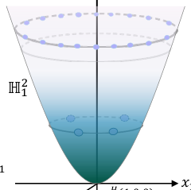
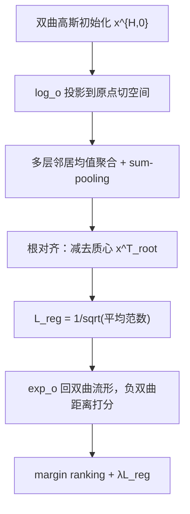

# HRCF: Enhancing Collaborative Filtering via Hyperbolic Geometric Regularization (双曲几何正则化的协同过滤)

- **会议/期刊**: WWW 2022 (The ACM Web Conference)
- **作者与机构**: Menglin Yang, Min Zhou, Jiahong Liu, Defu Lian, Irwin King（CUHK / 华为诺亚方舟 / HIT / USTC）
- **推荐链路定位**: 召回（图协同过滤表征学习）
- **研究方向**: 协同过滤与双塔召回 / 图神经网络推荐
- **论文原文**: [https://arxiv.org/abs/2204.08176v2](https://arxiv.org/abs/2204.08176v2)
- **开源代码**: [https://github.com/layer6ai-labs/HGCF](https://github.com/layer6ai-labs/HGCF)（在 HGCF 代码库上实现）

## TL;DR (1分钟核心速览)

用户-物品网络呈幂律/树状分布，欧氏空间体积多项式增长难以低失真嵌入，双曲空间（Lorentz 模型）虽体积指数增长，但已有工作（HGCF 等）只是把欧氏 GCN 平移到双曲流形，几乎所有 embedding 都挤在原点附近，判别性差。HRCF 提出一个**几何感知正则器**：以全体 embedding 质心为“根”对齐到双曲原点，再最大化整体 embedding 范数把节点推离原点。理论上证明该正则等价于放大全节点对距离，从而缓解双曲图聚合的过平滑。在 Amazon-CD/Book、Yelp2020 上按 1:1 负采样排序评估，Recall@20 相对 HGCF 提升 3.30%/3.49%/1.58%，长尾物品提升达 11.5%。

## Background & Motivation (背景与核心矛盾)

- **主流范式**: 将 user-item 二部图送入无线性变换、无非线性的图卷积（LightGCN/HGCF），在切空间做邻居均值聚合，用双曲距离 + margin ranking 损失优化。
- **前人局限**: ① 欧氏空间对树状数据失真下界差（Bourgain 定理），低维容量装不下海量用户/物品；② 现有双曲推荐（HGCF、HyperML、HSCML）只做“欧氏算子 → 双曲投影”的移植，未利用双曲空间“体积随半径指数增长”这一核心几何性质。
- **核心洞察 (Key Insight)**: 双曲空间中远离原点的区域远比原点附近“宽敞”，且靠近边界的样本更易区分；但直接全局外推会破坏长尾层级结构（热门物品应留在高层/近原点）。
- **本文切入点**: 先用“质心根对齐”固定层级骨架，再用“整体范数最大化”把大量长尾节点推向外围，一举兼顾结构保持与空间利用。

<figure class="paper-figure" markdown="span">
  <figcaption>图1：树状图/网络 𝐺、欧几里得空间 R2 与双曲空间 H2（半径均为1）的示意图。许多真实网络（如用户-物品网络、知识图谱）如图2所示呈树状，并可重新组织为 𝐺。将 𝐺 编码到欧几里得空间 R2 和双曲空间 H2 中会得到截然不同的结果。可以看到，双曲空间有更大的空间使节点更可分、更易区分，而欧几里得空间过于狭窄，难以很好地嵌入 𝐺。</figcaption>
</figure>

## Method (核心方法设计)

### 1. 整体框架 (Overall Architecture)

输入为双曲高斯采样初始化的用户/物品 embedding，经对数映射 $\log_{\mathbf{o}}(\cdot)$落到原点切空间$T_{\mathbf{o}}\mathcal{H}^n$；在此切空间内做多层邻居均值聚合与 sum-pooling 得到$\mathbf{x}^{T,sum}$；随后执行**根对齐**（减去全体 embedding 质心）与**原点感知惩罚**（最大化对齐后整体范数）；最终用指数映射$\exp_{\mathbf{o}}(\cdot)$ 回到双曲流形，以负双曲距离平方打分、margin ranking 训练。推理阶段仅需一次聚合与一次距离计算，复杂度与原 HGCF 同级。

### 2. 关键设计拆解 (Key Designs)

1. **根对齐 (Root Alignment)**：双曲层级需要一个“最高层”锚点，但真实网络常有多主题、多根、且层级未显式给出。作者取 embedding 质心作为根 $\mathbf{x}^{T}_{root}=\frac{1}{N}\sum_{i=1}^{N}\mathbf{x}^{T,sum}_i$（等价于最小化到各点切空间距离平方和的点，具备树根性质），再令$\bar{\mathbf{x}}^{T,sum}_i=\mathbf{x}^{T,sum}_i-\mathbf{x}^{T}_{root}$。质心唯一、$O(n)$ 可并行、且随任务目标自适应，天然处理多根情形；把根钉在原点后，其余节点才能按流行度/活跃度有序铺开，长尾结构不被外推破坏。

2. **原点感知惩罚 (Origin-aware Penalty)**：痛点在于双曲聚合会“收缩”邻居表征（Theorem 1：$\mathcal{D}(\mathbf{X}^{T,\ell+1})\le\mathcal{D}(\mathbf{X}^{T,\ell})$），多跳后节点趋同即过平滑。作者不添加复杂算子，而是在损失中加入$\bar{x}_{norm}=\frac{1}{N}\sum_{i}\|\bar{\mathbf{x}}^{T,sum}_i\|_2^2,\ \mathcal{L}_{reg}=1/(\bar{x}_{norm})^{1/2}$，最小化它即最大化整体范数，把节点推离原点、逼近边界。理论上可证$\bar{x}_{norm}=\frac{1}{2N}\sum_{i,j}\|\mathbf{x}_i-\mathbf{x}_j\|_2^2$，即该正则**等价于放大全节点对距离**，直接对抗聚合带来的距离衰减（Prop. 4）；同时几何上外推使“兄弟节点”路径比$d_{\mathcal{L}}(\mathbf{x},\mathbf{y})/(d_{\mathcal{L}}(\mathbf{x},\mathbf{o})+d_{\mathcal{L}}(\mathbf{y},\mathbf{o}))\to 1$，减小双曲距离畸变。作者还证明 log/exp、聚合、sum-pooling、根对齐都保持首坐标为 0，满足 Lorentz 约束$\langle\mathbf{x},\mathbf{x}\rangle_{\mathcal{L}}=-K$，不会漂出流形。

3. **训练目标、负采样与推理效率**：$\mathcal{L}=\mathcal{L}_{margin}+\lambda\mathcal{L}_{reg}$，其中$\mathcal{L}_{margin}=\max(d_{\mathcal{L}}^2(\mathbf{e}_u,\mathbf{e}_i)-d_{\mathcal{L}}^2(\mathbf{e}_u,\mathbf{e}_j)+m,0)$，$d_{\mathcal{L}}(\mathbf{x},\mathbf{y})=\operatorname{arcosh}(-\langle\mathbf{x},\mathbf{y}\rangle_{\mathcal{L}})$；负样本为每正例采 1 个未交互物品（1:1 随机负采样）。训练复杂度$N^2d+3N+2|E_{train}|$，仅比 HGCF 多一个$N$（正则项），测试复杂度$|E_{test}|$，几乎零额外开销；$\lambda\in\{10,15,20,25,30\}$，$m\in\{0.1,0.15,0.2\}$，RSGD 优化。

## Experimental Setup & Evaluation Protocol (实验设置与评估协议)

- **数据集与预处理**: 沿用 HGCF 的预处理，评分 $\ge 4$ 视为隐式正反馈。

| 数据集 | #Users | #Items | #Interactions | 密度 | 说明 |
| :--- | :---: | :---: | :---: | :---: | :--- |
| Amazon-CD | 22,947 | 18,395 | 422,301 | 0.00100 | 音乐 CD 评论 |
| Amazon-Book | 52,406 | 41,264 | 1,861,118 | 0.00086 | 图书评论 |
| Yelp2020 | 71,135 | 45,063 | 1,940,014 | 0.00047 | 本地商户 |

- **数据划分与防穿越 (Splitting Strategy)**: 随机 80%/20% 划分训练/测试（非时间切分，存在轻度未来信息泄漏风险）。
- **排名评测协议 (Ranking Protocol)**: **Sampled Ranking** —— 每个测试正例配 1 个未交互负例，计算 Recall@10/20 与 NDCG@10/20，未做 Full-Ranking 全库排序。
- **对比基线与超参设置**: MF 类（WRMF、VAE-CF）、度量学习类（TransCF、CML、LRML、SML）、图类（NGCF、LightGCN）、双曲类（HAE、HVAE、HGCF）。嵌入维度 $d=50$，训练 500 epoch，基线结果取自 HGCF 官方实现；最优与次优差异用 Wilcoxon signed rank test 检验（$p<0.05$）。

## Key Experimental Results (实验关键数据)

### 1. 主实验对比 (Main Results)

| 数据集 | 模型 | R@10 | R@20 | N@10 | N@20 |
| :--- | :--- | :---: | :---: | :---: | :---: |
| Amazon-CD | WRMF | 0.0863 | 0.1313 | 0.0651 | 0.0817 |
| | CML | 0.0864 | 0.1341 | 0.0639 | 0.0813 |
| | NGCF | 0.0758 | 0.1150 | 0.0591 | 0.0718 |
| | LightGCN | 0.0929 | 0.1404 | 0.0726 | 0.0881 |
| | HAE | 0.0666 | 0.0963 | 0.0565 | 0.0657 |
| | HVAE | 0.0781 | 0.1147 | 0.0629 | 0.0749 |
| | HGCF | 0.0962 | 0.1455 | 0.0751 | 0.0909 |
| | **HRCF** | **0.1003** | **0.1503** | **0.0785** | **0.0947** |
| | Improv. | +4.26% | +3.30% | +4.53% | +4.18% |
| Amazon-Book | LightGCN | 0.0799 | 0.1248 | 0.0780 | 0.0938 |
| | HGCF | 0.0867 | 0.1318 | 0.0869 | 0.1022 |
| | **HRCF** | **0.0900** | **0.1364** | **0.0902** | **0.1060** |
| | Improv. | +3.81% | +3.49% | +3.80% | +3.72% |
| Yelp2020 | LightGCN | 0.0522 | 0.0866 | 0.0461 | 0.0582 |
| | HGCF | 0.0527 | 0.0884 | 0.0458 | 0.0585 |
| | **HRCF** | **0.0537** | **0.0898** | **0.0468** | **0.0594** |
| | Improv. | +1.90% | +1.58% | +2.18% | +1.54% |

### 2. 消融实验 (Ablation Study)

原文未给出“逐组件删减”的显式表格，HGCF（无根对齐、无正则）即等价于同时移除两项的基线；作者以**长尾/头部拆分**与**训练轮数/层数**作为组件归因证据：

| 设置 | Amazon-CD Head R@10 | CD Tail R@10 | CD Tail N@10 | Book Head R@10 | Book Tail R@10 | Book Tail N@10 |
| :--- | :---: | :---: | :---: | :---: | :---: | :---: |
| HGCF（w/o 两项） | 0.0667 | 0.0295 | 0.0201 | 0.0550 | 0.0317 | 0.0291 |
| HRCF（完整） | **0.0674** | **0.0329** | **0.0227** | **0.0563** | **0.0337** | **0.0309** |
| Gain | +1.05% | +11.53% | +12.94% | +2.36% | +6.31% | +6.19% |
| 20 epoch R@10（CD / Book） | 0.0680 → **0.0792**（+16.47%） | | | 0.0505 → **0.0589**（+16.63%） | | |

### 3. 关键实验发现 (Key Findings)

1. **增益几乎全部来自长尾**：Amazon-CD 尾部 R@10 提升 11.53%、N@10 提升 12.94%，而头部仅 +1.05%/+0.90%。这直接验证“把大量长尾节点推向外围宽敞区”使其彼此可分的动机——头部物品本就靠原点、占据高层，不受外推影响。
2. **深层不再崩塌**：HGCF 在聚合阶数超过阈值后指标骤降（过平滑），HRCF 在阶数 2→10 全程单调上升后饱和，说明 $\mathcal{L}_{reg}$ 的“全节点对距离放大”确实抵消了聚合收缩，为深层图协同过滤提供了可行解。
3. **收敛更快、更轻量**：仅训 20 epoch 时相对提升扩大到 16.47%/16.63%（100 epoch 时只有 5.45%/10.39%）；维度降至 20 时仍全面优于 $d=50$ 的 HGCF，且在 Amazon-CD 上优势最大，适合存储/算力受限场景。

## Highlights & Limitations (亮点、对比与审稿批判)

- **与代表作对比 (vs. Prior Work)**: 与 HGCF 共享同一套切空间聚合与 margin 损失，唯一差异就是根对齐 + 范数正则，因此性能增益可干净归因于几何正则；相较 HyperML/HSCML 的“度量学习 + 双曲投影”，HRCF 首次从**空间利用率与过平滑**角度而非“相似度设计”角度切入。代价仅是 $O(N)$的质心计算与一个$\lambda$。
- **可迁移亮点**: ① “先定根、再外推”的两步范式可直接套到双曲知识图谱、POI 时空嵌入；② $\mathcal{L}_{reg}=1/\sqrt{\bar{x}_{norm}}$ 这种“反平均范数”形式可作为任何层级嵌入模型的通用多样性正则；③ 质心根对齐本身即可用于欧氏模型的层级初始化。
- **审稿级局限批判**: ① 评测仅用 **1:1 负采样排序**，缺乏 Full-Ranking 全库排序，热门偏置下结论稳健性存疑，且 80/20 随机划分存在时间穿越；② 根是当前参数下的质心，随训练漂移（moving target），论文未分析其收敛稳定性与 $\lambda$ 敏感性，三个数据集规模也都在 200 万交互以内，未验证工业级稀疏度下 exp/log/arcosh 的数值稳定性与吞吐开销。

## Rating (四维评分)

- **方法创新性 (Novelty)**: ⭐⭐⭐⭐ （正则器极简但视角新颖，配 Lorentz 约束保持与过平滑/距离放大的双向理论证明，非纯 trick 堆叠）
- **评估协议与实验扎实度 (Protocol & Experiments)**: ⭐⭐⭐ （三数据集 + 显著性检验 + 长尾/层数/维度/epoch 多维分析较完整，但仅采样排序、无 Full-Ranking、无逐组件消融表）
- **写作与数学规范度 (Clarity & Rigor)**: ⭐⭐⭐⭐ （Lorentz 模型符号统一，命题—证明链条完整，复杂度分析清晰；质心根的理论最优性论证略简）
- **工业落地与复现价值 (Industrial & Practical Value)**: ⭐⭐⭐⭐ （基于公开 HGCF 代码库，训练仅多一个 $N$ 项、测试零额外开销，可直接插入现有双曲召回；但双曲算子工程优化与大规模验证仍缺）

