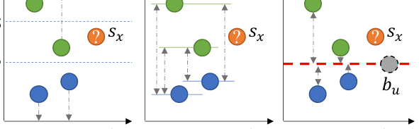
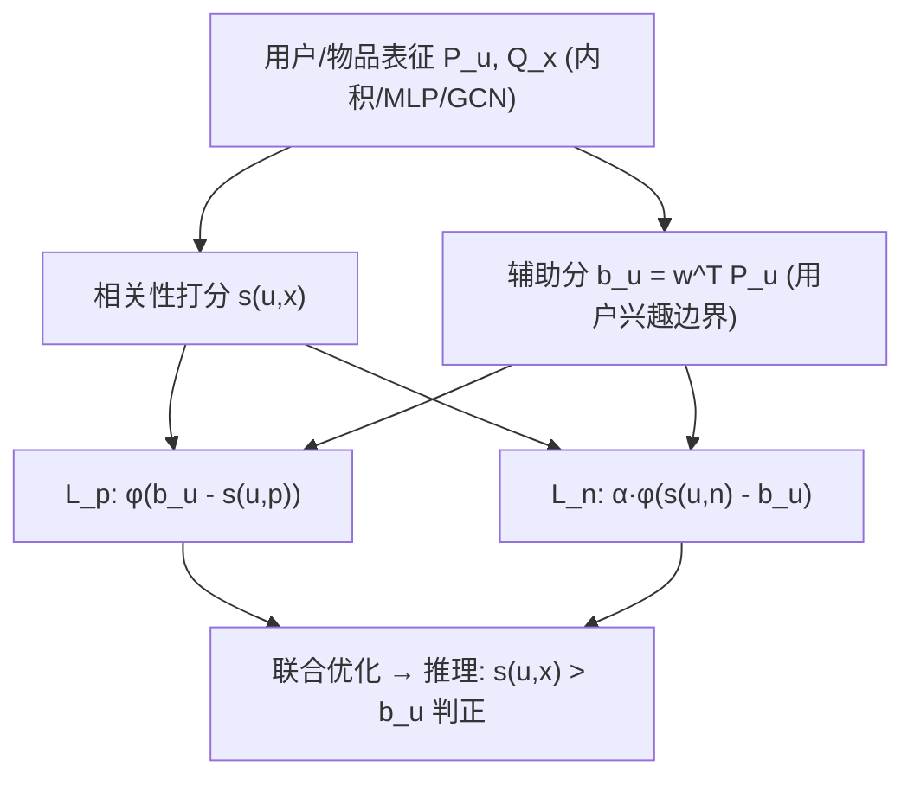
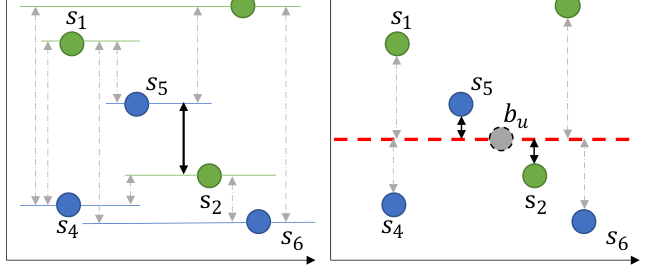

# Learning Explicit User Interest Boundary for Recommendation (显式学习用户兴趣边界的推荐方法)

- **会议/期刊**: WWW 2022
- **作者与机构**: Jianhuan Zhuo, Qiannan Zhu, Yinliang Yue, Yuhong Zhao（中科院信息工程研究所 / 中国人民大学高瓴人工智能学院）
- **推荐链路定位**: 精排（损失函数层，可下探至粗排/预排过滤）
- **研究方向**: 协同过滤与双塔召回 / 多任务学习与列表级重排
- **论文原文**: [https://arxiv.org/abs/2111.11026v1](https://arxiv.org/abs/2111.11026v1)
- **开源代码**: 暂未开源

## TL;DR (1分钟核心速览)

隐式反馈推荐的损失长期在 pointwise（拟合 0/1 标签但忽略排序）与 pairwise（学相对序但训练低效、无法给出判断"是否感兴趣"的阈值）之间二选一。本文为每个用户引入可学习辅助分 $b_u$作为**用户兴趣边界 (UIB)**，令正样本与$b_u$、负样本与$b_u$ 各自做 pairwise 惩罚，得到"整体 pointwise、内部 pairwise"的混合损失。在 4 个数据集、`Leave-One-Out` + 1:100 采样排序协议下，BPR/NCF/SML/LightGCN 全部被稳定提升，Hit@1 平均 +5.22%，并可在预排阶段过滤 95%–99% 的明显负例。

## Background & Motivation (背景与核心矛盾)

- **主流范式**: 隐式 CF 只优化"正样本分 $s_p$高、负样本分$s_n$ 低"，落地为逐样本交叉熵（NCF）或逐对 BPR/SML margin 损失。
- **前人局限一**: pointwise 在推理时对所有用户共用固定硬阈值（如 0.5），等价于假设全体用户兴趣边界相同；真实兴趣窄的用户，其正样本分数尚未达 0.5 却被判负。
- **前人局限二**: pairwise 只保证 $s_p>s_n$的相对序，推理阶段缺少"该物品是否值得推荐"的显式个性化判据；且训练后期大量易样本对$\Delta=s_n-s_p>0$不再成立，梯度消失（有效对概率约$M/N^2$）。
- **核心洞察 (Key Insight)**: 难样本本质是"贴着决策边界"的样本。既有工作（GAN-based、Cache-based、属性驱动难负采样）都在**提高采样命中难样本的概率**，而作者反问：为什么不直接用边界本身来代表难样本分数？
- **本文切入点**: 把边界显式参数化并放进损失，用一个辅助分同时解决"个性化判据缺失"与"训练效率低下"两个问题。

<figure class="paper-figure" markdown="span">
  <figcaption>图1：损失范式比较。</figcaption>
</figure>

## Method (核心方法设计)

### 1. 整体框架 (Overall Architecture)

打分函数 $s(u,x)$完全不动（内积 / MLP / 图卷积均可），仅在用户侧追加一个标量辅助分$b_u=\mathbf{w}^{\top}\mathbf{p}_u$。训练时损失拆成互不耦合的正样本项$L_p$与负样本项$L_n$：$L_p$要求$s(u,p)$高过$b_u$，$L_n$要求$b_u$高过$s(u,n)$，二者以$\alpha$加权。推理时对候选算$s(u,x)$，与学到的$b_u$比较即可给出"是否正类"的显式判定，而不只是排序。整个流程只多一次$d$ 维内积，可无侵入地替换任意 backbone 的损失层。

### 2. 关键设计拆解 (Key Designs)

1. **UIB 混合损失（Hybrid Loss）**：核心式 $L=\sum_{(u,p)\in\mathcal{I}}\phi\big(b_u-s(u,p)\big)+\alpha\sum_{(u,n)\notin\mathcal{I}}\phi\big(s(u,n)-b_u\big)$，取$\phi$为$\ln\sigma(\cdot)$即得 BPR 变体$L'=-\sum\ln\sigma(s(u,p)-b_u)-\alpha\sum\ln\sigma(b_u-s(u,n))$。与传统 pairwise 的唯一差别是把$s(u,n)$换成$b_u$：外层正负两部分独立求和，因此保留了 pointwise 在样本级加权/采样上的自由度；内层仍是 pairwise，因此保留了排序建模能力。
2. **边界自适应与类别再平衡**：$L_p$把$b_u$往下拉、$L_n$把$b_u$往上推，若边界偏离合理区间，失衡梯度会自动将其推回正负样本之间，故不同用户得到不同$b_u$（实验中呈不同正态分布）。$\alpha$则是打分空间的旋钮：$\alpha\uparrow$推动$b_u$上移、压缩正样本打分空间$\mathcal{S}_p$、同时因 margin 项放大使负样本分布更紧致，实现对正负类别的软性再平衡。
3. **训练效率来源与总目标**：$b_u$天然充当正样本的"难负例"和负样本的"难正例"。若正负各$N$个、共$M$个有效对，随机配对的 pairwise 有效梯度概率为$M/N^2$，UIB 只需$M/N$（文中 3 正 3 负示例：1/9 → 1/3）。训练用**均匀负采样**（每 batch 负样本数为正样本$M=32$ 倍），不做任何难负挖掘；推理开销几乎为零。

<figure class="paper-figure" markdown="span">
  <figcaption>图3：训练效率比较。</figcaption>
</figure>

## Experimental Setup & Evaluation Protocol (实验设置与评估协议)

- **数据集与预处理**:

| 数据集 | #Users | #Items | #Train | 稀疏度/密度 | 特征/场景说明 |
| :--- | :---: | :---: | :---: | :---: | :--- |
| AIV | 5,130 | 1,685 | 26,866 | 0.31% | Amazon Instant Video，`5-core` 过滤 |
| LastFM | 1,877 | 17,617 | 89,047 | 0.27% | 音乐艺人收听，物品侧极稀疏 |
| ML1M | 6,028 | 3,706 | 988,129 | 4.42% | 电影评分二值化 |
| ML10M | 69,878 | 10,677 | 9,860,298 | 1.32% | 大规模压力测试 |

- **数据划分与防穿越**: `Leave-One-Out`（每用户最后 1 条为 test、倒数第 2 条为 valid，其余为 train）。
- **排名评测协议**: `Sampled Ranking` —— 每个测试正样本配 **100 个固定负样本**（1:100），指标 Hit@1、Hit@10、NDCG@10、MRR@10，同一候选集重复 5 次取均值。
- **对比基线与超参**: BPR（pairwise）、NCF-MLP（pointwise CE）、SML（动态 margin 的 metric learning 复杂损失）、LightGCN（复杂图特征编码），共 4 类 backbone × 原始/UIB 两版。所有模型 $d=32$、batch=1024、Adagrad、训练 500 epoch（ML10M 100 epoch），$\alpha$与$M$ 按验证集 NDCG@10 网格搜索 + early stop。

## Key Experimental Results (实验关键数据)

### 1. 主实验对比 (Main Results)

| 模型 | AIV (Hit@1 / NDCG@10) | LastFM | ML1M | ML10M |
| :--- | :---: | :---: | :---: | :---: |
| BPR | 0.2216 / 0.3848 | 0.4717 / 0.6336 | 0.3327 / 0.5604 | 0.5279 / 0.7336 |
| BPR+UIB | 0.2452 / 0.4063 | 0.4907 / 0.6493 | 0.3486 / 0.5741 | 0.5478 / 0.7473 |
| NCF | 0.2322 / 0.4149 | 0.4827 / 0.6445 | 0.3272 / 0.5581 | 0.5278 / 0.7360 |
| NCF+UIB | 0.2608 / 0.4333 | 0.5205 / 0.6727 | **0.3515** / **0.5753** | **0.5760** / **0.7611** |
| SML | 0.2624 / 0.4559 | 0.5004 / 0.6681 | 0.3013 / 0.5319 | 0.4806 / 0.7030 |
| SML+UIB | 0.2591 / 0.4582 | 0.5077 / 0.6711 | 0.3132 / 0.5352 | 0.4832 / 0.7102 |
| LightGCN | 0.2617 / 0.4540 | 0.5070 / 0.6644 | 0.3329 / 0.5613 | 0.5182 / 0.7254 |
| LightGCN+UIB | **0.2747** / **0.4642** | **0.5237** / **0.6782** | 0.3467 / 0.5717 | 0.5519 / 0.7476 |
| **Avg. Improv.** | +6.67% / +3.19% | +4.15% / +2.35% | +5.08% / +2.00% | +4.99% / +2.34% |

### 2. 消融与组件分析 (Ablation & Analysis)

原文以"仅替换损失层"作为结构消融（backbone 与特征编码全部冻结），并补充 $\alpha$ 与边界偏移敏感性：

| 分析项 | AIV | LastFM | ML1M | ML10M |
| :--- | :---: | :---: | :---: | :---: |
| 换回原损失（BPR，Hit@1） | 0.2216 | 0.4717 | 0.3327 | 0.5279 |
| 换回原损失（NCF，Hit@1） | 0.2322 | 0.4827 | 0.3272 | 0.5278 |
| 边界偏移量 = 0 时的 F1 | 0.54 | 0.48 | 0.58 | 0.51 |
| $s(u,x)<b_u$ 可被预排过滤比例 | 99.37% | 99.69% | 95.24% | 99.06% |
| 有效梯度样本占比（后期 epoch） | 显著高于 BPR | 高于 BPR | BPR 10 epoch 后近乎枯竭 | 同左 |

### 3. 关键实验发现 (Key Findings)

1. **头部件收益最大且与架构正交**：Hit@1 平均提升 5.22%，远高于 Hit@10 的 0.9% 量级，说明个性化边界主要改善"首位判定"；pointwise（NCF，+9.18%）受益大于 pairwise（BPR，+5.81%），正因 pointwise 最缺排序性；LightGCN+UIB 仍有 +4.73% Hit@1，证明该损失与图卷积特征编码可叠加。
2. **学到的 $b_u$ 就是最优判负阈值**：offset 从 0 向正/负移动会单调地以 precision 换 recall，仅在 offset=0 时 F1 最优（AIV 54%、ML1M 58%），据此可在预排阶段过滤 99.37%（AIV）/95.24%（ML1M）的候选，直接转化为算力节省。
3. **$\alpha$是"打分空间"旋钮而非常规正则**：$\alpha$增大时$b_u$单调上移、$\mathcal{S}_p$被压缩、负样本分布更紧致，性能存在最优$\alpha$；同时 UIB 全程维持更高的 corrupted rate，验证了$M/N^2\to M/N$的效率论断。需注意 SML+UIB 在 AIV 的 Hit@1 反而从 0.2624 微降至 0.2591，说明复杂损失叠加时替换位置（仅改$L_A$）并非无损。

## Highlights & Limitations (亮点、对比与审稿批判)

- **与代表作对比**: 相比 BPR（纯相对序、无阈值、难样本靠采样）与 NCF（固定 0.5 全局阈值），UIB 用**一个标量参数**同时拿到个性化阈值与难样本；相比 SML（引入可学习 margin $m_u$ 与多项目标函数）与 GAN/Cache 类难负采样（额外采样器或缓存开销），UIB 不增加任何采样模块，工程侵入性最低。
- **可迁移亮点**: (1) "边界作为难样本"的思路可直接移植到双塔召回的内积打分层与 CTR 精排的 bias/position-bias 塔，作为 per-user 自适应偏置；(2) 用 $s(u,x)<b_u$ 做轻量预排过滤，是低成本级联裁剪的实用技巧。
- **审稿级局限批判**: (1) 评测用 1:100 采样排序，阈值 $b_u$的**绝对校准**在全库分布与真实曝光分布下未被检验，实际过滤比例可能失真；(2)$b_u=\mathbf{w}^{\top}\mathbf{p}_u$为线性映射，且强依赖人工设定的负采样倍数$M=32$与$\alpha$网格搜索，当用户兴趣多峰或曝光极度不均衡时单标量边界表达力存疑，文中也缺少对$\alpha$ 敏感度的方差报告与理论收敛性分析。

## Rating (四维评分)

- **方法创新性 (Novelty)**: ⭐⭐⭐⭐ （把"个性化决策边界"做成可学习标量并重解释为难样本，构思简洁有力，但本质仍是 margin 类损失的变形）
- **评估协议与实验扎实度 (Protocol & Experiments)**: ⭐⭐⭐⭐ （4 数据集 × 4 backbone 的全替换实验 + offset/$\alpha$/corrupted-rate 多维分析扎实，但仅采样排序、无全库 Full-Ranking 与显著性检验）
- **写作与数学规范度 (Clarity & Rigor)**: ⭐⭐⭐⭐ （损失对比与 $M/N^2\to M/N$的效率推导清晰直观，公式统一；$\alpha$ 与打分空间的定量关系仅有图示、缺解析刻画）
- **工业落地与复现价值 (Industrial & Practical Value)**: ⭐⭐⭐⭐ （零额外采样器、推理仅加一次内积、可直接用于预排过滤，落地成本极低；可惜未开源，超参与负样本倍数需重调）

