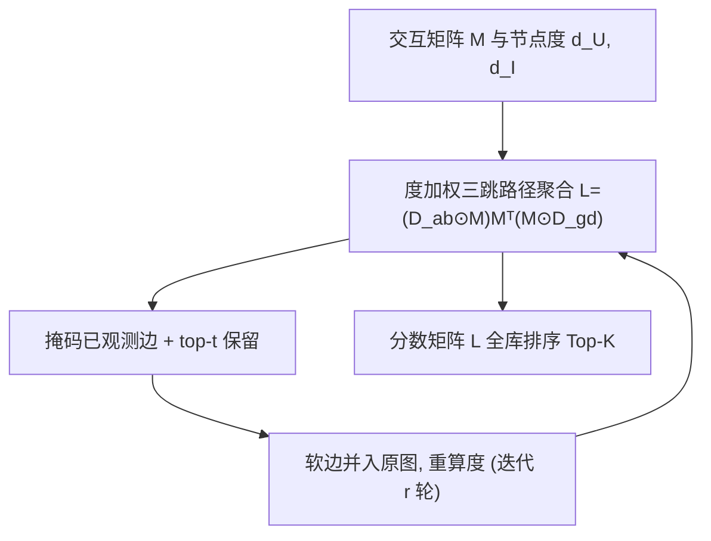
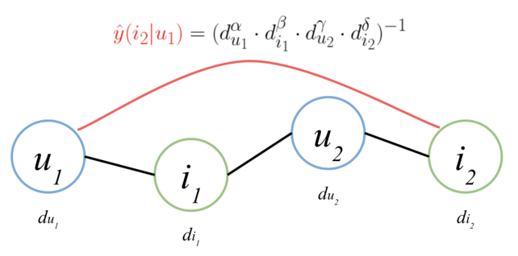

# Revisiting Neighborhood-based Link Prediction for Collaborative Filtering (重访面向协同过滤的邻域链接预测)

- **会议/期刊**: WWW '22 Companion (Graph Learning Workshop)
- **作者与机构**: Hao-Ming Fu, Patrick Poirson, Kwot Sin Lee, Chen Wang（Snap Inc. / CMU）
- **推荐链路定位**: 召回（全库排序打分器）
- **研究方向**: 协同过滤与双塔召回 / 图神经网络推荐
- **论文原文**: [https://arxiv.org/abs/2203.15789v1](https://arxiv.org/abs/2203.15789v1)
- **开源代码**: 暂未开源

## TL;DR (1分钟核心速览)

现有 GNN4Rec（NGCF/LightGCN/GTN）先学节点表征再以内积近似连边，本质是"绕道"求解链接预测。本文反其道而行：直接在 user-item 二部图上定义**度加权的三跳路径连通性分数** LinkProp，把 CN/SC/LHN/PD 等经典链接指标统一为该分数在参数取边界值时的特例，并叠加"迭代度更新"（LinkProp-Multi），全模型仅 6 个可学习参数、无神经网络。在 LightGCN 的全库排序协议（Recall/NDCG@20）下，四个基准全面超越 SOTA，Amazon-Book 上相对 GTN 提升 **60.2% / 69.9%**，且训练复杂度由 $O(u^3)$降至$O(u^{2.5})$。

## Background & Motivation (背景与核心矛盾)

- **主流范式**: NGCF、LightGCN、GTN 等在二部图上做多层邻居聚合，学习用户/物品低维嵌入，再用内积衡量亲和度；模型越做越"深"、越做越"重"。
- **前人局限**: ① 推荐本质是 user-item **连边预测**，而 GNN 只建模节点、用两节点表征的相似度**间接近似**连边，信息在嵌入压缩中损失；② 固定维度 $d=64$ 的隐空间在 Amazon-Book 这类大规模稀疏数据上表达能力饱和，扩大维度仍远落后（论文附录中 16× 维度的 LightGCN 仅涨 16.4%/15.3%）。
- **核心洞察 (Key Insight)**: 早在深度学习之前，Huang 等与 Chiluka 等已证明标准链接分数（CN、Katz）在推荐上强于 vanilla CF；且 LightGCN 的有效感受野恰好是三跳——那么"三跳路径的加权计数"本身可能就足够。
- **本文切入点**: 抛弃节点建模，直接把连边分数写成路径上各节点度的负幂乘积并让指数可学，再用迭代度更新注入高阶结构。

## Method (核心方法设计)

### 1. 整体框架 (Overall Architecture)

输入为用户-物品 0/1 交互矩阵 $M$。模型不学习任何嵌入，而是枚举所有长度 3 的路径$u_1\leftrightarrow i_x\leftrightarrow u_x\leftrightarrow i_2$，对每条路径按其四个端点度的负幂加权求和，得到候选连边分数矩阵$L$；随后（Multi 版本）将 top-$t$的高分软连边并入原图、重算度、再迭代$r$轮。训练阶段不写 BPR 代理损失，而是对 6 个参数做**量化网格搜索、直接以验证集 NDCG 为目标**；推理时输出稠密分数矩阵$L$，对每个用户未见物品全库排序取 Top-20。

<figure class="paper-figure" markdown="span">
  <figcaption>图 1：LinkProp 示意图。我们基于观测到的 𝑢1 ↔𝑖1 ↔𝑢2 ↔𝑖2 路径定义链接分数 ˆ𝑦(𝑖2|𝑢1)。</figcaption>
</figure>

### 2. 关键设计拆解 (Key Designs)

1. **LinkProp 分数（广义度加权三跳路径）**：痛点在于 CN/SC/LHN/PD 各自只惩罚路径上部分节点的度，且指数靠人工设定。本文将惩罚扩展到路径全部四个节点并令指数可学：
$\hat{y}(i_2|u_1)=\sum_{(i_x,u_x)\in P(u_1,i_2)}\frac{1}{d_{u_1}^{\alpha}\,d_{i_x}^{\beta}\,d_{u_x}^{\gamma}\,d_{i_2}^{\delta}}$。
由于评估时同一用户的 $d_{u_1}^{\alpha}$是全局常数，可约去，实际只剩$\beta,\gamma,\delta$三个参数（$\alpha=\beta=\gamma=\delta=0$退化为 CN，$\alpha=\delta=0.5$退化为 SC，$\alpha=\delta=1$ 退化为 LHN）。其物理直觉同 TF-IDF：两个用户共享一个冷门物品、或共同指向一个冷门物品时，该路径信息量更大，应给予更高权重。

2. **矩阵化与迭代度更新 (LinkProp-Multi)**：为避免逐路径枚举，令 $\mathbf{D}_{\alpha,\beta}=\boldsymbol{d}_U^{-\alpha}(\boldsymbol{d}_I^{-\beta})^{\top}$，则
$L=(\mathbf{D}_{\alpha,\beta}\odot M)\,M^{\top}(M\odot\mathbf{D}_{\gamma,\delta})$，
其中 $M M^{\top}M$正是二部图中三跳路径计数的解析形式，一次稀疏矩阵乘法即可全量打分。Multi 版本进一步把$L$中未观测的高分连边按比例$t$保留、并入$M$后重算度，重复$r$轮，使低度节点的度被"软边"抬升，从而在下一轮中传递更丰富的局部结构；此时因跨用户比较，$\alpha$需重新引入，参数增至$\{\alpha,\beta,\gamma,\delta,t,r\}$ 共 6 个。

3. **训练目标、负采样与推理效率**：无负采样、无梯度。目标直接是 $\max_{\Theta}\ \mathrm{NDCG@20}_{\text{val}}$，因 NDCG 不可导，采用量化网格搜索（$\{0,0.17,\dots,1.0\}$×$r\in\{1..4\}$×$t\in\{0.05..1.0\}$，共 511 组），可切换为 Recall 目标以适应召回阶段。复杂度上 LinkProp 为$O(g\,l\cdot\min(u,i))\approx O(u^{2.5})$，而 LightGCN 为$O(l^2Lde/b)\approx O(u^3)$，且无嵌入表、无显存瓶颈。

## Experimental Setup & Evaluation Protocol (实验设置与评估协议)

- **数据集与预处理**: 沿用 NGCF/LightGCN/GTN 的公开预处理版本（用户至少 10 次交互）。

| 数据集 | #Users | #Items | #Interactions | 稀疏度 | 场景说明 |
| :--- | :---: | :---: | :---: | :---: | :--- |
| Gowalla | 29,858 | 40,981 | 1,027,370 | 99.92% | LBS 签到 |
| Yelp2018 | 31,668 | 38,048 | 1,561,406 | 99.87% | 本地商户 |
| Amazon-Book | 52,643 | 91,599 | 2,984,108 | 99.94% | 图书电商 |
| LastFM | 23,566 | 48,123 | 3,034,763 | 99.73% | 音乐社交 |

- **数据划分与防穿越**: 沿用 LightGCN 设定，从训练集为每个用户随机抽 10% 交互作验证集用于选参，测试集为留出交互；参数搜索仅在验证集上进行，选定后再在原始训练图上推理，避免对测试集过拟合。
- **排名评测协议**: 无偏 **Full-Ranking**——候选集为该用户全部未交互物品，报告所有用户的平均 Recall@20 与 NDCG@20。
- **对比基线与超参设置**: MF、NeuCF、GC-MC、NGCF、Mult-VAE、DGCF、LightGCN、GTN；节点嵌入模型统一 $d=64$。LinkProp 无学习率概念，超参仅为网格搜索范围。

## Key Experimental Results (实验关键数据)

### 1. 主实验对比 (Main Results)

| 数据集 / 指标 | Gowalla R@20 | Gowalla N@20 | Yelp R@20 | Yelp N@20 | Amazon R@20 | Amazon N@20 | LastFM R@20 | LastFM N@20 |
| :--- | :---: | :---: | :---: | :---: | :---: | :---: | :---: | :---: |
| MF | 0.1299 | 0.1110 | 0.0436 | 0.0353 | 0.0252 | 0.0198 | 0.0725 | 0.0614 |
| NGCF | 0.1560 | 0.1324 | 0.0581 | 0.0475 | 0.0338 | 0.0266 | 0.0774 | 0.0693 |
| Mult-VAE | 0.1641 | 0.1335 | 0.0584 | 0.0450 | 0.0407 | 0.0315 | 0.0780 | 0.0700 |
| DGCF | 0.1794 | 0.1521 | 0.0640 | 0.0522 | 0.0399 | 0.0308 | 0.0794 | 0.0748 |
| LightGCN | 0.1823 | 0.1553 | 0.0649 | 0.0525 | 0.0420 | 0.0327 | 0.0850 | 0.0760 |
| GTN (前 SOTA) | **0.1870** | **0.1588** | 0.0679 | 0.0554 | 0.0450 | 0.0346 | 0.0932 | 0.0857 |
| LinkProp | 0.1814 | 0.1477 | 0.0676 | 0.0559 | 0.0684 | 0.0559 | 0.1054 | 0.1025 |
| **LinkProp-Multi** | 0.1908 | 0.1573 | **0.0690** | **0.0571** | **0.0721** | **0.0588** | **0.1071** | **0.1039** |
| Improv.% vs GTN | +2.03 | -0.94 | +1.62 | +3.07 | **+60.22** | **+69.94** | +14.91 | +21.24 |

### 2. 消融实验 (Ablation Study)

| 配置 (Recall@20 / NDCG@20) | Gowalla | Yelp2018 | Amazon-Book | LastFM |
| :--- | :---: | :---: | :---: | :---: |
| LHN ($\beta=\gamma=0,\delta=1$) | 0.0533/0.0360 | 0.0093/0.0075 | 0.0289/0.0219 | 0.0544/0.0432 |
| SC ($\beta=\gamma=0,\delta=0.5$) | 0.1252/0.0950 | 0.0553/0.0461 | 0.0506/0.0413 | 0.0936/0.0922 |
| CN (全 0) | 0.1367/0.1142 | 0.0468/0.0385 | 0.0348/0.0278 | 0.0786/0.0752 |
| 仅 $\delta$ 可学 (PD) | 0.1397/0.1108 | 0.0554/0.0461 | 0.0506/0.0413 | 0.0937/0.0922 |
| $\beta+\gamma$ 可学 | 0.1849/0.1350 | 0.0568/0.0466 | 0.0532/0.0416 | 0.0986/0.0929 |
| $\gamma+\delta$ 可学 | 0.1583/0.1251 | 0.0620/0.0514 | 0.0654/0.0540 | 0.0986/0.0954 |
| **$\beta+\gamma+\delta$ (LinkProp)** | **0.1814/0.1477** | **0.0676/0.0559** | **0.0684/0.0559** | **0.1054/0.1025** |

### 3. 关键实验发现 (Key Findings)

1. **规模越大，免嵌入优势越显著**：Amazon-Book 上 LinkProp 单跳版本已达 0.0684/0.0559，是 GTN 的 1.52×/1.62×；而 16× 维度的 LightGCN 仅涨 16.4%/15.3%，证明瓶颈不是维度预算而是"节点表征"这一范式本身。
2. **三个指数缺一不可，且 $\delta$（目标物品度）最敏感**：仅放开$\delta$即 PD 分数，Amazon-Book 从 CN 的 0.0348 升到 0.0506；再放开$\gamma$（中间用户度）跃至 0.0654，说明"路径中间人"的度惩罚是主要增益来源。
3. **抗噪性优于 LightGCN**：在随机注入 0%–30% 假交互的实验中（图 2），LinkProp-Multi 在 30% 噪声下曲线几乎持平，而 LightGCN/NGCF 单调下滑；原因是路径计数天然要求多跳共识，孤立噪声边难以构成三跳闭环，等价于隐式去噪。

## Highlights & Limitations (亮点、对比与审稿批判)

- **与代表作对比 (vs. Prior Work)**: 与 LightGCN 相比，本文把"度加权邻居聚合 + 内积"压缩成一个**闭式路径核**，$\alpha,\beta,\gamma,\delta$的可学性使其成为 CN/SC/LHN/PD 的严格超集；与 EASE^R 相比，EASE 学的是稠密 item-item 矩阵（$|I|^2$ 参数），而 LinkProp 只用 3–6 个标量参数、且天然支持用户侧非对称加权；与 GTN 相比，后者靠图三元组结构做去噪，本文靠路径共识，在干净数据上大幅领先、在极端噪声下略逊。
- **可迁移亮点**: ① "把模型超参当作可学参数、用验证指标做量化网格搜索"在小参数模型上是完全可行的替代方案，规避了代理损失与真实指标不一致；② 迭代度更新（top-$t$软边注入 + 度重算）可作为一个轻量插件，为任意基于度归一化的 GNN（LightGCN 的$\tilde{D}^{-1/2}\tilde{A}\tilde{D}^{-1/2}$）提供"度数校准"。
- **审稿级局限批判**: ① **推理成本被低估**：$MM^{\top}M$产生稠密$|U|\times|I|$分数矩阵，工业级千万级用户/物品下显存不可承受，论文只分析了训练复杂度而未讨论线上打分与 Top-K 检索的工程化；② **超参对数据集敏感**：表 3 显示 Amazon-Book 最优$\beta=\gamma=\delta=0.5$、LastFM 却是$\beta=\gamma=0.67,\delta=0.34$，$t$在 0.05–0.5 间波动，跨域迁移需重新网格搜索，且搜索目标锁定 NDCG@20 后换$K$ 需重跑；③ 缺少与 EASE^R、UltraGCN 等强线性基线的对比，且仅在 4 个中小规模学术数据集验证，无线上 A/B。

## Rating (四维评分)

- **方法创新性 (Novelty)**: ⭐⭐⭐⭐ （用统一度加权路径分数囊括 CN/SC/LHN/PD 并让指数可学，视角回归简洁但洞察锋利）
- **评估协议与实验扎实度 (Protocol & Experiments)**: ⭐⭐⭐⭐ （Full-Ranking 全库排序、四数据集 + 噪声鲁棒性 + 完整参数消融，但缺 EASE^R 类线性基线）
- **写作与数学规范度 (Clarity & Rigor)**: ⭐⭐⭐⭐⭐ （从 $A^{2k+1}$路径计数到矩阵形式$L$ 的推导链条干净，附 Numpy 伪代码与复杂度对比）
- **工业落地与复现价值 (Industrial & Practical Value)**: ⭐⭐⭐ （6 参数、无梯度、易实现且抗噪，但稠密分数矩阵与网格搜索在大规模场景需重设计，且未开源）

