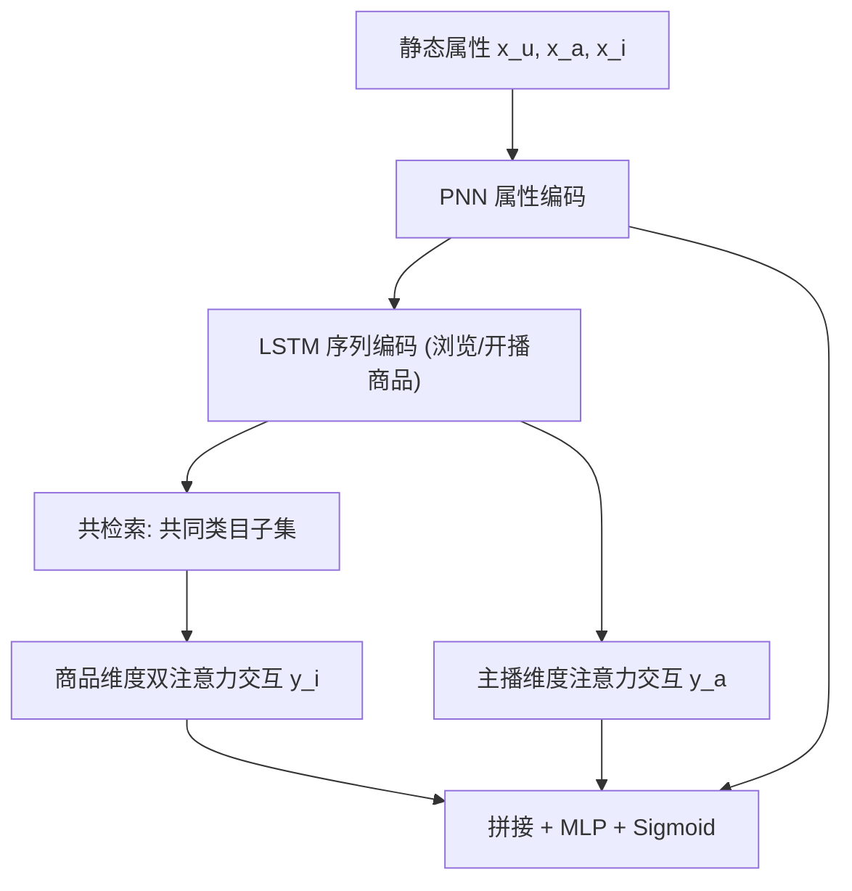
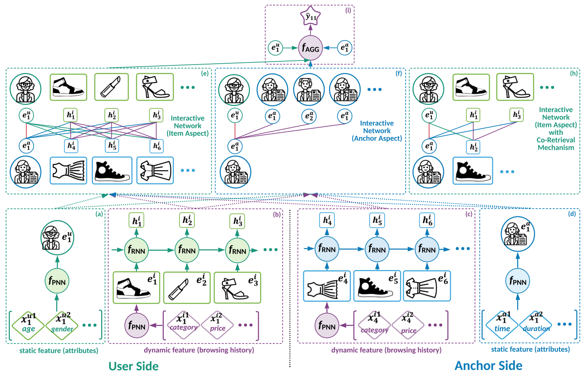
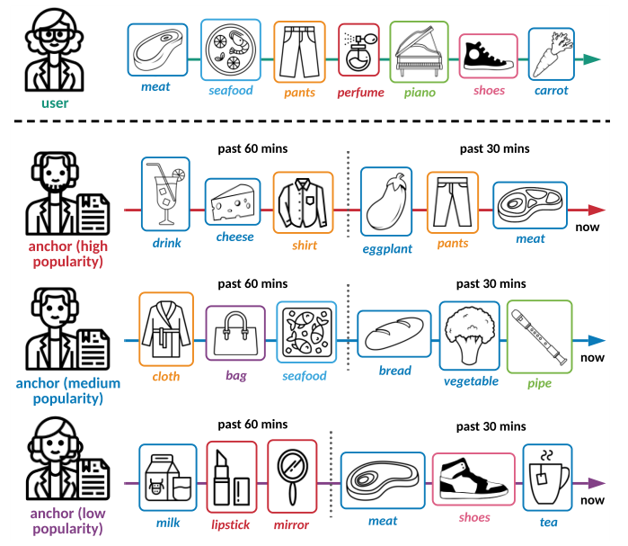

# Who to Watch Next: Two-side Interactive Networks for Live Broadcast Recommendation (看谁直播：面向直播推荐的双侧交互网络)

- **会议/期刊**: WWW 2022 (Proceedings of the ACM Web Conference)
- **作者与机构**: Jiarui Jin, Xianyu Chen, Yuanbo Chen, Weinan Zhang, Renting Rui, Zaifan Jiang, Zhewen Su, Yong Yu (上海交通大学 / 阿里巴巴集团)
- **推荐链路定位**: 精排（用户-主播 CTR 预估）
- **研究方向**: 协同过滤与双塔召回 / CTR 预估与特征交叉
- **论文原文**: [https://arxiv.org/abs/2202.04333v1](https://arxiv.org/abs/2202.04333v1)
- **开源代码**: 暂未开源

## TL;DR (1分钟核心速览)

传统推荐只建模 $\langle$用户, 商品$\rangle$二元交互，而直播推荐要推荐"主播"这一新对象，本质是$\langle$用户, 主播, 商品$\rangle$三元协同信号问题。本文提出 TWINS：用户侧/主播侧各用 PNN 编码类别属性、LSTM 编码行为序列，再用商品维度与主播维度的双注意力交互网络显式建模 "AND" 偏好模式，并用类目硬检索剪枝把$|\mathcal{H}^{ui}_p|\times|\mathcal{H}^{ai}_n|$ 的交叉开销压缩到共同类目子集。四个工业数据集上点式 CTR 评测全面领先，Diantao 线上 A/B 的 ACTR 提升 8.11%、UCVR 提升 3.52%。

## Background & Motivation (背景与核心矛盾)

- **主流范式**: 工业界把用户/主播两侧的人工特征拼接后送入 FM、DeepFM、DIN、ESMM 等分类器做 CTR 预估；协同过滤一侧则由 MF 到 SVD++ 建模用户-物品相似度。
- **前人局限**: (1) 这些方法均以"二元对象"为假设，从既有特征映射出 embedding，无法编码三元组内的协同信号；(2) 把用户历史与主播历史各自压缩成单一向量后再算相似度，存在**early summarization** 问题——用户"看了某鞋"与主播"正在卖某鞋"之间的 AND 关系在压缩中丢失。
- **核心洞察 (Key Insight)**: 主播侧的"正在播的商品列表"比用户侧历史更干净、更有信息量，因此把主播售卖序列作为显式特征引入相似度计算，比只扩展 SVD++ 的用户侧上下文更有效。
- **本文切入点**: 用双侧（用户侧 + 主播侧）架构，把交互模式在**商品层面**与**主播层面**分别显式建模，再用无参数共检索解决由此带来的组合爆炸。

## Method (核心方法设计)

### 1. 整体框架 (Overall Architecture)

输入是三元组的静态类别特征与三条序列（用户浏览主播序列 $\mathcal{H}^{ua}_p$、用户浏览商品序列$\mathcal{H}^{ui}_p$、主播开播商品序列$\mathcal{H}^{ai}_n$）。每个用户/主播/商品先用共享形式的 PNN 得到属性 embedding，再让商品 embedding 依次流入 LSTM 得到序列化表示。随后进入交互层：商品维度用双注意力对齐"用户看过的商品"与"主播正在卖的商品"，主播维度对齐"用户看过的主播"与"候选主播"，两路输出与直接内积$\boldsymbol{y}^e_{pn}=\boldsymbol{e}^u_p\odot\boldsymbol{e}^a_n$ 拼接后经 MLP + Sigmoid 输出点击概率。为保证线上可服务，商品维度交互前先按共同类目做硬检索。

<figure class="paper-figure" markdown="span">
  <figcaption>图2：TWINS 概览。底部部分（即 (a)-(d)）展示双侧架构：在用户侧和主播侧，使用 PNN 编码静态（类别）属性，使用 RNN 编码动态（序列）历史。上方部分（即 (e)-(g)）展示了交互网络：其以这些嵌入向量为输入，从物品和主播角度输出交互模式，并与用户和主播的静态特征进一步聚合，以进行最终预测（即对用户 𝑢1 和主播 𝑎1 的 b𝑦11）。此外，我们设计了一种协同检索机制。</figcaption>
</figure>

### 2. 关键设计拆解 (Key Designs)

1. **PNN + RNN 的对象建模（C1：静态与动态特征统一编码）**：纯 MLP 难以表达"年龄 AND 性别共同决定口红偏好"这类显式交叉，故先用 PNN 的 product layer 生成二阶交叉项，再把商品 embedding 灌入 LSTM 注入时序上下文：$\boldsymbol{e}^u_p=f^u_{\text{PNN}}(\boldsymbol{x}^u_p)=\boldsymbol{v}^u_p\odot\boldsymbol{x}^u_p+\sum_{j'<j''}(\boldsymbol{v}^u_{j'}\odot\boldsymbol{v}^u_{j''})x^u_{j'p}x^u_{j''p}$，$\boldsymbol{h}^i_q=f^i_{\text{RNN}}(\boldsymbol{e}^i_q\mid\boldsymbol{b}^i_{q-1})$。直觉：静态刻画"她是谁"，序列刻画"她最近在追什么"。

2. **商品维度双注意力交互（C2：破解 early summarization）**：SVD++ 式扩展 $\boldsymbol{y}^i_{pn}=(\boldsymbol{e}^u_p+\sum\lambda_{pq'}\boldsymbol{h}^i_{q'})^\top(\boldsymbol{e}^a_n+\sum\beta_{nq''}\boldsymbol{h}^i_{q''})$仍是先求和再内积，交互被平均化。TWINS 把配对项权重交给注意力：$\alpha^i_{pq'nq''}=\text{softmax}(\boldsymbol{w}^{i\top}[\boldsymbol{e}^u_p,\boldsymbol{h}^i_{q'},\boldsymbol{e}^a_n,\boldsymbol{h}^i_{q''}]+b)$，$\boldsymbol{y}^i_{pn}=\sum_{q'}\sum_{q''}\alpha^i_{pq'nq''}(\boldsymbol{h}^i_{q'}\odot\boldsymbol{h}^i_{q''})$。这样"鞋↔鞋"的配对可被单独激活，等价于可微的 AND 检索。

3. **主播维度交互与共检索剪枝（C2+C3：效率与去噪）**：主播侧用同构注意力 $\boldsymbol{y}^a_{pn}=\sum_{n'}\alpha^a_{pn'n}(\boldsymbol{e}^a_{n'}\odot\boldsymbol{e}^a_n)$刻画"她看过的主播与候选主播是否同质"。商品维度需$|\mathcal{H}^{ui}_p|\times|\mathcal{H}^{ai}_n|$次配对，长序列下不可接受，故设计无参数硬检索：$\hat{\mathcal{H}}^{ui}_p=\{i_{q'}\in\mathcal{H}^{ui}_p\mid \boldsymbol{x}^i_{1q'}\in\mathcal{C}^u_p\cap\mathcal{C}^a_n\}$，仅保留双方共同类目商品。训练目标为点式对数损失$\mathcal{L}=-\sum_{(u_p,a_n)}[y_{pn}\log\hat{y}_{pn}+(1-y_{pn})\log(1-\hat{y}_{pn})]$；负样本由日志中未点击曝光对自然提供，无需额外采样器；线上仅需一次前向 + 已离线建好的类目树检索。

## Experimental Setup & Evaluation Protocol (实验设置与评估协议)

- **数据集与预处理**:

| 数据集 | #Users | #Items | #Interactions | 稀疏度/密度 | 特征/场景说明 |
| :--- | :---: | :---: | :---: | :---: | :--- |
| Yelp Business | — | — | — | — | 商户点评，公共基准 |
| Trust Statement (Epinions) | — | — | — | — | 信任网络，公共基准 |
| Aminer Citation | — | — | — | — | 引文网络，公共基准 |
| Diantao Live Broadcast | 10M+ | 90K 主播 | 1.46B 日志 | — | 手淘直播场景，用户属性(年龄/性别/城市)+主播文档(标题/时间) |

- **数据划分与防穿越 (Splitting Strategy)**: 按线上日志的曝光-点击样本组织训练/测试（论文正文未给出比例细节，详见附录 C），无显式时间戳切分说明；Diantao 中播放时长 $>3$s 记为点击。
- **排名评测协议 (Ranking Protocol)**: 采用**点式二分类（Sampled/Logged 曝光样本）**，指标为 AUC、ACC（阈值 0.5）、LogLoss，**并非 Full-Ranking 的 Recall@K/NDCG@K**，故结论偏向 CTR 排序能力而非全库召回质量。
- **对比基线与超参设置**: 9 个基线覆盖交互模型（FM、NeuMF、DeepFM、PNN）、序列模型（LSTM、NARM）、多目标/注意力工业模型（ESMM、DIN、DIEN）；每个基线均给出 `X−`（仅用户浏览主播序列）与 `X`（再拼接商品侧序列）两版以控制输入公平性。显著性检验 $p<0.001$。

## Key Experimental Results (实验关键数据)

### 1. 主实验对比 (Main Results)

| 方法 | Yelp AUC | Yelp LogLoss | Aminer AUC | Aminer LogLoss | Diantao AUC | Diantao ACC | Diantao LogLoss |
| :--- | :---: | :---: | :---: | :---: | :---: | :---: | :---: |
| FM | 0.6233 | 0.6677 | 0.7071 | 0.6510 | 0.6896 | 0.6732 | 0.6541 |
| NeuMF | 0.8424 | 0.4895 | 0.8542 | 0.4797 | 0.7229 | 0.7124 | 0.5942 |
| DeepFM | 0.8658 | 0.4594 | 0.8826 | 0.4410 | 0.7345 | 0.7231 | 0.5832 |
| PNN | 0.8668 | 0.4581 | 0.9399 | 0.3932 | 0.7578 | 0.7367 | 0.5432 |
| NARM | 0.9463 | 0.3137 | 0.9893 | 0.1200 | 0.7953 | 0.7756 | 0.5233 |
| DIN | 0.9451 | 0.3156 | 0.9892 | 0.1212 | 0.7995 | 0.7784 | 0.5100 |
| DIEN | 0.9395 | 0.3291 | 0.9887 | 0.1242 | 0.8046 | 0.7843 | 0.5145 |
| TWINS$-i$ | 0.9538 | 0.2746 | 0.9893 | 0.1246 | 0.8010 | 0.7896 | 0.5012 |
| TWINS$-a$ | 0.9583 | 0.2608 | 0.9895 | 0.1233 | 0.8024 | 0.7920 | 0.4977 |
| **TWINS** | **0.9659** | **0.2603** | **0.9913** | **0.1081** | **0.8187** | 0.7934 | 0.4855 |
| **TWINS+co** | 0.9593 | 0.2596 | 0.9903 | 0.1170 | **0.8205** | **0.8045** | **0.4731** |
| **Improv.% (Diantao AUC)** | — | — | — | — | **+1.98%** | **+2.58%** | **-8.05%** |

线上 A/B（7 天，5% vs 5% 分流）：ACTR **+8.11%**、UCTR **+2.01%**、UCVR **+3.52%**。

### 2. 消融实验 (Ablation Study)

| 变体 | Yelp AUC | Diantao AUC | Diantao LogLoss | Aminer LogLoss | 说明 |
| :--- | :---: | :---: | :---: | :---: | :--- |
| TWINS$-i$（去商品维度交互） | 0.9538 | 0.8010 | 0.5012 | 0.1246 | 降幅最大 |
| TWINS$-a$（去主播维度交互） | 0.9583 | 0.8024 | 0.4977 | 0.1233 | 次之 |
| TWINS（完整交互） | **0.9659** | 0.8187 | 0.4855 | **0.1081** | 两路互补 |
| TWINS+co（加共检索） | 0.9593 | **0.8205** | **0.4731** | 0.1170 | 更快且基本不损精度 |

### 3. 关键实验发现 (Key Findings)

1. **"数据输入"的收益远小于"结构建模"的收益**：把用户浏览商品与主播开播商品简单拼接入 DIN/DIEN（`X` vs `X−`），Diantao AUC 仅从 0.7790 涨到 0.7995；而同样输入下 TWINS 用交互网络直接推到 0.8187，说明 early summarization 才是性能瓶颈，噪声拼接甚至会反噬（部分数据集上 `X` 低于 `X−`）。
2. **商品维度交互是主贡献、主播维度是补充**：去商品维度（TWINS$-i$）在 Aminer 上 LogLoss 从 0.1081 恶化到 0.1246（+15%），明显大于去主播维度（0.1233），验证"用户看主播的动机主要来自其在卖的商品"这一业务直觉；同时全库无检索版 TWINS 在 Diantao 上 AUC 已达 0.8187，共检索仅损失 0.2~1 个点却带来显著加速（图 4）。
3. **共检索同时起到去噪与提效作用**：TWINS+co 在 Diantao 上 AUC 与 ACC 反而高于完整版（0.8205 / 0.8045 vs 0.8187 / 0.7934），LogLoss 降至 0.4731，说明类目交集天然过滤了大量弱相关配对；案例研究（图 5）进一步显示交互权重能正确聚出"裤子-衬衫-香水-口红"等语义簇，并使高/中/低人气主播均有机会被推荐，缓解流行度偏置。

<figure class="paper-figure" markdown="span">
  <figcaption>图5：在预测用户与不同热度主播之间相关性的情况下，TWINS 交互模式的示例。每对颜色相似的物品表示两个物品之间具有高交互权重（即相关性）。</figcaption>
</figure>

## Highlights & Limitations (亮点、对比与审稿批判)

- **与代表作对比 (vs. Prior Work)**: 相比 SVD++ 把上下文求和后内积，TWINS 用双注意力保留配对级权重，是"可微版 AND 检索"；相比 DIN/DIEN 只在用户单侧做目标注意力，TWINS 补齐了主播侧序列这一信息源；相比 GraphHINGE 类图卷积方案，TWINS 不依赖显式构图，工程落地成本更低。
- **可迁移亮点**: (1) 用"共同类目/共同标签求交"做无参数硬检索，是长序列交叉注意力通用的降复杂度技巧，可直接移植到双塔精排；(2) 把候选方（主播/商家/作者）的供给侧序列作为一等公民引入相似度计算，对内容电商、短剧、达人推荐同样成立。
- **审稿级局限批判**: (1) **评测协议偏弱**——仅报告点式 AUC/ACC/LogLoss，无 Full-Ranking 或 Top-K 指标，负样本来自曝光日志，存在位置偏置与选择偏置未校正；(2) **共检索强依赖类目体系质量**，冷启动主播或跨类目带货（如美妆主播卖食品）时共同类目可能为空，交互层直接退化为纯内积；此外完整版 TWINS 的 $|\mathcal{H}^{ui}|\times|\mathcal{H}^{ai}|$ 复杂度在离线训练时仍昂贵，论文未给出序列截断长度与延迟的敏感性分析。

## Rating (四维评分)

- **方法创新性 (Novelty)**: ⭐⭐⭐⭐ （首个把三元组直播推荐形式化并用双侧注意力显式建模 AND 模式的工作，无参数共检索设计巧妙，但注意力 + PNN 的组件本身均为已有积木的组合）
- **评估协议与实验扎实度 (Protocol & Experiments)**: ⭐⭐⭐ （四个数据集 + 9 个基线 + 双版本输入对照 + 一周线上 A/B 很扎实，但只做点式 CTR 评测、缺 Top-K 全库排序与偏置校正，削弱了"推荐"意义上的说服力）
- **写作与数学规范度 (Clarity & Rigor)**: ⭐⭐⭐⭐ （公式推导与 SVD++ 退化关系解释清晰、复杂度对比到位；但 Eq.(4) 存在 $\boldsymbol{h}^i_{q''}\odot\boldsymbol{h}^i_{q''}$ 的笔误，附录承担了过多数据集细节）
- **工业落地与复现价值 (Industrial & Practical Value)**: ⭐⭐⭐⭐ （1.46B 日志真实场景验证 + 线上 8.11% ACTR 提升 + 类目树轻量化部署方案，工程参考价值高；但代码未开源、类目体系依赖强，复现门槛中等）

