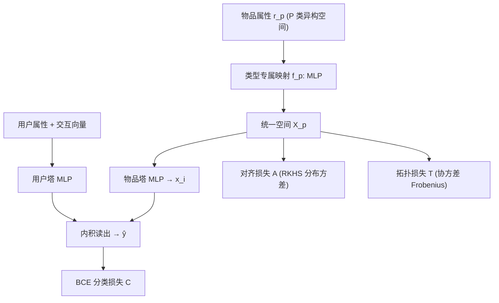
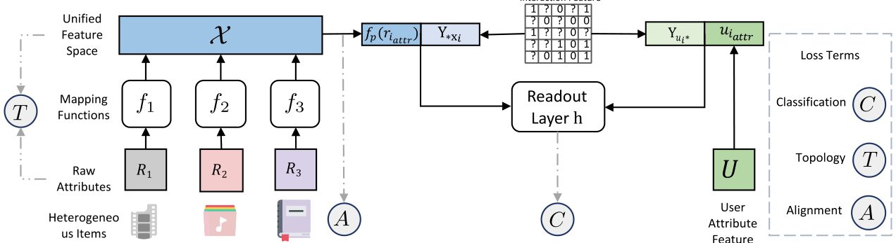
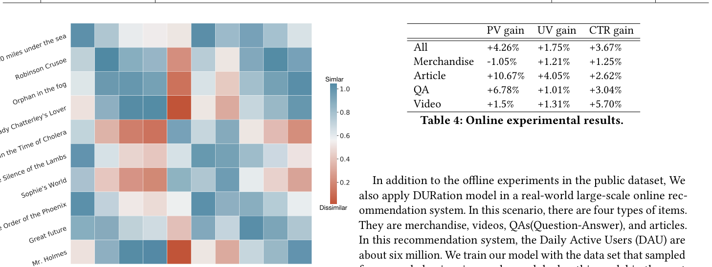

# Deep Unified Representation for Heterogeneous Recommendation (异构推荐的深度统一表征)

- **会议/期刊**: WWW 2022 (The ACM Web Conference)
- **作者与机构**: Chengqiang Lu, Mingyang Yin, Luo Ji, Hongxia Yang (阿里巴巴) / Shuheng Shen (蚂蚁集团) / Qi Liu (中国科学技术大学)
- **推荐链路定位**: 召回（双塔表征）
- **研究方向**: 跨域与多场景推荐 / 冷启动与长尾推荐
- **论文原文**: [https://arxiv.org/abs/2201.05861v2](https://arxiv.org/abs/2201.05861v2)
- **开源代码**: [https://github.com/geekinglcq/HRec](https://github.com/geekinglcq/HRec)

## TL;DR (1分钟核心速览)

真实平台常同时推荐商品、视频、文章、问答等多类**特征空间互不相同**的物品，传统同构模型只能取公共属性或分类型建模，造成侧信息浪费与稀疏加剧。本文提出 DURation：为每类物品配一个 MLP 映射 $f_p$把属性投射进统一空间$X$，并施加 **RKHS 均值嵌入的分布对齐损失**与**改版 CORAL 的协方差拓扑保持损失**，与 BCE 分类损失联合优化；小批量采样保证$1/(PB)\epsilon^2$ 收敛。Douban 上 AUC 0.804（较最强基线 +2.16%~+3.4%），线上 600 万 DAU 场景 CTR +3.67%、冷启新物品 CTR +27.22%。

## Background & Motivation (背景与核心矛盾)

- **主流范式**: 双塔/深度 CTR 模型依赖交互矩阵 + 同一特征空间内的属性拼接，跨域推荐（CCCFNet、DDTCDR）则假设源域与目标域共享输入空间 $\mathcal{X}$。
- **前人局限**: (1) 多类物品属性维度与语义完全不同，仅取"重叠特征"会丢弃大量侧信息；分类型多视图共享用户 embedding 时，各类物品之间相互"信息隔离"，稀疏类（如 Book 密度仅 $9.25\times10^{-5}$）继续冷启。(2) 迁移学习式映射（EMCDR、流形对齐）只做点对点映射，既**不对齐分布**也**不保拓扑**，且仅支持单源单目标。
- **核心洞察 (Key Insight)**: 若把各类映射后样本的分布 $\mathbb{P}_{X_p}$ 用 RBF 核均值映射嵌入 RKHS，则分布差异可用 Gram 矩阵刻画；由 Theorem 1（特征核的均值映射是单射，但两个不同分布仍可有极小内积）可知该度量只惩罚"高频细节差异"——**既能拉近不同类分布，又不会把不同物品抹成同一点**，保留细粒度判别力。
- **本文切入点**: 对齐（拉近分布）+ 拓扑（保住类内结构）+ 分类（保持 $\mathbb{P}(Y|R_p)$ 不变）三目标联合，把异构推荐统一为"多映射函数 + 双塔读出"。

## Method (核心方法设计)

### 1. 整体框架 (Overall Architecture)

左塔编码用户：把用户在所有物品上的评分向量 $Y_{u_i*}$与属性$u_i^{attr}$拼接后过 MLP 得$\mathbf{u}_i$。右塔编码物品：属性先经**类型专属映射**$\mathbf{x}_i=f_p(r_i^{attr})\in\mathbb{R}^d$进入统一空间，再与交互特征拼接过 MLP 得$\mathbf{x}_i$。读出层用内积$\hat{y}_{ij}=\langle\mathbf{u}_i,\mathbf{x}_j\rangle$（兼顾线上低延迟），训练时由灰度点划线标出的三条损失（对齐、拓扑、BCE）共同反传。

<figure class="paper-figure" markdown="span">
  <figcaption>图1：DURation 框架。左侧为统一表示学习；对异构物品构建多个映射函数，将其变换到统一特征空间。右侧为用户与交互特征的处理过程。学习用户（绿色条带）和物品（蓝色条带）嵌入后，将其送入读出层以输出最终预测。灰色点划线表示不同损失项的计算。</figcaption>
</figure>

### 2. 关键设计拆解 (Key Designs)

1. **RKHS 分布对齐损失 (Alignment Loss)**：痛点是一味拼接异构特征会让各类分布杂糅、下游 MLP 过拟合稀疏类。做法是对每个分布取均值映射 $\mu[\mathbb{P}_{X_p}]=\int_X\kappa(x,\cdot)d\mathbb{P}_{X_p}(x)$，最小化分布方差$\mathbb{V}_H(\mathcal{P})=\frac{1}{P}\mathrm{tr}(\Sigma)$ 的样本估计，展开得成对核和：

$$\mathcal{A}=\sum_{i,j=1}^{P}\sum_{k,l}\mathcal{A}_{ijkl},\quad \mathcal{A}_{ijkl}=\begin{cases}\dfrac{P-1}{P^2N_i^2}\kappa(\mathbf{x}_k^i,\mathbf{x}_l^j), & i=j\\[2mm] -\dfrac{1}{P^2N_iN_j}\kappa(\mathbf{x}_k^i,\mathbf{x}_l^j), & i\neq j\end{cases}$$

   直觉：同类样本对给正权、异类样本对给负权，即"压缩类内散度、拉近类间质心"；RBF 核 $\kappa(x,x')=\exp(-\lambda\lVert x-x'\rVert^2)$ 的普适性保证可逼近任意连续函数。
2. **拓扑保持损失 (Topology Loss)**：直接约束样本对距离会受相似度度量选择（高斯核/欧氏/余弦）支配而不稳。作者改为**只匹配二阶统计量**：分别算原始属性 $D_{R_i}$与映射后$D_{X_i}$的协方差$C_{R_i},C_{X_i}$，令

$$\mathcal{T}=\sum_{i=1}^{P}\frac{1}{4N_i}\big\lVert C_{R_i}-C_{X_i}\big\rVert_F^2$$

   由于协方差编码了原始空间的全局相关结构，约束它相当于保住"类簇形状"，且对维度差异 $d\neq d'$ 天然免疫（CORAL 的改版）。
3. **训练目标、采样与推理效率**：总体 $\mathcal{L}=\mathcal{C}+\alpha\mathcal{A}+\beta\mathcal{T}$，$\mathcal{C}$为交互级 BCE。$\mathcal{A}$的原始复杂度是$O(\sum N_i^2)$，无法支撑亿级样本；作者每个分布随机抽$B$个样本估计三项损失的 mini-batch 梯度，因样本索引独立故为无偏估计，收敛率$1/(PB)\epsilon^2$——这是"理论可证 + 工程可部署"的关键折中。推理仅需一次 MLP 前向 + 内积，无额外候选开销。

## Experimental Setup & Evaluation Protocol (实验设置与评估协议)

- **数据集与预处理**: Douban 真实多品类行为（Book / Music / Movie 三类），标签转为二分类"喜欢/不喜欢"，全量交互（无 5-core 过滤说明）。

| 数据集 | #Users | #Items | #Interactions | 密度 | 特征/场景说明 |
| :--- | :---: | :---: | :---: | :---: | :--- |
| Book | 25,496 | 150,955 | 356,001 | $9.25\times10^{-5}$ | 11 个属性，最稀疏 |
| Music | 25,426 | 102,571 | 269,760 | $1.03\times10^{-4}$ | 8 个属性 |
| Movie | 31,664 | 50,299 | 470,479 | $2.95\times10^{-4}$ | 10 个属性，最稠密 |
| All | 36,585 | 303,825 | 1,096,240 | $9.86\times10^{-5}$ | 混合三类 |

- **数据划分与防穿越 (Splitting Strategy)**: 正文未给出划分细节（声明见补充材料 A.2），按交互样本做二分类训练/测试切分；线上采用"第 $t$天行为训练、第$t+1$ 天部署"的时间切分，无穿越。
- **排名评测协议 (Ranking Protocol)**: **非全库排序**，而是逐交互 **AUC（点级二分类）**；未报告负采样比例与 Sampled/Full-Ranking 对比——这是评估上最明显的缺口。
- **对比基线与超参设置**: ①通用模型 DeepMF / FISM / NAIS（丢属性）；②同构上下文模型 DeepFM / xDeepFM / AFM / DSSM / Wide&Deep / AutoInt，分别跑异构公共属性（He）与同构全属性（Ho）两种设置；③异构模型 CCCFNet、DDTCDR（扩为多源）。优化器 Adam，$\alpha,\beta$ 为对齐/拓扑权重，映射函数与塔均为 ReLU-MLP。

## Key Experimental Results (实验关键数据)

### 1. 主实验对比 (Main Results)

| 模型 | 设置 | Book | Music | Movie | All |
| :--- | :---: | :---: | :---: | :---: | :---: |
| NAIS | He | 0.554 | 0.563 | 0.651 | 0.592 |
| DeepMF | He | 0.588 | 0.631 | 0.656 | 0.647 |
| FISM | He | 0.571 | 0.576 | 0.656 | 0.596 |
| DeepFM | Ho | 0.737 | 0.782 | 0.777 | / |
| AutoInt | Ho | 0.739 | 0.784 | 0.780 | / |
| CCCFNet | He | 0.741 | 0.786 | 0.782 | 0.787 |
| DDTCDR | He | 0.734 | 0.776 | 0.774 | 0.780 |
| **DURation** | He | **0.766** | **0.818** | **0.792** | **0.804** |
| **Improv.%** (vs 最优基线) | | +3.37% | +4.07% | +1.28% | +2.16% |

线上 A/B（600 万 DAU，5000 万训练样本，基线为带 self-attention 的 CCCFNet 变体，离线 AUC 0.675 vs 0.667）：整体 **PV +4.26%、UV +1.75%、CTR +3.67%**；分品类 Article PV +10.67%、Video CTR +5.70%，Merchandise PV 略降 −1.05%；**新物品 CTR +27.22%、新用户 CTR +2.59%**（30 天无活跃定义为冷启）。

### 2. 消融实验 (Ablation Study)

| 设置 | 模型 | Book | Music | Movie | All |
| :--- | :--- | :---: | :---: | :---: | :---: |
| 全量数据 | DURation | **0.766** | **0.819** | **0.792** | **0.804** |
| 全量数据 | w/o 对齐 $\mathcal{A}$& 拓扑$\mathcal{T}$ | 0.759 | 0.817 | 0.790 | 0.798 |
| 冷启动 | DURation | **0.707** | **0.667** | **0.675** | **0.576** |
| 冷启动 | w/o 对齐 $\mathcal{A}$& 拓扑$\mathcal{T}$ | 0.690 | 0.619 | 0.649 | 0.565 |

<figure class="paper-figure" markdown="span">
  <figcaption>图2：Book-Movie 相似度热图。横轴表示十本书，纵轴表示其电影改编作品。色块颜色表示对应图书与电影之间的相似度；越蓝表示相似度越高，反之越低。</figcaption>
</figure>

### 3. 关键实验发现 (Key Findings)

1. **收益与稀疏度强正相关**：最稀疏的 Book（密度 $9.25\times10^{-5}$）相对最强基线提升 +3.37%、相对通用模型 DeepMF 提升达 +30.3%，而最稠密的 Movie 仅 +1.28%——说明统一表征的价值主要来自"借用他类交互补足稀疏类"，而非简单增加参数。
2. **两项正则的真正战场是冷启动**：全量数据去掉 $\mathcal{A}+\mathcal{T}$ 仅掉 0.006（0.804→0.798），但冷启动场景掉 0.026（0.675→0.649，相对 −3.9%），且 Music 单类从 0.667 崩到 0.619；与线上新物品 CTR +27.22% 相互印证。
3. **表征层面确有对齐与保拓扑效果**：t-SNE/KDE 显示无对齐损失时三类物品呈明显分离团簇，加对齐后混合平滑；聚类宏平均成对 F1（图 4）在各类聚类数下均因拓扑损失 $\mathcal{T}$ 而提升，Book–Movie 改编作品相似度热图对角线显著偏蓝，说明统一空间捕捉到了跨品类的语义对应关系。

## Highlights & Limitations (亮点、对比与审稿批判)

- **与代表作对比 (vs. Prior Work)**: 相较 CCCFNet（多视图共享用户塔但各视图互不获益）与 DDTCDR（单源-单目标正交映射、仅用交互矩阵），本文用 $P$个映射函数 + 分布级对齐天然支持多源，并显式引入属性与拓扑约束；相较 DICA 类核方法，本文的 mini-batch 无偏估计把$O(N^2)$ 核矩阵降到可上线规模。
- **可迁移亮点**: (1) 把"分布对齐"表述为成对核和的正/负权形式，可直接套到多场景/多业务的 embedding 融合层；(2) 用协方差（二阶统计量）替代样本对距离做结构保持，规避相似度度量选择难题，适合任何"异构特征 → 共享空间"的迁移场景。
- **审稿级局限批判**: (1) 评估只用交互级 AUC，缺 Full-Ranking / NDCG / Recall 与负采样协议说明，无法判断真实排序收益，且 AUC 对稀疏类不敏感；(2) 对齐损失仍是 $O(P^2B^2)$的成对核计算，$P$增大或 batch 变大时开销上升，RBF 带宽$\lambda$与$\alpha,\beta$ 的敏感性、以及线上 Merchandise 场景 PV 负增长的原因均未剖析。

## Rating (四维评分)

- **方法创新性 (Novelty)**: ⭐⭐⭐⭐ （RKHS 分布方差 + 改版 CORAL 的双正则组合在异构推荐中较新，且有特征核单射定理支撑"对齐不抹平差异"的直觉）
- **评估协议与实验扎实度 (Protocol & Experiments)**: ⭐⭐⭐ （Douban 三品类 + 600 万 DAU 线上 A/B 与冷启分桶较有说服力，但仅报 AUC、划分与负采样细节缺失、消融未逐项拆解 $\mathcal{A}$与$\mathcal{T}$）
- **写作与数学规范度 (Clarity & Rigor)**: ⭐⭐⭐⭐ （从均值映射到成对核和的推导完整，附收敛率与复杂度讨论；部分符号（$d_p$vs$d$、$N_i$ 定义）散落表中，可读性略受影响）
- **工业落地与复现价值 (Industrial & Practical Value)**: ⭐⭐⭐⭐⭐ （代码开源，抽样近似保证可上线，内积读出零额外延迟，冷启 +27.22% CTR 的工业证据极具参考价值）

