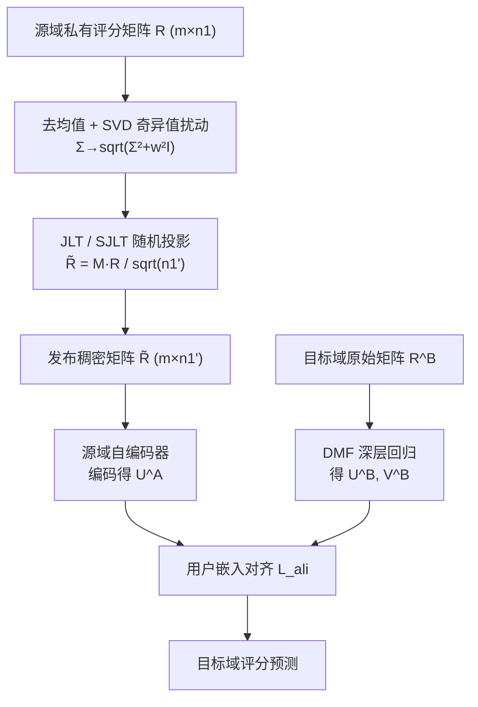
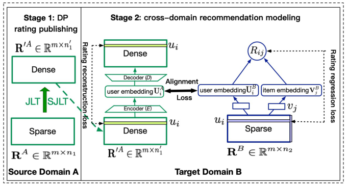

# Differential Private Knowledge Transfer for Privacy-Preserving Cross-Domain Recommendation (面向隐私保护跨域推荐的差分隐私知识迁移)

- **会议/期刊**: WWW 2022 (The Web Conference)
- **作者与机构**: Chaochao Chen, Huiwen Wu, Jiajie Su, Lingjuan Lyu, Xiaolin Zheng, Li Wang（浙江大学 / 蚂蚁集团 / Sony AI / JZTData）
- **推荐链路定位**: 召回（跨域用户表征迁移）
- **研究方向**: 跨域与多场景推荐 / 去偏公平与可信隐私
- **论文原文**: [https://arxiv.org/abs/2202.04893v1](https://arxiv.org/abs/2202.04893v1)
- **开源代码**: 暂未开源

## TL;DR (1分钟核心速览)

现有跨域推荐默认源域评分矩阵可明文"跨桥迁移"，忽略了两域数据不可共享的合规约束。本文提出两阶段框架 PriCDR：第一阶段用基于 Johnson-Lindenstrauss 变换（JLT）与其稀疏感知变体 SJLT 的差分隐私机制发布源域评分矩阵（先奇异值扰动、再随机降维投影）；第二阶段用异构模型 HeteroCDR（自编码器建模稠密发布矩阵 + DNN 建模目标域原始矩阵 + 用户嵌入对齐）完成迁移。在 Amazon / Douban 的 6 组迁移任务、留一法+99 负采样协议下，HR@5 相对最强基线 ETL 提升 7.6%~11.7%，且优于所有明文 CDR 模型。

## Background & Motivation (背景与核心矛盾)

- **主流范式**: CoNet、DDTCDR、DARec、ETL 等通过交叉连接、对偶迁移、对抗/等价变换等"桥"结构，在共享用户（或共享物品）上对齐两域表征以缓解目标域稀疏。
- **前人局限**: 其一，这些模型默认源域评分为双方可见的明文，与"两域属于不同业务方、数据不得出域"的现实相悖；其二，现有隐私推荐工作或面向单用户（2C）场景，或面向社交/位置等定制场景（2B），且部分依赖半诚实服务器或同态加密，仅能处理数百用户规模。
- **核心洞察 (Key Insight)**: 若发布矩阵只扰动奇异值、保留奇异向量，则既破坏"某用户是否评过某物品"的可辨识性（隐私），又保留用户间余弦相似度结构（协同过滤可用性），即矩阵补全中的 restricted isometry property（RIP）。
- **本文切入点**: 把"隐私发布"与"跨域建模"解耦成两阶段——源域只交出经 DP 处理的稠密矩阵，目标域在异构数据上自建 CDR 模型。

## Method (核心方法设计)

### 1. 整体框架 (Overall Architecture)

PriCDR 由两阶段串成闭环。阶段一（源域侧）：对源域评分矩阵 $\mathbf{R}\in\mathbb{R}^{m\times n_1}$先去均值、做 SVD，将奇异值$\sigma_i$替换为$\sqrt{\sigma_i^2+w^2}$注入隐私噪声量级$w$，再用 JLT（高斯稠密阵）或 SJLT（稀疏子高斯阵 × 归一化 Hadamard 阵 × 随机对角符号阵）把$n_1$维物品空间投影到$n_1'$维，得到可对外发布的稠密矩阵$\tilde{\mathbf{R}}\in\mathbb{R}^{m\times n_1'}$。阶段二（目标域侧）：发布矩阵因已降维、稠密且被扰动，与目标域原始稀疏矩阵$\mathbf{R}^B$ 异构，故用自编码器重建前者、用 DMF 式深层网络回归后者，并将两条通路的用户嵌入拉近完成知识迁移。

<figure class="paper-figure" markdown="span">
  <figcaption>图1：PriCDR 框架。</figcaption>
</figure>

### 2. 关键设计拆解 (Key Designs)

1. **JLT 差分隐私评分发布（保隐私 + 保相似度）**：痛点是把评分矩阵直接交出去等于泄露"用户-物品"存在性。做法是只扰动谱：令奇异值变为 $\sqrt{\sigma_i^2+w^2}$（$w=\sqrt{32n_1'\ln(2/\delta)/\epsilon}\ln(4n_1'/\delta)$），奇异向量$\mathbf{U},\mathbf{V}$原样保留，再乘高斯阵$\mathbf{M}\sim\mathcal{N}(\mathbf{0},\mathbf{1}_{n_1'\times n_1})$得$\tilde{\mathbf{R}}=\frac{1}{\sqrt{n_1'}}\mathbf{M}\mathbf{R}$。直觉：评分语义主要由主子空间承载，保留方向、抬高谱即可让"改一条评分"的输出分布几乎不可分辨，同时维持用户向量夹角近似不变。
2. **SJLT（稀疏感知 + 复杂度降阶）**：JLT 的稠密矩阵乘法 $O(dnm)$且对稀疏输入能量集中（$\ell_\infty$范数过大）导致效用差。SJLT 把$\mathbf{M}=\mathbf{P}\mathbf{H}\mathbf{D}$分解，$\mathbf{P}$以概率$q$取非零子高斯样本、$\mathbf{H}$为归一化 Hadamard 阵、$\mathbf{D}$为$\pm1$对角阵。关键性质是$\|\mathbf{H}\mathbf{D}\mathbf{x}\|_2=\|\mathbf{x}\|_2$但$\|\mathbf{H}\mathbf{D}\mathbf{x}\|_\infty$被压到$O(\sqrt{\ln(mn_1)/n_1})$，即预条件把稀疏向量的能量"抹平"，使稀疏扰动阵也能满足 RIP，并把复杂度降到$O(d\log d\, m)$。
3. **HeteroCDR 异构建模与训练目标**：已有 CDR 框架多为对称同构，无法吃"发布矩阵稠密、目标矩阵稀疏"的异构输入。本文对发布侧用自编码器重建 $\mathcal{L}_{rec}=\sum_i\mathcal{F}(\tilde{\mathbf{R}}^A_i,\hat{\tilde{\mathbf{R}}}^A_i)$，目标侧用带余弦打分的深层回归$\mathcal{L}_{reg}$（交叉熵形式），再加用户嵌入对齐$\mathcal{L}_{ali}=\sum_i\|\mathbf{U}^A_i-\mathbf{U}^B_i\|^2$，总损失$\mathcal{L}=\mathcal{L}_{rec}+\mathcal{L}_{reg}+\alpha\mathcal{L}_{ali}$，$\alpha=100$。对齐项是唯一显式"桥"，其约束强度直接决定迁移收益；训练无需负采样，推理仅一次前向内积。

## Experimental Setup & Evaluation Protocol (实验设置与评估协议)

- **数据集与预处理**: Amazon（Movie / Book / Music）与 Douban（Book / Music / Movie），评分二值化（$\ge 3$为正）、保留交互数$\ge 5$ 的 `5-core` 过滤，并仅取跨域共同用户。具体规模统计置于原文附录 D，正文未列出具体数值。

| 数据集 | #Users | #Items | #Interactions | 稀疏度/密度 | 特征/场景说明 |
| :--- | :---: | :---: | :---: | :---: | :--- |
| Amazon | 见附录 D | 见附录 D | 见附录 D | 高稀疏 | 三域 6 组迁移（Music→Book、Movie→Music、Movie→Book 等） |
| Douban | 见附录 D | 见附录 D | 见附录 D | 高稀疏 | 三域 6 组迁移（Book→Music、Movie→Book、Movie→Music 等） |

- **数据划分与防穿越 (Splitting Strategy)**: `Leave-One-Out`——每用户随机留 1 个验证项、1 个测试项。
- **排名评测协议 (Ranking Protocol)**: `Sampled Ranking`，每正样本配 **99 个随机未交互负样本**（正负比 1:99，候选池 100），报告 HR@5/10、NDCG@5/10、MRR@5/10。注意该协议未做全库 Full-Ranking。
- **对比基线与超参设置**: 单域基线 BPR、NeuMF、DMF；跨域基线 CoNet、DDTCDR、DARec、ETL；另有对称消融版 PriCDR-SYM。网络为两层 MLP（500-200），嵌入维度 $h=200$，Adam 优化，batch 128，$\delta=1/n$，$\epsilon\in\{0.5,\dots,64\}$，子空间维度$n_1'\in\{100,\dots,800\}$，SJLT 稀疏系数$sp\in\{0.1,\dots,0.9\}$；5 次随机实验取均值，未报告显著性检验。

## Key Experimental Results (实验关键数据)

### 1. 主实验对比 (Main Results)

| 任务 / 模型 | HR@5 | NDCG@5 | MRR@5 | HR@10 | NDCG@10 |
| :--- | :---: | :---: | :---: | :---: | :---: |
| **(Amazon) Music→Book** | | | | | |
| BPR | 0.2633 | 0.2090 | 0.1827 | 0.3824 | 0.2580 |
| NeuMF | 0.2760 | 0.2271 | 0.2086 | 0.4015 | 0.2577 |
| DMF | 0.3075 | 0.2543 | 0.2367 | 0.4312 | 0.2713 |
| CoNet | 0.3743 | 0.3157 | 0.3063 | 0.4831 | 0.3352 |
| DDTCDR | 0.4067 | 0.3403 | 0.3241 | 0.5054 | 0.3690 |
| DARec | 0.4741 | 0.3758 | 0.3420 | 0.5702 | 0.4098 |
| ETL | 0.4769 | 0.3801 | 0.3462 | 0.5877 | 0.4153 |
| PriCDR-J | 0.4898 | 0.3984 | 0.3648 | 0.5853 | 0.4292 |
| **PriCDR-S (Ours)** | **0.5203** | **0.4264** | **0.3964** | **0.6181** | **0.4580** |
| Improv.% vs ETL | +9.1% | +12.2% | +14.5% | +5.2% | +10.3% |
| **(Douban) Movie→Book** | | | | | |
| BPR | 0.1827 | 0.1132 | 0.1091 | 0.3436 | 0.1590 |
| NeuMF | 0.1989 | 0.1279 | 0.1124 | 0.3640 | 0.1748 |
| DMF | 0.2376 | 0.1438 | 0.1321 | 0.3952 | 0.1940 |
| CoNet | 0.2736 | 0.1724 | 0.1533 | 0.4407 | 0.2330 |
| DDTCDR | 0.2984 | 0.1803 | 0.1776 | 0.4699 | 0.2487 |
| DARec | 0.3331 | 0.2285 | 0.2109 | 0.4970 | 0.2789 |
| ETL | 0.3850 | 0.2705 | 0.2348 | 0.5247 | 0.3157 |
| PriCDR-J | 0.3926 | 0.2788 | 0.2421 | 0.5349 | 0.3248 |
| **PriCDR-S (Ours)** | **0.4301** | **0.3090** | **0.2702** | **0.5686** | **0.3503** |
| Improv.% vs ETL | +11.7% | +14.2% | +15.1% | +8.4% | +11.0% |

其余迁移任务的 HR@5：Amazon Movie→Book 0.5516 vs ETL 0.5124（+7.6%）；Amazon Movie→Music 0.5733 vs 0.5308（+8.0%）；Douban Book→Music 0.3701 vs 0.3241（+14.2%）；Douban Movie→Music 0.3801 vs 0.3383（+12.4%）。

### 2. 消融实验 (Ablation Study)

| 变体 / 任务 | Amazon Music→Book (HR@5 / NDCG@5) | Amazon Movie→Music (HR@5) | Douban Movie→Book (HR@5 / NDCG@5) | Douban Book→Music (HR@5) |
| :--- | :---: | :---: | :---: | :---: |
| PriCDR-SYM（对称建模 + JLT） | 0.4360 / 0.3467 | 0.4933 | 0.3742 / 0.2642 | 0.3225 |
| PriCDR-J（异构 + JLT） | 0.4898 / 0.3984 | 0.5399 | 0.3926 / 0.2788 | 0.3290 |
| **PriCDR-S（异构 + SJLT）** | **0.5203 / 0.4264** | **0.5733** | **0.4301 / 0.3090** | **0.3701** |

### 3. 关键实验发现 (Key Findings)

1. **同构→异构是最大增量**：仅把对称 CDR 换成 HeteroCDR（PriCDR-SYM→PriCDR-J），Amazon Music→Book HR@5 从 0.4360 升至 0.4898（+12.3%），Douban Movie→Book 从 0.3742 升至 0.3926；说明发布矩阵的"稠密+低维"特性必须用重建类网络而非共享嵌入直接对齐。
2. **稀疏感知带来第二轮增益**：JLT→SJLT 在 Douban Book→Music 上 HR@5 提升 12.5%（0.3290→0.3701），远超 Amazon 上的 6.2%，且在源域降采样到 $sd=1/8$ 时 SJLT 曲线下降明显更缓——与 Lemma 5.5 的"能量抹平"理论一致。
3. **隐私预算存在饱和拐点**：$\epsilon$从 0.5 增至 32 性能单调上升后趋于平稳（Amazon），Douban 拐点提前到$\epsilon=2$；子空间维度$n_1'$呈钟形，最佳值 Amazon 400 / Douban 500；$sp$ 过小（0.1）信息不足、过大（0.9）引入冗余，最优 0.5–0.7。这意味着隐私-效用并非无限互斥，中等预算即可逼近明文上限。

## Highlights & Limitations (亮点、对比与审稿批判)

- **与代表作对比 (vs. Prior Work)**: 相较 CoNet/DDTCDR/ETL 依赖明文双向传输，本文将跨域传输物化为"可公开的 DP 稠密矩阵"，从根本上改变威胁模型；相较经典 DP-MF（如 Hua 等对潜在因子加噪）与同态加密方案（仅支持数百用户），本文用 JLT 降维把计算量降到 $O(d\log d\,m)$ 并保持矩阵级 RIP 保证，具备规模化可能。
- **可迁移亮点**: (1) "只扰动奇异值、保留奇异向量"的谱式加噪，可作为任何需要共享用户表征（如联邦/多业务方）场景的通用脱敏算子；(2) 用随机 Hadamard 预条件把稀疏向量能量抹平，可迁移到稀疏特征降维与隐私草图（sketch）构建。
- **审稿级局限批判**: (1) 评估仅为 1:99 采样的 100 候选排序，缺乏全库 Full-Ranking，且只报告 5 次均值、无显著性检验，提升幅度（约 +0.02~0.05 绝对值）的统计稳健性存疑；(2) 假设两域用户集完全重叠、仅有评分信息，无侧信息与用户冷启动设定，现实 CDR 中非重叠用户占多数时对齐项 $\mathcal{L}_{ali}$直接失效；此外$\epsilon$、$n_1'$、$sp$ 三参数在两组数据上最优值不同，跨数据集需重调。

## Rating (四维评分)

- **方法创新性 (Novelty)**: ⭐⭐⭐⭐ （把 JLT/SJLT 首次系统用于跨域评分矩阵发布，并给出用户级与矩阵级 DP 证明及 RIP 效用上界，理论闭环较完整，但两阶段拼装思路本身不算颠覆）
- **评估协议与实验扎实度 (Protocol & Experiments)**: ⭐⭐⭐ （6 组迁移任务 + 7 个基线 + 对称消融较齐全，但 1:99 采样排序、无全库排序与显著性检验削弱了结论强度，数据集统计与部分结果下放附录）
- **写作与数学规范度 (Clarity & Rigor)**: ⭐⭐⭐⭐ （两阶段算法伪代码清晰，隐私/效用定理有条件、有证明路径，符号定义规范；部分定理常数与附录依赖较重）
- **工业落地与复现价值 (Industrial & Practical Value)**: ⭐⭐⭐ （契合跨业务方数据不出域的真实需求，SJLT 的 $O(d\log d\,m)$ 复杂度利于规模化，但强依赖用户集重叠假设、无开源代码，且加噪后矩阵稠密化会抬高存储与传输成本）

