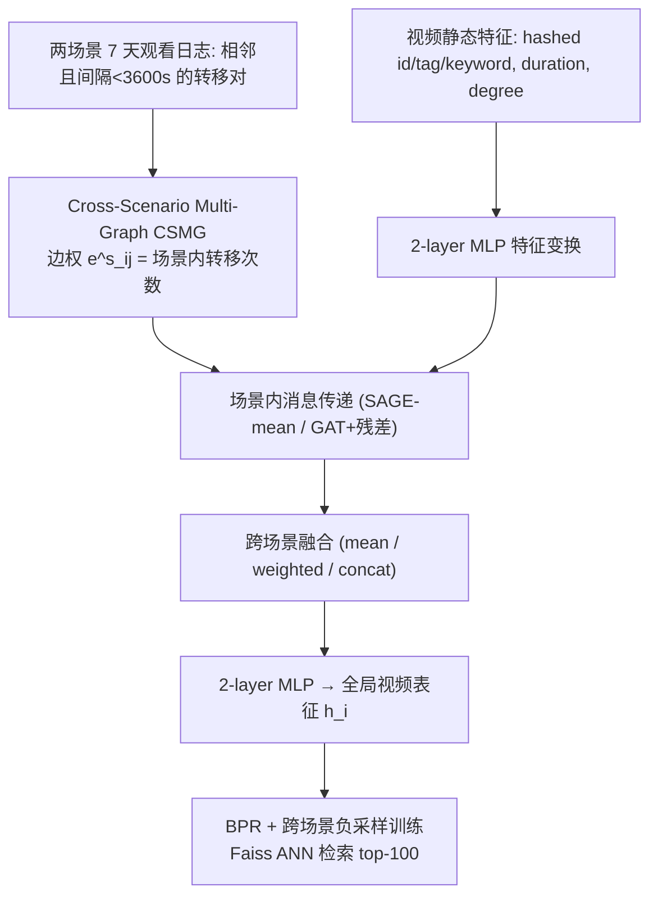
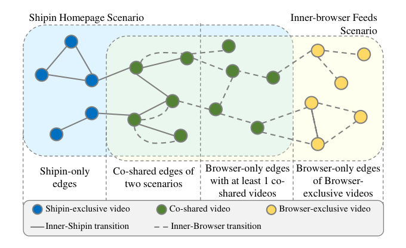
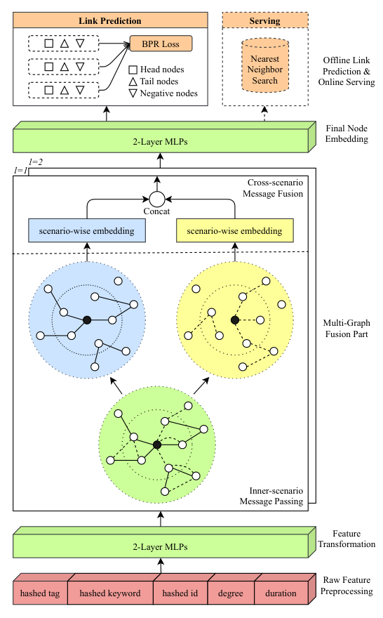

# Multi-Graph based Multi-Scenario Recommendation in Large-scale Online Video Services (大规模在线视频服务中基于多图的多场景推荐)

- **会议/期刊**: WWW 2022 Companion (Graph Learning Workshop)
- **作者与机构**: Fan Zhang, Qiuying Peng, Yulin Wu, Zheng Pan, Yue Qi (OPPO 研究院/AI&数据工程系统), Rong Zeng, Da Lin (ByteDance, 实习期间完成)
- **推荐链路定位**: 召回 (i2i 向量检索，Faiss ANN)
- **研究方向**: 跨域与多场景推荐 / 图神经网络推荐
- **论文原文**: [https://arxiv.org/abs/2205.02446v1](https://arxiv.org/abs/2205.02446v1)
- **开源代码**: 暂未开源

## TL;DR (1分钟核心速览)

两场景（Shipin Homepage 与 Browser Feeds）各自独立训练模型会放大曝光偏差与冷启动：目标场景只循环推荐已曝光的视频。本文不改双塔、不走跨域迁移，而是把两场景用户 1 小时内的视频转移边合并成**有向带权多图 CSMG**（边权=场景内转移次数），再用 **MGFN**（场景内 SAGE/GAT 消息传递 + 跨场景 concat 融合 + 度分布 $3/4$ 次幂跨场景负采样）学习全局 i2i 表征。在 Faiss 返回的 top-100 候选上，离线 p@100 相对 DataConcat 提升 3.86%(商1)/5.00%(商2)；线上 10 天 A/B 新用户 CTR +0.63%、VV +0.71%，跨场景视频观看数 +116%、冷视频激活 +25%。

## Background & Motivation (背景与核心矛盾)

- **主流范式**: 工业视频推荐普遍用 item-item 转移图 + GraphSAGE/GAT 做召回（PinSAGE、EGES 路线），但每个业务场景由独立团队单独训练、单独部署。
- **前人局限**: ① **曝光偏差**：正样本只来自系统已曝光视频，迭代数月后两场景各自向自身历史偏好加速收敛，跨场景模型互不适用；② **冷启动**：视频在两个 App 共享同一内容库与特征，但一个场景中的冷门视频在另一场景可能正热门，独立建模无法利用。
- **核心洞察 (Key Insight)**: 跨域迁移的三条常规路径在此均失效——特征对齐无意义（特征本就同源）、标签对齐会丢域差异、多任务/互学习不可行（两场景在线系统物理隔离，且法律禁止跨 App 传递用户级数据）。因此唯一可行通道是 **item 级全局表征**，而 item 级迁移的天然载体就是转移图。
- **本文切入点**: 用多图把"同一批视频节点 + 多类场景边"编码进一张图，让场景变体信息只体现在边属性上，从而在召回阶段拓宽候选池、把源场景的观看记录"回灌"给目标场景。

## Method (核心方法设计)

### 1. 整体框架 (Overall Architecture)

离线按 7 天滑动窗口从两侧日志构建 CSMG：过滤重复回传记录、剔除无注册信息的用户/视频、只保留完播率 >3% 的观看；随后把每条用户观看序列按时间排序，取相邻且间隔 <3600 s 的 $(v_j, v_{j+1})$作为一条转移边并累加权重。MGFN 先用 2 层 MLP 把 hashed keyword/tag/id、时长、度数投到$d_0$维；再对每个场景子图$G_s$做$L$层场景内消息传递，输出$\{h^{(L)}_{i,s}\}$；然后跨场景 concat 融合并过一层 MLP 得最终$\boldsymbol{h}_i$；训练用 BPR + 跨场景负采样，推理把$\boldsymbol{h}_i$ 灌入 Faiss，线上用最近 20 个观看视频各取 15 个最近邻（共 300 候选）去重后送 top-100 进精排。

### 2. 关键设计拆解 (Key Designs)

1. **CSMG：把"场景差异"压到边属性上**：若把两场景数据直接拼成一张同构边图（DataConcat），源场景的转移模式会污染目标场景分布。CSMG 只保留一套视频节点，用边 $e^{s}_{ij}$（场景$s$中$v_i \to v_j$ 的转移计数）区分来源。四类边中，**Browser-only 但至少一端为共现视频**的边占 71.93%（26.89M/37.38M），这类边的两端在 Shipin 已曝光但该转移未被 Shipin 捕获——正是消息传递能补全的"缺失共现"，从而在嵌入空间缩短二者的距离；纯 Browser 独有边（24.02%）通过多跳邻域扩张感受野，co-shared 边（4.05%）则负责跨场景表征对齐。

<figure class="paper-figure" markdown="span">
  <figcaption>图 2：CSMG 的边组成</figcaption>
</figure>

2. **双粒度消息传递 + 跨场景融合**：场景内层按边权缩放邻居消息（SAGE 原型）：
$h^{(l)}_{i,s} = W^{s}_{\text{self},l} h^{(l-1)}_{i} + \frac{1}{|\mathcal{V}_s(i)|}\sum_{j\in\mathcal{V}_s(i)} W^{s}_{\text{nb},l}\, e^{s}_{ji}\, h^{(l-1)}_{j}$GAT 原型额外引入注意力$\alpha^{l,s}_{ji}=\text{softmax}_j\, a(\cdot)$，且必须加**残差/跳连**——作者实测纯 GAT 严重欠拟合，说明节点自身特征信号本就很强，邻居聚合应作残差块而非替换。跨场景层用 concat 而非 mean/weighted：$h^{(l)}_{i} = h^{(l)}_{i,s=1}\Vert\cdots\Vert h^{(l)}_{i,s=S}$，保留各场景特有维度，避免平均池化抹平域差异。

<figure class="paper-figure" markdown="span">
  <figcaption>图 3：MGFN 的整体架构。</figcaption>
</figure>

3. **跨场景负采样与训练目标**：单场景度负采样在其他场景等价于随机采样，会把负样本压回热点区。本文按全场景度之和的 $3/4$ 次幂采样：
$P(v_n) \propto \Big(\sum_{s\in\mathcal{S}} \deg_s(v_n)\Big)^{3/4}$BPR 损失$\mathcal{L} = \frac{1}{b_s}\sum_{n=1}^{b_s}\log\big(1+\exp(\boldsymbol{h}_{v_h}\cdot\boldsymbol{h}_{v_n} - \boldsymbol{h}_{v_h}\cdot\boldsymbol{h}_{v_t})\big)$，每个正样本配 5 个负样本。$3/4$ 次幂在抑制热门过平滑与保留热门作为合理负例之间取折中；作者也试过 hard negative（按平均观看时长反比采样），线上收益有限。推理零额外开销：仅一次 ANN 查询，模型日更训练。

## Experimental Setup & Evaluation Protocol (实验设置与评估协议)

- **数据集与预处理**: 两个真实商用 App 的私有数据，分别取 2021 年 6 月与 7 月两个不重叠 7 天窗口；过滤完播率 ≤3% 的记录、去重回传、剔除无注册用户/视频。

| 数据集 | #Nodes | #Edges | Shipin 边 | Browser 边 | 说明 |
| :--- | :---: | :---: | :---: | :---: | :--- |
| Commercial 1 | 818,551 | 94,714,404 | 47,408,383 | 37,382,509 | 2021-06 窗口 |
| Commercial 2 | 796,985 | 73,210,932 | 47,306,021 | 35,828,423 | 2021-07 窗口 |

- **数据划分与防穿越 (Splitting Strategy)**: **全局时间戳切分**——用 7 天窗口建图训练，以次日（next-day）Shipin Homepage 观看记录作验证集，评估对象限定为训练集与验证集均有观看的用户。
- **排名评测协议 (Ranking Protocol)**: **Sampled/Restricted Ranking**（非全库）：离线复用与线上一致的 Faiss 召回策略，对每个用户最近 20 个观看视频各取 15 最近邻，去重后生成 top-100，再算 $\text{precision@100}$与$\text{recall@100}$。这是工业可复现的候选集内排序，弱于 Full-Ranking，但保证线上线下一致。
- **对比基线与超参设置**: 单场景 SAGE-Browser / SAGE-Shipin / GAT-Shipin（标 `*`，因 SAGE-Shipin 正在线上 A/B、训练集已含其推荐回声而不可直接比较），多场景 DataConcat、MGFN-mean、MGFN-weighted、MGFN-GAT。Dropout 离线最优取 0.0，Adam 优化，无交叉验证。

## Key Experimental Results (实验关键数据)

### 1. 主实验对比 (Main Results)

| 类别 | 模型 | 商1 p@100 | 商1 r@100 | 商2 p@100 | 商2 r@100 |
| :--- | :--- | :---: | :---: | :---: | :---: |
| 单场景 | SAGE-Browser | 0.001402 | 0.01349 | 0.001280 | 0.01603 |
| 单场景 | SAGE-Shipin `*` | 0.01561 | 0.1442 | 0.01600 | 0.1559 |
| 单场景 | GAT-Shipin `*` | 0.01575 | 0.1492 | 0.01522 | 0.1478 |
| 多场景 | DataConcat | 0.01398 | 0.1330 | 0.01359 | 0.1304 |
| 多场景 | MGFN-mean | 0.01319 | 0.1227 | 0.01423 | 0.1357 |
| 多场景 | MGFN-weighted | 0.01311 | 0.1242 | 0.01372 | 0.1323 |
| 多场景 | MGFN-GAT | 0.01429 | 0.1318 | 0.01362 | 0.1327 |
| 多场景 | **MGFN** | **0.01452** | **0.1339** | **0.01427** | **0.1382** |
| — | **Improv. vs DataConcat** | **+3.86%** | **+0.68%** | **+5.00%** | **+5.98%** |

线上 10 天 A/B（三桶 30%/35%/35%，数值相对 base）：

| 模型 | 用户群 | CTR | VV | VWT |
| :--- | :--- | :---: | :---: | :---: |
| DataConcat | 全体 / 活跃 / 低活跃 | +0.35% / +0.32% / +0.57% | +0.29% / +0.34% / +0.29% | −0.27% / −0.26% / +0.13% |
| **MGFN** | 全体 / 活跃 / **低活跃(含新用户)** | +0.06% / +0.00% / **+0.63%** | +0.47% / +0.54% / **+0.71%** | −0.01% / +0.04% / +0.31% |
| SAGE-Shipin | 全体 / 活跃 / 低活跃 | +0.21% / +0.14% / +0.87% | +0.80% / +0.87% / +1.00% | +0.02% / +0.05% / +0.49% |

### 2. 消融实验 (Ablation Study)

| 消融维度 | 变体 | 商1 p@100 | 商2 p@100 | 结论 |
| :--- | :--- | :---: | :---: | :--- |
| 融合算子 | concat (MGFN) | **0.01452** | **0.01427** | concat 保留域特有维度最优 |
| 融合算子 | mean (MGFN-mean) | 0.01319 | 0.01423 | 平均池化抹平场景差异 |
| 融合算子 | weighted | 0.01311 | 0.01372 | 可学习权重仍弱于拼接 |
| 卷积模块 | SAGE (MGFN) | **0.01452** | **0.01427** | 均值聚合泛化更好 |
| 卷积模块 | GAT+残差 (MGFN-GAT) | 0.01429 | 0.01362 | 注意力在已有交互上轻微过拟合 |
| 负采样 | 跨场景 (本文) | **0.01452** | — | r@100 = 0.1339 |
| 负采样 | 两场景随机 | 0.01054 | — | r@100 = 0.1023（−23.6%） |
| 负采样 | 仅 Browser 度采样 | 0.002478 | — | r@100 = 0.0171 |
| 负采样 | 仅 Shipin 度采样 | 0.000131 | — | 等同于其他场景随机采样，几乎崩塌 |

### 3. 关键实验发现 (Key Findings)

1. **单场景离线指标高是"回声"而非能力强**：SAGE-Shipin 的 p@100（0.01561/0.01600）高于 MGFN，但作者明确指出该模型正在线上 A/B，训练集已被其推荐结果污染，属于测不出来的天花板；SAGE-Browser 跨场景迁移到 Shipin 直接跌到 0.001402（约为 Shipin 自训的 1/11），定量证实了曝光偏差导致的行为分布鸿沟。
2. **跨场景负采样是最大杠杆，而非模型结构**：从两场景随机负采样（0.01054）换到跨场景度采样（0.01452）带来 **+37.8%** p@100，远超 concat vs mean（+10.1%）与 SAGE vs GAT（+1.6%）的组间差异；而任何单场景度采样都因在另一场景退化为近随机采样而崩盘（Shipin 侧 0.000131）。
3. **线上价值集中在低活跃/新用户与冷视频**：MGFN 在低活跃用户上 CTR/VV 分别 +0.63%/+0.71%（DataConcat 仅 +0.57%/+0.29%），且上线后日均跨场景视频观看由 86,621 升至 185,681（**+116%**）、日均独有跨场景视频数由 10,101 升至 12,628（**+25%**），即在不改 base 的前提下把 Browser 独有冷视频重新灌回 Shipin，形成跨场景良性循环。

## Highlights & Limitations (亮点、对比与审稿批判)

- **与代表作对比 (vs. Prior Work)**: 与 DMGE（同期多图多域工作）任务目标不同——DMGE 视为多任务学习、用多目标梯度下降追求互惠指标，本文则面向"目标场景冷启动/曝光偏差"，用跨场景负采样 + 真实线上 A/B 验证；与 CATN/DADNN 等跨域迁移方法相比，本文放弃特征/标签对齐与域适应（被视为不可行或不合法），改为纯 item 级图结构融合，规避跨 App 用户数据流动的合规风险。
- **可迁移亮点**: ① "边属性承载域标签"的多图范式极易扩展到 3+ 场景，只需新增边权维度而非新增子模型；② 全场景度之和的 $3/4$ 次幂负采样是一个即插即用、几乎零成本的召回增强技巧，可直接搬到任何多源 i2i 图。
- **审稿级局限批判**: ① **评估协议偏弱**：top-100 只从 20×15=300 的 ANN 候选池中产生，p@100 的绝对值很低（0.014），缺少 Full-Ranking 或与采样式指标的对照，且无显著性检验与多随机种子方差；② **线上对照组设置含混**：Phase I/II 分期比较而非同期同桶对照，MGFN 在全体/活跃用户上甚至弱于 SAGE-Shipin（+0.06% vs +0.21% CTR），作者未给出"为何只在低活跃用户上赢"的机制解释；③ 图日更、无在线学习，实时兴趣漂移与时变图建模留作未来工作。

## Rating (四维评分)

- **方法创新性 (Novelty)**: ⭐⭐⭐⭐ （CSMG"共享节点 + 边属性区分场景"的建模够巧，跨场景负采样有清晰的物理直觉；但消息传递与 BPR 均为成熟组件，属组合式创新）
- **评估协议与实验扎实度 (Protocol & Experiments)**: ⭐⭐⭐ （真实商用数据 + 线上 A/B + 冷视频激活指标难得，但离线为受限候选集指标、缺显著性检验，线上分期对照设计不严谨）
- **写作与数学规范度 (Clarity & Rigor)**: ⭐⭐⭐⭐ （多图定义、四类边的功能解释与表 2 的边占比统计很有说服力；但公式排版与符号统一性一般，无复杂度分析）
- **工业落地与复现价值 (Industrial & Practical Value)**: ⭐⭐⭐⭐⭐ （日更离线图 + Faiss ANN 的部署路径完整，隐私合规约束下的 item 级融合方案对多 App 平台极具参考价值；可惜未开源）

