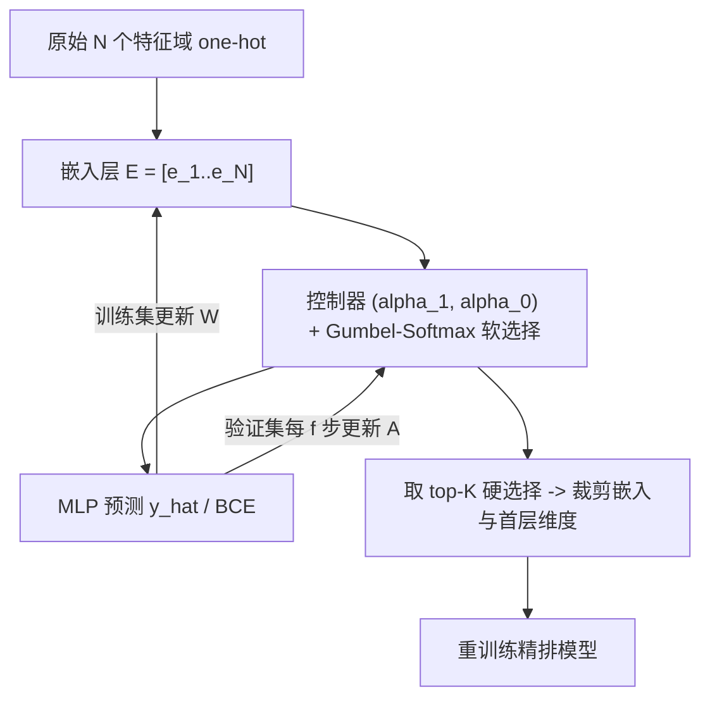
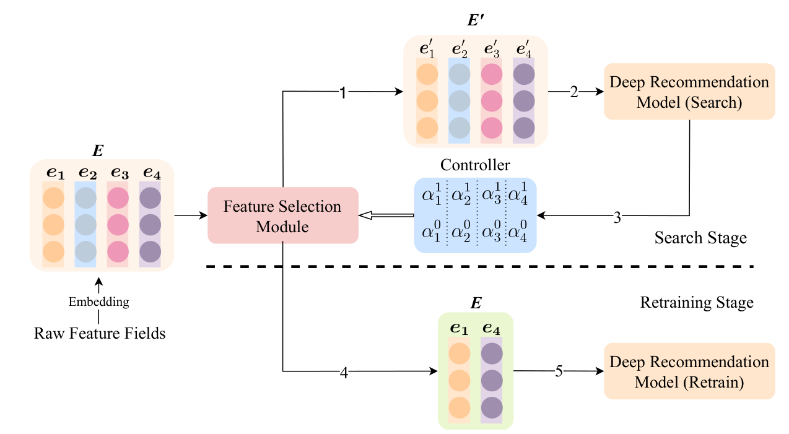

# AutoField: Automating Feature Selection in Deep Recommender Systems (深度推荐系统中的自动化特征选择)

- **会议/期刊**: WWW 2022 (Virtual Event, Lyon)
- **作者与机构**: Yejing Wang, Xiangyu Zhao (香港城市大学, 通讯作者), Tong Xu (中国科学技术大学), Xian Wu (腾讯)
- **推荐链路定位**: 精排（CTR 预估模型的前置特征域筛选，可迁移至召回/粗排的输入侧）
- **研究方向**: CTR 预估与特征交叉 / 工业级自动化架构
- **论文原文**: [https://arxiv.org/abs/2204.09078v1](https://arxiv.org/abs/2204.09078v1)
- **开源代码**: [https://github.com/rixwew/pytorch-fm](https://github.com/rixwew/pytorch-fm) （基于该公开 CTR 库实现，未提供 AutoField 官方独立仓库）

## TL;DR (1分钟核心速览)

深度推荐模型普遍"全量喂特征域"，导致嵌入参数膨胀、推理变慢，且弱特征甚至有害；人工筛选与网格搜索代价高昂。AutoField 把特征域选择建模为 $2^N$ 搜索空间上的可微 NAS 问题：为每个域配一对选择/丢弃概率，用 Gumbel-Softmax 模拟硬采样，并以 DARTS 式双层优化（训练集更新模型、验证集更新控制器）解耦。在 Avazu/Criteo 的 CTR 协议（AUC/Logloss，80/10/10 划分）下，Avazu 丢弃 50% 特征域后 AUC 由 0.7769 升至 0.7773，并带来 4%–17% 的推理时延下降。

## Background & Motivation (背景与核心矛盾)

- **主流范式**: 以 DeepFM/xDeepFM/DCN 为代表的精排模型，把离散域 one-hot 后统一投影为 $d$ 维嵌入再拼接送入 MLP，特征域集合通常由人工经验固定。
- **前人局限**: ①全量输入使嵌入表参数量与推理 FLOPs 随域数线性膨胀，弱域还会引入噪声；②Filter 类方法（PCA/相关性分析）与下游模型解耦，Embedded 类（LASSO/GBDT）又强依赖模型的结构假设，GBDT 在 Avazu 上原始分类器 AUC 仅 0.52，选出的子集反而把 AUC 拉到 0.7467。
- **核心洞察 (Key Insight)**: 特征域选择的本质是在 $2^N$个离散子集上搜索，而每个域的"选/不选"可以用一对概率$(\alpha_n^1,\alpha_n^0)$ 连续松弛；关键在于让"搜索阶段的软加权"与"重训练阶段的硬裁剪"在期望上一致。
- **本文切入点**: 用逐域独立的 Gumbel-Softmax 取代对全部域统一 softmax 的 IDARTS，从而避免全局竞争导致的训练震荡与局部最优。

## Method (核心方法设计)

### 1. 整体框架 (Overall Architecture)

框架分搜索与重训练两阶段。搜索阶段：全部 $N$个域经嵌入层得到$E=[e_1,\dots,e_N]$，控制器输出每对$(\alpha_n^1,\alpha_n^0)$，特征选择模块按软权重缩放嵌入得$E'$送入 MLP 预测$\hat{y}$；每个 mini-batch 用训练集 BCE 更新模型参数$W$，每$f$步用验证集 mini-batch 更新控制器参数$A$。搜索收敛后取$\alpha_n^1$最高的$K$个域做硬选择，裁剪嵌入表并同步把首层 MLP 输入维度由$N\times d$改为$K\times d$，再端到端重训练。整个流程只改变输入侧，因此选择结果可直接迁移到其他精排骨干。

<figure class="paper-figure" markdown="span">
  <figcaption>图 2：框架概览。步骤 1：软特征选择；步骤 2：更新推荐模型；步骤 3：更新控制器；步骤 4：使用训练良好的控制器进行硬特征选择；步骤 5：重新训练推荐模型。</figcaption>
</figure>

### 2. 关键设计拆解 (Key Designs)

1. **逐域概率对控制器 + Gumbel-Max 硬采样**：痛点是对全部域做一次 softmax 会让域之间互相"抢概率"，训练随机性直接扰动最终选择。AutoField 为第 $n$域独立维护$(\alpha_n^1,\alpha_n^0)$，初值$0.5/0.5$，硬选择由$z_n=\text{one\_hot}(\arg\max[\log\alpha_n^0+g_0,\ \log\alpha_n^1+g_1])$采样，$g_j=-\log(-\log u_j)$为 Gumbel 噪声。由于$\mathbb{E}[z_n e_n]=\alpha_n^1 e_n$，硬采样与软加权在期望上等价，这正是消除"搜索—重训练"落差的物理直觉。
2. **温度退火的 Softmax 可微近似**：$\arg\max$不可导，故用$p_{jn}=\frac{\exp((\log\alpha_{jn}+g_j)/\tau)}{\sum_{j\in\{0,1\}}\exp((\log\alpha_{jn}+g_j)/\tau)}$近似，最终软选择写作$e'_n=(p_{1n}\cdot\mathbf{1}+p_{0n}\cdot\mathbf{0})\cdot e_n=p_{1n}e_n$。$\tau=\max(0.01,\,1-0.00005t)$随步数退火：前期$\tau$大、梯度平滑利于探索，后期$\tau\to0.01$使$p_{1n}$ 逼近 0/1，软选择退化为硬选择，进一步压缩训练-推理 gap。
3. **训练目标与双层优化**：总目标为 $\min_{A}\mathcal{L}_{val}(W^*(A),A)\ \text{s.t.}\ W^*(A)=\arg\min_W \mathcal{L}_{train}(W,A^*)$，损失均为 BCE$\mathcal{L}=y\log\hat{y}+(1-y)\log(1-\hat{y})$。$W$与$A$严禁同 batch 联合更新（强耦合会严重过拟合），控制器每$f$步才用验证集更新一次；无负采样环节（CTR 二分类天然有负样本），推理期仅保留$K$个域的嵌入查表，开销随$K/N$ 线性下降。

## Experimental Setup & Evaluation Protocol (实验设置与评估协议)

- **数据集与预处理**（均为 CTR 点击日志，无 `5-core` 过滤；Criteo 的 13 个数值域被离散化为类别域）：

| 数据集 | #Users | #Items | #Interactions | 稀疏度/密度 | 特征/场景说明 |
| :--- | :---: | :---: | :---: | :---: | :--- |
| Avazu | 未披露(匿名) | 未披露 | 40M 点击 | 极高稀疏 | 22 个域，部分匿名；移动广告 CTR |
| Criteo | 未披露(匿名) | 未披露 | 45M 点击 | 极高稀疏 | 26 类别 + 13 数值(转类别) = 39 域；展示广告 CTR |
| MovieLens-1M | 6,040 | 3,706 | 1M 评分 | 4.5% | 仅用于 RQ5 穷举案例，评分>3 记为正 |

- **数据划分与防穿越 (Splitting Strategy)**: Avazu/Criteo 采用 `比例划分` 80% 训练 / 10% 验证 / 10% 测试；验证集专用于控制器更新，天然规避"用测试集选特征"的穿越问题。
- **排名评测协议 (Ranking Protocol)**: 本文不做 Top-N 排序，故**不使用 Full-Ranking 或 Sampled Ranking**；采用 CTR 二分类指标 **AUC↑ / Logloss↓**（0.001 量级差异即视为显著），另记录单 batch 推理时延与重训练总时长。
- **对比基线与超参设置**: 基线含 PCA、LASSO、GBR、GBDT、IDARTS（另一可微 NAS 变体）；骨干统一为 2 层 MLP，嵌入维度 $d=16$，MLP 隐层$[16,8]$，ReLU + Sigmoid，学习率$10^{-4}$，batch 2048，dropout 0.2；公平性上令各基线丢弃与 AutoField 相同（或更少）的域数。迁移实验另接 FM / DeepFM / xDeepFM / IPNN / Wide&Deep / DCN，并以双侧 t 检验$p<0.05$ 标注显著性。

## Key Experimental Results (实验关键数据)

### 1. 主实验对比 (Main Results)

| 选择方法 | Criteo AUC↑ | Criteo Logloss↓ | Avazu AUC↑ | Avazu Logloss↓ | 丢弃域数 (Cri/Ava) |
| :--- | :---: | :---: | :---: | :---: | :---: |
| All Fields (不选择) | 0.8027 | 0.4491 | 0.7769 | 0.3816 | 0 / 0 |
| PCA | 0.7999 | 0.4516 | 0.7751 | 0.3829 | 6 / 11 |
| LASSO | 0.8000 | 0.4514 | 0.7583 | 0.3919 | 5 / 11 |
| GBR | 0.8022 | 0.4497 | 0.7751 | 0.3829 | 6 / 11 |
| GBDT | 0.8010 | 0.4506 | 0.7467 | 0.3967 | 6 / 11 |
| IDARTS (AutoML) | 0.7985 | 0.4518 | 0.7554 | 0.3920 | 不稳定 |
| **AutoField** | **0.8029** | **0.4490** | **0.7773** | **0.3813** | 6 / 11 |
| Improv. vs 最强基线 | +0.09% (vs GBR) | −0.16% | +0.28% (vs GBR/PCA) | −0.42% | — |

### 2. 消融实验 (Ablation Study)

| 变体 (Avazu) | AUC↑ | Logloss↓ | 说明 |
| :--- | :---: | :---: | :--- |
| AL-1 | 0.7769 | 0.3816 | 仅用 $\arg\max$阈值$0.5$判定，不做 top-$K$ 截断 |
| AL-2 | 0.7615 | 0.3883 | 用原始 Softmax 替代 Gumbel-Softmax |
| AL-3 | 0.7554 | 0.3920 | 同时去掉上述两项 |
| **AutoField** | **0.7773** | **0.3813** | 完整模型，稳定丢弃 11 个域 |

### 3. 关键实验发现 (Key Findings)

1. **"砍一半域还能涨点"在 Avazu 上成立**：AutoField 丢弃 11/22 个域后 AUC 0.7773 高于全量 0.7769，而 GBDT 丢同样多域却跌至 0.7467（−3.9%），说明弱域确实带来负迁移，且选择质量比"丢多少"更关键。
2. **Gumbel-Softmax 是稳定性的唯一来源**：AL-2/AL-3 均无法给出稳定子集且 AUC 分别掉 2.0%/2.8%，AL-1 因缺少 top-$K$ 截断退化为"全选"，证实逐域 Gumbel 采样 + 硬选择期望等价性是核心增益点。
3. **选择结果可跨骨干迁移且加速明显**：在 Avazu 上把 AutoField 子集喂给 6 个模型，AUC 全部不降（DeepFM 0.7799→0.7818，$p<0.05$），推理时延下降 3.98%（FM）至 17.02%（Wide&Deep）；$K$的敏感性分析给出$K^*=11$，$K=8$明显欠拟合、$K=14$ 起开始引入冗余域。

## Highlights & Limitations (亮点、对比与审稿批判)

- **与代表作对比 (vs. Prior Work)**: 相比 PCA/LASSO 这类与下游模型解耦或依赖线性假设的 Filter/Embedded 方法，AutoField 的选择信号直接来自精排模型的验证损失；相比同源 DARTS 变体 IDARTS，其差别是把"全局一次 softmax"改为"逐域概率对 + Gumbel-Max"，这是稳定性差异的根因。
- **可迁移亮点**: ①把 Gumbel-Softmax 的退火温度 $\tau=\max(0.01,1-ct)$ 用于任何"离散结构选择"（如特征交叉模板选择、嵌入维度剪枝）；②"训练集更新权重 / 验证集更新控制器"的交替调度，可直接搬到多场景门控网络或专家路由的自动化设计中。
- **审稿级局限批判**: ①增益幅度极小（Criteo AUC +0.0002），主表未报告多次运行的方差与显著性，说服力偏弱；②$K$需人工预设并逐点调参（$K^*=11$ 属数据集特定），未实现"选择数也自动化"；③搜索阶段需完整训练一遍全量模型 + 一次重训练，训练总开销约为普通模型的 2 倍，且仅在小规模 22/39 域上验证，真实工业上千域的扩展性与控制器收敛性未知。

## Rating (四维评分)

- **方法创新性 (Novelty)**: ⭐⭐⭐⭐ （把可微 NAS 的逐域 Gumbel 松弛引入特征域选择，机制清晰但属 DARTS 的直接迁移，理论分析止于期望等价性）
- **评估协议与实验扎实度 (Protocol & Experiments)**: ⭐⭐⭐ （两大数据集 + 6 骨干迁移 + 穷举案例较完整，但缺少多次运行方差、主表增益未做显著性检验，且无 Top-N 排序视角）
- **写作与数学规范度 (Clarity & Rigor)**: ⭐⭐⭐⭐ （从软选择到 Gumbel-Max 再到温度退火的推导链条完整，公式与算法伪代码一一对应）
- **工业落地与复现价值 (Industrial & Practical Value)**: ⭐⭐⭐⭐ （即插即用的输入侧模块，实测推理时延降 4%–17%，但需两倍训练预算且官方未放出 AutoField 独立实现）

