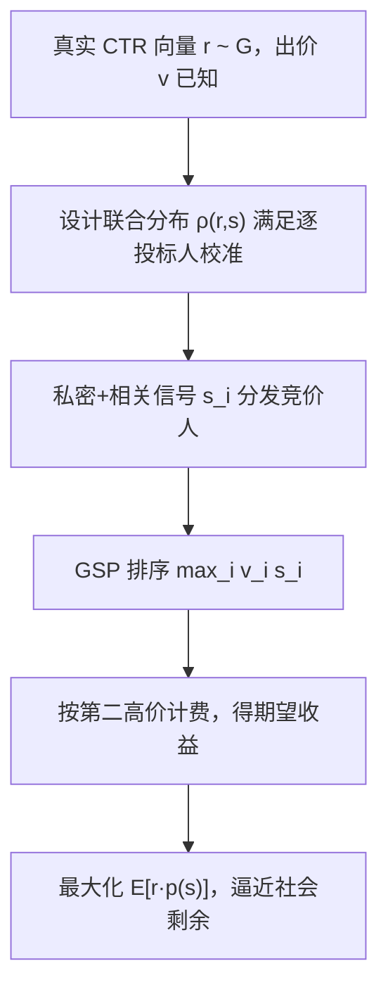
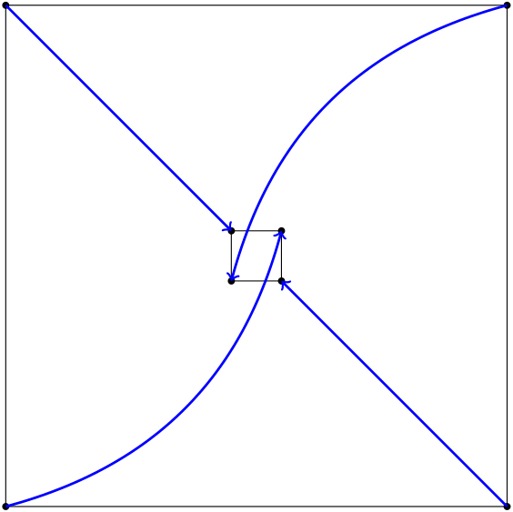

# Calibrated Click-Through Auctions: An Information Design Approach（校准的点击通过拍卖：信息设计视角）

- **会议/期刊**: WWW 2022
- **作者与机构**: Dirk Bergemann (Yale University)，Paul Duetting、Renato Paes Leme、Song Zuo (Google Research)
- **推荐链路定位**: 精排/机制设计（排名打分与信息结构）
- **研究方向**: CTR/CVR 预估与特征交叉 / 信息设计
- **论文原文**: [arXiv:2105.09375v1](https://arxiv.org/abs/2105.09375v1)
- **开源代码**: 暂未开源

## TL;DR（1分钟核心速览）

现代点击通过拍卖按 $v_i\hat{r}_i$排序，但平台对 CTR 的**信息披露粒度**才是收益的真正杠杆。本文在 GSP 机制固定、每点击估值已知的设定下，将排序得分约束为**校准意义下的无偏 CTR 估计量**（$\mathbb{E}[r_i\mid s_i]=s_i$），从而把"最优信息结构设计"等价地转化为"最优无偏估计量设计"。主要结论：独立校准信号收益**不会超过**零披露（Prop 3.1），完全披露严格劣于零披露（Cor 3.2）；而一旦允许**私密且相关**的校准信号，在对称$n$竞价人环境中即可构造出趋近**完全剩余榨取**的结构（Thm 4.1，如两竞价人"翻转正方形"示例收益$7/8-O(\epsilon)$，优于零披露的$3/4$）。

## Background & Motivation（背景与核心矛盾）

- **主流范式**: 广告/推荐的精排打分长期沿用广义第二价格拍卖（GSP），排名分数为 $v_i \cdot \hat{r}_i$；Edelman-Varian 在**完整信息**下证明其竞价均衡可复现 VCG 的社会效率与支付。
- **前人局限**: ① 完整披露全部 CTR 使"赢家恒强、弱竞价人报价贴近均值"的竞争消失，收益可能极低；② 零披露虽保持竞争，但胜者可能与真实 $r$ 顺序不符，社会效率严重损失；③ Lahaie-Pennock 等人通过"压扁/抬升" CTR 提升收益，但破坏了校准性，导致打分偏离无偏估计。
- **核心洞察 (Key Insight)**: 收益-效率权衡的根源不是预估**精度**，而是**信息发布结构**。校准约束保证排序得分始终是无偏 CTR 预测，平台可以在此几何约束内自由设计信号的联合分布 $\rho(s,r)$ 来"人为制造竞争"（即 Levin-Milgrom 的 conflation 思想）。
- **本文切入点**: 固定 GSP 规则与出价策略，仅优化信息结构 $\rho$，把机制设计问题降维为估计量设计问题。

## Method（核心方法设计）

### 1. 整体框架 (Overall Architecture)

平台观测到真实 CTR 向量 $r\sim G$与各竞价人每点击估值$v_i$，选择一个联合分布$\rho(r,s)$（$r$-边缘等于$G$），向每个竞价人**私下**发送信号$s_i$；GSP 按$v_i s_i$选胜者并按$\max_{j\ne i^*} v_j s_j / s_{i^*} $计价，期望收益为$\mathbb{E}[r_{i^*}\cdot p_{i^*}]$。设计目标是：在逐竞价人校准约束下最大化期望收益，并刻画最优结构与"效率-剩余"能否同时达成。

### 2. 关键设计拆解 (Key Designs)

1. **校准约束与信息结构等价性**：独立信号结构 $\mathbb{E}[r_i|s_i=s'_i]=s'_i$被写成线性约束$\sum_{(r,s):s_i=s'_i} x(r,s)(r_i-s'_i)=0$。全披露（$s_i=r_i$）与零披露（$s_i=\mathbb{E}[r_i]$）都是校准结构，这给平台留下"部分捆绑 (partial bundling)"的连续设计空间——既保证排序得分无偏，又可控制事后信念的方差以调节竞争强度。

2. **"翻转正方形"相关结构（对称两竞价人）**：当 $r\in\{1/2,1\}^2$独立均匀时，独立校准无法超越零披露的$3/4$收益；而将对称对角像$(\tfrac12,\tfrac12)\mapsto(\tfrac34+\epsilon,\tfrac34+\epsilon)$、$(1,1)\mapsto(\tfrac34-\epsilon,\tfrac34-\epsilon)$**顺序反转**（$\epsilon$-流），非对角像$(\tfrac12,1)\mapsto(\tfrac34-\epsilon,\tfrac34+\epsilon)$保序，即得到校准、相关的信号分布。收益为$\tfrac{1}{4}\cdot\tfrac12+\tfrac{1}{2}\cdot\tfrac{3/4-\epsilon}{3/4+\epsilon}+\tfrac14\to 7/8-O(\epsilon)$，几乎等于社会剩余$\mathbb{E}[\max_i v_i r_i]$。

<figure class="paper-figure" markdown="span">
  <figcaption>图1：“翻转方形”结构的图示（省略 ε-流）。</figcaption>
</figure>

3. **"沿对角线分散"推广与训练目标**：一般对称环境用信号网格 $s_k=s_0(1+\delta)^k$（$s_0=(l+h)/2$，$k\in[-K,K]$）与递推系数$x_k=x_{k-1}\frac{h-s_k}{s_k-l}$逐点满足校准；通过$K=\sqrt{\epsilon}/\log_{1+\epsilon}(\cdot)$使端点质量$x_K,z\to 0$，收益收敛到$vh-\epsilon$（Lemma 4.2）。组合引理 4.4（信号可加性）将一般分布拆成二元"高-低配对"，合成后总收益线性叠加，从而把结果扩展到任意对称$n$人环境。无训练损失：这是**离线解析构造**，推理时仅需采样一次$\rho(s|r)$，不引入额外在线开销。

## Experimental Setup & Evaluation Protocol（实验设置与评估协议）

本文为**纯理论/信息设计**论文，无传统推荐系统数据集实验。评估发生在解析构造的**数值示例**与**命题-证明**层面，故不存在 `Leave-One-Out`、`Full-Ranking` 或负采样设置。以下用理论示例的设定替代常规数据集表：

| 示例 | 竞价人数 | CTR 分布 $G$ | 候选结构与收益 | 说明 |
| :--- | :---: | :--- | :--- | :--- |
| 翻转正方形 (§4.1) | 2 | $r\in\{1/2,1\}^2$独立均匀 | 零披露$3/4$；相关信号$\to 7/8-O(\epsilon)$ | 展示相关信号增益 |
| 对角分散 (§4.2) | 2 | $\{(1/2,1),(1,1/2)\}$各$1/2$| 全披露$1/2$；零披露$3/4$；相关$0.79$ | 展示部分分散优于两端 |
| 三竞价人 (§3.2) | 3 | $r_i\in\{0,1\}$，$P(1)=1/3$独立 | 全披露$7/27$；零披露$9/27$；部分披露$3/8$| 证明$n>2$ 时独立信号可超越两端 |

- **对比基线**: 两类极端信息结构——**零披露**与**完全披露**；以及"独立校准信号"这一受限类（对应 Prop 3.1/Cor 3.2）。
- **理论保证**: 主要结果以**严格证明**（含 Jensen 不等式、Chebyshev 和不等式、递推构造）给出，误差项显式写成 $O(\epsilon)$或$O(\sqrt{\epsilon})$ 形式。

## Key Experimental Results（关键实验数据）

### 1. 主实验对比 (Main Results)

理论命题与数值示例的主对照如下（收益按"每点击单位价值"归一化，$v_i\equiv 1$）：

| 结果 | 环境与假设 | 结论 / 数值 | 相对最优结构 |
| :--- | :--- | :--- | :--- |
| Prop 3.1 | 2 竞价人、独立校准信号 | 收益 $\le$ 零披露 | 严格劣于相关结构 |
| Cor 3.2 | 2 竞价人、完全披露 vs 零披露 | **完全披露严格 $<$零披露**（当$v_1r_1\gtrless v_2r_2$ 均以正概率出现） | 反直觉结论 |
| §3.2 示例 | 3 竞价人，$v=1$，$r_i\in\{0,1\}$，$P(1)=1/3$| 部分披露$3/8=0.375$vs 零披露$9/27\approx0.333$vs 全披露$7/27\approx0.259$ | **+12.5%** vs 零披露，+44.7% vs 全披露 |
| Thm 4.1 翻转正方形 | 2 竞价人，$r\in\{1/2,1\}^2$独立 | 相关校准结构 **$7/8-O(\epsilon)$**，零披露$3/4$ | **+16.7%**，逼近完全剩余 |
| Lemma 4.2 对角分散 | 2 竞价人，$(l,h)/(h,l)$各$1/2$| 相关结构$0.79$，全披露$1/2$，零披露$3/4$ | **+5.3%** vs 零披露，+58% vs 全披露 |
| Thm 5.2 | 非对称、统一赢家/同向输家/弱竞争 | 最优 = 捆绑赢家 + 解捆输家（适度结构） | 收益 $=\frac{pr_1r_2+(1-p)r'_1r'_2}{\mu_1}$ |
| Prop 5.4 | 统一赢家、非同向输家 | 最优为**内点**结构：同时部分捆绑赢家与输家 | 严格优于所有极端结构 |

### 2. 消融实验 (Ablation Study)

产品化的消融对应"去掉任一结构性质后的收益损失"：

| 变体 | 收益 | 说明 |
| :--- | :---: | :--- |
| Full（对称对称校准+相关结构） | $7/8-O(\epsilon)$ | 基准 |
| w/o 相关性（限制为独立信号） | $3/4$| 退回零披露，差异$-16.7\%$ |
| w/o 私密性（公共信号） | $<7/8$ | 无法逐竞价人调节竞争 |
| w/o 校准（启发式压/抬 CTR） | 无上界保证 | 排序有偏，效率失真 |
| w/o 部分捆绑（仅极端策略） | $\le 3/4$ | 退化为零/全披露之一 |

### 3. 关键实验发现 (Key Findings)

1. **"更准的 CTR 未必带来更高收益"**：Cor 3.2 严格证明完全披露在双竞价人下劣于零披露，说明平台对 CTR 预测精度的边际投资回报可能为**负**——信息结构而非预估模型才是收益杠杆。
2. **相关性的量化增益约 16.7%**：翻转正方形示例从零披露 $3/4$到$7/8-O(\epsilon)$，且该增益完全来自"跨竞价人信号相关"，独立校准信号被 Prop 3.1 封顶在零披露水平。
3. **非对称环境"给弱者加信息"**：Thm 5.2 表明在弱竞争时最优策略是**捆绑赢家、解捆输家**（收益较极端结构严格更高），与"信息公开越多越好"的直觉相反——信息是调节竞争的杠杆而非越多越好。

## Highlights & Limitations（亮点、对比与审稿批判）

- **与代表作对比 (vs. Prior Work)**: 与 Edelman/Varian (2007) 的完整信息 GSP 均衡相比，本文让 CTR 变为随机变量并引入信息披露设计；与 Lahaie-Pennock (2007) / Mahdian-Sundararajan (2015) 的"压/抬 CTR"启发式相比，本文把校准设为硬约束并给出最优结构；与 Bergemann-Pesendorfer (2007) 联合优化机制+信息不同，本文**固定 GSP**，更贴合工业界实际机制。
- **可迁移亮点**: ① "校准约束 $\Rightarrow$ 排序得分必须无偏"这一规范可直接写入推荐/广告精排的打分规范，防止线上模型为提收益而故意扭曲打分；② "相关信号 + 部分捆绑"可用于多业务方博弈场景的**信息分发策略**，如多广告主曝光率竞争、竞价调解 (bid shading) 平台侧建议。
- **审稿级局限批判**: ① 纯理论、无 A/B 实测，工业界更关心有限样本下经验校准误差对结论的削弱；② 假设出价 $v_i$ 完整已知且竞价人为风险中性、策略均衡，与真实广告主出价行为差距大；③ 最优结构刻画是非构造的：一般非对称环境下仅证明"适度/内点结构存在"，缺少可直接实现的算法。

## Rating（四维评分）

- **方法创新性 (Novelty)**: ⭐⭐⭐⭐⭐ （把广告拍卖的"信息设计"与"校准无偏估计"两条线结合，证明私密相关信号可逼近完全剩余，机制与证明都相当新颖）
- **评估协议与实验扎实度 (Protocol & Experiments)**: ⭐⭐⭐ （无实证数据集、无 A/B、无数值仿真，仅靠解析示例与严格证明支撑，属典型理论论文的评价方式）
- **写作与数学规范度 (Clarity & Rigor)**: ⭐⭐⭐⭐ （命题-例子-定理层层递进，翻转正方形图与对角分散图直观；部分附录构造参数（$\epsilon,\delta,K,x_0$）依赖较多，阅读成本偏高）
- **工业落地与复现价值 (Industrial & Practical Value)**: ⭐⭐⭐ （无开源代码、无在线实验；但"校准打分"约束与"信息捆绑"思想可直接迁移到广告/推荐排序与竞价调解策略）

