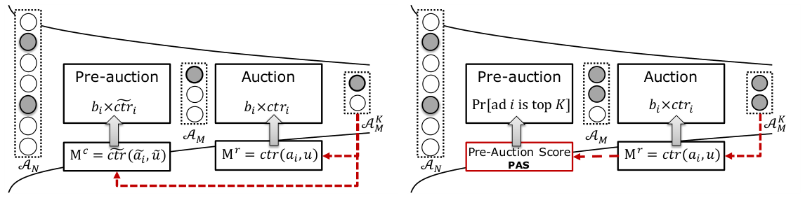
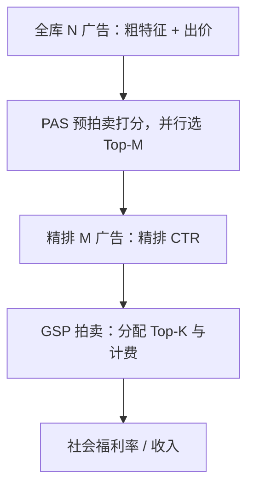

# On Designing a Two-stage Auction for Online Advertising (面向在线广告的两阶段拍卖设计)

- **会议/期刊**: WWW 2022
- **作者与机构**: Yiqing Wang, Xiangyu Liu, Zhenzhe Zheng, Zhilin Zhang, Miao Xu, Chuan Yu, Fan Wu；上海交通大学、阿里巴巴
- **推荐链路定位**: 粗排 / 预拍卖 + 精排拍卖
- **研究方向**: CTR/CVR 预估与特征交叉 / 去偏公平、可信隐私与工业架构
- **论文原文**: [论文原文链接](https://arxiv.org/abs/2111.05555v1)
- **开源代码**: 暂未开源

## TL;DR (1分钟核心速览)

针对两阶段广告拍卖中粗排以 $b\times\tilde{ctr}$ 贪心选 Top-M、会漏掉精排高 CTR 广告的问题，本文把预拍卖建模为随机子集选择，提出广告级 PAS 指标——广告进入最终 Top-K 的概率，并用 Plackett-Luce 学习实现；在 Amazon Books 与工业日志上，SWr@5 相对 GDY 提升 3.31%–4.35%，REVr@5 提升 4.38%–4.91%。

## Background & Motivation (背景与核心矛盾)

- **主流范式**: 工业广告系统常用两阶段拍卖：预拍卖用轻量模型从 $N$个广告选$M$ 个，拍卖阶段用精排 CTR 跑 GSP；单阶段 GSP 对全库精排则无法满足时延。
- **前人局限**: 贪心预拍卖与精排使用同一 $b\times ctr$排序，只在$M=K$时最优；当$M>K$，粗/精排 CTR 差距会误删“粗排低、精排高”的广告，造成社会福利损失。
- **核心洞察 (Key Insight)**: 粗排 CTR 可视为精排 CTR 在部分特征上的条件期望，即 $\tilde{ctr}(\tilde a_i,\tilde u)=E[ctr(a_i,u)\mid \tilde a_i,\tilde u]$；预拍卖应关心广告进入最终 Top-K 的概率，而非粗排 CTR 本身。
- **本文切入点**: 将预拍卖解耦为随机子集选择，第二阶段固定 GSP，并证明该解耦仍保持 IC/IR。

## Method (核心方法设计)

### 1. 整体框架 (Overall Architecture)

输入为一轮拍卖的 $N$个广告及其出价、粗特征与用户特征；预拍卖用 PAS 对每个广告并行打分并选 Top-M，送入精排 CTR 模型，再用 GSP 在$M$内分配 Top-K 并计费。训练时用离线精排模型为全库广告生成$b_i ctr_i$ 标签，PAS 只学习排序概率，不直接回归 CTR。整体将“上游选得准”与“下游拍卖激励相容”解耦。

<figure class="paper-figure" markdown="span">
  <figcaption>图 1：(a) 被广泛采用的两阶段拍卖贪心设计。(b) 我们采用预拍卖得分（PAS）的设计。</figcaption>
</figure>
图 1：贪心两阶段拍卖与 PAS 设计对比（来自原文）。

### 2. 关键设计拆解 (Key Designs)

1. **PAS：把预拍卖从 Top-M 贪心改为 Top-K 覆盖概率**：贪心优化 $b_i\tilde{ctr}_i$，但第二阶段只关心最终 Top-K；当$M>K$时，高精排 CTR 但低粗排 CTR 的广告会被误删。本文转而最大化期望 Recall：$\max_{A_M}\sum_{i\in A_M}\Pr[i\in A_N^K]$，其最优广告级打分为$f_i=\Pr_{ctr}[i\in A_N^K]$，即 PAS。这样每个广告可并行打分，且$f_i$对$b_i$ 单调，预拍卖分配满足单调性。

2. **PAS 的 Plackett-Luce 学习实现**：精确 PAS 需 $ctr$的联合分布，难以在线获得。本文用神经网络输出$f_\theta$作为排序 logit，并按 Plackett-Luce 将$b_i ctr_i$的排序视为样本，最小化交叉熵：$\mathcal{L}=-\frac{1}{|D_f|}\sum_j\sum_i \Pr[i\text{ top1}|y^j]\log\Pr[i\text{ top1}|f_\theta^j]$。标签由离线精排模型对全库生成，避免线上只对$M$ 个广告有精排分的问题。

3. **两阶段解耦与 GSP 兼容**：第二阶段固定 GSP，按 $b_i ctr_i$分配、按临界价计费；只要预拍卖分配对$b_i$单调，整体仍满足 IC/IR。训练负采样为 1:1，线上用$\eta$下采样校准$ctr=p/(p+(1-p)/\eta)$；推理时 PAS 仅需粗特征，精排只跑$M$ 个广告，保持两阶段时延。

## Experimental Setup & Evaluation Protocol (实验设置与评估协议)

- **数据集与预处理**:

| 数据集 | #Users | #Items | #Interactions | 稀疏度/密度 | 特征/场景说明 |
| :--- | :---: | :---: | :---: | :---: | :--- |
| Amazon Books (Public-1/5) | 未单列 | 367K | 603K reviews | 极稀疏 | 用户历史≥5；40k 场拍卖，$N=1000,M=50$；$\eta=0.01/0.05$ |
| Industrial | 未披露 | 700 广告/场 | 30K 拍卖 | 未披露 | 电商两阶段拍卖日志，$N=700,M=30$ |

- **数据划分与防穿越 (Splitting Strategy)**: 按 3:1:1 划分训练/验证/测试，用验证集 SWr@5 早停。
- **排名评测协议 (Ranking Protocol)**: 每场拍卖在全部 $N$ 个候选广告上做 Full-Ranking，指标为 Recall@K、SWr@K、REVr@K，均相对全库真实 Top-K 归一化；训练 CTR 用 1:1 负采样。
- **对比基线与超参设置**: GDY（粗排 $b\times\tilde{ctr}$）、REGCTR（回归$ctr_i$）、REG（回归$b_i ctr_i$）；三者与 PAS 使用相同粗特征，20 个随机种子重复，文中未给嵌入维度$d$，亦未报告显著性检验。

## Key Experimental Results (实验关键数据)

### 1. 主实验对比 (Main Results)

| 数据集 | 方法 | Recall@10 | SWr@5 | REVr@5 |
| :--- | :--- | :---: | :---: | :---: |
| Public-1 | GDY | 0.6597 | 0.9252 | 0.9028 |
| Public-1 | REGCTR | 0.6698 | 0.9234 | 0.9026 |
| Public-1 | REG | 0.6709 | 0.9274 | 0.9058 |
| Public-1 | **PAS** | **0.8246** (+16.49%) | **0.9613** (+3.61%) | **0.9519** (+4.91%) |
| Public-5 | GDY | 0.6623 | 0.9389 | 0.9213 |
| Public-5 | REGCTR | 0.7972 | 0.9669 | 0.9578 |
| Public-5 | REG | 0.7982 | 0.9673 | 0.9583 |
| Public-5 | **PAS** | **0.8363** (+17.40%) | **0.9720** (+3.31%) | **0.9651** (+4.38%) |
| Industrial | GDY | 0.3175 | 0.7808 | 0.7483 |
| Industrial | REGCTR | 0.3451 | 0.8081 | 0.7764 |
| Industrial | REG | 0.3474 | 0.8089 | 0.7783 |
| Industrial | **PAS** | **0.3635** (+4.60%) | **0.8243** (+4.35%) | **0.7942** (+4.59%) |

### 2. 消融实验 (Ablation Study)

| 预拍卖指标 | Public-1 SWr@5 | Public-5 SWr@5 | Industrial SWr@5 |
| :--- | :---: | :---: | :---: |
| GDY: $b_i\tilde{ctr}_i$（无二阶段监督） | 0.9252 | 0.9389 | 0.7808 |
| REGCTR: 回归 $ctr_i$ | 0.9234 | 0.9669 | 0.8081 |
| REG: 回归 $b_i ctr_i$ | 0.9274 | 0.9673 | 0.8089 |
| PAS: 学习 Top-K 概率 | **0.9613** | **0.9720** | **0.8243** |

### 3. 关键实验发现 (Key Findings)

1. PAS 在三种设定均最优：Industrial 上 SWr@5 0.8243（+4.35%）、REVr@5 0.7942（+4.59%）、Recall@10 0.3635（+4.60%），说明用 Top-K 概率替代粗排 CTR 直接提升拍卖效率。
2. 粗精排差距越大，PAS 优势越明显：Public-1 的 $\eta=0.01$比 Public-5 的$\eta=0.05$ 差距更大，GDY SWr@5 从 0.9389 降到 0.9252，REG 仅 +0.22%；PAS 仍达 0.9613（+3.61%），对估计偏差更稳。
3. IC 扰动测试中 PAS 单调性失败率为 0（Public-1/5）与 $1.40\times10^{-5}$（Industrial），低于 REG 的$10.4\times10^{-5}$（Public-1）和$4.63\times10^{-5}$（Industrial），表明学习式 PAS 可近似保持激励相容。

## Highlights & Limitations (亮点、对比与审稿批判)

- **与代表作对比 (vs. Prior Work)**: GDY 在两个阶段都用 $b\times ctr$，只在$M=K$时最优；REG/REGCTR 直接回归 CTR 或$b\times ctr$，未建模“进入最终 Top-K”的事件；PAS 显式建模$\Pr[i\in A_N^K]$，并用 PL 排序损失学习，兼顾预拍卖选择与 GSP 的 IC/IR。
- **可迁移亮点**: 级联系统中上游粗排可学习“下游精排 Top-K 概率”而非拟合精排分数；用离线精排模型为全库生成软标签，可解上游监督缺失。
- **审稿级局限批判**: 仅以 CTR 作为广告质量，未覆盖 CVR、预算约束与多目标；学习式 PAS 无严格单调性保证，且依赖离线精排标签与全库特征，训练/维护成本高，缺少真实线上 A/B 与端到端延迟数据。

## Rating (四维评分)

- **方法创新性 (Novelty)**: ⭐⭐⭐⭐ （把预拍卖从贪心 Top-M 改为 Top-K 覆盖概率，并证明解耦保持 IC/IR，机制设计视角较新）
- **评估协议与实验扎实度 (Protocol & Experiments)**: ⭐⭐⭐ （有 Amazon Books 与工业日志、20 次重复和 IC 扰动，但基线少且无显著性检验）
- **写作与数学规范度 (Clarity & Rigor)**: ⭐⭐⭐⭐ （粗/精排 CTR 关系、NP-hard 与 PAS 推导清晰，公式规范）
- **工业落地与复现价值 (Industrial & Practical Value)**: ⭐⭐⭐⭐ （两阶段拍卖工业日志验证、推理仅精排 $M$ 个广告；但无开源代码，部署细节有限）

