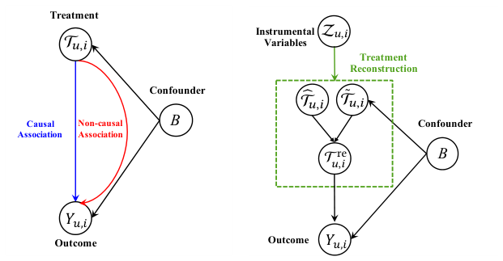
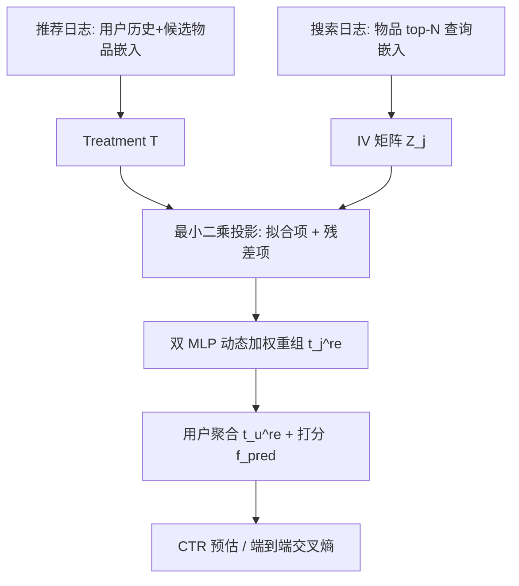
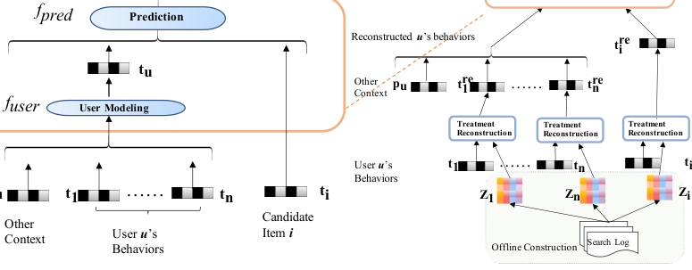

# A Model-Agnostic Causal Learning Framework for Recommendation using Search Data (基于搜索数据的模型无关因果学习推荐框架)

- **会议/期刊**: WWW 2022 (The Web Conference)
- **作者与机构**: Zihua Si, Xueran Han, Xiao Zhang, Jun Xu, Yue Yin, Yang Song, Ji-Rong Wen（中国人民大学高瓴人工智能学院 & 快手科技）
- **推荐链路定位**: 精排（CTR 预估），可作为通用嵌入增强前置模块
- **研究方向**: 去偏、公平、可信与工业架构 / 跨域与多场景推荐
- **论文原文**: [https://arxiv.org/abs/2202.04514v3](https://arxiv.org/abs/2202.04514v3)
- **开源代码**: [https://github.com/Ethan00Si/Instrumental-variables-for-](https://github.com/Ethan00Si/Instrumental-variables-for-)

## TL;DR (1分钟核心速览)

现有推荐模型把用户/物品嵌入整体喂入打分函数，而该嵌入混合了"用户为何喜欢该物品"的因果关联与曝光机制、位置偏差等混杂因素带来的非因果关联。IV4Rec 将与物品相关的搜索查询视为**工具变量 (IV)**，用最小二乘回归把推荐侧嵌入拆成"拟合项（因果）+ 残差项（非因果）"，再用双 MLP 动态加权重组后送入原模型。作为模型无关框架，它在快手的点击日志（按时间切分）与公开 MIND 上使 NRHUB 的 AUC 分别提升 1.84%/1.93%，DIN 提升 0.75%/0.69%，且优于联合训练搜索与推荐的 JSR，线上推理零额外开销。

## Background & Motivation (背景与核心矛盾)

- **主流范式**: 搜索与推荐通常在同一 App 内独立部署，共享用户与物品；既有工作或将二者联合训练（JSR），或将搜索历史作为额外特征/行为序列（NRHUB）拼进用户建模。
- **前人局限**: ①这些做法把嵌入当作不可分的整体，忽略其中因果信号与非因果（曝光、位置、流行度）信号的机制差异，偏差被原样传递；②标准因果去偏（IPW、去混杂表征）需要显式建模偏差或丢弃残差，在推荐里既难识别又会损失预测精度。
- **核心洞察 (Key Insight)**: 搜索查询由用户在搜索场景主动发出，**不受推荐侧排序/曝光机制影响**（甚至常来自其他用户），满足 IV 的**外生性**；同时同平台共享物品，查询是物品需求的显式表达，满足**相关性**。因此查询天然可充当推荐嵌入的工具变量。
- **本文切入点**: 不做显式去偏，而是用 IV 回归把嵌入"分解—重组"，把残差项也作为互补信号保留，实现精度导向的因果学习。

<figure class="paper-figure" markdown="span">
  <figcaption>图 2：(a)：传统 RSs。(b)：受 IVs 干预的 RSs。T𝑢,𝑖：用户和物品的嵌入。𝐵：混杂因素（例如流行度偏差、位置偏差）。𝑌𝑢,𝑖：用户反馈。Z𝑢,𝑖：IVs（即查询）。bT𝑢,𝑖：拟合向量。˜T𝑢,𝑖：残差。</figcaption>
</figure>

## Method (核心方法设计)

### 1. 整体框架 (Overall Architecture)

对候选对 $(u,i)$，先由推荐日志定义 treatment（目标物品与用户历史物品的嵌入集合）与由搜索日志离线构建的 IV 矩阵（每个物品 top-$N$相关查询的嵌入堆叠）；随后对每个物品做一次最小二乘投影，得到拟合项$\hat{\mathbf{t}}_j$与残差$\tilde{\mathbf{t}}_j$，两者经两个 MLP 预测的系数加权合成重构嵌入$\mathbf{t}^{re}_j$；用户侧由重构后的历史物品序列经原模型聚合为$\mathbf{t}^{re}_u$，再与$\mathbf{t}^{re}_i$ 打分。整个分解-重组模块与底层模型用点击交叉熵端到端联合训练；重构可在离线对全库物品预计算，在线直接查表。

<figure class="paper-figure" markdown="span">
  <figcaption>图 3：IV4Rec 框架的架构。中间：IV4Rec 应用于底层模型的过程。左侧：底层模型的结构。右侧：处理重建的详细实现。</figcaption>
</figure>

### 2. 关键设计拆解 (Key Designs)

1. **工具变量下的嵌入分解（Treatment Decomposition）**：痛点是把混杂偏差与真实偏好混在一个向量里，且物品-查询点击极稀疏。做法是先把物品嵌入非线性映射到查询空间，再对 IV 矩阵做最小二乘投影，闭式解用伪逆：
$\hat{\mathbf{t}}_j=\mathbf{Z}_j\boldsymbol{\tau}_j,\quad \boldsymbol{\tau}_j=\mathbf{Z}_j^{\dagger}\,\mathrm{MLP}_0(\mathbf{t}_j),\quad \tilde{\mathbf{t}}_j=\mathrm{MLP}_0(\mathbf{t}_j)-\hat{\mathbf{t}}_j$
直觉：把表征投影到 IV 张成的子空间，落在子空间内的分量（由搜索需求驱动）即与混杂无关的因果部分，正交补即非因果部分。

2. **因果/非因果的加权重组（Treatment Combination）**：与传统 2SLS 直接丢弃残差不同，本文认为残差虽含偏差但与点击强相关，应保留互补。系数由双 MLP 依样本自适应给出：
$\mathbf{t}^{re}_j=\alpha_{1j}\hat{\mathbf{t}}_j+\alpha_{2j}\tilde{\mathbf{t}}_j,\quad \alpha_{kj}=\mathrm{MLP}_k\big([\mathrm{MLP}_0(\mathbf{t}_j);\mathbf{Z}_j]\big)$
相比简单拼接，加权机制让模型按物品的查询覆盖质量自行调节因果/非因果配比，查询越丰富越倚重因果项。

3. **训练目标与推理效率**：总损失为点击交叉熵加 L2 正则
$\mathcal{L}_{\Theta}=-\frac{1}{|\mathcal{D}_{rec}|}\sum_{(u,i,c)}[c\log\hat{y}_{u,i}+(1-c)\log(1-\hat{y}_{u,i})]+\lambda\|\Theta\|_2^2$其中$\Theta$含$\mathrm{MLP}_{0,1,2}$ 与底层推荐模型全部参数，联合优化、无独立阶段。训练沿用日志曝光样本（正负点击直接来自曝光记录，无额外负采样策略）；IV 与伪逆均在离线预处理阶段完成，在线只做一次嵌入查表，**推理时延与底层模型完全一致**。

## Experimental Setup & Evaluation Protocol (实验设置与评估协议)

- **数据集与预处理**:

| 数据集 | #Users | #Items | #Queries | #Interactions | 稀疏度/密度 | 特征/场景说明 |
| :--- | :---: | :---: | :---: | :---: | :---: | :--- |
| Kuaishou | 12,000 | 3,053,966 | 162,624 | 4,001,613 | 密度约 1.1e-4 | 短视频，7 天真实搜索+推荐日志；用户/物品/查询嵌入均为平台预训练 64 维 |
| MIND | 736,349 | 130,380 | 130,380 | 95,447,571 | — | 新闻；原数据无查询，按"类别+子类别+实体"规则合成 1 条查询/文章，BERT 768 维 |

- **数据划分与防穿越 (Splitting Strategy)**: Kuaishou 采用**全局时间戳切分**（前 5 天训练、第 6 天验证、第 7 天测试）；MIND 因无带标签测试集，用原始 train/validation 充当 train/test，属比例划分。
- **排名评测协议 (Ranking Protocol)**: 非全库 Full-Ranking，而是**曝光列表级（Impression-level）排序**——在每轮曝光的候选列表内用点击作相关性标签计算 MRR / nDCG@5 / nDCG@10，并在所有曝光上取平均；AUC 在曝光样本上逐条计算。无采样负例。
- **对比基线与超参设置**: 基线为 NRHUB（注意力多视图融合搜索查询/点击/浏览行为）、DIN（注意力兴趣建模，Kuaishou 上额外拼接搜索历史）、以及联合训练框架 JSR 的两个版本 JSR-NRHUB / JSR-DIN。学习率网格 $\{1e^{-4},\dots,1e^{-3}\}$，dropout 保留率$\{0.5,0.9,1.0\}$，Adam 优化；IV 数量$N=10$（Kuaishou）、$N=1$（MIND）；显著性以$p<0.05$检验（分别对 NRHUB、DIN 标注$*$与$\dagger$）。

## Key Experimental Results (实验关键数据)

### 1. 主实验对比 (Main Results)

| Model | Kuaishou AUC | MRR | nDCG@5 | nDCG@10 | MIND AUC | MRR | nDCG@5 | nDCG@10 |
| :--- | :---: | :---: | :---: | :---: | :---: | :---: | :---: | :---: |
| NRHUB | 0.6455 | 0.1816 | 0.4347 | 0.4692 | 0.6595 | 0.3123 | 0.3428 | 0.4065 |
| JSR-NRHUB | 0.6488 | 0.1812 | 0.4326 | 0.4687 | 0.6660 | 0.3164 | 0.3480 | 0.4117 |
| **IV4Rec-NRHUB** | **0.6574** | **0.1837** | **0.4411** | **0.4774** | **0.6722** | **0.3271** | **0.3609** | **0.4219** |
| DIN | 0.6512 | 0.1833 | 0.4416 | 0.4743 | 0.6851 | 0.3326 | 0.3680 | 0.4304 |
| JSR-DIN | 0.6524 | 0.1838 | 0.4417 | 0.4755 | 0.6873 | 0.3315 | 0.3686 | 0.4308 |
| **IV4Rec-DIN** | **0.6561** | **0.1844** | **0.4432** | **0.4779** | **0.6898** | **0.3336** | **0.3700** | **0.4326** |
| Improv.% (vs. 底模) | +1.84% / +0.75% | +1.16% / +0.60% | +1.47% / +0.36% | +1.75% / +0.76% | +1.93% / +0.69% | +4.74% / +0.30% | +5.28% / +0.54% | +3.79% / +0.51% |

注：Improv.% 依次为 NRHUB 系与 DIN 系相对各自底模的提升；加粗为同底模下最优，全部提升在 $p<0.05$ 下显著（MRR/部分 nDCG 指标除外）。

### 2. 消融实验 (Ablation Study)

| 变体（Kuaishou, 图 6 读数趋势） | AUC 表现（0.635–0.660 区间） | 说明 |
| :--- | :---: | :--- |
| 仅拟合项 $\hat{\mathbf{T}}_{u,i}$ | 最低 | 纯因果项丢失大量可用信号 |
| 仅残差项 $\tilde{\mathbf{T}}_{u,i}$ | 偏低 | 非因果项单独不足以刻画偏好 |
| 原始嵌入 $\mathbf{T}_{u,i}$（不重建） | 中 | 即底模水平 |
| 拼接 $\hat{\mathbf{T}}\oplus\tilde{\mathbf{T}}$ | 较高 | 双路信息互补已见效 |
| **加权重建 $\mathbf{T}^{re}_{u,i}$（本文）** | **最高** | 自适应门控优于静态拼接 |

### 3. 关键实验发现 (Key Findings)

1. **IV 的相关性直接决定收益**：每物品相关查询数从 3 增至 10 时 AUC 单调上升，且只有当每物品相关查询 **多于 5 条**时 IV4Rec 才显著超过 DIN/NRHUB 基线；把 IV 中的点击查询按 20%→100% 替换为随机查询，AUC 单调下降，验证"查询必须真与物品相关"这一 IV 假设是收益前提。
2. **残差项不该被丢**：仅用拟合项或仅用残差项都弱于原始嵌入，而两者加权重组后才超过底模，说明推荐场景下非因果关联与点击强相关，因果识别的目标应让位于"分解—互补利用"；加权重组又稳定优于直接拼接，证明双 MLP 门控有效。
3. **重构确实改善了表征几何**：MIND 上 t-SNE 显示，BERT 原始新闻嵌入类间混杂，而 IV4Rec-NRHUB 重构后 sports/autos/weather/tv 四类形成更紧致的簇；同时 IV4Rec 优于 JSR（如 Kuaishou 上 0.6574 vs 0.6488），说明增益来自因果分解而非"多喂了搜索特征"。

## Highlights & Limitations (亮点、对比与审稿批判)

- **与代表作对比 (vs. Prior Work)**: 与 NRHUB（把搜索查询当作额外行为视图融合）相比，本文将查询放在**因果图的上游位置**，只用于重构 treatment 而不直接进入打分，避免查询-点击的统计捷径；与 JSR（共享损失联合优化两个模型）相比，本文无需搜索侧标签与双模型训练，只需离线 IV 表；与传统 2SLS/IPW 去偏相比，本文保留残差并端到端学习，目标从"无偏估计"转为"更准预测"。
- **可迁移亮点**: ①"离线伪逆投影 + 在线查表"的解耦范式可零成本嵌入任意双塔/序列精排模型；②任何"同平台异场景信号"（如评论、加购、直播观看）都可尝试充当 IV，替代昂贵的人群实验。
- **审稿级局限批判**: ①**外生性论证偏定性**：未做负控实验（如用未来查询或随机用户查询验证不直接影响推荐点击），也未与 IPW/DR 等去偏基线数值对比；②**覆盖依赖与冷启风险**：物品无搜索查询时只能靠余弦相似度补全相似查询，收益在查询稀疏的头尾分布上可能高度不均，论文未给出分桶结果；③MIND 的查询是按规则合成的伪查询，外部有效性受限；基线仅 2 个骨干、增益不足 2% AUC，且缺乏线上 A/B 与推理成本实测。

## Rating (四维评分)

- **方法创新性 (Novelty)**: ⭐⭐⭐⭐ （把搜索查询严格嵌入 IV 因果图并给出"分解+加权重组+端到端"改造，思路清晰且区别于常规去偏，但本质仍是 2SLS 的推荐化改写）
- **评估协议与实验扎实度 (Protocol & Experiments)**: ⭐⭐⭐ （工业+公开双数据集、时间切分与显著性检验到位，但仅两个骨干、曝光级排序非全库排序、消融以图代表缺乏精确数值）
- **写作与数学规范度 (Clarity & Rigor)**: ⭐⭐⭐⭐ （因果图、两步闭式解与重组公式推导完整，IV 两大假设逐条讨论；但 $N$ 不足时的补全策略与伪逆复杂度未量化）
- **工业落地与复现价值 (Industrial & Practical Value)**: ⭐⭐⭐⭐⭐ （离线预计算、在线零时延、模型无关且有快手真实数据验证，代码开源，是最易被工业界直接套用的因果增强插件之一）

