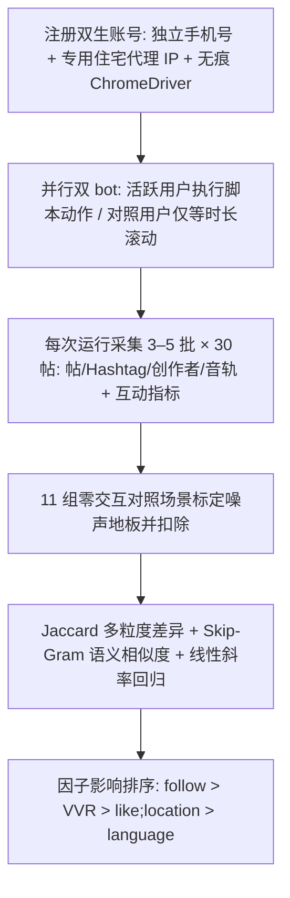
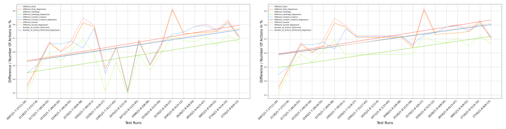

# An Empirical Investigation of Personalization Factors on TikTok (TikTok 个性化影响因子实证审计)

- **会议/期刊**: The Web Conference (WWW) 2022
- **作者与机构**: Maximilian Boeker, Aleksandra Urman（University of Zurich / TU Munich）
- **推荐链路定位**: 端到端信息流分发（"For You" 召回 + 排序的整体黑盒审计，非模型改进）
- **研究方向**: 去偏公平、可信隐私与工业架构 / 智能体仿真审计
- **论文原文**: [https://arxiv.org/abs/2201.12271v1](https://arxiv.org/abs/2201.12271v1)
- **开源代码**: [mboeke/TikTok-Personalization-Investigation](https://github.com/mboeke/TikTok-Personalization-Investigation)

## TL;DR (1分钟核心速览)

针对工业级短视频推荐系统"纯算法分发却完全黑箱"的信任危机，本文提出**带噪声标定的双生子傀儡账号审计协议（sock-puppet audit）**：用独立手机号 + 专用住宅代理 + 无痕 ChromeDriver 注册一对仅差一个行为的账号，先以 11 组双方零交互的对照场景标定平台固有随机化噪声，再以 Jaccard 差异与 Hashtag Skip-Gram 语义斜率归因。覆盖 39 个场景、30,436 条帖，结论为 **关注 > 完播率 > 点赞**、**位置 > 语言**，同配置双账号在 3 批内即有 69.74% 帖子不重叠。

## Background & Motivation (背景与核心矛盾)

- **主流范式**: TikTok 的内容分发几乎完全由算法驱动（弱社交关系链），公开信息显示其为"打标签 → 召回 → 排序 → 分桶放量"的工业级级联系统；已有研究多集中在**供给侧**（如何让视频被推）或纯思辨式的"民间理论"。
- **前人局限**: ① 唯一触及需求侧的《华尔街日报》实验为新闻调查，无对照账号、无重复运行、无统计口径，结论不可复现；② 用户侧审计面临致命混淆——平台的探索/随机化项会让两个"完全相同"的账号信息流天然分叉，未标定噪声的研究会把随机性误判成个性化。
- **核心洞察 (Key Insight)**: 作者先量化"噪声地板"：双方零交互的对照场景下，两账号信息流在帖子层面差异即达 **66.17%（5 批）/ 69.74%（3 批）**，Hashtag 与创作者差异也高达 58.6%–68.2%；同时发现差异曲线每逢周末骤降，疑为算法灰度发布，需插值校正。
- **本文切入点**: 把"个性化"定义为**可观测信息流差异减去对照噪声后的净增量**，并在多粒度（帖 / Hashtag / 创作者 / 音轨 / 语义）上同时验证，以交叉确认归因。

## Method (核心方法设计)

### 1. 整体框架 (Overall Architecture)

每次运行在一台本机并行启动两个 bot（活跃用户 / 对照孪生用户）：两者使用同一机器、同一 ChromeDriver 版本、同日注册，但绑定**不同住宅代理 IP（可精确指定城市/国家）**与不同语言设置。活跃账号按场景脚本执行关注、点赞或"延长观看"，对照账号只以完全相同的秒数滚动同样的批次数。TikTok 网页端每次访问预加载约 30 条帖为一"批（batch）"，默认采集 3 批（部分场景 5 批），bot 直接从前端响应与 DOM 抽取帖子元数据（点赞、浏览、评论、分享、Hashtag、创作者、音轨）落库 PostgreSQL。每场景约 20 次运行、每日两轮、执行顺序轮换，`Jun–Aug 2021` 共完成 39 个有效场景。

### 2. 关键设计拆解 (Key Designs)

1. **噪声标定与净影响归因（本文最关键的方法论增量）**：痛点是无对照即无法从随机化中分离个性化 $\to$对四个粒度$k\in\{\text{post},\text{hashtag},\text{creator},\text{sound}\}$计算 Jaccard 距离并减去对照期望：$D_{a,c}^{(k)}=1-\frac{|\mathcal{S}_a^{(k)}\cap\mathcal{S}_c^{(k)}|}{|\mathcal{S}_a^{(k)}\cup\mathcal{S}_c^{(k)}|}$，$\tilde{D}^{(k)}=\mathbb{E}[D^{(k)}_{\text{test}}]-\mathbb{E}[D^{(k)}_{\text{ctrl}}]$。之所以有效：它把"任何看起来不同的 feed"降级为待检验假设，只有净增量显著为正才归因于被测因子。

<figure class="paper-figure" markdown="span">
  <figcaption>图1：未计入丢弃时测试场景7每次测试运行的信息流数量差异。图2：计入丢弃后测试场景7每次测试运行的信息流数量差异。</figcaption>
</figure>

2. **斜率式收敛度量（而非绝对水平）**：痛点是对照与活跃账号的初始信息流本就水平不可比 $\to$对每次运行内的相似度序列拟合$s_t=\beta_0+\beta_1 t+\varepsilon_t$，比较$\Delta\beta_1=\hat\beta_1^{\text{active}}-\hat\beta_1^{\text{control}}>0$是否成立；Hashtag 语义相似度用 Skip-Gram 词向量度量：$\text{sim}(p_i,p_j)=\frac{1}{|\mathcal{H}_i||\mathcal{H}_j|}\sum_{h\in\mathcal{H}_i}\sum_{h'\in\mathcal{H}_j}\frac{\boldsymbol{e}_h^{\top}\boldsymbol{e}_{h'}}{\|\boldsymbol{e}_h\|\|\boldsymbol{e}_{h'}\|}$，并剔除 `#fyp` 等超高频标签。直觉：个性化本质是**分布收敛速度**的差异，看斜率可抵消起点噪声。

3. **统计口径与实验成本（对应模型论文的训练/推理开销）**：无模型训练，等价"超参"是操控强度——关注每两次运行关注 1 位创作者；点赞含随机 / persona-Hashtag 集 / 指定创作者 / 指定音轨四种选帖策略；完播率（VVR，视频观看比例）取 25%/50%/75%/100%/400%。每场景 ~20 次运行、5 台机器、共 39 个成功场景（另有若干因 bot 卡死被剔除），总计采集 30,436 条帖、34,905 个 Hashtag、21,278 位创作者、20,302 条音轨。

## Experimental Setup & Evaluation Protocol (实验设置与评估协议)

- **数据集与预处理（采集语料）**:

| 场景组 | #Scenarios | #Runs/场景 | #Posts | #Hashtags | #Creators | 说明 |
| :--- | :---: | :---: | :---: | :---: | :---: | :--- |
| Control（噪声标定） | 11 | ~20 | — | — | — | 双方零交互，3 或 5 批 |
| Language / Location | 3（有效） | ~20 | — | — | — | US↔CA、US↔DE、US 内 4 语言 |
| Like | 11 | ~20 | — | — | — | 随机 / persona / creator / sound |
| Follow | 6（有效 5） | ~20 | — | — | — | 每两次运行关注 1 位创作者 |
| Video View Rate | 10 | ~20 | — | — | — | 25%–400% 观看比例 |
| **合计** | **39** | — | **30,436** | **34,905** | **21,278** | 音轨 20,302；时间窗 2021-06~08 |

- **数据划分与防穿越 (Splitting Strategy)**: 属**在线 A/B 式受控审计**而非离线划分；通过"同日并行运行 + 同一机器 + 同版本浏览器 + 同国代理"实现配对设计，用 11 组零交互对照场景作**噪声基线（对应"防泄漏"）**。
- **排名评测协议 (Ranking Protocol)**: 不做候选集采样排序，等价于**全曝光日志观测（Full-Feed Observation）**：不注入候选池，直接记录平台自然下发的每一条帖子，代理指标为 Jaccard 重叠率与语义相似度斜率；热度指标（点赞/浏览/评论/分享）作为流行度侧证。
- **对比基线与超参设置**: 无外部模型基线，"基线"即**孪生对照账号（twin control）**与 11 组对照场景；热度热力图以 35.38% 的重叠率作为零点偏移；未报告 $p$ 值，结论依赖净增量与跨场景一致性。

## Key Experimental Results (实验关键数据)

### 1. 主实验对比 (Main Results)

| 个性化因子 | 操控方式 | 净信息流差异（vs 对照） | 代表性数值证据 | 影响强度排序 |
| :--- | :--- | :---: | :--- | :---: |
| **Follow（关注）** | 每 2 次运行关注 1 位创作者 | **最强** | 场景 28：Hashtag 语义相似度斜率 **21% > 18%**；活跃账号 top-4 创作者中 3 位并未被关注 | **1** |
| **VVR（完播率）** | persona 化延长观看 25%–400% | 次强（persona ≫ random） | 场景 33（25%）平均差异 **0.85%** > 场景 35（75%）**0.56%**；场景 40 斜率 **16.03% > 7.98%** | **2** |
| **Like（点赞）** | persona / creator / sound / random | 中等，随机点赞最弱 | 活跃账号 feed 语义更快收敛；指定创作者/音轨的帖子复现率显著升高 | **3** |
| **Location（位置）** | US↔CA、US↔DE 代理切换 | 强，且切换后即时生效 | 同地配对重叠显著高于异地配对（扣 35.38% 噪声后） | **1（环境类）** |
| **Language（语言）** | 同为 US，EN/DE/ES/FR | 弱于位置 | 仅法语组内部相似度最高，EN/DE/ES 组间差异被英语主流内容稀释 | **2（环境类）** |

### 2. 消融实验 (Ablation Study)

以"移除噪声标定 / 移除对照"作为消融，等价对照场景的噪声地板即为关键量化项：

| 对照配置（活跃因子全部关闭） | #Batches | Post 差异 | Hashtag 差异 | Creator 差异 | Sound 差异 |
| :--- | :---: | :---: | :---: | :---: | :---: |
| 对照场景（5 批） | 5 | 66.17% | 58.62% | 66.05% | 64.47% |
| 对照场景（3 批） | 3 | 69.74% | 59.63% | 68.15% | 68.05% |
| w/o 软件更新插值校正 | 3 | 曲线在周末骤降，斜率被系统性低估 | — | — | — |
| w/o 高频 Hashtag 清洗（`#fyp` 等） | 3 | — | 相似度被虚高、真假收敛不可分 | — | — |
| w/o 语义 Skip-Gram 度量 | 3 | — | 仅字面重叠，无法识别同义标签簇 | — | — |

### 3. 关键实验发现 (Key Findings)

1. **关注是最强显式信号，但作用是"创作者邻域扩散"而非精确订阅**：场景 28 中活跃账号最常出现的 4 位创作者里 3 位并未被关注，说明算法在做"相似创作者 + 组合热度"的邻域召回，这解释了为何 follow 的权重高于单点 like。
2. **不做噪声校正的审计结论不可信**：两个零交互账号在 3 批内已有 69.74% 帖子不重叠、Hashtag 差异 59.63%，平台内建探索/随机化远大于多数文献假设的"个性化效应"，本文所有因子结论均建立在扣除该地板之上。
3. **完播率存在非单调、前段采样特性**：观看 25% 反而比 75% 引起更大 feed 分叉（0.85% > 0.56%），作者解释为算法主要在前 25%–50% 时长内判断偏好；同时 persona 化观看账号平均单次运行时长 33.73 分钟 > 对照 27.78 分钟，说明"看什么"比"看多久"更决定收敛方向。

## Highlights & Limitations (亮点、对比与审稿批判)

- **与代表作对比 (vs. Prior Work)**: 相比 WSJ 调查式实验（单账号、单次、无对照），本文用 39 场景 × ~20 次的重复配对设计给出可复现框架；相比 Zhao 等的供给侧"分桶放量"分析，本文从需求侧给出用户可控性证据；相比用户"民间理论"研究（认为点赞/发帖时间最关键），本文实测排序为 follow > VVR > like，直接反驳了流行认知。
- **可迁移亮点**: ① **噪声地板标定 + 净增量归因**协议可平移至 YouTube Shorts / Reels / 电商推荐等任意黑盒分发系统的第三方审计；② **斜率式收敛度量**在起点水平不可比时（如冷启动对比、跨域迁移评估）比绝对指标更稳健，同样适用于离线仿真沙盒的对比分析。
- **审稿级局限批判**: ① 统计功效与严谨性不足——每场景仅 ~20 次运行，结论以净增量方向与跨场景一致性支撑，未报告置信区间或显著性检验，且 3 批 vs 5 批两种采集口径被直接视作等价；② 外部效度受限——仅审计 2021 年 6–8 月的**网页端**，代理 IP 与真实移动端设备指纹并不等价，且平台算法持续灰度更新，结论时效性很短；同时只能覆盖 5 类"显式"行为，评论/分享/搜索等更强信号被排除，属明确的探索性第一步而非定论。

## Rating (四维评分)

- **方法创新性 (Novelty)**: ⭐⭐⭐ （无模型创新，但"噪声地板 + 净增量 + 斜率收敛"的审计协议在推荐系统可信研究中有方法论开创性）
- **评估协议与实验扎实度 (Protocol & Experiments)**: ⭐⭐⭐⭐ （11 组纯对照、39 场景 × ~20 次配对重复、多粒度交叉验证相当扎实，扣分在缺显著性检验与两种采集口径混用）
- **写作与数学规范度 (Clarity & Rigor)**: ⭐⭐⭐⭐ （度量定义与噪声处理交代清晰、图例自洽，但公式层面偏轻，归因推理多为定性叙述）
- **工业落地与复现价值 (Industrial & Practical Value)**: ⭐⭐⭐ （代码全开源、协议可直接被监管/第三方审计复用；但账号注册依赖手机号与住宅代理，成本高且平台更新会使结论快速失效）

