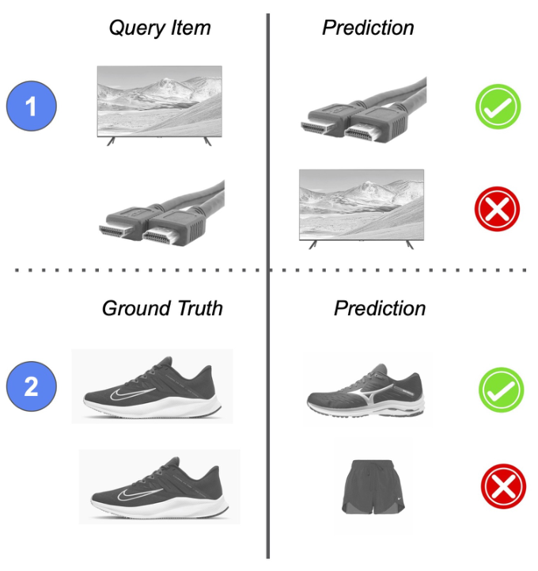
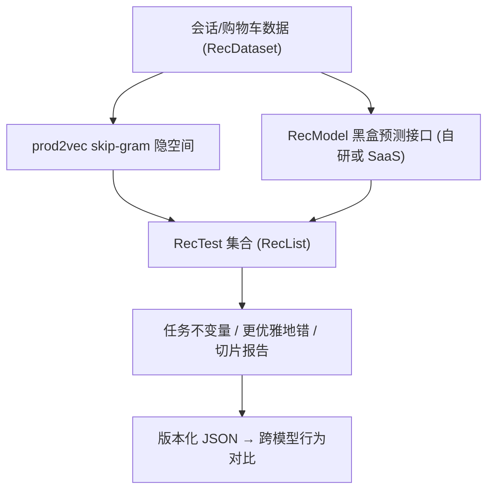
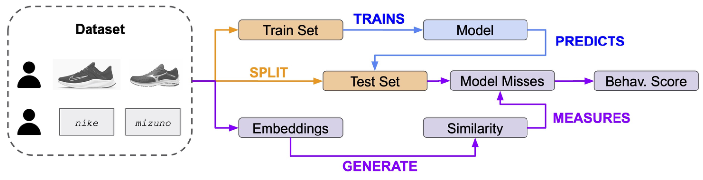

# Beyond NDCG: behavioral testing of recommender systems with RecList (超越 NDCG：用 RecList 做推荐系统行为测试)

- **会议/期刊**: WWW 2022 (Companion Proceedings of the Web Conference)
- **作者与机构**: Patrick John Chia, Jacopo Tagliabue (Coveo / Coveo Labs), Federico Bianchi (Bocconi), Chloe He (Stanford), Brian Ko (KOSA AI)
- **推荐链路定位**: 离线评测 / 上线前验收（覆盖召回与重排输出，模型无关的黑盒测试层）
- **研究方向**: 去偏公平、可信与工业架构 / 冷启动与长尾
- **论文原文**: [https://arxiv.org/abs/2111.09963v2](https://arxiv.org/abs/2111.09963v2)
- **开源代码**: [https://github.com/jacopotagliabue/reclist](https://github.com/jacopotagliabue/reclist)

## TL;DR (1分钟核心速览)

针对"单一 NDCG 无法刻画线上行为"的痛点，本文把 NLP 的 Checklist 行为测试迁移到推荐，提出开源框架 **RecList**：按相似品/互补品/会话三类用例抽象出 `RecTask/RecModel/RecDataset/RecList` 四层黑盒接口，并用 prod2vec 隐空间落地"任务不变量、更优雅地错、数据切片"三类可插拔测试。在 100 万条运动服饰购物会话、2.5K 条时间外样本上，HR@10 几乎相同的 prod2vec(0.197) 与 Google API(0.199) 在长尾命中上相差 40%、热门命中相差 200%、类目路径长度 1.13 vs 1.59，彻底暴露了单指标评估的盲区。

## Background & Motivation (背景与核心矛盾)

- **主流范式**: 学术界与工业界均以留出集上的 HR/NDCG/MRR 单点分数作为模型选型与排行榜依据。
- **前人局限 (1)**: 命中/不命中被二值化——把"推荐《终结者》"与"推荐《电子情书》"当作同等错误，丢失了错误的语义程度；而 38% 的消费者表示看到不相关推荐就会放弃购物。
- **前人局限 (2)**: 全局均值掩盖切片差异，模型在长尾/特定品牌/冷启物品上的崩溃无法从 NDCG 中读出；覆盖率、惊喜度等指标虽有补充，但仍无法定位"哪里坏了"。
- **核心洞察 (Key Insight)**: 不同用例存在**形式化不变量**——相似品必须可互换（对称），互补品天然有方向（买了电视推线缆合理，反向不合理，见图 1）；且"输入到标签"与"输入到预测"的隐空间距离分布应当一致。
- **本文切入点**: 不发明新模型，而是把上述领域知识编码为**与实现解耦的黑盒测试套件**，让 SaaS 服务与自研模型可用同一套语言比较。

<figure class="paper-figure" markdown="span">
  <figcaption>图1：推荐系统（RSs）的行为原则示例：（1）展示了推荐互补商品时所期望的不对称性；（2）说明模型错误（即未命中真实项）可能以不同方式降低购物体验。</figcaption>
</figure>

## Method (核心方法设计)

### 1. 整体框架 (Overall Architecture)

RecList 把评测拆成"用例—模型—数据—测试"四层抽象：`RecDataset` 统一提供 train/test 划分与物品元数据（品牌、类目、价格）；`RecModel` 只需实现一个"输入上下文→返回 Top-k"的预测接口，因此商业黑盒 API 与自研模型地位对等；`RecTask` 声明当前是相似品、互补品还是会话推荐；`RecList` 则由若干 `RecTest` 组成，运行时自动对结果做版本化并导出机器可读 JSON，便于接入现有 ML 工具做跨模型对比。测试所需的语义空间不依赖被测模型，而是由 `RecDataset` 上独立训练的 prod2vec（会话视为物品/品牌序列，skip-gram + 负采样）提供，从而保证"度量尺子"与"被量对象"解耦。

<figure class="paper-figure" markdown="span">
  <figcaption>图2：行为测试的示例工作流。从购物数据（左侧）开始，数据集划分（橙色）和模型训练（蓝色）模拟常规训练循环。RecList 创建潜在空间，以度量输入、真实值和预测之间的关系，例如未命中项与真实值之间的距离（紫色）（真实示例见图3）。由于会话可视为项目或特征（品牌）的序列，RecList 可复用 skip-gram 为不同测试创建嵌入。</figcaption>
</figure>

### 2. 关键设计拆解 (Key Designs)

1. **任务不变量测试（Asymmetry Test）**：互补关系是有向的，而点式指标对此完全无感。做法是把预测结果与物品元数据联结，用价格等单调属性检验方向一致性：对输入 $x$与预测$\hat{y}$，统计满足约束的样本比例
$\text{Inv}(x\to\hat{y})=\frac{1}{|\mathcal{D}|}\sum_{(x,\hat{y})}\mathbb{I}\big[\text{price}(\hat{y})\geq\text{price}(x)\big]$
若模型把"配件→主机"也当作合理补全，该比例会显著偏离数据真实分布。直觉是：不变量把"业务上的硬约束"变成可计算的方向性检查，比任何相关性指标都更贴近购物逻辑。

2. **"更优雅地错"（Being Less Wrong）**：把命中率换成**距离分布对齐**。在 prod2vec 空间中定义
$d_{\cos}(x,z)=1-\frac{\boldsymbol{e}_x^{\top}\boldsymbol{e}_z}{\lVert \boldsymbol{e}_x\rVert\,\lVert \boldsymbol{e}_z\rVert}$分别计算"输入→真实标签"分布$P_{XY}$与"输入→预测"分布$P_{X\hat{Y}}$，用两样本检验（KS/Wasserstein）衡量二者差异；差异越小，说明模型即便 miss，也 miss 在正确的语义邻域。同时可用品牌亲和度距离与类目树路径长度两种离散替代度量，分别刻画"品牌相近性"与"推荐多样性"。

3. **切片报告、偏差度量与工程开销**：所有测试支持任意分区函数 $g(\cdot)$（品牌、冷热、价格带），并按切片输出命中率；同时内置覆盖度与流行度偏差
$\text{Bias@}k=\frac{1}{|\mathcal{I}|}\sum_{i\in\mathcal{I}}\big|p^{\text{rec}}_i(k)-p^{\text{pop}}_i\big|$其中$p^{\text{rec}}_i(k)$为物品$i$ 在 Top-k 中的出现频率。整套流程**无需重训被测模型**，仅需一次前向/API 调用与一次嵌入查表，2.5K 测试样本可在分钟级跑完，因而适合放进 CI 做上线前回归。

## Experimental Setup & Evaluation Protocol (实验设置与评估协议)

- **数据集与预处理**: 单一私有运动服饰电商数据（"reasonable scale"），会话式购物篮数据，未做 5-core 过滤。

| 数据集 | #Users | #Items | #Interactions | 稀疏度/密度 | 特征/场景说明 |
| :--- | :---: | :---: | :---: | :---: | :--- |
| 私有电商（运动服饰） | 未披露 | 未披露（含品牌/类目树/价格） | 训练 ≈1M（2019 年 3 个月采样）；测试 2.5K | — | 互补品购物车推荐；含 prod2vec 所需会话序列 |

- **数据划分与防穿越 (Splitting Strategy)**: **全局时间戳切分**——训练取 2019 年连续 3 个月采样，测试取与之不相交的时间段 2.5K 样本，避免同会话泄漏。
- **排名评测协议 (Ranking Protocol)**: 点式采样评估，直接在被测模型返回的 Top-10 上统计 HR@10 / MRR@10，**非 Full-Ranking 全库排序**；因此数值不可与全库未交互排序结果直接横向比较，仅用于同设定下模型间对比。
- **对比基线与超参设置**: 三类被测系统——prod2vec 自研基线 (P2V)、Google Recommendations AI 商业 API (GOO)、某流行 SaaS 模型 (S1)；嵌入维度与 prod2vec 超参沿用默认配置，未做显著性检验（作者明确声明目标不是给模型排名，而是演示方法论）。

## Key Experimental Results (实验关键数据)

### 1. 主实验对比 (Main Results)

| RecTest | P2V（自研） | GOO（Google API） | S1（SaaS） | 判读方向 |
| :--- | :---: | :---: | :---: | :--- |
| HR@10 ↑ | 0.197 | **0.199** | 0.094 | 单指标几乎打平 |
| MRR@10 ↑ | 0.091 | **0.102** | 0.069 | GOO 略优 |
| Coverage@10 ↑ | 1.01e-2 | **1.99e-2** | 3.00e-3 | GOO 覆盖面约 2× |
| Popularity Bias@10 ↓ | **9.91e-5** | 1.41e-4 | 1.20e-4 | P2V 更不偏热门 |
| Cos Distance (Brand) ↓ | **0.411** | 0.483 | 0.540 | P2V 品牌更贴输入 |
| Cos Distance (Misses) | 0.564 | **0.537** | 0.577 | GOO 的 miss 更接近标签分布 |
| Path Length (Category) ↑ | 1.13 | **1.59** | 1.91 | GOO/S1 跨类目更"互补" |

（原文表中 Coverage 处印为 `1.99e2`，按量级应为 `1.99e-2`。）

### 2. 消融与判别力分析 (Ablation / Discriminative Power)

原文为 6 页方法学短文，**未提供组件级消融**（无 `w/o test` 变体），故此处改以"各测试对模型的判别力"呈现：若只看第一行 HR@10，P2V 与 GOO 差异仅 1%；而逐项展开后差异被逐级放大。

| 去掉的测试维度 | 保留的可见差异 | 被掩盖的行为差异 |
| :--- | :--- | :--- |
| 仅保留 HR/MRR | P2V 0.197 vs GOO 0.199（≈1%） | 长尾/热门/切片差异全部不可见 |
| 去掉切片测试 | 全局均值持平 | P2V 在 `asics` 上显著更优，`nike` 上略低 |
| 去掉 "Being Less Wrong" | 命中数相同 | GOO 的 miss 距离分布更贴近标签分布（0.537 vs 0.564） |
| 去掉 Path Length | 命中数相同 | P2V 类目路径仅 1.13，倾向同类目内循环，互补性不足 |

### 3. 关键实验发现 (Key Findings)

1. **长尾与热门命中呈镜像关系**：P2V 在稀有物品上的命中比 GOO **高 40%**，而 GOO 在最热门物品上比 P2V **高 200%**；二者 HR@10 却只差 0.002，说明单指标会把"服务长尾"与"押注头部"这两种截然不同的产品策略抹平。
2. **命中率相同不等于体验相同**：P2V 的 miss 余弦距离 0.564 明显大于 GOO 的 0.537，且 P2V 类目路径长度仅 1.13（GOO 1.59），印证其倾向推荐同品类替代品，而购物车场景需要跨品类互补——这正是 NDCG 无法编码的任务不变量。
3. **切片差异可被精确定位**：在品牌切片上，P2V 于 `asics` 表现突出、`nike` 略逊，这一偏差在聚合指标中完全不可见，但对"运动品牌营销活动页"这类高价值流量意味着直接的体验与转化损失。

## Highlights & Limitations (亮点、对比与审稿批判)

- **与代表作对比 (vs. Prior Work)**: 相比 Checklist (ACL'20) 只处理"通用 NLP 模型"，RecList 必须面对推荐模型**不可通用**的现实（同一双跑鞋在 A 店热门、B 店冷门），因此把隐空间改为按数据集训练；相比 coverage / serendipity / bias 等单点补充指标，它提供了可组合、可版本化的测试**协议**而非又一个标量；相比传统 A/B 测试，它以极低成本在离线阶段做"分切片体检"。
- **可迁移亮点**: (1) 把"业务不变量"（价格单调性、类目方向性）编译成可执行断言，可直接搬进召回/重排的 CI 门禁；(2) 用独立训练的 prod2vec 作为"度量尺子"，避免被测模型自证清白，这一解耦思路可复用到多模态与生成式推荐的语义距离评估。
- **审稿级局限批判**: (1) 证据基础偏薄——仅一个私有电商数据集、2.5K 测试样本、无显著性检验、无多随机种子，且自研 P2V 与商业 API 的超参不可比，结论更接近案例研究而非受控实验；(2) 隐空间由 skip-gram 在**同一份交互数据**上训练，存在与目标模型共享流行度偏置的风险，"更优雅地错"的距离度量可能被热门物品主导；框架本身不解决偏差，只做度量。

## Rating (四维评分)

- **方法创新性 (Novelty)**: ⭐⭐⭐ （把 NLP 行为测试系统性移植到推荐并给出四层抽象，工程与概念贡献清晰，但缺乏新的理论或学习机制）
- **评估协议与实验扎实度 (Protocol & Experiments)**: ⭐⭐ （单一私有数据集、点式采样指标、无显著性检验与组件消融，仅作方法演示，证据强度有限）
- **写作与数学规范度 (Clarity & Rigor)**: ⭐⭐⭐⭐ （用例—不变量—测试的叙述链条清楚，公式极简易复现；但部分指标定义仅在代码中给出，正文缺形式化）
- **工业落地与复现价值 (Industrial & Practical Value)**: ⭐⭐⭐⭐⭐ （开源可用、模型无关、分钟级跑完 2.5K 样本，可无缝接入上线前回归与 CI，是多租户 SaaS 场景的实用工具）

