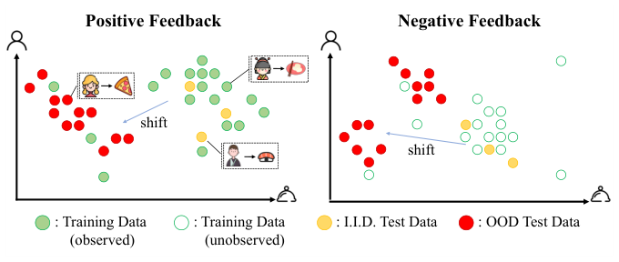
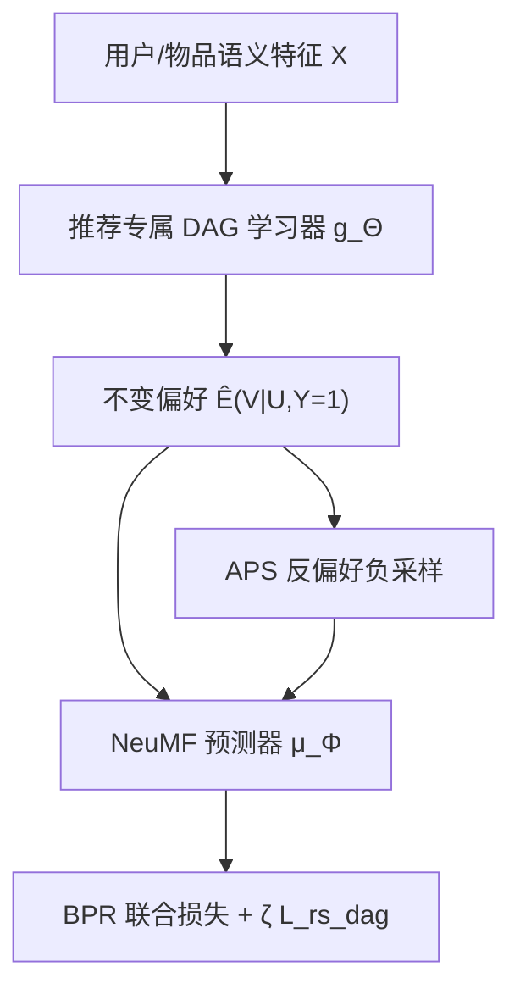
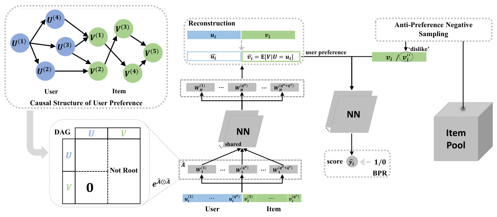

# CausPref: Causal Preference Learning for Out-of-Distribution Recommendation (面向分布外推荐的因果偏好学习)

- **会议/期刊**: WWW 2022 (The ACM Web Conference)
- **作者与机构**: Yue He, Zimu Wang, Peng Cui, Hao Zou (清华大学), Yafeng Zhang, Qiang Cui, Yong Jiang (美团)
- **推荐链路定位**: 召回 (隐式反馈 NCF 排序打分)
- **研究方向**: 去偏公平、可信隐私与工业架构 / 冷启动与长尾推荐
- **论文原文**: [https://arxiv.org/abs/2202.03984v2](https://arxiv.org/abs/2202.03984v2)
- **开源代码**: [https://github.com/HeYueThu/CausPref](https://github.com/HeYueThu/CausPref)

## TL;DR (1分钟核心速览)

隐式反馈推荐在用户/物品分布偏移（活跃用户主导、热门物品霸屏、跨地域上线）下性能骤降，而现有去偏方法（IPS/DICE）依赖预定义因果图或辅助无偏数据。本文从理论上证明：只要**正反馈偏好 $P(V|U,Y=1)$跨环境不变**，则$P(Y|U,V)$ 不变；据此提出 CausPref——用推荐专属可微 DAG 学习器显式估计不变偏好，并以"反偏好"负采样近似未观测负反馈。在 Dining-Out 物品特征偏移下 NDCG@20 达 19.75（+5.2%），全冷启动场景相对最强基线提升 NDCG +21.4%。

## Background & Motivation (背景与核心矛盾)

- **主流范式**: 以 NeuMF / LightGCN 为代表的隐式反馈协同过滤，在 I.I.D. 假设下用 BPR + 随机负采样训练。
- **前人局限**: (1) 随机负采样与真实偏好无关，训练出的决策边界在测试分布漂移（长尾物品、新地域）时直接失效；(2) IPS/CausE 需辅助无偏小样本，DICE 需专家预定义因果图，二者都只能针对*特定形式*偏差，无法应对未知（agnostic）偏移。
- **核心洞察 (Key Insight)**: 贝叶斯展开后 $P(Y=1|U,V)=\frac{P(V|U,Y=1)}{P(V|U,Y=1)+C\cdot F(P(V|U,Y=1))}$，即打分函数**只依赖不变偏好项**；只要把该项估准，并把负采样器设计成$F(\cdot)$，就能同时稳住观测正反馈与未观测负反馈两侧的偏移（图 1）。
- **本文切入点**: 用"推荐专属"因果结构约束下的可微 DAG 重建模块充当偏好估计器，取代传统把用户 Embedding 直接喂进 MLP 的做法。

<figure class="paper-figure" markdown="span">
  <figcaption>图 1：隐式反馈下 OOD 与 I.I.D 推荐之间的差异。分布偏移同时出现在观测到的正反馈和未观测到的负反馈中，导致 OOD 测试性能不佳。</figcaption>
</figure>

## Method (核心方法设计)

### 1. 整体框架 (Overall Architecture)

模型把用户特征 $\mathbf{u}_i\in\mathbb{R}^{q_u}$与物品特征$\mathbf{v}_i\in\mathbb{R}^{q_v}$拼成矩阵$X$，送入 DAG 学习器$g_\Theta$：每个子网络重建一个变量且屏蔽自身输入，由输入层权重的行范数构造邻接矩阵$\hat{A}$，并施加无环、稀疏与两条推荐专属结构约束。训练后只把用户特征灌入（物品位补零），输出即偏好期望$\mathbb{E}(V|U=\mathbf{u}_i,Y=1)$；该向量既作为下游 NeuMF 预测器$\mu_\Phi$的用户侧输入，又用于驱动 APS 负采样器挑"最不像他喜欢的"物品，最终用 BPR 联合优化$\Theta,\Phi$（图 2）。

<figure class="paper-figure" markdown="span">
  <figcaption>图 2：基于因果偏好的推荐框架。</figcaption>
</figure>

### 2. 关键设计拆解 (Key Designs)

1. **推荐专属 DAG 结构正则**：通用因果发现会学出"物品特征→用户特征"等反直觉边或孤立根节点。作者在标准可微 DAG 目标上追加两条硬/软约束——只有用户特征可指向物品特征（无反向边），且任何物品特征不得为根节点，得到
$\mathcal{L}_{rs\_dag}=\mathcal{L}_{dag}+\xi\|\hat{A}_{[q_u+1:q_u+q_v,\,1:q_u]}\|+\lambda\sum_{d=q_u+1}^{q_u+q_v}-\log\|\hat{A}_{:,d}\|$，
其中 $\hat{A}_{k,d}=\|W_1^{(d)}[k,:]\|_2$、$\mathcal{L}_{dag}=\frac{1}{N}\|X-g_\Theta(X)\|_F^2+\alpha(\mathrm{tr}(e^{\hat{A}\circ\hat{A}})-d)^2+\beta\|W_1\|_1$。物理直觉：砍掉"物品→用户"的虚假通路后，模型只能借用户侧变量重建物品，等价于强迫其编码"这类用户会选什么"，从而剥离热门度/曝光位置等环境相关捷径。
2. **反偏好负采样 (APS)**：随机负样本与偏好分布无关，无法近似 $P(V|U,Y=0)$。APS 先用$\hat{g}_\Theta([\mathbf{u}_i\,|\,\mathbf{0}])$得到偏好期望，再从全库随机抽$K$个候选，按与期望的**反相似度**加权采样$w_i=\tau_2(\tau_1(\mathbb{E}(V|U=\mathbf{u}_i,Y=1),\mathbf{v}'_i))$。这样负样本落在偏好流形之外，BPR 的正负对比恰好在"喜欢/不喜欢"边界上施加梯度，且候选集抽样使开销与全库规模解耦。
3. **训练目标与推理开销**：$\min\mathcal{L}=-\sum_{i}\log\sigma\big(\mu_\Phi(\hat{g}_\Theta([\mathbf{u}_i]),\mathbf{v}_i)-\mu_\Phi(\hat{g}_\Theta([\mathbf{u}_i]),\mathbf{v}''_i)\big)+\zeta\mathcal{L}_{rs\_dag}$；BPR 梯度回传至$\Theta$，为结构学习补充监督信号。负采样为"偏好引导的 Hard Negative"，无需辅助无偏数据；推理时 DAG 学习器与 NeuMF 可离线固化，在线仅一次前向。

## Experimental Setup & Evaluation Protocol (实验设置与评估协议)

| 数据集 | #Users | #Items | #Interactions | 稀疏度 | 特征/场景说明 |
| :--- | :---: | :---: | :---: | :---: | :--- |
| Cloud Theme Click (淘宝 C2C) | – | – | 单月点击/购买 | – | 促销前一个月行为，含用户/物品特征 |
| Dining-Out (美团 B2C) | 314,684 | 206,082 | 851,325 | ≤1e-3 | 2019 全年到店消费，含年龄/性别/消费等级/品类/评分/销量等语义特征 |

- **数据划分与防穿越**: 比例划分 **8:1:2**（train/valid/test）；通过重采样构造 5 类偏移——用户/物品**特征偏移**（两簇比例训练 8:2、测试 2:8）、用户/物品**度数偏移**（测试主要取低度用户/长尾物品）、**地域偏移**（A 城训练、B 城测试，近似全冷启动）；另设 transductive 与 inductive（含新用户/新物品）两版。
- **排名评测协议**: `Full-Ranking`，但候选池受业务约束——Dining-Out 中每个用户的候选池限定为其居住/到访区域内的餐厅；指标为 NDCG@K 与 Recall@K（Cloud 用 $1e{-3}$量级 K=50/60，Dining 用$1e{-2}$ 量级 K=20/25），10 个随机种子取均值。
- **对比基线与超参**: NeuMF / NeuMF-Linear（骨干）、L1/L2/Dropout 正则、IPS、CausE、DICE、LightGCN，以及两个削弱版 CausPref(−)（去 $\mathcal{L}_{zero},\mathcal{L}_{nor}$）与 CausPref(−−)（去 DAG）；所有模型统一使用用户/物品特征输入。

## Key Experimental Results (实验关键数据)

### 1. 主实验对比 (Main Results)

| 方法 | Cloud 物品度数偏移 (inductive) NDCG@50 / Recall@50 | Cloud 物品度数偏移 (transductive) NDCG@50 / Recall@50 | Dining 物品特征偏移 NDCG@20 / Recall@20 | Dining 地域偏移 NDCG@20 / Recall@20 |
| :--- | :---: | :---: | :---: | :---: |
| NeuMF-Linear | 3.19 / 1.24 | 4.10 / 1.46 | 17.20 / 35.53 | 25.45 / 48.97 |
| NeuMF | 3.36 / 1.27 | 4.86 / 1.75 | 18.16 / 37.73 | 26.32 / 51.15 |
| LightGCN | 1.26 / 0.48 | 5.32 / 1.80 | 11.78 / 28.75 | 17.14 / 37.83 |
| IPS | 3.19 / 1.19 | 4.25 / 1.44 | 18.77 / 39.12 | 26.05 / 49.81 |
| CausE | 3.32 / 1.31 | 4.44 / 1.49 | 18.78 / 38.32 | 25.47 / 49.08 |
| DICE | 3.75 / 1.36 | 4.78 / 1.70 | 18.02 / 37.28 | 25.21 / 48.94 |
| **CausPref** | **4.40 / 1.58** | **5.54 / 2.04** | **19.75 / 42.14** | **27.27 / 53.17** |
| **Improv.%** | **+17.3% / +16.2%** | **+4.1% / +13.3%** | **+5.2% / +7.7%** | **+3.6% / +3.9%** |

全冷启动（全为新用户/物品）设置下，CausPref-Linear 相对最强基线 IPS 提升 NDCG@20 **+21.4%**、Recall@20 **+26.6%**。

### 2. 消融实验 (Ablation Study)

| 变体 (Dining-Out, 物品特征偏移) | NDCG@20 | Recall@20 | 说明 |
| :--- | :---: | :---: | :--- |
| w/o DAG（仅重建损失，CausPref(−−)） | 17.97 | 37.63 | 结构正则是收益主源 |
| w/o $\mathcal{L}_{zero},\mathcal{L}_{nor}$（CausPref(−)） | 18.38 | 38.60 | 专属约束不可省 |
| w/o BPR 反馈回传 + APS（随机负采样） | 显著下降 | 显著下降 | 见原文图 4 |
| **CausPref (full)** | **19.75** | **42.14** | — |

### 3. 关键实验发现 (Key Findings)

1. **结构正则是主力**：去掉 DAG 后 Dining-Out 物品特征偏移 NDCG 从 19.75 掉到 17.97（−9.0%），甚至在 Cloud 上 CausPref(−) 崩到 2.14（低于 NeuMF 的 3.36）——说明仅有重建损失而无无环/方向约束时，偏好估计会拟合数据中的伪相关，比不做因果建模更糟。
2. **偏移越强收益越大**：在用户特征偏移比例从 2:8 扫到 8:2 的曲线上（图 3），I.I.D. 时 CausPref 与其骨干几乎持平（仅小幅优于新用户带来的微偏移），偏移拉满时优势显著扩大，验证了"不变性"而非"更强拟合"的收益来源。
3. **inductive 才是主战场**：同一物品度数偏移下 inductive 指标（4.40）远低于 transductive（5.54），且 CausPref 在 inductive 上相对提升（+17.3%）明显大于 transductive（+4.1%）；LightGCN 在地域偏移下从 26.32 量级跌至 17.14，说明图卷积对结构偏移极敏感。

## Highlights & Limitations (亮点、对比与审稿批判)

- **与代表作对比 (vs. Prior Work)**: 相对 IPS，CausPref 不需要倾向分估计与无偏辅助集；相对 DICE，其因果结构是**学出来**而非专家预定义，因而能统一应对特征/度数/地域多类偏移；相对 CASTLE 类通用因果发现，加入了"仅用户→物品、物品非根"的推荐专属约束，把结构搜索空间压到业务合理子空间。
- **可迁移亮点**: (1) "用预测头自身输出的期望作为用户表征"这一自蒸馏式输入替换，可低成本嵌入任意 NCF 骨干；(2) APS 的"候选集抽样 + 反相似度加权"是把 hard negative 做得既便宜又稳的通用配方。
- **审稿级局限批判**: (1) DAG 学习器需对所有特征做逐维重建，$O((q_u+q_v)^2)$的输入层与$\mathrm{tr}(e^{\hat{A}\circ\hat{A}})$的矩阵指数在高维稀疏特征下开销可观，论文未给出训练时长/显存对比；(2) 评测候选池被业务规则裁剪（周边餐厅），且仅报 NDCG/Recall、缺少 AUC/校准与显著性检验，与全库 Full-Ranking 结论的可比性存疑；(3)$\xi,\lambda,\zeta$及候选集大小$K$ 的敏感性未系统给出。

## Rating (四维评分)

- **方法创新性 (Novelty)**: ⭐⭐⭐⭐ （首次把可微因果发现引入推荐 OOD 问题，并以贝叶斯分解给出"估不变偏好 + 按偏好设计负采样"的清晰范式）
- **评估协议与实验扎实度 (Protocol & Experiments)**: ⭐⭐⭐⭐ （5 类偏移 + transductive/inductive + 10 seed 覆盖充分，但候选池裁剪、缺显著性检验）
- **写作与数学规范度 (Clarity & Rigor)**: ⭐⭐⭐⭐ （理论推导链条完整、两条结构约束动机清晰，附录数据细节略简）
- **工业落地与复现价值 (Industrial & Practical Value)**: ⭐⭐⭐⭐ （代码开源、可即插 NeuMF、负采样与全库解耦；DAG 训练开销与超参调优是上线主要门槛）

