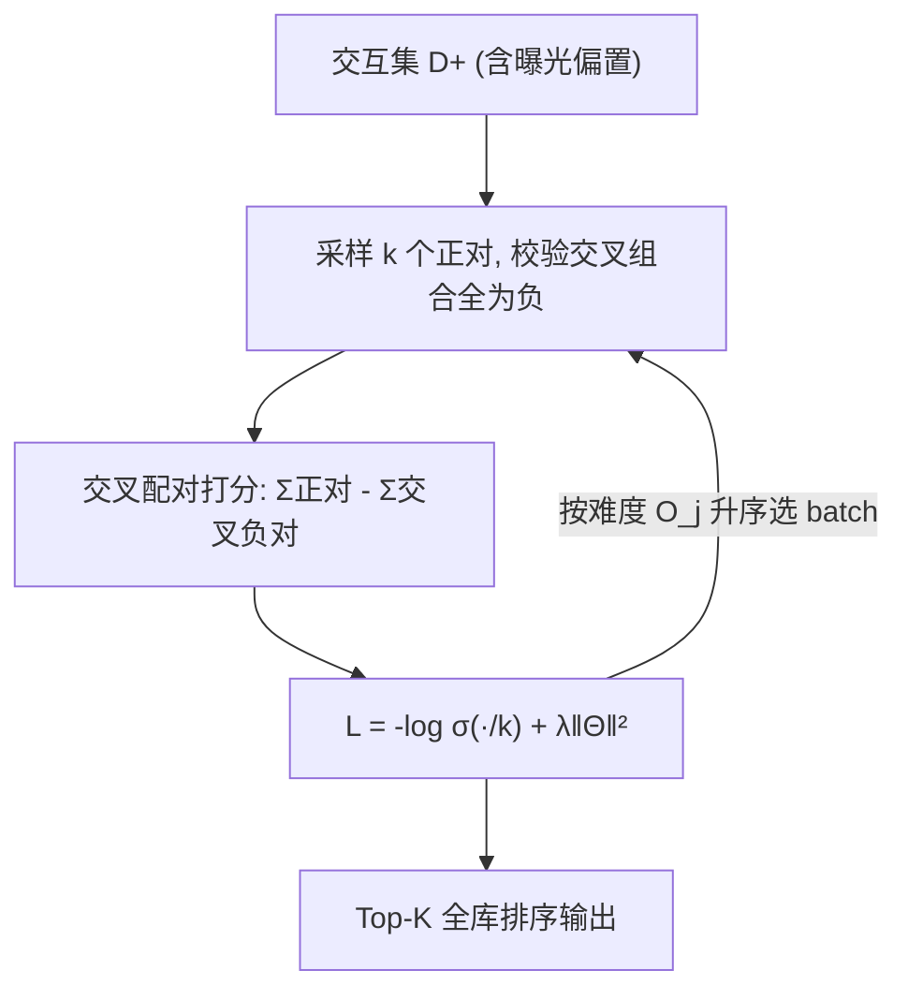
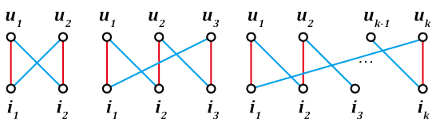

# Cross Pairwise Ranking for Unbiased Item Recommendation (面向无偏物品推荐的交叉配对排序)

- **会议/期刊**: WWW 2022
- **作者与机构**: Qi Wan, Xiangnan He, Xiang Wang, Jiancan Wu (USTC), Wei Guo, Ruiming Tang (华为诺亚方舟实验室)
- **推荐链路定位**: 召回/排序打分（训练损失层，模型无关）
- **研究方向**: 去偏公平与可信推荐 / 协同过滤
- **论文原文**: [https://arxiv.org/abs/2204.12176v1](https://arxiv.org/abs/2204.12176v1)
- **开源代码**: [https://github.com/Qcactus/CPR](https://github.com/Qcactus/CPR)

## TL;DR (1分钟核心速览)

曝光机制使观测交互带有流行度偏置，而 BCE/BPR 直接拟合观测标签，会把"曝光概率"学进打分函数，导致马太效应。本文提出 CPR：一次采样 $k$个正交互并强制其交叉组合全为负对，用"正对得分和 − 交叉负对得分和"构造损失，在曝光可分解为$p_u\cdot p_i\cdot P(R)^{\alpha}$ 的温和假设下证明倾向项成对抵消，实现**样本级**无偏且无需估计倾向分。在 MovieLens/Netflix/iFashion 的重采样无偏测试集上，Recall@20 相对最强基线 DICE 提升 9.16%/14.73%/7.44%，训练时间仅为 DICE 的 2.6%/1.3%。

## Background & Motivation (背景与核心矛盾)

- **主流范式**: 以 BCE 逐点回归或 BPR 逐对比较拟合观测交互，隐含假设"曝光即偏好"。
- **前人局限**: IPS 系（Rel-MF/UBPR）需预设倾向分且重加权后方差剧增，裁剪降方差又破坏无偏性；DICE 系需解耦双嵌入并依赖少量无偏数据，且未直接修正损失。
- **核心洞察 (Key Insight)**: 把无偏性定义从"期望等于理想损失"改为"收敛时排序一致" $\hat{s}_{u,i}>\hat{s}_{u,j}\Leftrightarrow s_{u,i}>s_{u,j}$；此时可证明 BCE 实际拟合的是$s_{u,i}+\ln P(O_{u,i}=1|R_{u,i}=1)$，BPR 则残留$\frac{1}{1+\alpha}(-\ln p_i+\ln p_j)$ 的物品倾向差——偏置源于损失结构，而非数据本身。
- **本文切入点**: 不改权重、不改数据，只改"一个样本由哪些交互组成"，让倾向项在减法中自然抵消。

## Method (核心方法设计)

### 1. 整体框架 (Overall Architecture)

输入仍是隐式交互集 $\mathcal{D}^+$；采样器每次抽取$k$个互不重叠的正对$(\boldsymbol{u},\boldsymbol{i})$，校验其交叉组合$\{(u_1,i_2),\dots,(u_k,i_1)\}$全为未交互负对后组装配对样本；打分器（MF/LightGCN/NeuMF/NGCF）输出$\hat{s}_{u,i}$，损失鼓励正对得分之和高于交叉负对之和；训练时用当前模型打分的"难度值"对候选样本排序，保留最难的一批组成 batch；推理即常规 Top-K 全库排序，无额外开销。

### 2. 关键设计拆解 (Key Designs)

1. **交叉配对排序损失 (CPR Loss)**：痛点在于逐点/逐对损失无法消除 $p_u,p_i$。CPR 把$k$ 个正对与循环错位的负对做差：
$$\mathcal{L}_{CPR}=-\!\!\sum_{\mathcal{D}^k}\!\ln\sigma\Big(\tfrac{1}{k}\big(\textstyle\sum_{t=1}^{k}\hat{s}_{u_t,i_t}-\sum_{t=1}^{k}\hat{s}_{u_t,i_{t+1}}\big)\Big)$$
在 $P(O_{u,i}=1|R_{u,i}=1)=p_u p_i P(R_{u,i}=1)^{\alpha}$下，正负两侧各含一次$p_{u_t}$与$p_{i_t}$，相减后$\ln p$项完全抵消，只剩$s_{u,i}$ 的比较——这是"结构对消"而非"权重补偿"，故方差不会爆炸。<figure class="paper-figure" markdown="span">
  <figcaption>图1：CPR样本的组成。红线表示正样本对，蓝线表示负样本对。从左到右的图分别表示D2、D3和D𝑘中样本的组成。</figcaption>
</figure>

2. **样本规模扩展与权衡**：$k$可推广至任意$\ge 2$，$\frac{1}{k}$用于跨不同$k$归一口径；但$k$越大，越多的对被强行绑定训练，出现"过拟合对拖累未收敛对"的刚性，实验取$k\in\{2,3\}$且$\mathcal{D}^2:\mathcal{D}^3\approx 3$ 时最优。

3. **训练目标与动态采样**：总损失 $\mathcal{L}=\mathcal{L}_{CPR}+\lambda\|\Theta\|^2$。随机采样对全部合法样本等概率，但易样本贡献低；借鉴 DNS，先抽$b\beta\gamma$个候选、过滤非法组合得$b\beta$个，再按$O_j=\frac{1}{k}(\sum\hat{s}_{pos}-\sum\hat{s}_{neg})$升序取前$b$ 个（越小越难）。负采样来自"同批其他用户的正交互"，天然构成 in-batch 难负例，无需均匀负采样。

## Experimental Setup & Evaluation Protocol (实验设置与评估协议)

- **数据集与预处理**（刻意采用 **3-core** 而非 10-core，以保留长尾物品）：

| 数据集 | #Users | #Items | #Interactions | 密度 | 说明 |
| :--- | :---: | :---: | :---: | :---: | :--- |
| MovieLens-10M | 61,770 | 6,958 | 1,533,956 | 0.0036 | 评分≥5 二值化为 1 |
| Netflix | 46,420 | 12,898 | 2,475,020 | 0.0041 | 同上 |
| iFashion | 264,251 | 53,033 | 1,505,141 | 0.0001 | 点击即交互，极稀疏 |

- **数据划分与防穿越**: 非随机划分，而是**构造模拟无偏集**——按 $p_s(u,i)\propto\min(1/d_i,a)$逆度采样（$a=1/60$于 ML/Netflix，$1/12$ 于 iFashion）得到验证/测试集，其余为训练集，比例 70/10/20；测试集流行物品被降采样，强调长尾。
- **排名评测协议**: 全库排序取 Top-20，报告 Recall@20、NDCG@20 与 ARP@20（Top-20 物品平均度，越低越无偏）。
- **对比基线与超参**: 传统方法 BPR、Mult-VAE；去偏方法 CausE、Rel-MF、UBPR、DICE。统一 MF 骨干，$d=128$（DICE 取 64 以对齐参数量），Adam + early stopping，5 次随机种子重复并做双尾配对 t 检验（$p<0.05$）。

## Key Experimental Results (实验关键数据)

### 1. 主实验对比 (Main Results)

| 方法 | ML Recall | ML NDCG | ML ARP | NF Recall | NF NDCG | NF ARP | iF Recall | iF NDCG | iF ARP |
| :--- | :---: | :---: | :---: | :---: | :---: | :---: | :---: | :---: | :---: |
| BPR | 0.1579 | 0.0939 | 4084 | 0.1255 | 0.0952 | 3341 | 0.0278 | 0.0122 | 436 |
| Mult-VAE | 0.1676 | 0.1004 | 4468 | 0.1242 | 0.0921 | 3554 | 0.0309 | 0.0142 | 415 |
| CausE | 0.1440 | 0.0805 | 3814 | 0.1080 | 0.0730 | 3206 | 0.0214 | 0.0094 | 408 |
| Rel-MF | 0.1463 | 0.0829 | 4107 | 0.1138 | 0.0765 | 3254 | 0.0250 | 0.0113 | 421 |
| UBPR | 0.1682 | 0.1000 | 2691 | 0.1315 | 0.1007 | 2289 | 0.0281 | 0.0126 | 404 |
| DICE | 0.1835 | 0.1101 | 1173 | 0.1317 | 0.1007 | 1244 | 0.0275 | 0.0124 | 250 |
| CPR-rand | 0.1938 | 0.1192 | **1055** | 0.1462 | 0.1143 | 1270 | 0.0307 | 0.0137 | 398 |
| **CPR** | **0.2003** | **0.1223** | 1138 | **0.1511** | **0.1190** | **1204** | **0.0332** | **0.0151** | 359 |
| **Improv.%** | +9.16% | +11.08% | — | +14.73% | +18.17% | — | +7.44% | +6.34% | — |

### 2. 消融实验 (Ablation Study)

| 设置 | ML Recall | ML NDCG | NF Recall | NF NDCG |
| :--- | :---: | :---: | :---: | :---: |
| CPR-rand（均匀随机采样，$k\in\{2,3\}$） | 0.1938 | 0.1192 | 0.1462 | 0.1143 |
| **CPR（动态难样本采样）** | **0.2003** | **0.1223** | **0.1511** | **0.1190** |
| CPR @ LightGCN | 0.1963 | 0.1210 | 0.1502 | 0.1180 |
| CPR @ NeuMF | 0.1895 | 0.1155 | 0.1434 | 0.1109 |
| CPR @ NGCF | 0.1952 | 0.1182 | 0.1498 | 0.1173 |
| CPR（$\theta=0.5$ 强偏置训练集） | 0.1584 | 0.0927 | 0.1189 | 0.0858 |
| CPR（$\theta=-0.5$ 弱偏置训练集） | 0.1737 | 0.1040 | 0.1274 | 0.0965 |

### 3. 关键实验发现 (Key Findings)

1. **增益主要落在长尾**：CPR 在 MovieLens 上 Recall@20 比 DICE 高 9.16%，同时 ARP 从 BPR 的 4084、UBPR 的 2691 压到 1138，且推荐分布最贴近无偏测试集（图 4），说明提升不是"更准地推热门"，而是把曝光份额让渡给低度物品。
2. **动态难样本采样等价于"隐式方差控制"**：仅替换采样策略（rand→dynamic）即带来 +3.35% Recall、+2.60% NDCG，且收敛所需 epoch 最少；相比 IPS 通过裁剪权重降方差（破坏无偏性），CPR 用样本难度筛选提速而不损伤理论性质。
3. **损失与骨干解耦且抗偏置强度变化**：换用 LightGCN/NeuMF/NGCF 后 NDCG@20 仍比 DICE 高 7.9%/26.4%/10.4%（NeuMF 上增益最大，说明该骨干最易被流行度污染）；在人为放大/削弱偏置（$\theta=\pm0.5$）的训练集上 NDCG 稳定领先 DICE 约 10%–14%，体现对曝光分布漂移的鲁棒性。

## Highlights & Limitations (亮点、对比与审稿批判)

- **与代表作对比**: 相比 IPS（Rel-MF/UBPR）——不需倾向分、不做重加权、保证逐样本无偏而非仅期望无偏；相比 DICE——不需解耦双嵌入、不需无偏辅助数据，纯损失层改造；相比 Setwise Ranking——后者为提升 BPR 精度而做集合级比较，样本仍是单用户三元组，无法消去跨用户共享的 $p_i$，故无去偏能力。
- **可迁移亮点**: (1) "构造交叉样本使混淆因子在减法中对消"的思路可直接移植到跨域/多场景共享偏置、群组推荐中的群体曝光偏差；(2) 用当前模型打分排序候选样本的难度感知采样，可低成本嵌入任意 pairwise 训练管线。
- **审稿级局限批判**: (1) 核心假设 $P(O|R)=p_u p_i P(R)^{\alpha}$把曝光简化为用户×物品乘积，忽略位置、上下文与序列位置偏置，且$p_u,p_i$与$P(R)$存在可辨识性纠缠；(2) 要求$k$个正对的交叉组合全为负，在密度$10^{-4}$的 iFashion 上拒绝率高、采样代价上升，且$k>3$后性能反降，超参敏感；(3) 评测依赖人造重采样测试集而非真实无偏日志，ARP 数值受上限$a$ 强烈影响，跨数据集 ARP 不可直接比较。

## Rating (四维评分)

- **方法创新性 (Novelty)**: ⭐⭐⭐⭐⭐ （把去偏从"重加权"翻转为"重构样本组成"，$p_u p_i$ 成对抵消的推导干净且给出样本级无偏这一更强结论）
- **评估协议与实验扎实度 (Protocol & Experiments)**: ⭐⭐⭐⭐ （3 数据集 + 3 骨干 + 偏置强度扰动 + 5 次重复 t 检验齐备，但测试集为模拟无偏采样，缺少真实线上验证）
- **写作与数学规范度 (Clarity & Rigor)**: ⭐⭐⭐⭐ （命题—证明链条清晰、BCE/BPR 偏置性证明直观；对 CPR 仅为"松弛优化目标"的自我批判诚实，但 $k$ 扩展部分证明从略）
- **工业落地与复现价值 (Industrial & Practical Value)**: ⭐⭐⭐⭐⭐ （纯损失替换、代码开源、训练时间仅 DICE 的 1.3%–2.6%，推理零额外开销，可直接插入现有召回/精排训练流程）

