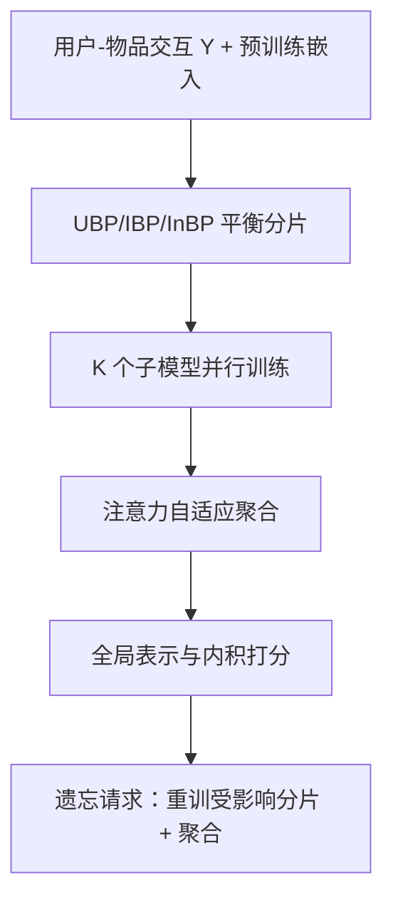
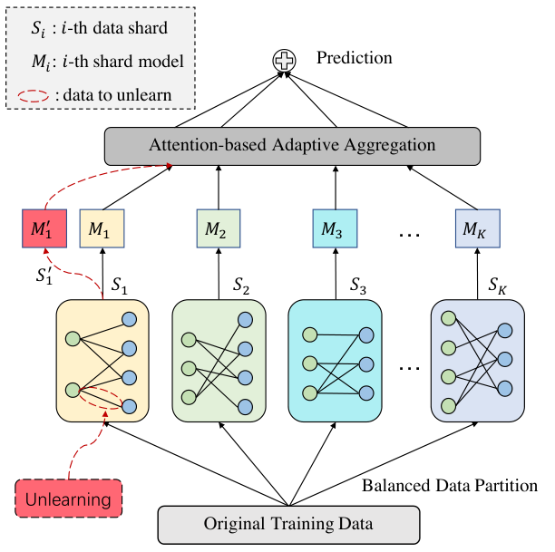

# Recommendation Unlearning（推荐系统遗忘学习）

- **会议/期刊**: WWW 2022
- **作者与机构**: Chong Chen, Fei Sun, Min Zhang, Bolin Ding；清华大学、阿里巴巴 DAMO Academy
- **推荐链路定位**: 训练后模型遗忘（召回/排序模型通用）
- **研究方向**: 去偏公平、可信隐私与工业架构 / 协同过滤与双塔召回
- **论文原文**: [https://arxiv.org/abs/2201.06820v2](https://arxiv.org/abs/2201.06820v2)
- **开源代码**: [https://github.com/chenchongthu/Recommendation-Unlearning](https://github.com/chenchongthu/Recommendation-Unlearning)

## TL;DR (1分钟核心速览)

针对推荐系统在隐私撤回、脏数据清除与用户反馈纠偏时的“训练数据遗忘”需求，RecEraser 用 UBP/IBP/InBP 相似度平衡分片保留协同信息，并以注意力自适应聚合子模型；在三个真实数据、全库排序下仅重训受影响分片，Yelp2018 BPR Recall@20 较 SISA/GraphEraser 提升约 61%/11%，ML-10m 遗忘耗时降低约 10–27 倍。

## Background & Motivation (背景与核心矛盾)

- **主流范式**: 机器遗忘以 SISA 为代表：随机分片、独立训练子模型，遗忘时只重训受影响分片；GraphEraser 将图聚类分片与静态加权聚合用于图数据。
- **前人局限**: 随机分片会破坏推荐数据中的用户—物品协同信息；图聚类/社区发现易产生极不均衡分片，使大分片重训拖慢遗忘效率。
- **核心洞察**: 推荐模型的子模型应对不同用户—物品对贡献不同；聚合权重应随预测样本动态变化，而非全局静态权重。
- **本文切入点**: 用相似度驱动的**平衡分片**保留协同结构，再用**样本级注意力聚合**提升全局模型效用。

## Method (核心方法设计)

### 1. 整体框架 (Overall Architecture)

RecEraser 先用预训练 WMF 嵌入做平衡数据划分，将交互集切成 $K$ 个大小受控的 shard；每个 shard 独立训练 BPR/WMF/LightGCN 子模型。预测时，先将各子模型嵌入投影到统一空间，再由注意力网络按用户/物品生成聚合权重，得到全局表示并内积打分。收到遗忘请求时，仅重训包含被删交互的子模型，并重训轻量聚合网络，实现精确遗忘路径。

<figure class="paper-figure" markdown="span">
  <figcaption>图1：我们的 RecEraser 框架示意图，包括数据划分、子模型训练和子模型聚合三部分。当收到数据遗忘请求时，只需重新训练对应的子模型和聚合部分。</figcaption>
</figure>

### 2. 关键设计拆解 (Key Designs)

1. **相似度平衡分片（UBP/IBP/InBP）**：随机分片丢失协同信息，纯聚类又易失衡。UBP 以用户嵌入欧氏距离分配：$d(a_i,u)=\lVert\bar{\boldsymbol{p}}_{a_i}-\bar{\boldsymbol{p}}_u\rVert_2$，每片上限$t$保证均衡；InBP 进一步以交互对为锚点，$d(a_i,y_{uv})=\lVert\bar{\boldsymbol{p}}_i-\bar{\boldsymbol{p}}_u\rVert_2\times\lVert\bar{\boldsymbol{q}}_i-\bar{\boldsymbol{q}}_v\rVert_2$，同时保留用户与物品相似性。直觉是：相似交互同片可维持协同信号，大小上限又避免遗忘时重训过大分片。

2. **注意力自适应聚合（AttAgg）**：先统一各子模型表示空间：$\boldsymbol{P}_i^{tr}=\boldsymbol{W}_i\boldsymbol{P}_i+\boldsymbol{b}_i$，$\boldsymbol{Q}_i^{tr}=\boldsymbol{W}_i\boldsymbol{Q}_i+\boldsymbol{b}_i$；再聚合$\boldsymbol{P}=\sum_{i=1}^{K}\alpha_i\boldsymbol{P}_i^{tr}$，$\boldsymbol{Q}=\sum_{i=1}^{K}\beta_i\boldsymbol{Q}_i^{tr}$。其中$\alpha_i=\frac{\exp(\boldsymbol{h}_1^\top\sigma(\boldsymbol{W}_1\boldsymbol{p}_i^{tr}+\boldsymbol{b}_1))}{\sum_j\exp(\boldsymbol{h}_1^\top\sigma(\boldsymbol{W}_1\boldsymbol{p}_j^{tr}+\boldsymbol{b}_1))}$，$\beta_i$ 同理。它让不同子模型对不同用户—物品对贡献不同，比平均/静态加权更贴合推荐异质偏好。

3. **训练目标、负采样与推理效率**：子模型按各自损失训练（BPR 成对负采样，WMF 非采样全负例）；固定子模型后仅优化聚合参数：$\min_{\Theta}\mathcal{L}(\boldsymbol{P},\boldsymbol{Q},\boldsymbol{Y})+\lambda\lVert\Theta\rVert_2^2$。聚合网络约 10 epoch 即可收敛。推理为“子模型表示 + 聚合 + 内积”，遗忘开销为 1 个 shard 重训 + 聚合重训。

## Experimental Setup & Evaluation Protocol (实验设置与评估协议)

- **数据集与预处理**:

| 数据集 | #Users | #Items | #Interactions | 稀疏度/密度 | 特征/场景说明 |
| :--- | :---: | :---: | :---: | :---: | :--- |
| Yelp2018 | 31,668 | 38,048 | 1,561,406 | 0.13% | 本地生活商户隐式反馈，最稀疏 |
| Movielens-1m | 6,940 | 3,706 | 1,000,209 | 3.89% | 电影评分转隐式反馈 |
| Movielens-10m | 71,567 | 10,681 | 10,000,054 | 1.31% | 大规模电影隐式反馈 |

- **数据划分与防穿越**: 随机 80% 交互为训练集，其余为测试集；再从训练集随机取 10% 作验证集调参。属于比例划分，非全局时间戳切分。
- **排名评测协议**: 对每个用户做 **Full-Ranking 全库排序**，候选为除训练正例外的全部物品；报告 Recall@10/20/50 与 NDCG@10/20/50。
- **对比基线与超参**: Retrain 为上限；SISA 随机分片+平均聚合；GraphEraser 图聚类分片+静态学习加权。底座为 BPR、WMF、LightGCN；$K=10$，$d=64$，注意力维度$k=32$，batch 512，lr 0.05；显著性用 paired t-test，$p<0.01$。

## Key Experimental Results (实验关键数据)

### 1. 主实验对比 (Main Results)

下表保留 3 个遗忘基线 × 2 个代表性底座在 2 个数据集上的 Recall@20 / NDCG@20；Retrain 为理论上限，加粗为最佳遗忘法。

| 数据集/底座 | 指标 R@20 / N@20 | Retrain | SISA | GraphEraser | RecEraser | vs 最优基线 |
| :--- | :---: | :---: | :---: | :---: | :---: | :---: |
| Yelp2018-BPR | R@20 / N@20 | **0.0521 / 0.0423** | 0.0272 / 0.0224 | 0.0397 / 0.0319 | **0.0439 / 0.0353** | +10.6% |
| Yelp2018-WMF | R@20 / N@20 | **0.0619 / 0.0512** | 0.0401 / 0.0336 | 0.0431 / 0.0360 | **0.0572 / 0.0471** | +32.7% |
| Yelp2018-LightGCN | R@20 / N@20 | **0.0637 / 0.0524** | 0.0392 / 0.0321 | 0.0479 / 0.0393 | **0.0568 / 0.0465** | +18.6% |
| ML-1m-BPR | R@20 / N@20 | **0.2389 / 0.3368** | 0.1737 / 0.2679 | 0.1906 / 0.2827 | **0.2254 / 0.3186** | +18.3% |
| ML-1m-WMF | R@20 / N@20 | **0.2507 / 0.3509** | 0.1266 / 0.1998 | 0.1823 / 0.2557 | **0.2254 / 0.3253** | +23.6% |
| ML-1m-LightGCN | R@20 / N@20 | **0.2428 / 0.3447** | 0.1743 / 0.2686 | 0.1914 / 0.2791 | **0.2266 / 0.3229** | +18.4% |

### 2. 消融实验 (Ablation Study)

| 数据集/底座 | 变体 | Recall@20 | 说明 |
| :--- | :--- | :---: | :--- |
| Yelp2018/LightGCN | Random | 0.0472 | 随机分片破坏协同信息 |
| Yelp2018/LightGCN | InBP | **0.0568** | +20.3% vs Random |
| Yelp2018/WMF | MeanAgg | 0.0475 | SISA 式平均聚合 |
| Yelp2018/WMF | StaticAgg | 0.0482 | GraphEraser 式静态加权 |
| Yelp2018/WMF | AttAgg | **0.0572** | +18.7% vs StaticAgg |

### 3. 关键实验发现 (Key Findings)

1. **分片方式比“是否分片”更关键**：Yelp2018/LightGCN 上 InBP 的 Recall@20=0.0568，较 Random 的 0.0472 提升 20.3%，说明按交互相似度分片能显著保留协同信号。
2. **自适应聚合稳定优于静态聚合**：Yelp2018/WMF 上 AttAgg 达 0.0572，较 StaticAgg 的 0.0482 提升 18.7%，验证了“权重应随用户—物品对变化”的假设。
3. **效率收益随模型与数据规模放大**：ML-10m/LightGCN 从 Retrain 的 25,330 分钟降至 940 分钟（约 27×），BPR 从 3,250 降至 320 分钟（约 10×）；但 $K$ 增大时遗忘更快、Recall 略降，需在效率与协同信息保留间折中。

## Highlights & Limitations (亮点、对比与审稿批判)

- **与代表作对比**: SISA 随机分片会破坏 CF 协同结构；GraphEraser 面向图数据且聚合权重静态。RecEraser 以相似度平衡分片+样本级注意力聚合，直接面向推荐场景。
- **可迁移亮点**: “相似度分片 + 分片上限”可迁移到隐私删除、增量学习与联邦推荐；“独立子模型 + 注意力聚合”可作为通用集成/蒸馏前处理。
- **审稿级局限批判**: ① 精确遗忘仍依赖重训受影响 shard 与聚合网络，$K$ 越大性能越受损，且聚合重训需全量训练数据，批量遗忘请求未解决；② 实验限于 BPR/WMF/LightGCN 与三个基准，缺少隐私攻击、形式化遗忘证书与线上时延验证。

## Rating (四维评分)

- **方法创新性 (Novelty)**: ⭐⭐⭐⭐ （首次将机器遗忘系统化引入推荐，平衡分片与样本级注意力聚合机制清晰）
- **评估协议与实验扎实度 (Protocol & Experiments)**: ⭐⭐⭐⭐ （3 数据集×3 底座、全库排序与显著性检验完整，但遗忘基线数量有限）
- **写作与数学规范度 (Clarity & Rigor)**: ⭐⭐⭐⭐ （算法与公式定义较清晰，复杂度与隐私保证的形式化略欠）
- **工业落地与复现价值 (Industrial & Practical Value)**: ⭐⭐⭐⭐ （代码开源、模型无关、遗忘加速显著；但分片数与聚合重训需工程调参）

