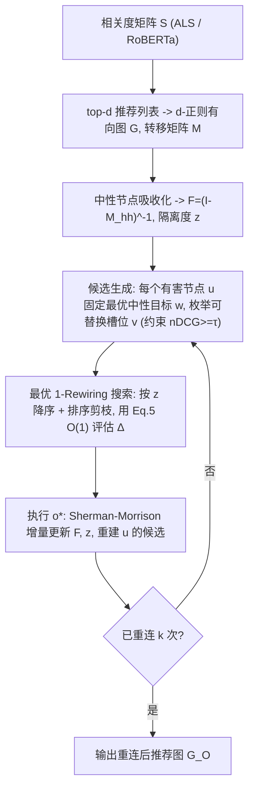

# Rewiring What-to-Watch-Next Recommendations to Reduce Radicalization Pathways (通过重连"下一个看什么"推荐以减少激进化路径)

- **会议/期刊**: WWW 2022 (The ACM Web Conference)
- **作者与机构**: Francesco Fabbri (UPF & Eurecat)、Yanhao Wang (华东师范大学)、Francesco Bonchi (ISI Foundation)、Carlos Castillo (ICREA & UPF)、Michael Mathioudakis (赫尔辛基大学)
- **推荐链路定位**: 召回（W2W 推荐列表后处理 / 图结构重连）
- **研究方向**: 去偏公平、可信与工业架构 / 图神经网络与知识图谱推荐
- **论文原文**: [https://arxiv.org/abs/2202.00640v1](https://arxiv.org/abs/2202.00640v1)
- **开源代码**: [https://github.com/FraFabbri/rewiring-what-to-watch](https://github.com/FraFabbri/rewiring-what-to-watch)（对比基线 RePBubLik: [https://github.com/CriMenghini/RePBubLik](https://github.com/CriMenghini/RePBubLik)）

## TL;DR (1分钟核心速览)

"下一个看什么"推荐器天然同质化，会把用户推向越来越极端的激进内容并形成"激进化路径"。本文把推荐列表整体建模为 d-正则有向概率图，将用户会话视为随机游走，把"有害节点进入中性节点集前的期望命中步长"定义为隔离度 $z_u$，并提出在 nDCG 质量阈值$\tau$约束下最小化最坏隔离度的 **k-Rewiring** 问题。作者证明该问题 NP-难且任意因子不可近似，转而利用吸收随机游走理论 + Sherman-Morrison 增量更新设计贪心算法（HEU）。在 6 个 YouTube 图与 4 个 NELA-GT 新闻图上，HEU 以$k\le 50$次重连将$Z_T/Z_0$ 降至 0.2–0.6（降幅 40%–80%），全面优于 RePBubLik 与启发式基线。

## Background & Motivation (背景与核心矛盾)

- **主流范式**: 平台级干预研究分为两类——(i) 在**用户网络**上做边增删以限制不良信息传播或降低极化（Friedkin-Johnsen 动力学、争议度、Polarization-Disagreement 指数）；(ii) 在**物品网络**上用"气泡半径"（bubble radius）衡量结构偏差并通过**加边**减小之（RePBubLik）。
- **前人局限**:
  - 用户网络模型与 W2W 场景不匹配：推荐是"物品 $\to$ 物品"的有向边，且用户会话遵循的是推荐列表的点击概率，而非信息传播概率。
  - 现有物品网络方法只操纵"插入新边"，而 W2W 列表槽位固定为 $d$，物理上只能"替换"（删一条 + 插一条）；且优化的是全体节点偏差之和（平均意义），无法保证**最坏个体**不被困住。
- **核心洞察 (Key Insight)**: 若把中性节点设为**吸收态**，则随机游走从有害节点出发到被吸收的期望步长，恰好等于"用户连续消费有害内容的期望长度"；这一量可由基本矩阵 $(\mathbf{I}-\mathbf{M}_{hh})^{-1}$闭式得到。并且**单次重连（$k=1$）的最优解可在多项式时间内求得**，从而贪心$k$ 次即可。
- **本文切入点**: 以"最坏隔离度最小化 + nDCG 质量约束"定义 k-Rewiring，用增量公式把每次重连的评估代价从 $O(n^3)$矩阵求逆降到$O(1)$，配合候选剪枝实现近线性实用复杂度。

## Method (核心方法设计)

### 1. 整体框架 (Overall Architecture)

输入是相关度矩阵 $\mathbf{S}$（YouTube 上由 ALS 隐因子得到，新闻上由 RoBERTa 语义相似度得到）与由 top-$d$生成的 d-正则有向图$G=(V,E,\mathbf{M})$，其中$\mathbf{M}[u,v]=p_{uv}=f(i_u(v))$由推荐位次决定点击概率。将中性节点置为吸收态后构造分块转移矩阵$\mathbf{M}=\begin{bmatrix}\mathbf{M}_{hh} & \mathbf{M}_{hn}\\ \mathbf{0} & \mathbf{I}\end{bmatrix}$，用幂迭代近似$\mathbf{F}=(\mathbf{I}-\mathbf{M}_{hh})^{-1}$与隔离向量$\mathbf{z}$。随后进入"候选生成$\to$最优$1$-Rewiring 搜索"循环：每轮挑出使最坏$z$下降最多的重连操作$o=(u,v,w)$（删$(u,v)\in V_h\times V_h$，插$(u,w)$且$w\in V_n$，保持位次与概率不变），用 Sherman-Morrison 增量刷新$\mathbf{F},\mathbf{z}$，并重建被改节点$u$的候选集，重复$k$ 轮。全程无需训练，纯图后处理（离线一次、可周期性重跑）。

### 2. 关键设计拆解 (Key Designs)

1. **隔离度与最坏情形目标（Segregation）**：痛点是"平均极化度"无法刻画个体被困风险。定义 $z_u=\mathbb{E}_G[T_u(V_n)]$、$\mathbf{z}=(\mathbf{I}-\mathbf{M}_{hh})^{-1}\mathbf{1}$、$Z(G)=\max_{u\in V_h} z_u$，目标为最大化$\Delta(O)=Z(G)-Z(G_O)$且满足$\forall u:\ L(\Gamma^+(u))=\mathrm{DCG}(\Gamma^+(u))/\mathrm{DCG}(\Gamma_0^+(u))\ge\tau$。以**最大值**而非总和为目标，等价于给最脆弱的激进内容"兜底"，物理上对应切断最深的那条沉浸通道。

2. **Sherman-Morrison 增量评估（核心加速）**：痛点是暴力法需对每个候选做 $O(n^3)$求逆，规模为$O(dn^2)$个候选时不可行。由于单次重连只改变$\mathbf{M}$的一个秩一扰动$\mathbf{e}\mathbf{g}^\top$（$g_v=-p_o,\ g_w=+p_o$），有
$$\mathbf{F}'=\mathbf{F}-\frac{\mathbf{F}\mathbf{e}\mathbf{g}^{\top}\mathbf{F}}{1+\mathbf{g}^{\top}\mathbf{F}\mathbf{e}},\qquad \Delta(h,o)=z_h-z'_h=\frac{f_{hu}\,z_v}{1/p_o+f_{vu}}$$
该式显示 $\Delta(h,o)$**与目标节点$w$无关**，因此可对每个$u$只固定一个 nDCG 最优的$w$，把候选集从$O(dn^2)$压到$O(dn)$；再按$z$降序只检查前几个节点（若$z'_{h_1}>z_{h_2}$则最坏值必来自$h_1$，提前终止），得到最坏$O(dn^2)$、实测近$O(n(d+\log n))$ 的复杂度。

3. **训练目标、负采样与推理开销**：本文**无训练损失、无负采样**（纯图优化算法）。贪心 $k$轮总代价$O(kdn^2)$最坏、实用近$O(kn(d+\log n))$；$\mathbf{F},\mathbf{z}$用幂迭代（$\text{iter}=O(k)$）而非求逆。工业部署上等价于对推荐列表做一次离线批量改写，线上零额外延迟，但需周期性重算（图是静态快照）。

## Experimental Setup & Evaluation Protocol (实验设置与评估协议)

- **数据集与预处理**（原文表 1）：

| 数据集 | #Nodes $n$| #Edges$m$|$n_h/n$| 初始$Z_0$ | 说明 |
| :--- | :---: | :---: | :---: | :---: | :--- |
| YT-D5-S / -B | 31,524 / 105,143 | 157,620 / 525,715 | 0.48 / 0.43 | 588.86 / 598.32 | $d=5$，YouTube$\ge$10k 播放 |
| YT-D10-S / -B | 31,524 / 105,143 | 315,240 / 1,051,430 | 0.48 / 0.43 | 718.92 / 718.37 | $d=10$ |
| YT-D20-S / -B | 31,524 / 105,143 | 630,480 / 2,102,860 | 0.48 / 0.43 | 328.03 / 331.09 | $d=20$ |
| NEWS-1～4 | 27,286 / 22,296 / 28,861 / 26,114 | 272,860 / 222,960 / 288,610 / 261,140 | 0.61～0.65 | 88.53 / 29.90 / 335.23 / 75.15 | NELA-GT 四个月，$d=10$ |

YouTube 原始 330,925 视频 / 2,474,044 条推荐，标签 alt-right/alt-lite/intellectual dark web 合并为 harmful；NELA-GT 713k 新闻按 credibility 二元标注，按月份切分 4 个子图。

- **数据划分与防穿越**: **无 train/test 划分**——这是结构性干预研究，评估对象是"给定静态推荐图的改写效果"，全图节点均参与优化与测量；不涉及时间穿越，但也因此无法反映用户兴趣漂移。
- **排名评测协议**: 非传统 Top-N 排序指标。主指标为 **$Z_T/Z_0$**（$k$次重连后的最坏隔离度相对初始值，越低越好，全库图遍历计算，无采样）；质量侧用 **nDCG loss$L(\Gamma^+(u))\ge\tau$**（对比理想 top-$d$列表）作为硬约束，实验中$\tau=0.9$为主、另测$\{0.5,0.8,0.9,0.99\}$。
- **对比基线与超参设置**: HEU（本文）vs. **BSL-1**（一次性选 $\Delta$最大的$k$个操作，不迭代）、**BSL-2**（仅在初始$z$最大的$k$个节点上找操作）、**RND**（随机）、**RBL**（RePBubLik 的加边算法适配为"加边 + 找可替换边满足$\tau$"）。$d\in\{5,10,20\}$，YouTube 上$k=50$、新闻上$k=20$；未报告显著性检验。

## Key Experimental Results (实验关键数据)

### 1. 主实验对比 (Main Results)

原文主结果为累积曲线（图 1/图 2），下表数值按图读数近似（$\tau=0.9$，越低越好）：

| 图 | $k$ | HEU | BSL-1 | BSL-2 | RND | RBL | HEU 降幅 |
| :--- | :---: | :---: | :---: | :---: | :---: | :---: | :---: |
| YT-D5-S | 50 | **≈0.56** | ≈0.56 | ≈0.95 | ≈1.00 | ≈0.82 | **≈44%** |
| YT-D10-S | 50 | **≈0.20** | ≈0.20 | ≈0.85 | ≈1.00 | ≈0.72 | **≈80%** |
| YT-D20-S | 50 | **≈0.60** | ≈0.60 | ≈0.95 | ≈1.00 | — | **≈40%** |
| YT-D5-B / D10-B | 50 | **≈0.56 / ≈0.20** | 同 HEU | ≈0.95 | ≈1.00 | n/a（>24h 未完成） | 一致 |
| NEWS-1 | 20 | **≈0.30** | ≈0.55 | ≈0.60 | ≈0.95 | ≈0.90 | **≈70%** |
| NEWS-3 | 20 | **≈0.15** | ≈0.20 | ≈0.25 | ≈0.95 | ≈0.85 | **≈85%** |

### 2. 消融与敏感性分析 (Ablation & Sensitivity)

原文未做组件级消融，改以阈值与出度敏感性代替：

| 设置 | $d=5$(YT-D5-B) |$d=10$|$d=20$ | 结论 |
| :--- | :---: | :---: | :---: | :--- |
| $\tau=0.5$ | 降幅最大 | 同 | 同 | 放宽质量约束可换更多去激进化收益 |
| $\tau=0.8$| 在$k\approx20$后停滞 | 持续下降 | 持续下降 | 小$d$时候选池被$\tau$ 掐死 |
| $\tau=0.9$（默认） |$Z_{50}/Z_0\approx0.56$|$\approx0.20$|$\approx0.60$ | 主结果 |
| $\tau=0.99$| 与 0.8/0.9 接近 | 更慢收敛 | 差异最小 | 大$d$对严格$\tau$ 更鲁棒 |
| BSL-1 vs HEU | 几乎相同 | 几乎相同 | 几乎相同 | 说明贪心"批处理"与逐次迭代解高度重合 |
| 全节点 $z$ 分布（图 4） | 整体左移 | 整体左移 | 差异最大 | 压制最坏值同时降低总体暴露 |

### 3. 关键实验发现 (Key Findings)

1. **最坏值压制会"顺带"改善整体分布**：图 4 的 violin 图显示，$k=50$重连后所有有害节点的$z$分布整体向小值集中，且$d=20$时 HEU 与 RBL 的分布差异最大——说明以$\max$ 为目标的贪心并未牺牲多数节点。
2. **收益在 $d=10$处达到峰值（≈80% 降幅），$d=5$时 10 次操作即降 40% 并在$k\approx30$饱和**：小$d$下候选重连空间被$d$与$\tau$双重限制，算法很快"无操作可用"；$d=20$ 时候选多但单条边的影响力被稀释，50 次操作仅到 ≈40%。
3. **图结构决定方法成败**：YouTube 有害节点入度 Gini 系数 >90%（强偏斜），RePBubLik 在该结构下有效；NELA-GT 入度 Gini <50%，RBL 退化到与随机（RND）相近（NEWS-3 降幅仅 ≈15%，HEU ≈85%）——说明基于"气泡半径"的加边方法对入度分布敏感，而本文的随机游走框架不依赖此假设。

## Highlights & Limitations (亮点、对比与审稿批判)

- **与代表作对比 (vs. Prior Work)**: 相较 **RePBubLik (Haddadan et al.)**，本文三点本质差异——单向（有害$\to$中性）操纵而非双向、**重连（替换槽位）**而非加边、优化**最坏隔离度**而非气泡半径之和；相较 **Garimella 等/Musco 等**的用户网络动力学方法，本文建模对象是"物品$\to$物品"推荐图，用户会话作为随机游走，更贴合 W2W 物理机制。
- **可迁移亮点**: (i) 秩一扰动 + Sherman-Morrison 的 $O(1)$边影响评估，可直接迁移到"图边增删后的影响力/传播范围快速重算"类问题；(ii) "Δ 与目标节点$w$无关"这一结构性观察将候选空间从$O(dn^2)$降到$O(dn)$，是典型的解耦式剪枝技巧。
- **审稿级局限批判**: (1) 假设**二元标签**（harmful/neutral）且图静态预计算，真实平台内容激进程度是连续的、推荐是实时生成的，作者亦在结论中承认；(2) nDCG 用理想 top-$d$归一化，但$\tau=0.9$ 的质量损失在真实业务中意味着可观的点击/时长下降，论文未量化这种参与度—安全性权衡（无在线 A/B）；(3) 未报告显著性检验，主结果以读图曲线呈现，跨方法差异（尤其 BSL-1 与 HEU 几乎重合）缺乏统计支撑。

## Rating (四维评分)

- **方法创新性 (Novelty)**: ⭐⭐⭐⭐ （把"激进化路径"形式化为吸收随机游走的最坏命中长度，并用秩一扰动闭式评估边影响，建模与算法均有实质增量）
- **评估协议与实验扎实度 (Protocol & Experiments)**: ⭐⭐⭐ （10 张真实图、5 类基线、阈值敏感性充分，但无 train/test 协议、无显著性检验、主结果为读图曲线且缺组件消融）
- **写作与数学规范度 (Clarity & Rigor)**: ⭐⭐⭐⭐ （从 NP-难性与不可近似性到 1-Rewiring 最优性再到复杂度分析，链条完整；$\Delta$与$w$ 无关的关键化简推导清晰）
- **工业落地与复现价值 (Industrial & Practical Value)**: ⭐⭐⭐⭐ （代码数据均开源、纯后处理零线上延迟、实测近线性可扩展；但需周期性全图重算，且 $\tau$ 需与业务指标联合调参）

