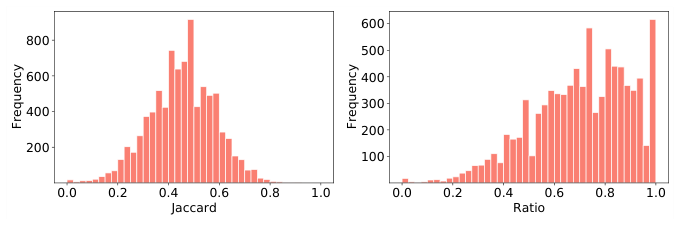
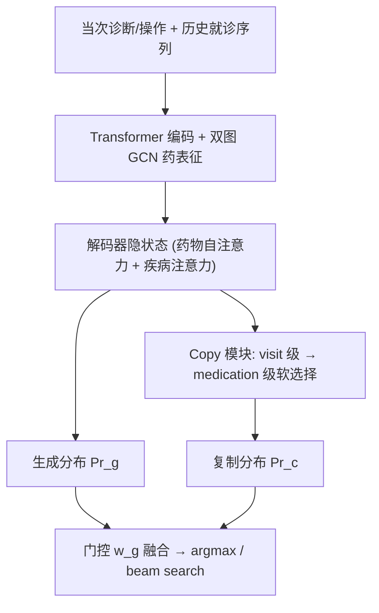
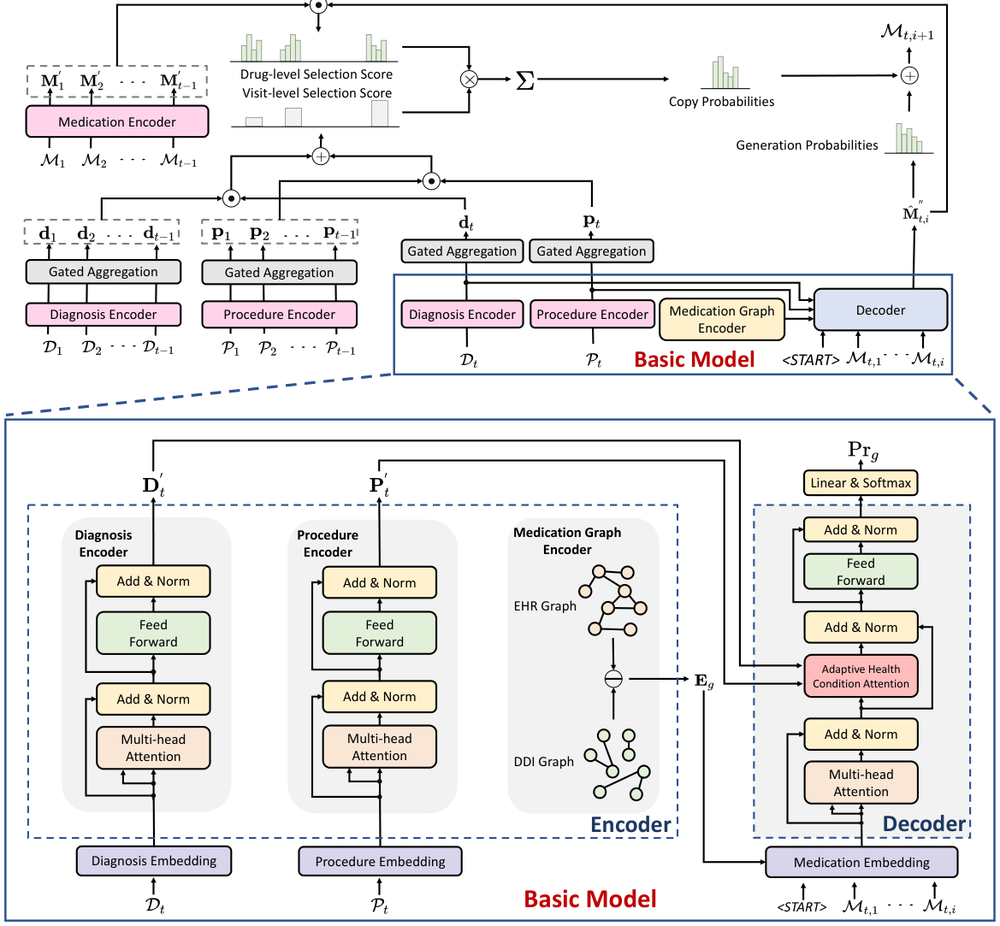

# Conditional Generation Net for Medication Recommendation (条件生成网络用于药物推荐)

- **会议/期刊**: WWW 2022 (The Web Conference)
- **作者与机构**: Rui Wu, Zhaopeng Qiu, Jiacheng Jiang, Guilin Qi, Xian Wu（东南大学 / 腾讯）
- **推荐链路定位**: 端到端生成式（编码器-解码器序列生成 + 复制指针）
- **研究方向**: 生成式推荐与离散语义ID / 序列与会话推荐
- **论文原文**: [https://arxiv.org/abs/2202.06588v2](https://arxiv.org/abs/2202.06588v2)
- **开源代码**: [https://github.com/BarryRun/COGNet](https://github.com/BarryRun/COGNet)

## TL;DR (1分钟核心速览)

药物推荐长期被建模为「多标签分类」，同一患者历史处方的高复用性（图 2 中 Jaccard 显著右偏）被完全忽略。COGNet 把处方集预测改造为序列生成：每步由 copy-or-predict 门控决定「复制历史药」还是「生成新药」，并以 visit→medication 两级软选择定位可复用药物。在 MIMIC-III（14,995 次就诊、131 种药全库打分）上取得 Jaccard 0.5336、F1 0.6869、PRAUC 0.7739，较 SafeDrug 分别提升 2.36%/1.49%/1.20%，DDI 率 0.0852 与数据天然分布 0.0838 基本持平。

## Background & Motivation (背景与核心矛盾)

- **主流范式**: 分为 instance-based（LEAP，仅用当次诊断/操作）与 longitudinal（GAMENet/MICRON/SafeDrug，用 RNN 或记忆网络聚合历次就诊）。
- **前人局限**: ① 全部形式化为 multi-label 分类，药物之间的组合依赖与「同一患者跨次就诊的药物延续性」未被显式建模；② RNN 式递推状态难以建模长程就诊依赖，MICRON 的 recurrent residual 还会累积预测误差。
- **核心洞察 (Key Insight)**: 对 MIMIC-III 统计（图 2）显示，多数就诊的处方与历史处方 Jaccard 集中于中高区间，且相当比例的药物此前已开具——医生的真实决策本质上就是「复制为主、新增为辅」。
- **本文切入点**: 把 NLP 中成熟的 copy/pointer 机制引入处方生成，将「是否复用历史药」变成可学习的概率决策。

<figure class="paper-figure" markdown="span">
  <figcaption>图 2：当前药物与历史药物之间 Jaccard 的直方图（左）以及当前药物出现在既往就诊中的比例直方图（右）。</figcaption>
</figure>

## Method (核心方法设计)

### 1. 整体框架 (Overall Architecture)

编码端：当次就诊的诊断集与操作集分别经 Transformer 编码器得到 $\mathbf{D}'_t,\mathbf{P}'_t$；药库则同时在 EHR 共现图与 DDI 图上做两层 GCN，融合为关系感知药表征$\mathbf{E}_g$。解码端以$\langle\mathrm{START}\rangle$起逐药生成：已生成药物序列先自注意力建模组合依赖，再对$\mathbf{D}'_t,\mathbf{P}'_t$做自适应疾病注意力得到隐状态$\hat{\mathbf{M}}''_{t,i-1}$，输出生成分布$\Pr_g$；copy 模块并行地用同一隐状态在历史就诊上做 visit 级与 medication 级软检索，得到复制分布$\Pr_c$；sigmoid 门控融合后取 argmax 作为第$i$ 个药。训练用 teacher forcing + 交叉熵，推理用 beam search。

<figure class="paper-figure" markdown="span">
  <figcaption>图 3：我们提出的 COGNet 概览。基础模型仅根据患者本次就诊的健康状况推荐药物。另一部分称为复制模块，考虑患者历史就诊的信息。</figcaption>
</figure>

### 2. 关键设计拆解 (Key Designs)

1. **Copy-or-Predict 门控融合（核心增量）**：分类式模型无法表达「这个药和上次一样」这一语义。COGNet 将最终分布写成生成与复制的凸组合，门控由解码隐状态自适应给出：
$\Pr = w_g \Pr_g + (1-w_g)\Pr_c,\quad w_g=\mathrm{Sigmoid}(\hat{\mathbf{M}}''_{t,i-1}\mathbf{W}_f+\mathbf{b}_f)$。
直觉上 $w_g$ 学到的是「当前疾病谱相对历史漂移了多少」，慢病续方时自动偏向复制，新发诊断时偏向生成。

2. **层级软选择复制概率（可解释性来源）**：直接在全部历史药物上打分会被无关就诊稀释。作者先比较就诊相似度 $c_j=\mathrm{Softmax}\big((\mathbf{v}^d_j\cdot\mathbf{v}^d_t+\mathbf{v}^p_j\cdot\mathbf{v}^p_t)/\sqrt{s}\big)$，再在选中就诊内部做药级打分$q_{j,k}\propto\exp\big((\hat{\mathbf{M}}''_{t,i-1}\mathbf{W}_c)\cdot\mathbf{M}'_{j,k}/\sqrt{s}\big)$，同一药物跨多次出现时概率累加并归一化：
$\hat{p}^{(i)}_c=\sum_{j=1}^{t-1}\sum_{k=1}^{|M_j|} q_{j,k}\,c_j\,\mathbb{I}\{M_{j,k}=m_i\}$。
两级乘积等价于「先选值得抄的病历，再选值得抄的药」，天然给出复制路径的可视化解释（图 5）。

3. **关系感知药表征与 DDI 减法**：处方需同时满足「常同开」与「不能同开」两种关系，故用两个独立 GCN 编码后用减号融合 $\mathbf{E}_g=\mathbf{G}_e-\lambda\mathbf{G}_d$（$\lambda$ 可学习），使表征空间沿 DDI 方向被主动推开；解码时再以式 (12) 把诊断、操作作为 query 对齐到已生成药物上，动态聚焦「尚未被覆盖的疾病」。

4. **训练目标、负采样与推理开销**：损失为逐解码步的交叉熵 $\mathcal{L}=-\sum_{\mathcal{R}}\sum_t\sum_i \log \Pr(M_{t,i}\mid \mathbf{V}_{<t},\mathbf{D}_t,\mathbf{P}_t,\mathbf{M}_{t,<i};\theta)$，在全部 131 种药上做 softmax，**无需负采样**；训练用 teacher forcing，推理用 beam search（对比 greedy 提升约 1.3% Jaccard），代价是每个 beam 需完整跑一遍自回归解码。

## Experimental Setup & Evaluation Protocol (实验设置与评估协议)

- **数据集与预处理**: MIMIC-III，沿用 SafeDrug 官方处理脚本，按 ATC 四级码归并药物。

| 数据集 | #Patients | #Medications | #Visits | 平均药/次 | 特征/场景说明 |
| :--- | :---: | :---: | :---: | :---: | :--- |
| MIMIC-III | 6,350 | 131 | 14,995 | 11.44 | 1,958 诊断 / 1,430 操作 / 448 DDI 对；平均 2.37 次就诊，最长 29 次 |

- **数据划分与防穿越 (Splitting Strategy)**: 沿用 SafeDrug 的**就诊记录随机比例划分**（约 2/3 : 1/6 : 1/6），非严格时间戳切分。
- **排名评测协议 (Ranking Protocol)**: **全库打分（全部 131 种药）**的多标签评测，非采样排序；指标为 Jaccard、Average F1、PRAUC 与 DDI Rate，逐患者平均。
- **对比基线与超参设置**: 8 个基线覆盖 LR / ECC（分类链）/ RETAIN / LEAP（序列生成）/ DMNC / GAMENet / MICRON / SafeDrug；嵌入维度 $s$ 与 Transformer 层数沿用 GAMENet 设定，结果取 5 次运行均值 ± 标准差。

## Key Experimental Results (实验关键数据)

### 1. 主实验对比 (Main Results)

| Model | Jaccard | F1 | PRAUC | DDI Rate | Avg. # Drugs |
| :--- | :---: | :---: | :---: | :---: | :---: |
| LR | 0.4865 | 0.6434 | 0.7509 | 0.0829 | 16.18 |
| ECC | 0.4996 | 0.6569 | 0.6844 | 0.0846 | 18.07 |
| RETAIN | 0.4887 | 0.6481 | 0.7556 | 0.0835 | 20.41 |
| LEAP | 0.4521 | 0.6138 | 0.6549 | 0.0731 | 18.71 |
| DMNC | 0.4864 | 0.6529 | 0.7580 | 0.0842 | 20.00 |
| GAMENet | 0.5067 | 0.6626 | 0.7631 | 0.0864 | 27.21 |
| MICRON | 0.5100 | 0.6654 | 0.7687 | 0.0641 | 17.93 |
| SafeDrug | 0.5213 | 0.6768 | 0.7647 | **0.0589** | 19.92 |
| **COGNet** | **0.5336** | **0.6869** | **0.7739** | 0.0852 | 28.09 |
| Improv.% (vs SafeDrug) | +2.36% | +1.49% | +1.20% | — | — |

### 2. 消融实验 (Ablation Study)

| Variant | Jaccard | F1 | PRAUC | Avg. # Drugs | Δ Jaccard |
| :--- | :---: | :---: | :---: | :---: | :---: |
| w/o Copy | 0.5163 | 0.6713 | 0.7637 | 28.31 | −3.24% |
| w/o $c_i$ (visit 级选择) | 0.5119 | 0.6629 | 0.7588 | 26.89 | −4.07% |
| w/o $G$ (EHR+DDI 图) | 0.5306 | 0.6836 | 0.7706 | 29.11 | −0.56% |
| w/o $D$ (诊断) | 0.4937 | 0.6496 | 0.7443 | 28.05 | −7.48% |
| w/o $P$ (操作) | 0.5117 | 0.6669 | 0.7625 | 28.96 | −4.10% |
| w/o BS (greedy) | 0.5266 | 0.6805 | 0.7729 | 28.56 | −1.31% |
| **COGNet** | **0.5336** | **0.6869** | **0.7739** | 28.09 | — |

### 3. 关键实验发现 (Key Findings)

1. **Copy 是主要增益来源但不独立成立**：去掉 copy 模块 Jaccard 掉 3.24%（0.5336→0.5163），而去掉诊断信息掉 7.48%（→0.4937）——说明复制机制建立在「疾病编码精确对齐」之上，二者是乘性关系而非替代关系。
2. **visit 级选择比药级打分更关键**：去掉 $c_j$ 后 Jaccard 掉 4.07% 且平均药数从 28.09 降到 26.89，证明「先筛值得抄的病历」承担了主要去噪职责；仅靠药级相似度会从无关就诊中引入假复用。
3. **长程依赖优势随就诊次数放大**：图 4 显示随 visits 增加，COGNet 的 Jaccard/F1 持续上升，SafeDrug 基本持平、MICRON 因误差累积而下降——注意力式检索比 RNN 递推更抗长序列漂移。

## Highlights & Limitations (亮点、对比与审稿批判)

- **与代表作对比 (vs. Prior Work)**: 与 MICRON 的区别在于后者用 recurrent residual 硬性继承上次处方（单步、易累积误差），COGNet 则在多历史就诊上做注意力软检索；与 GAMENet 都用图结构，但本文把 DDI 图以减法形式嵌入表征而非仅作约束；与 SafeDrug 相比放弃分子图，换取药物级复用建模，Jaccard 更高但 DDI 率也更高（0.0852 vs 0.0589）。
- **可迁移亮点**: ①「复制 vs 生成」门控可直接迁移到复购/续费/订阅类推荐与长尾物品复用场景；② visit→item 两级软检索是一种廉价的长程记忆访问方式，可替代 RNN 状态递推。
- **审稿级局限批判**: ① 解码未建模停止条件，生成 28.09 个药而真实均值仅 11.44，过度生成拉低精度；② 采用就诊级随机划分，同一患者的历史可能跨越训练/测试集，存在信息泄漏风险；③ DDI 仅以软减法引导、无硬约束解码，安全性不如图结构硬过滤；④ 每步自回归 + beam search 的推理成本远高于一次性多标签 sigmoid。

## Rating (四维评分)

- **方法创新性 (Novelty)**: ⭐⭐⭐⭐ （把 copy/pointer 与层级软检索迁移到处方生成，问题重构比算子本身更亮眼，但各部分组件均为已有技术的组合）
- **评估协议与实验扎实度 (Protocol & Experiments)**: ⭐⭐⭐ （指标与基线齐全、5 次运行带标准差，但随机划分存在泄漏隐患，且缺乏与真实处方长度、DDI 硬约束的对照实验）
- **写作与数学规范度 (Clarity & Rigor)**: ⭐⭐⭐⭐ （公式链条完整、符号定义集中，copy 概率的指示函数表达清晰，仅 beam search 超参等细节略欠）
- **工业落地与复现价值 (Industrial & Practical Value)**: ⭐⭐⭐⭐ （代码开源、数据结构简单，但自回归解码延迟与 DDI 安全约束是真实上线的主要障碍）

