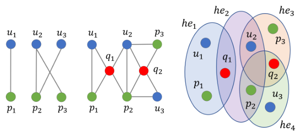
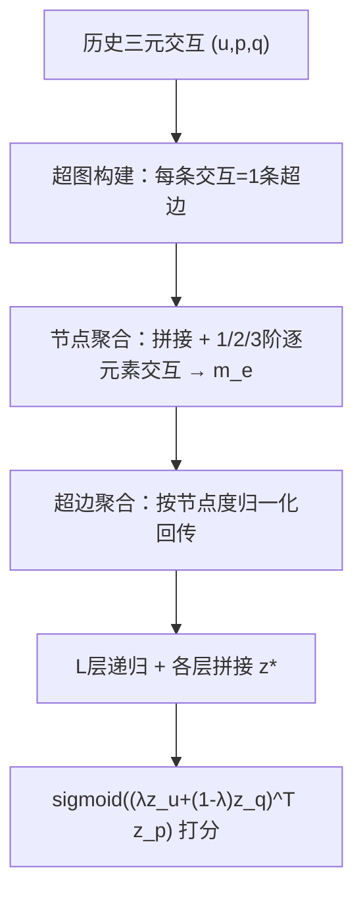
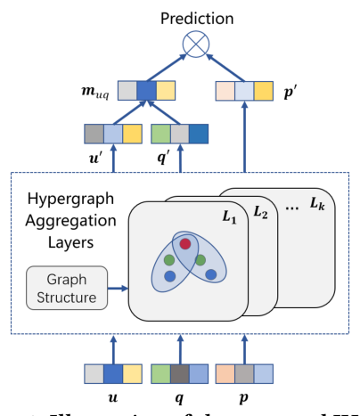

# IHGNN: Interactive Hypergraph Neural Network for Personalized Product Search (面向个性化商品搜索的交互式超图神经网络)

- **会议/期刊**: WWW 2022 (Proceedings of the ACM Web Conference)
- **作者与机构**: Dian Cheng, Jiawei Chen, Wenjun Peng, Wenqin Ye, Xiangnan He (USTC) ; Fuyu Lv, Tao Zhuang, Xiaoyi Zeng (Alibaba Group)
- **推荐链路定位**: 召回（查询条件下的个性化商品检索）
- **研究方向**: 图神经网络与知识图谱推荐 / CTR 特征交叉
- **论文原文**: [https://arxiv.org/abs/2202.04972v1](https://arxiv.org/abs/2202.04972v1)
- **开源代码**: [https://github.com/CDboyOne/IHGNN](https://github.com/CDboyOne/IHGNN)

## TL;DR (1分钟核心速览)

个性化商品搜索（PPS）的交互是 `(user, product, query)` **三元组**，但现有表征学习方法（HEM/ZAM/TEM，乃至只手工设计三种亲和模式的 GraphSRRL）无法无损保留三元关系，也未利用邻居间的高阶特征交互这一协同信号。IHGNN 将每条三元交互建成一条连接 u/q/p 的**超边**，用"节点聚合→超边聚合"两步传播 + 显式 1/2/3 阶特征交互编码结构信息；在时间切分（70/10/20）、HR/NDCG/MAP@10 协议下，4 个数据集全面超越 GAT/HyperGCN，Ali-1Core 的 HR@10 相对最优基线提升 8.6%，MAP@10 提升 19.7%。

## Background & Motivation (背景与核心矛盾)

- **主流范式**: 将 user、query、product 映射到同一隐空间，用内积（HEM）、注意力调节个性化强度（ZAM）、Transformer 编码历史序列（TEM）来预测购买倾向。
- **前人局限**: ① 三元关系不可无损拆解——若强行坍缩成 user-product、query-product 二部图（图 1(b)），就丢失"该次购买发生在哪个 query 下"的信息；② 现有 GNN 对邻居特征做**线性加权平均**，丢弃了邻居之间的组合语义（如"women's bag"⊗"Hermès" ⇒ 奢侈品女包偏好）。
- **核心洞察 (Key Insight)**: 协同信号本质是拓扑邻近性——共同连接同一 query 的用户偏好相似、共同被同一用户购买的 query 语义相似；超图的超边可天然承载"任意基数节点的一次共现"。
- **本文切入点**: 用超边作为**信息中转站**把三元交互整体化，并在超边内做显式高阶特征交叉后再回传。

<figure class="paper-figure" markdown="span">
  <figcaption>图1：(a) 给出了推荐中用户-商品图的一个样例，而 (b)(c) 给出了个性化商品搜索中折叠图和超图的样例。𝑢𝑖,𝑞𝑖, 𝑝𝑖(𝑖= 1, 2, 3) 分别是表示用户、商品或查询的节点，ℎ𝑒𝑖(𝑖 = 1, 2, 3, 4) 表示 (c) 中以椭圆展示的超边。每个用户-查询-商品交互对应一条超边。共有四个交互：(𝑢1,𝑞1, 𝑝1)、(𝑢2,𝑞1, 𝑝2)、(𝑢2,𝑞2, 𝑝3) 和 (𝑢3,𝑞2, 𝑝2)。</figcaption>
</figure>

## Method (核心方法设计)

### 1. 整体框架 (Overall Architecture)

输入为历史三元交互集合 $\mathcal{L}$，先构图：节点集$\mathcal{V}=\mathcal{U}\cup\mathcal{Q}\cup\mathcal{P}$，每条交互$(u,p,q)\in\mathcal{L}$对应一条超边$e$（关联矩阵$h(u,e)=h(p,e)=h(q,e)=1$）。query 用词向量均值池化初始化，user/product 用 Embedding 查表；随后$L$层"节点聚合（含高阶特征交互）→ 超边聚合"递归传播，各层输出拼接得$z_v^*$，最终以$\lambda$ 加权融合用户偏好与查询相关性同商品向量内积打分，BCE 损失 + 10 负样本训练。推理时只需前向查表与线性变换，无序列解码开销。

<figure class="paper-figure" markdown="span">
  <figcaption>图2：所提出的 IHGNN 示意图。</figcaption>
</figure>

### 2. 关键设计拆解 (Key Designs)

1. **超边中介的两步传播（保住三元整体性）**: 普通 GNN 把三元拆成三条二边，信息在拆解中丢失。IHGNN 先用节点聚合把超边内三类节点压成一条消息 $m_e=[\boldsymbol{z}_u\|\boldsymbol{z}_p\|\boldsymbol{z}_q]\boldsymbol{W}$（$\boldsymbol{W}\in\mathbb{R}^{3d\times d}$，用可学习线性变换而非均值，因异类节点贡献不同），再按节点度归一化聚合到目标节点：$z_v^{(1)}=\sum_{e\in\mathcal{E}_v}m_e/d(v)$。等价于"先整体编码、再分发"，使$u_1,u_2$通过共享$q$ 的超边自动获得相似表征。
2. **超边内显式高阶特征交互（核心增量）**: 仅拼接仍属线性聚合，无法表达邻居组合语义。作者在超边内构造 1/2/3 阶交互：
$fo_e^1=z_u\|z_q\|z_p,\; fo_e^2=(z_u\!\odot\!z_q)\|(z_u\!\odot\!z_p)\|(z_q\!\odot\!z_p),\; fo_e^3=z_u\!\odot\!z_q\!\odot\!z_p$，
再 $m_e=[fo_e^1\|fo_e^2\|fo_e^3]\boldsymbol{W}_{o3}$。仅在**共享同一超边**的节点间做交叉（而非全邻居两两交叉），把组合复杂度从$O(|\mathcal{N}_v|^2)$ 降到每条超边固定 7 项，兼顾表达力与效率。
3. **训练目标与预测融合**: $\hat{y}_{uqp}=\sigma\big((\lambda z_u^*+(1-\lambda)z_q^*)^\top z_p^*\big)$，$\lambda=0.5$平衡个性化与相关性；损失为逐样本 BCE：$\mathcal{L}=\sum_{(u,q,p)\in\mathcal{L}\cup\mathcal{B}^-}-y\log\hat{y}-(1-y)\log(1-\hat{y})$，$\mathcal{B}^-$为均匀采样 10 个负商品三元组；最终表征$z_v^*=z_v^{(0)}\|\dots\|z_v^{(L)}$，$L=2$。无 in-batch/hard negative，训练成本$O(|\mathcal{L}|d^2)$。

## Experimental Setup & Evaluation Protocol (实验设置与评估协议)

- **数据集与预处理**: Ali-1Core/Ali-5Core 来自淘宝 2020-12-23~29 的 20 万用户真实搜索日志（分别 1-core、5-core 过滤，用于检验稀疏/冷启动鲁棒性）；CIKM 过滤掉匿名日志并保留类目浏览与点击；CDs_5 为 Amazon 半合成集（类目串当 query）。

| 数据集 | #Users | #Items | #Interactions | 稀疏度/密度 | 特征/场景说明 |
| :--- | :---: | :---: | :---: | :---: | :--- |
| Ali-1Core | 200,000 | 220,779 | 940,946 | 2.1e-5 | 真实淘宝日志，1-core，含大量冷启动实体 |
| Ali-5Core | 39,976 | 39,326 | 403,982 | 2.6e-4 | 同上，5-core（query 数 46,098） |
| CIKM | 23,882 | 23,550 | 339,341 | 6.0e-4 | CIKM-Cup2016，query 仅 3,256 |
| CDs_5 | 112,379 | 67,602 | 1,296,885 | 1.7e-4 | Amazon 评论半合成，query 仅 509 |

- **数据划分与防穿越 (Splitting Strategy)**: 按用户交互的**搜索时间**切分为 70% 训练 / 10% 验证 / 20% 测试，属全局时间戳切分；以验证集 NDCG@10 最优选模型。
- **排名评测协议 (Ranking Protocol)**: 非全库 Full-Ranking——对每条测试 $(u,q,\cdot)$ 日志内的候选商品列表取 Top-10 计算 HR/NDCG/MAP@10；训练侧每正样本配 **10 个均匀随机负商品**（非 hard negative）。
- **对比基线与超参设置**: 基线含非图方法 LSE（非个性化）、HEM、ZAM、TEM、GraphSRRL，图方法 GCN、GAT（坍缩二部图）、HyperGCN（同款超图）；Embedding 维 $d=32$，Adam lr=0.001，batch=100，图模型统一 2 层，$\lambda=0.5$，t-test 显著性$p<0.05$/$p<0.1$。

## Key Experimental Results (实验关键数据)

### 1. 主实验对比 (Main Results)

| 方法 | Ali-1Core HR | NDCG | Ali-5Core HR | NDCG | CIKM HR | NDCG | CDs_5 HR | NDCG |
| :--- | :---: | :---: | :---: | :---: | :---: | :---: | :---: | :---: |
| LSE (非个性化) | 0.1373 | 0.0848 | 0.1979 | 0.1257 | 0.3147 | 0.2215 | 0.1300 | 0.0696 |
| HEM | 0.1490 | 0.0957 | 0.2238 | 0.1485 | 0.4100 | 0.3541 | 0.1409 | 0.0762 |
| TEM | 0.1320 | 0.0916 | 0.2493 | 0.1758 | 0.4471 | 0.3576 | 0.1292 | 0.0666 |
| GraphSRRL | 0.1306 | 0.0872 | 0.2445 | 0.1659 | 0.4729 | 0.3729 | 0.1577 | 0.0846 |
| GCN | 0.1773 | 0.1177 | 0.2549 | 0.1743 | 0.4424 | 0.3557 | 0.1451 | 0.0785 |
| GAT (最优基线) | 0.1908 | 0.1264 | 0.2715 | 0.1858 | 0.5238 | 0.4211 | 0.1652 | 0.0873 |
| HyperGCN | 0.1803 | 0.1180 | 0.2655 | 0.1826 | 0.4100 | 0.3474 | 0.1396 | 0.0755 |
| **IHGNN-O3** | **0.2073** | **0.1465** | **0.2894** | **0.2091** | **0.5514** | **0.4855** | **0.1672** | **0.0893** |
| **Improv.%** | +8.6% | +15.9% | +6.6% | +12.5% | +5.3% | +15.3% | +1.2% | +2.3% |

（MAP@10 提升更显著：Ali-1Core +19.7%、Ali-5Core +14.3%、CIKM +21.0%、CDs_5 +3.0%。）

### 2. 消融实验 (Ablation Study)

| 变体 (Ali-1Core / Ali-5Core) | HR@10 | NDCG@10 |
| :--- | :---: | :---: |
| IHGNN-up（仅 u,p 节点，丢 query） | 0.1523 / 0.2711 | 0.0997 / 0.1893 |
| IHGNN-qp（仅 q,p 节点，丢 user） | 0.1750 / 0.2410 | 0.1171 / 0.1637 |
| HyperGCN（同款超图，无加权、无交互） | 0.1803 / 0.2655 | 0.1180 / 0.1826 |
| IHGNN-O1（加权传播，1 阶） | 0.2038 / 0.2812 | 0.1427 / 0.2035 |
| IHGNN-O2（2 阶交互） | 0.2023 / 0.2873 | 0.1420 / 0.2094 |
| IHGNN-O3（3 阶交互） | **0.2073** / **0.2894** | **0.1465** / **0.2091** |

### 3. 关键实验发现 (Key Findings)

1. **三元完整性比"图结构"本身更值钱**：同样用超图，HyperGCN 在 Ali-1Core 上甚至不如 GCN（NDCG 0.1180 vs 0.1177）；而 IHGNN-O1 仅靠加权传播就比 HyperGCN 提升 20.9%（0.1427 vs 0.1180）。反过来，丢掉 query 节点（IHGNN-up）导致 NDCG 暴跌 31.9%（0.1465→0.0997），丢掉 user 掉 20.1%，说明"谁在什么 query 下买了什么"这一三元共现是主要增益来源。
2. **高阶交互有效但 2 阶即饱和**：O1→O3 在 Ali-1Core/Ali-5Core 的 NDCG 分别提升 2.7%/2.8%，而 O2 与 O3 在 Ali-5Core 上几乎持平（0.2094 vs 0.2091），说明收益来自"乘积交叉"这一非线性项的存在，而非阶数堆叠。
3. **超图收益随三元共现密度下降而衰减、但稀疏鲁棒性更强**：从 5-core 退化到 1-core，LSE/GraphSRRL 平均掉 40.5%/42.2%，GCN/GAT/HyperGCN 掉 30.8%/33.3%，IHGNN 仅掉 28.4%/29.9%；而 query 只有 509 个的 CDs_5 上增益仅 1.2%/2.3%，表明超边可利用的"同 query 跨用户"组合本就稀少时，超图优势被压缩。

## Highlights & Limitations (亮点、对比与审稿批判)

- **与代表作对比 (vs. Prior Work)**: 相较 GraphSRRL 的三种**手工亲和模式**，IHGNN 让超图拓扑 + 学习式加权自动覆盖任意长度路径；相较坍缩图 GCN/GAT，它用超边保留三元整体性；相较 HyperGCN 的谱卷积式均值聚合，它引入类型加权与超边内特征交叉——消融显示这两项合计贡献约 24% 的 NDCG 增益。
- **可迁移亮点**: ①"超边当中转站"的构图思想可直接迁移到 `(user, session, item)`、`(user, context/POI, item)` 等任意三元场景；②仅在共享超边内做逐元素交叉，是把高阶交叉约束到语义相关子集的低成本做法，可作为 GNN 聚合器的通用插件。
- **审稿级局限批判**: ①评估非全库 Full-Ranking，测试候选来自日志内商品列表且训练仅 10 个均匀负样本，指标绝对值偏乐观、跨论文可比性弱；②超边数等于交互数（Ali-1Core 达 94 万条），两层传播需缓存每条超边的 $m_e$，显存与延迟随交互量线性膨胀，论文未给复杂度/线上时延分析；③特征交叉阶数固定为 3、无注意力权重，作者亦将"attention 化传播与高阶项"列为 future work，说明当前设计仍属手工阶数选择。

## Rating (四维评分)

- **方法创新性 (Novelty)**: ⭐⭐⭐⭐ （首个把 user-query-product 三元超图 + 超边内高阶特征交叉结合用于 PPS，构图视角清晰，但各组件均为已有算子的组合改良）
- **评估协议与实验扎实度 (Protocol & Experiments)**: ⭐⭐⭐ （4 个数据集含真实工业日志与稀疏 1-core 设置、含 t-test，但非全库排序、仅 10 负样本、无线上 A/B，评估强度受限）
- **写作与数学规范度 (Clarity & Rigor)**: ⭐⭐⭐⭐ （符号与两步传播公式定义干净，并专门用 Discussion 小节厘清与 GraphSRRL/HGNN/GNN 的关系，但缺复杂度与收敛性分析）
- **工业落地与复现价值 (Industrial & Practical Value)**: ⭐⭐⭐⭐ （代码已开源、架构简单易嵌入现有搜索召回链路，但超边规模带来的显存与实时性开销需工程裁剪）

