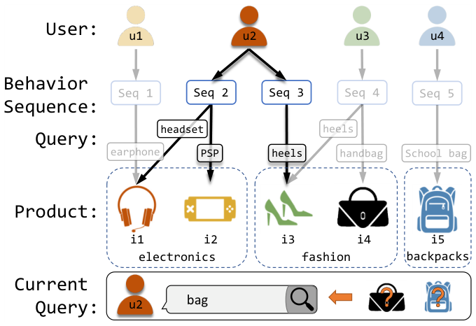
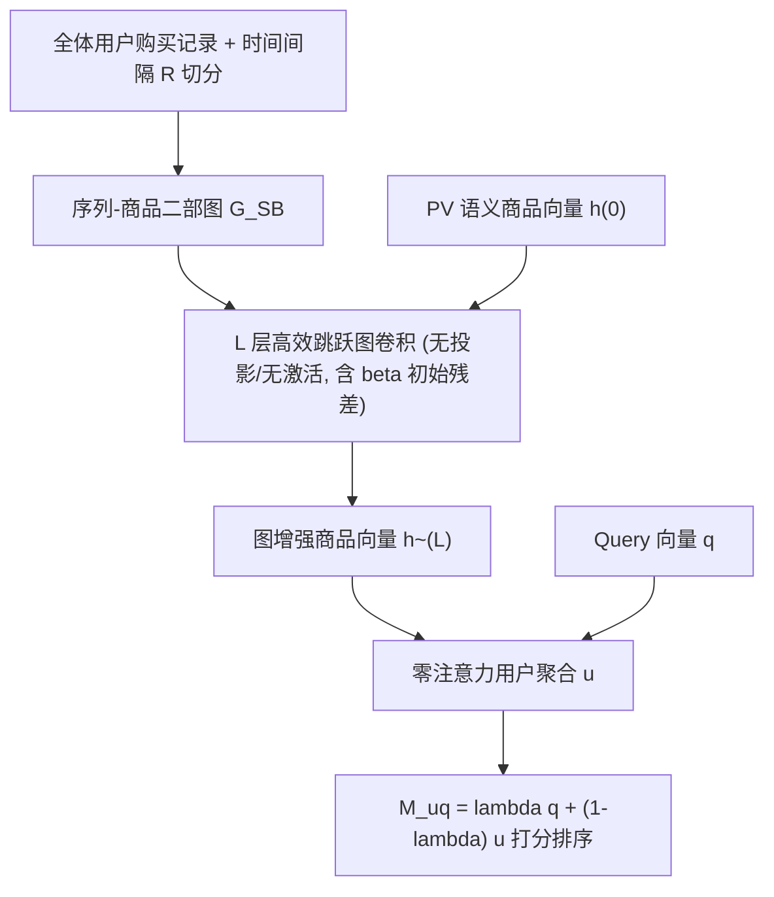
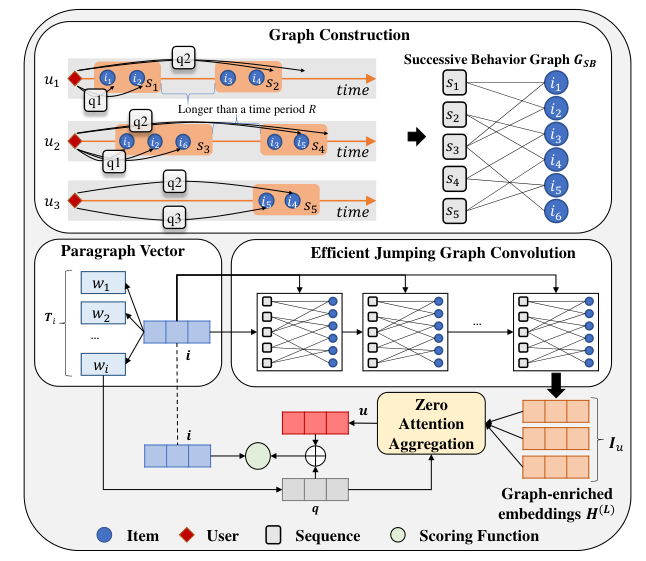

# Modeling User Behavior with Graph Convolution for Personalized Product Search (基于图卷积的用户行为建模用于个性化商品搜索)

- **会议/期刊**: WWW 2022 (The ACM Web Conference)
- **作者与机构**: Lu Fan, Qimai Li, Bo Liu, Xiao-Ming Wu (香港理工大学)；Xiaotong Zhang (大连理工大学)；Fuyu Lv, Guli Lin, Sen Li, Taiwei Jin, Keping Yang (阿里巴巴)
- **推荐链路定位**: 召回（查询-商品潜空间检索）
- **研究方向**: 图神经网络与知识图谱推荐 / 协同过滤与双塔召回
- **论文原文**: [https://arxiv.org/abs/2202.06081v1](https://arxiv.org/abs/2202.06081v1)
- **开源代码**: [https://github.com/floatSDSDS/SBG](https://github.com/floatSDSDS/SBG)

## TL;DR (1分钟核心速览)

个性化商品搜索中，用户长期行为噪声大、短期行为信号不足。本文用**全体用户**在时间窗 $R$ 内的短期行为构建「连续行为图 (SBG)」，以**去掉投影/激活层的跳跃图卷积**聚合高阶共现关系，得到图增强商品向量并替换零注意力模型中的用户历史商品表示。在 8 个 Amazon 5-core 域上采用「末序列测试 + 1000 候选采样排序」协议，NDCG@10 较 ZAM 提升 7.76%~41.39%，并在 7/8 域优于 DREM。

## Background & Motivation (背景与核心矛盾)

- **主流范式**: LSE/HEM/ZAM/TEM 把 query、商品、词元投影到同一潜空间，用段落向量 (PV) 学语义、用注意力把用户历史商品聚合成用户向量，再以 $M_{uq}=\lambda q+(1-\lambda)u$ 做内积检索。
- **前人局限 1（长期噪声）**: HEM 用全部历史评论表示用户，跨类目噪声（查"包"却浏览过电子设备）直接污染意图；DREM 把全部历史行为塞进统一知识图谱，同样无法筛选信息。
- **前人局限 2（短期不足）**: ZAM/TEM 为效率截断历史，只保留最近行为，虽去噪但信号量不足以区分"手提包/背包"；GraphSRRL 依赖人工预定义的高频结构模式，域不适配时（Clothing、Phones）性能崩溃。
- **核心洞察 (Key Insight)**: 单个用户的短期序列太短，但**所有用户**的短期序列拼接后形成的商品共现图富含协同信号——它既能"扩展"用户潜在意图商品集合，又能通过图卷积把共现商品在潜空间拉近。
- **本文切入点**: 以序列-商品二部图 + 跳跃图卷积把全局协同信息注入商品表征，作为即插即用模块挂载到潜空间检索框架。

<figure class="paper-figure" markdown="span">
  <figcaption>图1：利用全局用户连续行为进行个性化商品搜索的示意图。给定用户𝑢2发布的查询包，系统应检索满足用户意图的合适包。通过图卷积对全局用户连续行为图建模，我们提出的方法能够捕获隐式偏好信号并产生理想结果。</figcaption>
</figure>

## Method (核心方法设计)

### 1. 整体框架 (Overall Architecture)

对每个用户按时间排序购买记录，相邻动作间隔 $\le R$则划入同一"连续行为序列"，得到序列-商品二部图$G_{SB}$；商品节点以 PV 学到的语义向量初始化，序列节点随机初始化；堆叠$L$层高效跳跃图卷积得到图增强商品向量$\tilde{h}_i^{(L)}$，**仅用于替换用户侧注意力聚合中的商品向量**，而商品检索打分与语言建模仍使用原始语义向量以保持商品唯一性；最终以$L=L_{PR}+L_{LM}$联合训练，检索时按$P(i|u,q)$ 全候选打分。

<figure class="paper-figure" markdown="span">
  <figcaption>图2：我们提出的SBG模型的框架。</figcaption>
</figure>

### 2. 关键设计拆解 (Key Designs)

1. **高效图卷积（去掉投影与激活）**：常规 GCN 的 $W^{(l)}$会扭曲 PV 学到的语义空间。作者改为纯传播算子，只用自环权重$\omega$ 控制自信息强度：
$H^{(l)}=(\omega I+(1-\omega)D^{-1}A)H^{(l-1)}$，参数量为 0，既保留语义又注入协同共现结构。

2. **跳跃连接抗过平滑**：购买行为稀疏，需高阶邻居（$L$ 大）才有信号，但普通传播会让节点表征塌缩。借鉴 GCNII，每层额外注入初始表征：
$\tilde{H}^{(l)}=(\omega I+(1-\omega)D^{-1}A)(\beta H^{(0)}+(1-\beta)\tilde{H}^{(l-1)})$。
作者用 Laplacian-Beltrami 算子 $\Omega(H)=\sum_k\sum_{i,j}a_{ij}(H_{i,k}-H_{j,k})^2$度量表征多样性，证明$\Omega(\tilde{H}^{(l)})>\Omega(H^{(l)})$且$\lim_{l\to\infty}\Omega(\tilde{H}^{(l)})>0$，即跳跃连接从理论上阻止多样性归零。

3. **用户侧注入与训练目标**：把 ZAM 的零注意力打分 $s(q,i)$中的商品向量$i$替换为$\tilde{h}_i^{(L)}$，$u=\sum_{i\in I_u\cup\{0\}}\mathrm{softmax}(s(q,i))\,\tilde{h}_i^{(L)}$，其中零向量负责自适应调节个性化强度。损失为$\mathcal{L}=\mathcal{L}_{PR}+\mathcal{L}_{LM}$，商品与词均采用**均匀随机负采样**（词采样率 5、商品 2，词负样本按 unigram 分布的$3/4$ 次幂抽取）。推理无额外开销，训练时间与 ZAM/DREM 相当（图 5）。

## Experimental Setup & Evaluation Protocol (实验设置与评估协议)

- **数据集与预处理**: Amazon review 8 个子域，取 `5-core` 并过滤无正样本商品：

| 数据集 | #Users | #Items | #Interactions | 特征/场景说明 |
| :--- | :---: | :---: | :---: | :--- |
| Magazine | 694 | 876 | 4,583 | 极小规模，冷商品多 |
| Software | 3,642 | 5,875 | 25,086 | 稀疏域 |
| Phones | 17,464 | 10,278 | 133,792 | 3C 类目 |
| Toys&Games | 16,370 | 11,875 | 148,756 | 玩具 |
| Instruments | 23,887 | 9,756 | 209,229 | 乐器 |
| Clothing | 37,914 | 23,033 | 270,854 | 服饰，类目最杂 |
| Health | 36,639 | 17,956 | 334,025 | 健康 |
| Home&Kitchen | 65,510 | 27,888 | 545,083 | 最大域 |

- **数据划分与防穿越**: 按用户时间排序后切序列，**最后一段序列作测试、倒数第二段作验证**（末序列留出，Leave-Last-Sequence-Out），严格时序防穿越。
- **排名评测协议**: `Sampled Ranking` —— 每条测试序列的 1 个真实目标商品与从全库随机采样的负样本混合成 **1000 候选**，计算 HR@10、MRR@100、NDCG@{10,20,100}；非全库 Full-Ranking。
- **对比基线与超参设置**: HEM、ZAM（主骨干）、DREM、GraphSRRL；嵌入维度 $d=64$、batch 1024、Adam lr=0.001、注意力维度$d_a=8$、$\lambda=0.5$、$L=4$、$\omega=0.1$、$\beta=0.1$；显著性用 paired t-test，$p\le0.01$。

## Key Experimental Results (实验关键数据)

### 1. 主实验对比 (Main Results)

NDCG@10 对比如下（**加粗为最优**）：

| 数据集 | HEM | ZAM | DREM | GraphSRRL | **SBG (ours)** | Improv. vs ZAM |
| :--- | :---: | :---: | :---: | :---: | :---: | :---: |
| Software | 0.2474 | 0.3289 | 0.3555 | 0.1598 | **0.4144** | +25.99% |
| Magazine | 0.2526 | 0.2657 | 0.2469 | 0.1579 | **0.2952** | +11.10% |
| Phones | 0.2697 | 0.3386 | 0.3841 | 0.1035 | **0.3904** | +15.30% |
| Toys&Games | 0.1501 | 0.2653 | 0.3554 | 0.2166 | **0.3648** | +37.50% |
| Instruments | 0.2974 | 0.3202 | 0.2856 | 0.3194 | **0.3451** | +7.76% |
| Clothing | 0.3409 | 0.3671 | 0.2741 | 0.0946 | **0.4001** | +8.99% |
| Health | 0.2572 | 0.2952 | 0.3985 | 0.3194 | **0.4174** | +41.39% |
| Home&Kitchen | 0.3164 | 0.3593 | 0.4236 | 0.2604 | **0.4546** | +26.53% |

HR@10 同样全面领先（如 Home&Kitchen 0.6419 vs ZAM 0.5247、DREM 0.5793；Clothing 0.6020 vs 0.5606），且除 Phones 的 MRR@100 外全部在 $p\le0.01$ 下显著。

### 2. 消融实验 (Ablation Study)

| 配置 | Phones NDCG@10 | Toys&Games NDCG@10 | 结论 |
| :--- | :---: | :---: | :--- |
| $L=0$（即 ZAM，无图卷积） | 0.3386 | 0.2653 | 基线 |
| $L=4$，含跳跃（SBG, wj） | **0.3904** | **0.3648** | 最优层数 |
| $L$ 增大至 8~64（wj） | 缓慢下降 | 缓慢下降 | 跳跃连接延缓过平滑 |
| $L$增大至 8~64（oj，去跳跃） | 明显下降 | 显著下降（$L>4$ 即陡降） | 验证 Theorem 1 |
| 时间间隔 $R$=月/季/年 | 下降 | 下降 | 长窗口引入噪声 |

### 3. 关键实验发现 (Key Findings)

1. **增益强依赖域内共现密度**：NDCG@10 相对 ZAM 的提升在 Health (+41.39%)、Toys&Games (+37.50%) 最大，在 Instruments (+7.76%)、Clothing (+8.99%) 最小；同时 DREM 在 Software/Instruments/Clothing 三域相对 ZAM 为负增益 (-7.06%/-10.83%/-25.34%)，说明图方法的收益随域特性剧烈波动，并非普适万能。
2. **$L=4$是精度-过平滑的甜点**：从 0 层到 4 层即可拿到全部收益（Phones 0.3386→0.3904，Toys&Games 0.2653→0.3648），继续加深则因过平滑退化；跳跃连接使退化曲线明显变缓（图 3），与$\Omega(\tilde{H}^{(l)})>0$ 的理论结论一致。
3. **短窗口 $R$才是"去噪"关键**：$R$取 day/week 普遍最优，放大到 month/quarter/year 后性能下降，因为长窗口序列过度多样、噪声回流；唯一例外是 Magazine——该域样本极少、冷商品多，更大$R$ 反而让冷商品连到更广邻域而受益。此外 GraphSRRL 在 Clothing/Phones 上 NDCG@10 仅 0.0946/0.1035，暴露预定义结构模式假设在真实域中脆弱。

## Highlights & Limitations (亮点、对比与审稿批判)

- **与代表作对比 (vs. Prior Work)**: 相比 HEM/ZAM 只在**单用户**短序列上做注意力，SBG 引入**跨用户全局**共现；相比 DREM 把所有历史行为灌入统一知识图谱，SBG 用时间窗 $R$ 显式剪枝序列以抑制噪声；相比 GraphSRRL 的硬编码三元结构模式，SBG 用可学习的多层传播自动挖掘高阶关系，鲁棒性明显更强。
- **可迁移亮点**: ①"**去掉 GCN 投影层、只做传播**"以保护预训练语义空间，可低成本迁移到任何 LLM/语义向量召回系统；②图增强向量**只用于用户侧、不用于商品打分侧**，避免商品表征同质化而丧失辨识度，这一非对称使用技巧值得复用。
- **审稿级局限批判**: ①评估仅用 **1000 候选采样排序**，与工业级全库 ANN 检索的真实难度差距较大，未报告 Full-Ranking 结果；②$G_{SB}$在训练前一次性静态构建，无法反映在线新行为，且$L$、$\beta$、$\omega$、$R$ 四个超参均需逐域调优，跨域鲁棒性存疑；③仅在 ZAM 单一骨干上验证"即插即用"，未在 Transformer 类骨干 (TEM/RTM) 上给出证据。

## Rating (四维评分)

- **方法创新性 (Novelty)**: ⭐⭐⭐⭐ （首次将图卷积引入个性化商品搜索，"全局连续行为图 + 跳跃传播"组合新颖，并给出 Laplacian-Beltrami 过平滑理论证明）
- **评估协议与实验扎实度 (Protocol & Experiments)**: ⭐⭐⭐⭐ （8 个 Amazon 域 + 4 个强基线 + paired t-test，消融覆盖 $L$、跳跃连接与$R$；扣分在于仅 1000 候选采样排序、缺全库评测）
- **写作与数学规范度 (Clarity & Rigor)**: ⭐⭐⭐⭐ （公式链条清晰，Theorem 1 与附录谱分析推导完整；但 $R$ 划分与序列构造细节略依赖附录式描述）
- **工业落地与复现价值 (Industrial & Practical Value)**: ⭐⭐⭐⭐ （代码开源、图卷积零参数、训练开销与 ZAM 持平，可直接嵌入现有 PV/双塔召回；静态图与超参敏感是主要工程障碍）

