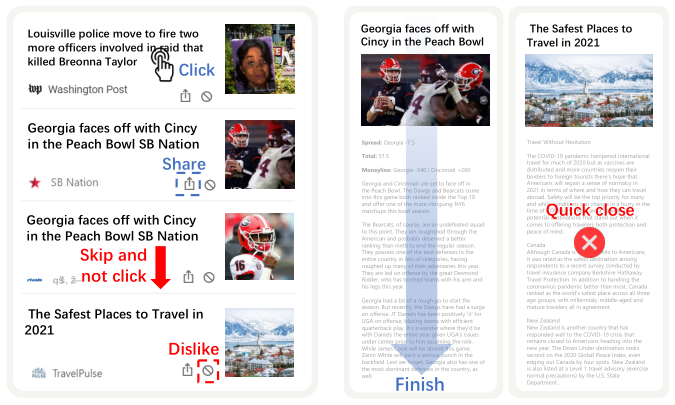
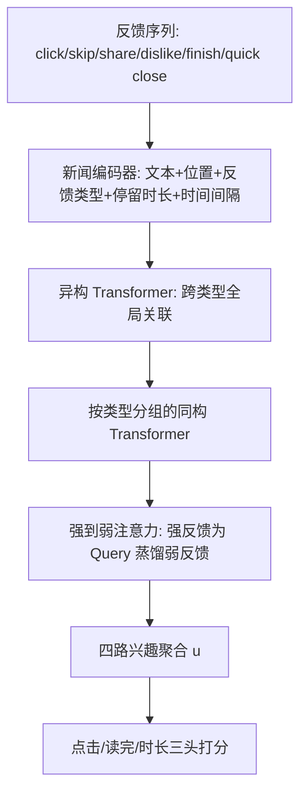
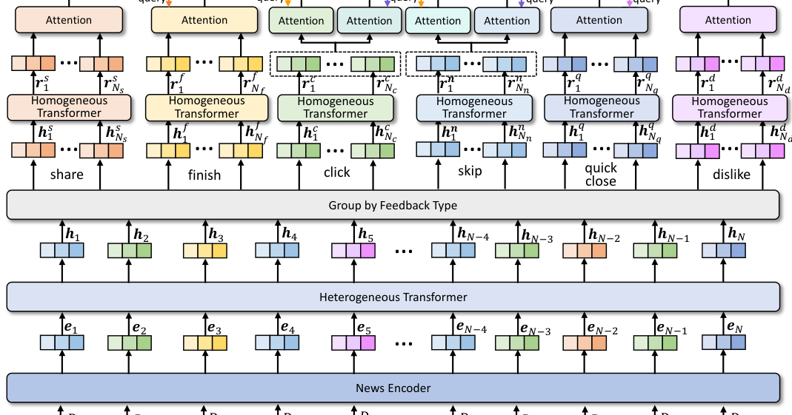

# FeedRec: News Feed Recommendation with Various User Feedbacks (融合多类用户反馈的新闻信息流推荐)

- **会议/期刊**: WWW 2022 (The ACM Web Conference)
- **作者与机构**: Chuhan Wu, Fangzhao Wu, Tao Qi, Qi Liu, Xuan Tian, Jie Li, Wei He, Yongfeng Huang, Xing Xie（清华大学电子系、微软亚洲研究院、中国科学技术大学、北京林业大学、微软 STCA）
- **推荐链路定位**: 精排（信息流候选新闻打分）/ 多任务训练
- **研究方向**: 多任务学习与列表级重排 / 序列推荐
- **论文原文**: [https://arxiv.org/abs/2102.04903v2](https://arxiv.org/abs/2102.04903v2)
- **开源代码**: [https://github.com/wuch15/FeedRec](https://github.com/wuch15/FeedRec)

## TL;DR (1分钟核心速览)

针对"仅用点击建模用户兴趣"这一主流范式存在点击强噪声、且无法表达"点踩/读完"等复杂兴趣、更无法优化分享/停留时长等参与度目标的三重痛点，FeedRec 提出统一多反馈用户建模框架：以异构 Transformer 捕捉跨类型反馈关联、同构 Transformer 捕捉同类型反馈内部关联，再用"强到弱注意力"以分享/点踩/读完/秒关等强反馈为 Query 从噪声点击与跳过中蒸馏正负兴趣，并以点击预测+读完预测+停留时长回归+正负解耦正则四任务联合训练。在真实商业新闻 App 数据（1 万用户、2599 万条跳过日志）上，采样排序协议下 AUC 0.6609（较 CPRS +4.3%）、nDCG@5 0.3304（+11.2%），Share 命中率 +10.0%、Dwell Time +2.2%。

## Background & Motivation (背景与核心矛盾)

- **主流范式**: EBNR/NPA/NAML/NRMS/FIM 一类方法均以"历史点击新闻序列"经 GRU/多头自注意力编码为用户向量，仅用下一次点击做监督训练。
- **前人局限一**: 点击是隐式反馈且噪声极重——用户可能被标题吸引点击后立刻关闭，"点击≠满意"；同时点击无法表达"不喜欢"这类复杂兴趣。
- **前人局限二**: 只优化点击的二分类目标，与平台真正关心的分享率、读完率、停留时长等参与度指标存在系统性错位，模型无法"学出"高参与度的排序。
- **核心洞察 (Key Insight)**: 信息流场景天然存在强度分层的多类反馈：显式强反馈（分享/点踩）、隐式强反馈（读完/10 秒内秒关）、隐式弱反馈（点击/跳过）。强反馈稀疏但可信，弱反馈稠密但噪声大，二者恰好可互补。
- **本文切入点**: 不做多路独立塔，而是用"强反馈当 Query、弱反馈当 Key/Value"的注意力蒸馏路径，把强反馈的可靠性注入到稠密弱反馈的选择过程中。

<figure class="paper-figure" markdown="span">
  <figcaption>图1：新闻信息流平台上各种用户反馈的示例。</figcaption>
</figure>

## Method (核心方法设计)

### 1. 整体框架 (Overall Architecture)

模型对每条反馈 $D_i$（反馈类型 + 关联新闻）用共享新闻编码器生成嵌入$\mathbf{e}_i$：标题经 Transformer 得文本嵌入，并与位置嵌入、反馈类型嵌入、停留时长嵌入（量化$\tilde{t}=\lfloor\log_2(t+1)\rfloor$）、时间间隔嵌入相加。反馈序列$\mathbf{E}=[\mathbf{e}_1,\dots,\mathbf{e}_N]$先过异构 Transformer 建模全局跨类型关联得$\mathbf{H}$，再按反馈类型分组送入六个独立的同构 Transformer 得类型专属表示$\mathbf{R}^s,\mathbf{R}^f,\mathbf{R}^c,\mathbf{R}^n,\mathbf{R}^q,\mathbf{R}^d$；随后强到弱注意力逐级蒸馏出$\mathbf{s}^p,\mathbf{w}^p,\mathbf{w}^n,\mathbf{s}^n$四路兴趣，线性聚合为统一用户向量$\mathbf{u}$，与候选新闻向量$\mathbf{e}$ 内积打分，并以四任务损失联合训练。

<figure class="paper-figure" markdown="span">
  <figcaption>图2：我们的 FeedRec 方法的用户建模框架。</figcaption>
</figure>

### 2. 关键设计拆解 (Key Designs)

1. **强到弱注意力蒸馏 (Strong-to-Weak Attention)**：解决"弱反馈噪声大、强反馈稀疏"的矛盾。先用两条独立注意力从分享、点踩表示聚出显式正/负兴趣 $\mathbf{u}_e^p,\mathbf{u}_e^n$；再以$\mathbf{u}_e^p$为 Query 聚合读完表示得隐式强正兴趣$\mathbf{u}_i^p$（负向同理用$\mathbf{u}_e^n$聚合秒关）；最后用二者之和$\mathbf{u}_e^p+\mathbf{u}_i^p$ 作 Query 从点击/跳过中蒸馏弱正/弱负兴趣：
$$\gamma_k^p=\frac{\exp[(\mathbf{u}_e^p+\mathbf{u}_i^p)\cdot\mathbf{r}_k^c]}{\sum_j\exp[(\mathbf{u}_e^p+\mathbf{u}_i^p)\cdot\mathbf{r}_j^c]},\quad \mathbf{u}_c^p=\sum_k\gamma_k^p\mathbf{r}_k^c$$
直觉：强反馈充当"可靠语义锚点"，把与之语义相近的点击挑出来，语义背离的点击自然被降权，等价于软性去噪而非硬过滤。
2. **门控式分层聚合**：不同类型反馈重要性差异大且需保留各自功能。先门控融合显式与隐式强反馈 $\delta^p=\sigma(\mathbf{v}_p\cdot[\mathbf{u}_e^p;\mathbf{u}_i^p])$，$\mathbf{s}^p=\delta^p\mathbf{u}_e^p+(1-\delta^p)\mathbf{u}_i^p$，弱反馈同理得$\mathbf{w}^p,\mathbf{w}^n$，最终以可学习权重线性加权$\mathbf{u}=s_p\mathbf{s}^p+w_p\mathbf{w}^p+s_n\mathbf{s}^n+w_n\mathbf{w}^n$，避免早期拼接造成的表示稀释。
3. **多反馈训练目标与推理开销**：三个预测头共享 $\mathbf{u}$，$\hat{y}=\mathbf{u}\cdot\mathbf{e}$、$\hat{z}=\mathbf{u}\cdot(\mathbf{W}_z\mathbf{e})$、$\hat{t}=\max[0,\mathbf{u}\cdot(\mathbf{W}_t\mathbf{e})]$。总损失为
$$\mathcal{L}=\mathcal{L}_R+\alpha\mathcal{L}_F+\beta\mathcal{L}_T+\gamma\mathcal{L}_D,\quad \mathcal{L}_D=\frac{\mathbf{w}^p\cdot\mathbf{w}^n}{\|\mathbf{w}^p\|\|\mathbf{w}^n\|}$$
其中 $\mathcal{L}_R$为 1 正$K$负的 softmax 交叉熵（负样本取自同一曝光页的跳过新闻，$K=4$）、$\mathcal{L}_F$为读完 BCE、$\mathcal{L}_T$为对数停留时长 L1 回归、$\mathcal{L}_D$余弦正则强制正负兴趣子空间正交。经验取值$\alpha=0.2,\beta=0.15,\gamma=0.2$。在线仅需一次用户编码 + 内积打分，额外开销来自 6 个同构 Transformer 的并行小序列编码，无候选侧增量。

## Experimental Setup & Evaluation Protocol (实验设置与评估协议)

- **数据集与预处理**: 自建商业新闻 Feed App 真实日志（2020-09-01 至 2020-10-02，约一个月）。因跳过反馈占绝对主导，随机采样 10% 跳过以控制序列长度；秒关阈值由停留时长双峰分布（0–10s 与正常阅读峰）确定为 $T=10$s。

| 数据集 | #Users | #Items | #Interactions | 稀疏度/密度 | 特征/场景说明 |
| :--- | :---: | :---: | :---: | :---: | :--- |
| 商业新闻 Feed 日志 | 10,000 | 590,485 | 351,581 曝光 / 25,986,877 跳过 / 493,266 点击 | 极稀疏、跳过主导 | share 2,764、dislike 17,073、finish 234,759、quick close 108,396，平均停留 83.90s |

- **数据划分与防穿越 (Splitting Strategy)**: 全局时间戳切分——最后一周日志作测试集，其余作训练集，最后一天日志作验证集，严格避免未来反馈泄漏。
- **排名评测协议 (Ranking Protocol)**: `Sampled Ranking`——对每个正样本（点击）从同一曝光页采样 $K=4$ 条被跳过新闻构成 5 候选列表，指标在此列表上计算，**并非 Full-Ranking 全库排序**；该协议下 AUC/MRR/nDCG@5/HR@5 绝对值偏高，跨论文比较需谨慎。参与度指标：Top-5 列表的 share/dislike 频次占全库同类反馈总量的比例、Top-5 平均读完率、点击后平均停留时长。
- **对比基线与超参设置**: 9 个基线覆盖 EBNR/DKN（CNN+KG）、NPA/NAML（个性化与多视角注意力）、LSTUR（长短期兴趣）、NRMS（多头自注意力）、FIM（细粒度兴趣匹配）、DFN（多反馈）、CPRS（点击偏好+阅读满意度）。所有嵌入维度 $d=256$，用户侧 Transformer 16 头 × 16 维，Adam，学习率 1e-4，批大小 32，dropout 0.2，负采样比 4，每实验独立重复 5 次取均值。

## Key Experimental Results (实验关键数据)

### 1. 主实验对比 (Main Results)

**点击效果**（采样排序，$K=4$）：

| Method | AUC | MRR | nDCG@5 | HR@5 |
| :--- | :---: | :---: | :---: | :---: |
| EBNR | 0.6112 | 0.2622 | 0.2790 | 0.1062 |
| NPA | 0.6210 | 0.2685 | 0.2882 | 0.1095 |
| LSTUR | 0.6224 | 0.2701 | 0.2896 | 0.1099 |
| NRMS | 0.6231 | 0.2707 | 0.2904 | 0.1103 |
| FIM | 0.6250 | 0.2729 | 0.2925 | 0.1114 |
| DFN | 0.6296 | 0.2748 | 0.2948 | 0.1140 |
| CPRS | 0.6334 | 0.2781 | 0.2972 | 0.1156 |
| **FeedRec** | **0.6609** | **0.3026** | **0.3304** | **0.1328** |
| Improv. vs best | **+4.34%** | **+8.81%** | **+11.17%** | **+14.88%** |

**参与度效果**（↑越高越好，↓越低越好）：

| Method | Share↑ | Dislike↓ | Finish↑ | Dwell Time/s↑ |
| :--- | :---: | :---: | :---: | :---: |
| NRMS | 1.1343 | 0.9583 | 0.0709 | 84.793 |
| FIM | 1.1365 | 0.9595 | 0.0711 | 85.010 |
| DFN | 1.1398 | 0.9519 | 0.0745 | 85.346 |
| CPRS | 1.1455 | 0.9434 | 0.0772 | 86.129 |
| **FeedRec** | **1.2603** | **0.9011** | **0.0940** | **87.989** |
| Improv. vs best | **+10.02%** | **−4.48%** | **+21.76%** | **+2.16%** |

### 2. 消融实验 (Ablation Study)

原文以图 7–10 给出消融曲线（FeedRec 基准 AUC 0.6609 / nDCG@5 0.3304），此处汇总其排序与量级：

| 移除对象 | AUC / nDCG@5 变化 | 结论 |
| :--- | :---: | :--- |
| 移除 Click 反馈 | 下降最大 | 点击仍是主信号 |
| 移除 Skip 反馈 | 下降第二 | 跳过含丰富负向线索 |
| 移除 Finish / Quick Close | 显著下降 | 阅读满意度关键 |
| 移除 Share / Dislike | 下降最小 | 强但过稀疏（2764 vs 2599 万） |
| w/o 异构 Transformer | 下降最大（组件级） | 跨类型全局关联最关键 |
| w/o 强到弱注意力 | 明显下降 | 弱反馈蒸馏有效 |
| w/o 同构 Transformer | 小幅下降 | 类型特异性建模有增益 |
| w/o 反馈类型嵌入 | 嵌入级最大降幅 | 区分反馈类型最重要 |
| w/o 停留时长嵌入 | 次大降幅 | 满意度信息补充 |
| w/o $\mathcal{L}_D$/$\mathcal{L}_F$/$\mathcal{L}_T$ | 依次递减 | 正负解耦正则收益最高 |

### 3. 关键实验发现 (Key Findings)

1. **多反馈是点击预测的净增量而非替代**：仅用点击的 NRMS 为 0.6231 AUC，引入读完/秒关的 CPRS 升至 0.6334，FeedRec 进一步到 0.6609——相比最强多反馈基线仍 +4.34% AUC，说明增益主要来自"强到弱蒸馏"的建模方式而非反馈种类的简单堆叠。
2. **稀疏强反馈需靠稠密弱反馈放大其价值**：share 仅 2,764 条、dislike 17,073 条，单独移除它们降幅最小；但移除其蒸馏下游的 click/skip 反馈降幅最大，印证强反馈的作用是"作注意力 Query 去重加权弱反馈"，而非自身直接贡献表示。
3. **参与度指标与点击指标可同时提升，不存在明显跷跷板**：FeedRec 在 AUC +4.34% 的同时，Top-5 读完率 +21.76%、点踩率 −4.48%、停留时长 +2.16%，说明 $\mathcal{L}_F/\mathcal{L}_T$ 并非以牺牲相关性为代价换取"标题党式"点击。

## Highlights & Limitations (亮点、对比与审稿批判)

- **与代表作对比 (vs. Prior Work)**: 相比 NRMS/FIM 只用点击序列，本文把反馈序列升级为"带类型的异构事件流"；相比 DFN 仅用点赞/点踩做正负兴趣解耦，本文引入读完/秒关这类**稠密的隐式强反馈**并以注意力级联方式向点击蒸馏；相比 CPRS 用停留时长对点击加权，本文把停留时长同时用于输入嵌入、辅助回归任务与秒关构造，形成三重利用。
- **可迁移亮点**: ①"强反馈作 Query、弱反馈作 Key/Value"的级联注意力可直接迁移到电商（加购/收藏 → 点击）与短视频（完播/复看 → 曝光点击）去噪场景；②正负兴趣余弦解耦正则 $\mathcal{L}_D$ 是极低成本的通用插件。
- **审稿级局限批判**: ①评估仅在 $K=4$采样列表上进行，缺少 Full-Ranking 与线上 A/B，AUC 绝对值与工业可感知收益之间存在鸿沟；②用户侧需 1 个异构 + 6 个同构 Transformer 串行编码，序列长度与延迟随反馈类型数线性增长，论文未报告推理时延；③秒关阈值$T=10$s 为数据集特定经验值（图 11 显示 5s/20s 均掉点），跨平台需重调；④式 (4) 中分母误写为$\exp(\mathbf{u}_e^q\cdot\mathbf{r}_j^q)$，符号一致性存在笔误。

## Rating (四维评分)

- **方法创新性 (Novelty)**: ⭐⭐⭐⭐ （强到弱注意力蒸馏 + 正负兴趣解耦正则组合新颖，但组件均为 Transformer/注意力常规改造，理论分析偏弱）
- **评估协议与实验扎实度 (Protocol & Experiments)**: ⭐⭐⭐ （自建真实数据集与 9 个基线较充分、5 次重复取均值，但仅采样排序、无全库排序与线上实验、无显著性检验）
- **写作与数学规范度 (Clarity & Rigor)**: ⭐⭐⭐⭐ （框架图与公式链条清晰，四路兴趣聚合逻辑完整，个别符号笔误与消融仅以图呈现数值）
- **工业落地与复现价值 (Industrial & Practical Value)**: ⭐⭐⭐⭐ （代码开源、多任务与多反馈均为工业信息流标配，收益在多目标上同时为正，但多 Transformer 编码的延迟成本需评估）

