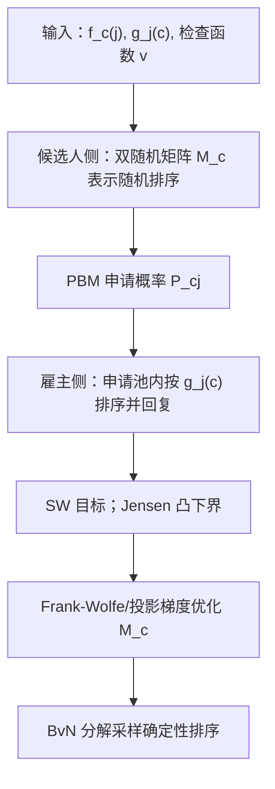
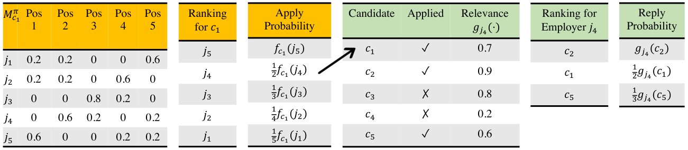

# Optimizing Rankings for Recommendation in Matching Markets (双边匹配市场中的推荐排序优化)

- **会议/期刊**: WWW 2022
- **作者与机构**: Yi Su, Magd Bayoumi, Thorsten Joachims；Cornell University
- **推荐链路定位**: 重排 / 列表级市场联合排序
- **研究方向**: 多任务学习与列表级重排 / 去偏公平、可信隐私与工业架构
- **论文原文**: [https://arxiv.org/abs/2106.01941v1](https://arxiv.org/abs/2106.01941v1)
- **开源代码**: 暂未开源

## TL;DR (1分钟核心速览)

针对双边匹配市场中单边/互惠排序忽略容量与拥挤的痛点，本文将候选人申请—雇主回复建模为双向 PBM，用双随机矩阵表示个性化随机排序，并联合优化全市场社会福利的凸下界；在会议社交与约会数据上，全市场仿真匹配数较互惠排序提升 7.9% 与 25.3%。

## Background & Motivation (背景与核心矛盾)

- **主流范式**: 传统推荐按单边相关性做 PRP 排序；互惠推荐用 $f_c(j)g_j(c)$ 等局部双向分数排序，稳定匹配则依赖集中式匹配程序。
- **前人局限**: 单边排序忽略雇主容量与申请拥挤；互惠分数虽考虑双向偏好，却忽略“其他候选人也申请同一雇主”造成的排名竞争，在高拥挤下退化。
- **核心洞察 (Key Insight)**: 匹配成功取决于双方互相发现且雇主有限注意力内的排名；一个候选人的排序会改变其他人的申请池与回复排名，因此个体效用强耦合，联合优化可显著优于局部打分。
- **本文切入点**: 在 apply-accept 协议下，直接以全市场期望匹配数为目标，联合优化所有候选人的随机排序策略。

## Method (核心方法设计)

### 1. 整体框架 (Overall Architecture)

输入两侧相关性概率 $f_c(j)$、$g_j(c)$与位置审查函数$v$；候选人侧用双随机矩阵$\mathbf{M}_c$表示随机排序，PBM 给出申请概率；雇主侧对实际申请池按$g_j(c)$排序并回复；以全市场期望匹配数为社会福利目标，因真实回复排名是 Poisson Binomial 而不可直接优化，转而最大化 Jensen 凸下界；用 Frank-Wolfe/投影梯度优化所有$\mathbf{M}_c$，再用 BvN 分解采样确定性排序。真实实验中先互惠召回 top-100，再仅对头部做市场级重排以控成本。

图 1 直观展示了候选人申请、雇主回复及双侧 PBM 的交互闭环。

<figure class="paper-figure" markdown="span">
  <figcaption>图 1：一个包含 |C| = 5 名候选人和 |J| = 5 名雇主的双边匹配市场，检验函数为 v(x) = 1/x。黄色表格展示特定候选人 c1 的交互过程，绿色表格展示特定雇主 j4 的交互过程（其他候选人和雇主遵循类似过程）。从左到右，系统首先计算个性化随机排序 Mπ</figcaption>
</figure>

### 2. 关键设计拆解 (Key Designs)

1. **双边 PBM 与双随机排序策略**：痛点是把指数级排序空间直接优化不可行，且单边 PRP 只看 $f_c(j)$。本文将候选人排序策略压缩为双随机矩阵$\mathbf{M}_c$，其$(j,k)$项是雇主$j$被放在第$k$位的边际概率，申请概率为$P^\pi_{c,j}=f_c(j)e_j^\top\mathbf{M}_c v$；这样只需$|\mathcal{J}|^2$ 参数即可表达所有等价随机排序，并可在 Birkhoff 多面体上优化。

2. **社会福利目标与可计算凸下界**：雇主回复概率为 $P^\pi_{j,c}=g_j(c)\mathbb{E}[v(\mathrm{rk}^\pi_j(c))]$，其中$\mathrm{rk}^\pi_j(c)\sim1+\mathrm{PoissonBinomial}(\{P^\pi_{c',j}\}_{c'\in A_j(c)})$，直接求期望涉及组合爆炸。对凸$v$用 Jensen 得下界：$\overline{SW}=\sum_{c,j}f_c(j)g_j(c)v(1+\sum_{c'\in A_j(c)}f_{c'}(j)e_j^\top\mathbf{M}_{c'}v)e_j^\top\mathbf{M}_c v$；直觉是用期望竞争人数替代随机排名，拥挤雇主被自动降权，从而鼓励申请分散。

3. **优化、训练目标与推理**：求解带双随机约束的 $\max_{\{\mathbf{M}_c\}}\overline{SW}$，无负采样；Frank-Wolfe 每步解线性子问题，投影梯度则用 Sinkhorn 投影。得到$\mathbf{M}_c$ 后经 BvN 分解采样确定性排序；线上可用“互惠召回 top-100 + 市场重排”控制开销。

## Experimental Setup & Evaluation Protocol (实验设置与评估协议)

- **数据集与预处理**:

| 数据集 | #Users | #Items | #Interactions | 稀疏度/密度 | 特征/场景说明 |
| :--- | :---: | :---: | :---: | :---: | :--- |
| 合成市场 | 150 候选人 | 100 雇主 | 15,000 全对相关性 | 100% 稠密 | $n=100$，1.5n 候选人，$\lambda=0.5$，$v=1/x$ |
| Networking | 925 | 925 | 925×925 相关性矩阵 | 稠密估计 | 会议社交，用户同时为双边；初始每人 top-150 推荐 |
| Libimseti | 1,000 | 1,000 | 500×500 跨性别评分+ALS 插补 | 插补后稠密 | 在线约会，500 男+500 女 |

- **数据划分与防穿越 (Splitting Strategy)**: 无训练/测试切分；合成集按生成过程做 10,000 次 Monte Carlo 估计真实 SW，真实集用已估计相关性做全市场反事实仿真，无负采样。
- **排名评测协议 (Ranking Protocol)**: 候选人侧全量雇主排序，属全市场 Full-Ranking 仿真；真实数据先取互惠 top-100 再重排，Top-100 后固定，非采样负例排序。
- **对比基线与超参设置**: 基线仅 Naive-Relevance (PRP) 与 Reciprocal-Relevance；FW 50 步、学习率 0.2、停止阈值 $10^{-3}$；报告 ±2 SE，未给$p$值。无神经嵌入维度，直接使用估计的$f,g$。

## Key Experimental Results (实验关键数据)

### 1. 主实验对比 (Main Results)

| 数据集 | Naive-Relevance | Reciprocal-Relevance | Social-Welfare (本文) | SW vs Reciprocal |
| :--- | :---: | :---: | :---: | :---: |
| Networking | 604.0±0.11 | 763.8±0.06 | **824.1±0.18** | **+7.9%** |
| Online Dating | 844.0±0.10 | 957.2±0.12 | **1199.2±0.14** | **+25.3%** |

原文仅设 2 个基线；本文在两个真实市场均取得最高社会福利。

### 2. 消融实验 (Ablation Study)

原文无逐组件消融；以下为关键场景敏感性（$v=1/x$、$\lambda=0.5$、$n=100$ 除注明外）：

| 场景/敏感性设置 | Naive | Reciprocal | Social-Welfare | SW vs Reciprocal |
| :--- | :---: | :---: | :---: | :---: |
| 陡峭审查 $v=1/e^{x-1}$ | 25.9 | 47.8 | **84.4** | **+76.6%** |
| 高拥挤 $\lambda=1$ | 92.1 | 92.1 | **118.2** | **+28.3%** |
| 无拥挤 $\lambda=0$ | 156.3 | **199.9** | 198.5 | -0.7% |
| 相似双边偏好 | 126.2 | 143.8 | **167.4** | **+16.4%** |
| 市场规模 $n=200$ | 220.1 | 274.3 | **332.6** | **+21.3%** |

### 3. 关键实验发现 (Key Findings)

- 真实市场中，SW 较互惠排序在 Networking 提升 7.9%、约会数据提升 25.3%；Networking 中超过 88% 用户个体效用增加，说明联合优化并非牺牲多数人换总量。
- 审查越陡峭，联合排序收益越大：陡峭 $v$下 SW 84.4 对互惠 47.8，提升 76.6%；高拥挤$\lambda=1$ 时互惠已退化为单边水平（均 92.1），而 SW 达 118.2。
- 无拥挤 $\lambda=0$ 时互惠排序已近最优（199.9 vs 198.5），说明本文价值主要在容量竞争与注意力稀缺场景；下界近似在无拥挤时可能轻微低估。

## Highlights & Limitations (亮点、对比与审稿批判)

- **与代表作对比 (vs. Prior Work)**: 互惠推荐 [42] 假设固定推荐数且用户全量评估，本文保留随机浏览与有限注意力；稳定匹配需集中式匹配与完整偏好，本文只优化“发现与申请”的排序且保留用户自主决策。
- **可迁移亮点**: 双随机矩阵压缩随机排序 + 凸下界替代 Poisson Binomial 期望，可迁移到双边市场、招聘、社交匹配等列表级重排；top-k 两阶段重排适合工业级成本控制。
- **审稿级局限批判**: 依赖准确且同质的 $f,g$ 与 PBM 审查函数，相关性估计误差会直接扭曲社会福利；仅 2 个基线且无显著性检验；FW/Sinkhorn 与 BvN 采样在全市场大规模下仍有计算与部署开销。

## Rating (四维评分)

- **方法创新性 (Novelty)**: ⭐⭐⭐⭐ （首个在双边匹配市场中联合优化全市场排序的社会福利方法，双随机策略与 Θ(n) 次优性证明较扎实）
- **评估协议与实验扎实度 (Protocol & Experiments)**: ⭐⭐⭐ （合成+两个真实市场有说服力，但仅 2 个基线、无 p 值检验，消融以场景敏感性为主）
- **写作与数学规范度 (Clarity & Rigor)**: ⭐⭐⭐⭐ （模型、Poisson Binomial 排名与 Jensen 下界推导清晰，PBM 同质假设略强）
- **工业落地与复现价值 (Industrial & Practical Value)**: ⭐⭐⭐ （真实会议系统验证有价值，但依赖相关性估计、凸优化与 BvN 采样，工程复杂度不低）

