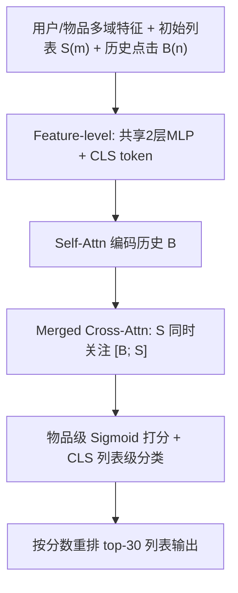
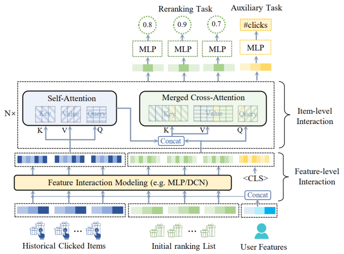
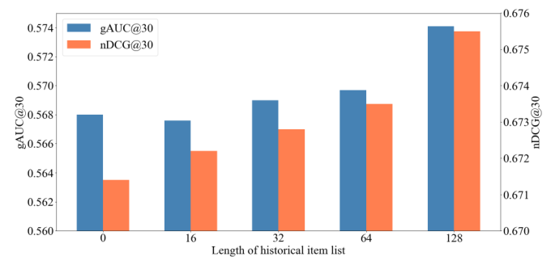

# PEAR: Personalized Re-ranking with Contextualized Transformer for Recommendation (面向推荐的个性化上下文 Transformer 重排)

- **会议/期刊**: WWW 2022 (Companion)
- **作者与机构**: Yi Li, Jieming Zhu, Weiwen Liu, Liangcai Su, Guohao Cai, Qi Zhang, Ruiming Tang, Xi Xiao, Xiuqiang He（清华大学深圳国际研究生院 / 华为诺亚方舟实验室）
- **推荐链路定位**: 重排（精排之后的 top-30 列表级重排）
- **研究方向**: 多任务学习与列表级重排 / 序列与会话推荐
- **论文原文**: [https://arxiv.org/abs/2203.12267v1](https://arxiv.org/abs/2203.12267v1)
- **开源代码**: 暂未开源

## TL;DR (1分钟核心速览)

针对"重排只建模初始列表内部相互影响、忽略用户历史点击列表"的痛点，PEAR 用上下文 Transformer 把用户历史行为序列与初始候选列表做**合并交叉注意力**联合编码，同时保留特征级交叉（可替换 MLP/DCN/AFN），并以"物品级点击预测 + CLS 列表级满意度分类"多任务训练。在 MicroVideo-1.7M 与华为新闻生产日志上，以 DCN 生成 top-30 初始列表、以 gAUC@K / nDCG@K 评估，gAUC@30 相对最强基线 PRM 分别提升 1.07% 与 1.71%。

## Background & Motivation (背景与核心矛盾)

- **主流范式**: 工业链路 matching→ranking→re-ranking；重排侧以 RNN（GlobalRank/DLCM）或 self-attention（PRM/SetRank）联合编码初始列表 $S=[s_1,\dots,s_m]$，显式建模物品间相互影响。
- **前人局限**: (1) RNN 难以直接建模任意两物品对关系；Transformer 类方法虽并行且关系建模强，但**只看初始列表上下文**，把重排当成与用户无关的"集合内去冗余"问题；(2) 多数模型用 Web 搜索数据集验证，天然缺失个性化信号，与推荐场景错配。
- **核心洞察 (Key Insight)**: 推荐中某物品该排第几，取决于用户**历史点击列表** $B=[b_1,\dots,b_n]$ 提供的兴趣证据——例如母亲历史点击里既有婴儿用品又有时尚服饰时，婴儿用品应被推前。这是搜索式重排模型完全不具备的上下文源。
- **本文切入点**: 把历史序列作为"第二上下文"接入重排 Transformer，用跨序列交叉注意力让列表内物品直接"查询"历史行为；再以列表级任务补足物品级独立打分缺失的全局监督。

## Method (核心方法设计)

### 1. 整体框架 (Overall Architecture)

模型输入为三部分：用户多域特征 $f_u$、候选/历史物品多域特征$f_i$、以及两段序列$S$（含末尾可学习 CLS token）与$B$。先由**特征级交互模块**（2 层 MLP，可换成 DCN/AFN/DeepFM）把每个 user-item 对压成$d$维上下文表示，得到$Z_S\in\mathbb{R}^{d\times(m+1)}$、$Z_B\in\mathbb{R}^{d\times n}$；再由 **item 级交互模块**（1 个 block：历史 self-attention + 合并 cross-attention）产出列表表示$H_S$；最后一路 MLP+Sigmoid 出物品点击分用于重排，另一路由 CLS 向量出列表级满意度概率参与多任务训练。训练用 BCE 多标签损失，推理直接按分数重排这 30 个候选，不触达全库。

<figure class="paper-figure" markdown="span">
  <figcaption>图1：PEAR 的模型架构。</figcaption>
</figure>
图 1：PEAR 的模型架构（特征级交互 → 历史自注意力 → 合并交叉注意力 → 双任务输出）。

### 2. 关键设计拆解 (Key Designs)

1. **特征级交互作为"重排内的精排"**：直接把物品 embedding 送进注意力会丢失细粒度交叉特征（城市×类目×性别）。做法是把 $f_u$与每个$f_i$拼接成矩阵$X\in\mathbb{R}^{(d_u+d_i)\times(n+m)}$，用共享 2 层 MLP 逐列变换：$Z=W_2\sigma(W_1X+b_1)+b_2$。直觉：该模块与 Transformer 的 FFN 同构，等价于在注意力前后各插一层可替换的特征交叉网络，使 PEAR 兼具精排的 feature-level 建模与重排的 item-level 建模。

2. **合并交叉注意力（Merged Cross-Attention）**：现有 PRM 只做列表内 self-attention。PEAR 先对历史做 self-attention 得到 $H_B$：$H_B=\mathrm{Softmax}\!\left(\frac{(W_QZ_B)^\top(W_KZ_B)}{\sqrt{d_h}}\right)(W_VZ_B)^\top$，再把历史 key/value 与列表 key/value **拼接**后做一次注意力：
$H_S=\mathrm{Softmax}\!\left(\frac{(W_qZ_S)^\top[W_{k1}H_B^\top,\,W_{k2}Z_S]}{\sqrt{d_h}}\right)[W_{v1}H_B^\top,\,W_{v2}Z_S]^\top$。
与"self-attn 子层 + cross-attn 子层"串行相比，合并后 softmax 在历史项与列表项上**共享归一化**，每个候选物品需要在"看历史"与"看邻居"之间分配注意力预算，等效于学习一个自适应的历史/列表上下文配比；同时少一层、GPU 并行更友好。$N=1$ 已足够。

3. **训练目标、负采样与推理开销**：因一个列表内常有多个正例，softmax 不适用（真值概率和 $>1$），改用多标签 BCE：$\mathcal{L}_m=\sum_t[y_t\log \hat{y}_t+(1-y_t)\log(1-\hat{y}_t)]$；辅助列表级任务$\mathcal{L}_{aux}$用 CLS 预测"该列表是否含正例"，总损失$\mathcal{L}=\mathcal{L}_m+\alpha\mathcal{L}_{aux}$（$\alpha=1$）。**无显式负采样**：负例即初始列表中被曝未点击的物品，天然 in-list 采样。推理只对 30 个候选做一次前向，代价约$O((n+m)^2 d_h)$，主要成本来自历史序列长度$n$。

## Experimental Setup & Evaluation Protocol (实验设置与评估协议)

- **数据集与预处理**:

| 数据集 | #Users | #Items | #Interactions | 密度 | 特征/场景说明 |
| :--- | :---: | :---: | :---: | :---: | :--- |
| MicroVideo-1.7M | 10,986 | 1,704,880 | 12,737,619 | $\approx 0.068\%$ | 公开微视频推荐日志，沿用原文 train/test 划分 |
| News-Dataset | 1.8M | 37K | 17,203,522 | $\approx 0.026\%$ | 华为新闻生产系统随机采样的 3 小时点击日志（私有） |

- **数据划分与防穿越 (Splitting Strategy)**: MicroVideo 沿用已有划分（未做 5-core 过滤，长尾物品大量保留）；News 为线上真实时间片日志，初始列表由上线系统产生，属天然时间切分，不存在人工构造穿越。
- **排名评测协议 (Ranking Protocol)**: 采用**候选列表级重排评测**——先用 DCN 精排生成 top-30 初始列表，重排模型只在这 30 个候选内重排，不使用全库 Full-Ranking；指标为 gAUC@20/30 与 nDCG@20/30（$K=20,30$，与 PRM 保持一致）。
- **对比基线与超参设置**: DCN（初始精排，base）、DLCM（BiRNN）、SetRank（self-attn + attention rank loss）、PRM（self-attn + 预训练个性化向量）；特征级 MLP 隐层 [500,500]，$d_h=500$，历史长度 128，dropout 0.1，head 数 1（News 为 2），Adam + early stopping（patience=2），学习率网格$\{10^{-3},10^{-4},5\times10^{-5},10^{-5}\}$。未报告显著性检验。

## Key Experimental Results (实验关键数据)

### 1. 主实验对比 (Main Results)

| 模型 | MicroVideo gAUC@20 | gAUC@30 | nDCG@20 | nDCG@30 | News gAUC@20 | gAUC@30 | nDCG@20 | nDCG@30 |
| :--- | :---: | :---: | :---: | :---: | :---: | :---: | :---: | :---: |
| DCN (base) | 0.5342 | 0.5405 | 0.5349 | 0.6585 | 0.6014 | 0.6097 | 0.2557 | 0.2601 |
| DLCM | 0.5604 | 0.5665 | 0.5571 | 0.6711 | 0.6040 | 0.6115 | 0.2564 | 0.2608 |
| SetRank | 0.5483 | 0.5537 | 0.5445 | 0.6620 | 0.6017 | 0.6099 | 0.2555 | 0.2602 |
| PRM | 0.5629 | 0.5680 | 0.5579 | 0.6714 | 0.6059 | 0.6125 | 0.2572 | 0.2616 |
| **PEAR** | **0.5681** | **0.5741** | **0.5640** | **0.6755** | **0.6172** | **0.6230** | **0.2599** | **0.2641** |
| Improv. (vs PRM) | +0.92% | +1.07% | +1.09% | +0.61% | +1.87% | +1.71% | +1.05% | +0.96% |

### 2. 消融实验 (Ablation Study)

| 配置 (MicroVideo-1.7M) | gAUC@20 | gAUC@30 | nDCG@20 | nDCG@30 |
| :--- | :---: | :---: | :---: | :---: |
| w/o 列表级辅助任务 | 0.5606 | 0.5672 | 0.5626 | 0.6747 |
| **w/ 列表级辅助任务** | **0.5681** | **0.5741** | **0.5640** | **0.6755** |
| $\Delta$ | +1.34% | +1.22% | +0.25% | +0.12% |

<figure class="paper-figure" markdown="span">
  <figcaption>图2：PEAR 在 MicroVideo-1.7M 数据集上不同历史长度下的结果。</figcaption>
</figure>
图 2：MicroVideo-1.7M 上历史序列长度（64 → 128）对 gAUC@30 / nDCG@30 的影响。

### 3. 关键实验发现 (Key Findings)

1. **历史序列交叉注意力是主增益源，且在生产日志上收益更大**：相对最强基线 PRM，MicroVideo gAUC@30 从 0.5680 升至 0.5741（+1.07%），而在噪声更重的华为新闻日志上从 0.6125 升至 0.6230（+1.71%）。说明当精排信号本身不可靠时，历史行为提供的额外兴趣证据价值更高。
2. **列表级辅助任务的收益集中在全局排序（gAUC）而非头部位置（nDCG）**：去掉后 gAUC@20 掉 1.34%、gAUC@30 掉 1.22%，但 nDCG@30 只掉 0.12%（0.6755→0.6747）。CLS 监督更像是对整列点击强度做校准，改善的是"整体排序一致性"，而非重排头部若干位置。
3. **历史长度 64→128 增益最显著，但短历史用户被放弃**：随历史变长指标单调上升，且 64→128 区间提升最大，验证长序列信号有效；但对长尾短历史用户（作者在结论中自认）没有专门处理，模型收益分布不均。
4. SetRank 全指标垫底（MicroVideo gAUC@20 0.5483 低于 DLCM 0.5604），作者归因于其 attention rank loss 不适配推荐场景，提示序列重排的损失设计与特征交互层同等重要。

## Highlights & Limitations (亮点、对比与审稿批判)

- **与代表作对比 (vs. Prior Work)**: 相比 DLCM/GlobalRank 用 RNN 串行编码，PEAR 用注意力直接建任意两物品关系；相比 PRM 仅做列表内 self-attention + 一个静态个性化向量，PEAR 把历史列表作为**可被逐物品查询的动态键值记忆**；相比 SetRank 的 listwise attention rank loss，PEAR 改用多标签 BCE + 列表级辅助任务，规避了多正例下 softmax 概率和不为一的问题。
- **可迁移亮点**: (1) 用"共享 softmax 的合并 key/value 拼接"把 self- 与 cross-attention 融成单层，可直接迁移到任何"序列 A 查询序列 B"的重排/会话推荐场景；(2) CLS token 做列表级满意度监督，可作为多任务重排的通用正则项，成本仅一次前向。
- **审稿级局限批判**: (1) **消融严重不足**——只消融了辅助任务，未消融历史交叉注意力分支与特征级模块（论文称 MLP 可换 DCN/AFN 但无实验支撑），因果归因不完整；(2) **推理与工程开销未量化**：历史长度 128 的序列注意力使单次重排成本约为纯列表 self-attention 的 $(n+m)^2/m^2$ 倍级，论文对线上时延只字未提，且代码未开源；(3) 原文正文把 gAUC@30 的 0.5741→0.5672 误写成"nDCG@30"，与表 2 不符，写作严谨性打折；(4) 评测限于候选列表内重排且无显著性检验，跨数据集的 +1% 量级提升是否稳健仍存疑。

## Rating (四维评分)

- **方法创新性 (Novelty)**: ⭐⭐⭐⭐ （合并自/交叉注意力 + 历史序列注入重排属结构上的实质增量，但整体仍是 transformer 重排框架的工程式改良，缺乏理论分析）
- **评估协议与实验扎实度 (Protocol & Experiments)**: ⭐⭐⭐ （公开集 + 工业集双验证可贵，但仅候选列表内评测、消融只覆盖一个组件、无显著性检验与方差报告）
- **写作与数学规范度 (Clarity & Rigor)**: ⭐⭐⭐ （公式与模块划分清晰、动机例子直观，但注意力维度符号前后不一致，正文指标名称与表格数值错配）
- **工业落地与复现价值 (Industrial & Practical Value)**: ⭐⭐⭐⭐ （直接嵌入精排后 top-30 重排、特征级模块可替换、已在华为新闻生产日志验证，唯缺开源与延迟数据）

