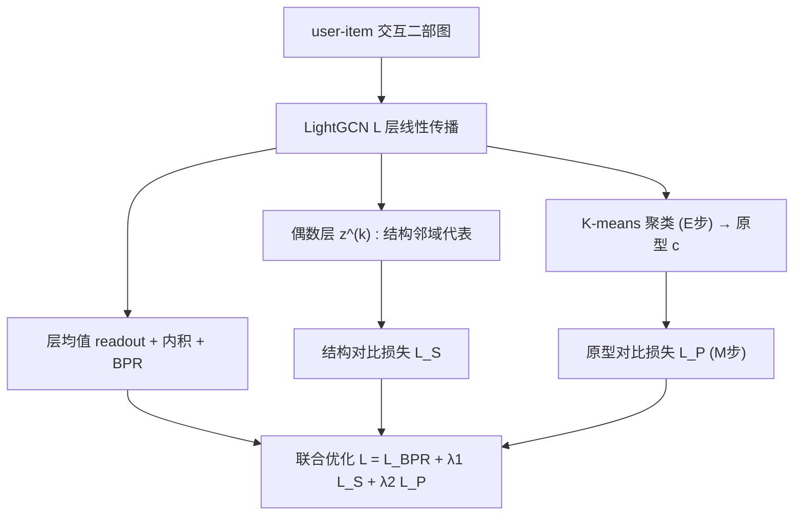
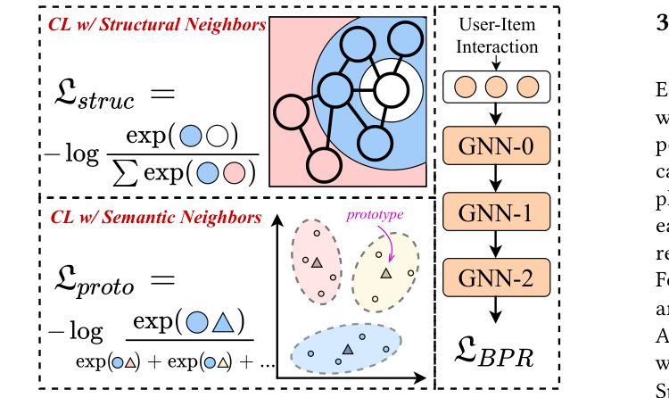

# Improving Graph Collaborative Filtering with Neighborhood-enriched Contrastive Learning (邻域增强对比学习的图协同过滤改进)

- **会议/期刊**: WWW 2022 (TheWebConf)
- **作者与机构**: Zihan Lin, Changxin Tian, Yupeng Hou, Wayne Xin Zhao（中国人民大学信息学院 / 高瓴人工智能学院）
- **推荐链路定位**: 召回（图协同过滤表征学习）
- **研究方向**: 自监督对比学习与交互去噪 / 图神经网络推荐
- **论文原文**: [https://arxiv.org/abs/2202.06200v2](https://arxiv.org/abs/2202.06200v2)
- **开源代码**: [https://github.com/RUCAIBox/NCL](https://github.com/RUCAIBox/NCL)（基于 RecBole 实现）

## TL;DR (1分钟核心速览)

针对图协同过滤在稀疏交互下表征不可靠、且现有对比学习（如 SGL）仅靠随机边丢弃/子图扰动构造"无意义正样本"的痛点，本文提出 NCL：把**结构邻域**（LightGCN 偶数层输出的同质多跳邻居）与**语义邻域**（K-means 原型，EM 求解）显式拉入对比对，作为 BPR 的辅助多任务损失。在 5 个公开数据集、随机 8:1:1 划分、Full-Ranking 协议下，相对基座 LightGCN 在 Yelp / Amazon-Books 的 Recall@10 分别提升 26.0% 与 17.1%，相对最强基线 SGL 仍提升 10.44% / 3.90%（$p<0.01$）。

## Background & Motivation (背景与核心矛盾)

- **主流范式**: LightGCN 类线性 GNN 在 user-item 二部图上做对称归一化传播 + 层均值 readout + BPR 排序损失；SGL 在此基础上用随机边丢弃/特征掩码生成增广视图，做 InfoNCE 自监督。
- **前人局限**: ① 对比对由**随机采样/随机增广**决定，同一用户的增广视图与其真实"相似用户"无关，正样本语义随机，忽略了推荐场景中最有价值的 user-user / item-item 相关性；② 模型仅依赖显式交互边，高阶相似约束无法显式注入，稀疏图上尤其脆弱；③ SGL 需同时维护两个视图嵌入，空间近 2 倍。
- **核心洞察 (Key Insight)**: 在无自环、无特征变换的线性传播下，第 $k$层输出$\mathbf{z}^{(k)}$恰为$k$ 跳邻居的加权和，而二部图上**偶数层**才回落到同质节点（用户→用户），因此偶数层输出天然就是"结构邻域代表向量"；语义相似但图上不可达的节点则可由嵌入空间的聚类中心（原型）刻画。
- **本文切入点**: 以"邻域"取代"随机增广"作为正样本来源，并用**单个代表向量**替代 pairwise 邻域对比以控制复杂度。

<figure class="paper-figure" markdown="span">
  ![忽略用户（或物品）间相关性的现有自监督学习方法（如 SGL \[33\]）与所提邻域增强对比学习方法（我们的方法）的比较。](../../../../assets/papers/2202.06200v2/figure_1.png)<figcaption>忽略用户（或物品）间相关性的现有自监督学习方法（如 SGL [33]）与所提邻域增强对比学习方法（我们的方法）的比较。</figcaption>
</figure>

## Method (核心方法设计)

### 1. 整体框架 (Overall Architecture)

输入 user-item 交互二部图，经 $L$层 LightGCN 传播得到各层表示$\mathbf{z}^{(0)},\dots,\mathbf{z}^{(L)}$，取均值作为最终表示并做内积打分与 BPR 训练；同时并行两路自监督：结构对比从偶数层输出中取$\mathbf{z}^{(k)}$与初始嵌入$\mathbf{z}^{(0)}$构造正对；语义对比在每个 epoch 的 E 步对全部用户/物品嵌入做 K-means 得到$K$ 个原型，再以原型对比损失回传梯度（M 步）。三项目标多任务联合优化。推理阶段原型与对比分支全部丢弃，仅保留 LightGCN 主干，**零额外参数、零额外推理开销**。

<figure class="paper-figure" markdown="span">
  <figcaption>我们所提邻域增强对比协同过滤方法的整体框架。</figcaption>
</figure>

### 2. 关键设计拆解 (Key Designs)

1. **结构对比（Structure-contrastive）**：痛点在于交互监督不含同质邻居约束，而随机增广正样本无语义。做法是把第 $k$层（$k$为偶数）输出作为$k$ 跳同质邻居代表，与自身初始嵌入构成正对：
$\mathcal{L}_{S}=\sum_{u\in\mathcal{U}}-\log\frac{\exp(\mathbf{z}_{u}^{(k)\top}\mathbf{z}_{u}^{(0)}/\tau)}{\sum_{v\in\mathcal{U}}\exp(\mathbf{z}_{u}^{(k)\top}\mathbf{z}_{v}^{(0)}/\tau)}+\alpha\sum_{i\in\mathcal{I}}-\log\frac{\exp(\mathbf{z}_{i}^{(k)\top}\mathbf{z}_{i}^{(0)}/\tau)}{\sum_{j\in\mathcal{I}}\exp(\mathbf{z}_{i}^{(k)\top}\mathbf{z}_{j}^{(0)}/\tau)}$物理直觉：二部图上偶数跳才可能回到同类节点，故$k$ 取最小偶层即可等价实现"用户—其相似用户"拉近，且不需构图、不需增广算子，比 SGL 省近一半显存。

2. **原型对比（Prototype-contrastive）+ EM 求解**：结构邻居被等权聚合会引入噪声。设嵌入服从以原型为中心、同方差各向同性高斯，最大化 $\sum_u \log\sum_{c_i\in C}p(e_u,c_i\mid\Theta,R)$的 Jensen 下界；E 步用 K-means 硬指示$\hat Q(c_i|e_u)$，M 步在归一化下有$(\mathbf{e}_u-\mathbf{c}_i)^2=2-2\mathbf{e}_u^{\top}\mathbf{c}_i$，似然化简为
$\mathcal{L}_{P}=\sum_{u\in\mathcal{U}}-\log\frac{\exp(\mathbf{e}_{u}^{\top}\mathbf{c}_{i}/\tau)}{\sum_{c_{j}\in C}\exp(\mathbf{e}_{u}^{\top}\mathbf{c}_{j}/\tau)}$即"节点—其所在簇原型"的 InfoNCE。直觉：原型把大批弱相关邻居压缩成$K$个语义锚点，既过滤结构噪声（$K\!\approx\!1000$ 时最优），又把"长度归一化 cosine + 温度"的高斯假设落到实处。

3. **训练目标、负采样与推理效率**：$\mathcal{L}=\mathcal{L}_{BPR}+\lambda_1\mathcal{L}_{S}+\lambda_2\mathcal{L}_{P}+\lambda_3\|\Theta\|_2^2$；负样本不额外构造，分母遍历全用户/物品集（batch 内采样$S$个负例近似），BPR 每正例均匀采 1 负。时间$O(N(S+K)d)$，空间无新增参数。

## Experimental Setup & Evaluation Protocol (实验设置与评估协议)

| 数据集 | #Users | #Items | #Interactions | 密度 | 说明 |
| :--- | :---: | :---: | :---: | :---: | :--- |
| ML-1M | 6,040 | 3,629 | 836,478 | 0.03816 | 稠密电影评分 |
| Yelp | 45,478 | 30,709 | 1,777,765 | 0.00127 | 商家评论，15-core 过滤 |
| Amazon-Books | 58,145 | 58,052 | 2,517,437 | 0.00075 | 图书，15-core 过滤 |
| Gowalla | 29,859 | 40,989 | 1,027,464 | 0.00084 | LBS 签到 |
| Alibaba-iFashion | 300,000 | 81,614 | 1,607,813 | 0.00007 | 超大极稀疏电商 |

- **数据划分与防穿越**: 随机 `80% / 10% / 10%` 比例划分（训练/验证/测试），**非全局时间戳切分**，存在轻度未来信息穿越风险；Yelp、Books 仅保留交互数 ≥15 的用户与物品。
- **排名评测协议**: 无偏 `Full-Ranking`（对全部未交互物品排序，非采样排序）；指标 Recall@$\{10,20,50\}$、NDCG@$\{10,20,50\}$。
- **对比基线与超参**: 8 个基线覆盖 MF（BPRMF/NeuMF/FISM）、图模型（NGCF/Multi-GCCF/DGCF/LightGCN）与自监督（SGL-ED）；统一 RecBole 实现，$d=64$，batch 4096，Adam，按 NDCG@10 早停（patience=10）；$\lambda_{1,2}\in[10^{-10},10^{-6}]$，$\tau\in[0.01,1]$，$k\in[5,10000]$；最优值显著性$p<0.01$。

## Key Experimental Results (实验关键数据)

### 1. 主实验对比 (Main Results)

| 模型 | ML-1M R@10 | N@10 | Yelp R@10 | N@10 | Books R@10 | N@10 | Gowalla R@10 | N@10 | iFashion R@10 | N@10 |
| :--- | :---: | :---: | :---: | :---: | :---: | :---: | :---: | :---: | :---: | :---: |
| BPRMF | 0.1804 | 0.2463 | 0.0643 | 0.0458 | 0.0607 | 0.0430 | 0.1158 | 0.0833 | 0.0303 | 0.0161 |
| NeuMF | 0.1657 | 0.2295 | 0.0531 | 0.0377 | 0.0507 | 0.0351 | 0.1039 | 0.0731 | 0.0182 | 0.0092 |
| FISM | 0.1887 | 0.2494 | 0.0714 | 0.0510 | 0.0721 | 0.0504 | 0.1081 | 0.0755 | 0.0357 | 0.0190 |
| NGCF | 0.1846 | 0.2528 | 0.0630 | 0.0446 | 0.0617 | 0.0427 | 0.1192 | 0.0852 | 0.0382 | 0.0198 |
| DGCF | 0.1881 | 0.2520 | 0.0723 | 0.0514 | 0.0737 | 0.0521 | 0.1252 | 0.0902 | 0.0447 | 0.0241 |
| LightGCN | 0.1876 | 0.2514 | 0.0730 | 0.0520 | 0.0797 | 0.0565 | 0.1362 | 0.0876 | 0.0457 | 0.0246 |
| SGL-ED | 0.1888 | 0.2526 | 0.0833 | 0.0601 | 0.0898 | 0.0645 | 0.1465 | 0.1048 | 0.0461 | 0.0248 |
| **NCL** | **0.2057** | **0.2732** | **0.0920** | **0.0678** | **0.0933** | **0.0679** | **0.1500** | **0.1082** | **0.0477** | **0.0259** |
| **Improv. (vs best baseline)** | +8.95% | +8.07% | +10.44% | +12.81% | +3.90% | +5.27% | +2.39% | +3.24% | +3.47% | +4.44% |

### 2. 消融实验 (Ablation Study)

结构性邻居跳数消融 + 主干可迁移性（Table 3 / Table 4）：

| 变体 | ML-1M R@10 | ML-1M N@10 | Yelp R@10 | Yelp N@10 |
| :--- | :---: | :---: | :---: | :---: |
| LightGCN (w/o s-n，无结构对比) | 0.1876 | 0.2514 | 0.0730 | 0.0520 |
| NCL @ 1-hop 同质邻居（最小偶层，默认） | **0.2057** | **0.2732** | **0.0920** | **0.0678** |
| NCL @ 2-hop 同质邻居 | 0.1838 | 0.2516 | 0.0837 | 0.0602 |
| NCL @ 3-hop 同质邻居 | 0.1839 | 0.2507 | 0.0787 | 0.0557 |
| NGCF → +NCL | 0.1846 → 0.1852 | 0.2528 → 0.2542 | 0.0630 → 0.0663 | 0.0446 → 0.0465 |
| DGCF → +NCL | 0.1881 → 0.1877 | 0.2520 → 0.2522 | 0.0723 → 0.0739 | 0.0514 → 0.0528 |
| LightGCN → +NCL | 0.1876 → **0.2057** | 0.2514 → **0.2732** | 0.0730 → **0.0920** | 0.0520 → **0.0678** |

（另据原文图 3：单独去掉语义对比 `w/o p-n` 或单独去掉结构对比 `w/o s-n` 均低于完整 NCL，且两者都仍优于 LightGCN，说明两类邻域互补。）

### 3. 关键实验发现 (Key Findings)

1. **收益主要来自"精选正样本"而非更强编码器**：相对基座 LightGCN，Yelp / Books 的 Recall@10 相对提升 26.0% / 17.1%（$0.0920$vs$0.0730$、$0.0933$vs$0.0797$），而对已含自监督的 SGL 仍有 +10.44% / +3.90%；由于推理零新增参数，增益完全归因于对比目标而非模型容量。
2. **稀疏越重、增益越大**：按交互数把用户分 5 组后，NCL 全组优于 LightGCN，且最优组 $G_1$（交互最少）增益最大；数据集侧也一致——极稀疏的 Alibaba-iFashion 绝对数值低但相对 SGL 仍 +3.47%，稠密 ML-1M 因邻域信息已充分反而结构对比饱和（1-hop 已足够）。
3. **邻域"阶数"与"原型数"存在明确最优点**：1-hop 同质邻居显著优于 2/3-hop（ML-1M $0.2057$vs$0.1838$/$0.1839$），说明高阶聚合被过度平滑稀释；$k\approx1000$时最优、$k=0$时明显掉点，印证原型确实在起"去噪 + 补语义"作用；$\tau$需在$[0.05,0.1]$且越稀疏数据集应取更小值。此外 NCL 对 NGCF/DGCF 的提升仅$+0.0006$/$+0.0024$，远小于对 LightGCN 的$+0.0169$——线性无变换传播保证各层处于同一表示空间，是该结构对比成立的前提。

## Highlights & Limitations (亮点、对比与审稿批判)

- **与代表作对比 (vs. Prior Work)**: 与 SGL 的本质区别在于正样本来源——SGL 用随机边丢弃/掩码制造"人工视图"，NCL 用 GNN 自身的多跳聚合（结构）与聚类中心（语义）作为"语义正确"的视图，且无需第二套嵌入，空间省近一半；与 Multi-GCCF 相比，NCL 不显式构造 user-user 投影图（该图在稀疏数据上稠密重叠、反而导致 Multi-GCCF 弱于 NGCF），仅通过损失隐式利用高阶相似；与 CV 的原型对比（PCL）相比，NCL 的原型是"兴趣簇质心"而非实例层级结构，并通过 EM 与推荐损失联合优化。
- **可迁移亮点**: ① 在任意线性传播 GNN 上，把"偶数层输出"直接当作同质邻域代表，是一种零成本、免构图的图增广替代方案，可迁移到序列/跨域模型的辅助任务；② 用 K-means + InfoNCE 的 EM 形式把"隐式语义簇"变成可回传梯度的锚点，是处理隐式反馈假阳性噪声的通用正则化手段（$K$ 越大越保守）。
- **审稿级局限批判**: ① 每个 epoch 都要在全部 $N$个嵌入上跑 K-means，$O(NKd)$的额外开销随$K$线性增长，论文未给出实际训练 wall-clock 与 epoch 数对比，也未做$K$的敏感性自适应；② 评估采用随机 8:1:1 划分而非时间切分，与真实线上分布不一致，且"$+0.0006$"级别的 NGCF 增益表明 model-agnostic 主张在非线性主干上实际较弱，缺少对 2-hop 掉点的严格解释（仅归因于过度平滑）；③ 仅验证静态 CF，未涉及序列/多行为场景，且未报告冷启动物品分桶结果。

## Rating (四维评分)

- **方法创新性 (Novelty)**: ⭐⭐⭐⭐ （把"偶数层=同质邻居"这一结构性质转成免增广对比正样本，配合 EM 原型对比，机制简洁且有清晰物理直觉，但仍是 InfoNCE 框架内的巧妙组合）
- **评估协议与实验扎实度 (Protocol & Experiments)**: ⭐⭐⭐⭐ （5 个跨规模数据集、Full-Ranking、$p<0.01$显著性、跳数/$\alpha$/$\tau$/$K$/主干迁移与稀疏分桶消融齐全；扣分在随机划分与缺少时间切分、缺少效率实测）
- **写作与数学规范度 (Clarity & Rigor)**: ⭐⭐⭐⭐ （从 Jensen 下界经各向同性高斯假设推导至 InfoNCE 的链条完整，复杂度与空间分析明确；但高斯同方差假设略强，负样本 $S$ 的采样细节描述偏简）
- **工业落地与复现价值 (Industrial & Practical Value)**: ⭐⭐⭐⭐ （推理零额外参数与开销、代码基于 RecBole 全量开源、可与 LightGCN 类召回直接替换；主要成本是训练期聚类，需在大规模场景做近似/降频优化）

