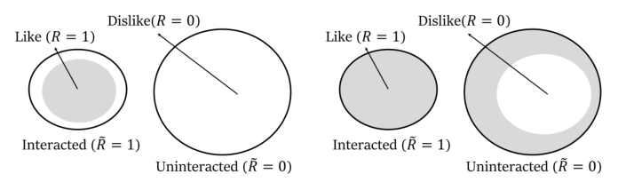
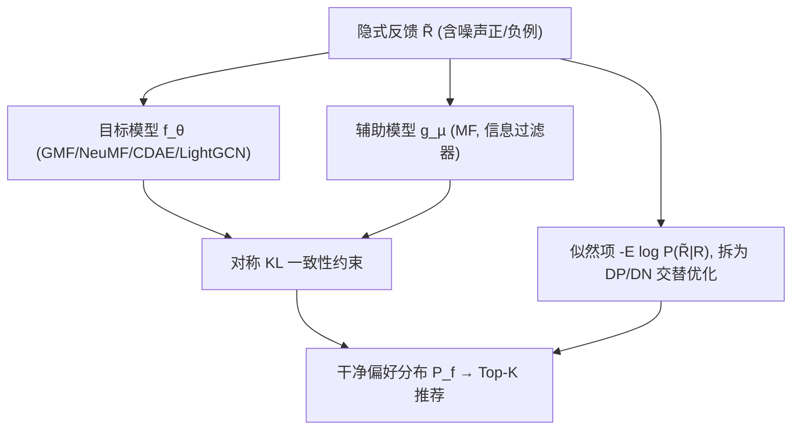

# Learning Robust Recommenders through Cross-Model Agreement (基于跨模型一致性的鲁棒推荐学习)

- **会议/期刊**: WWW 2022 (Virtual Event, Lyon)
- **作者与机构**: Yu Wang, Fuli Feng, Xiangnan He (USTC)；Xin Xin (山东大学，通讯)；Zaiqiao Meng (Cambridge)；Joemon M Jose (Glasgow)
- **推荐链路定位**: 召回/粗排（隐式反馈训练框架，model-agnostic）
- **研究方向**: 自监督对比学习与交互去噪 / 协同过滤
- **论文原文**: [https://arxiv.org/abs/2105.09605v3](https://arxiv.org/abs/2105.09605v3)
- **开源代码**: [https://github.com/wangyu-ustc/DeCA](https://github.com/wangyu-ustc/DeCA)

## TL;DR (1分钟核心速览)

隐式反馈中"交互≠真喜欢"与"未交互≠真不喜欢"两类噪声同时存在，而按 loss 大小判噪的重加权方法无法区分 hard-but-clean 样本。本文发现干净样本上不同推荐模型的预测高度一致、噪声样本上分歧极大（图 2），据此提出 DeCA：在最大化数据似然的同时最小化两个模型参数化偏好分布间的对称 KL 散度，把一致性作为弱监督去噪信号，并拆成 DP/DN 两个子任务交替优化。在 4 个数据集、4 个骨干上普遍超越 Normal/WBPR/T-CE/Ensemble，如 NeuMF 在 MovieLens 上 N@20 由 0.070 升至 0.081（+15.7%）。

## Background & Motivation (背景与核心矛盾)

- **主流范式**: 隐式反馈训练假设"交互=正、随机采样未交互=负"，用 BCE 或 pairwise 排序损失拟合二值标签。
- **前人局限**: ① 重加权类（T-CE）以高 loss 判噪，但靠近分类边界的 hard-clean 样本 loss 同样很高，二者不可分辨；② 重采样类（WBPR）性能强依赖采样分布、方差大；③ 依靠 dwell time、gaze、辅助特征的方法需要额外知识源，落地受限。
- **核心洞察 (Key Insight)**: 在 MovieLens-100k 上用 4 个模型做实证——干净正例（评分 4/5）上模型间预测差异显著小于噪声正例（评分 1/2）；甚至**同一模型换随机种子**也呈现同样规律，说明一致性信号源自数据本身而非模型结构。

<figure class="paper-figure" markdown="span">
  <figcaption>图 2：Modcloth 中干净样本与噪声样本上的平均预测差异，分别来自 (a) 不同模型或 (b) 用两个不同随机种子训练的同一模型。NMF 和 LGN 分别是 NeuMF 和 LightGCN 的缩写。</figcaption>
</figure>

- **本文切入点**: 不引入外部信息，让两个模型互相"校准"，用一致性把噪声信号压下去、把干净信号留下来；且与 Ensemble 不同——只在训练期蒸馏进**单个**目标模型，推理时无额外开销。

## Method (核心方法设计)

### 1. 整体框架 (Overall Architecture)

输入为含噪二值矩阵 $\tilde{R}$。目标模型$f_\theta$（GMF/NeuMF/CDAE/LightGCN，输出 sigmoid 概率）负责最终推荐；辅助模型$g_\mu$固定为轻量 MF，充当"信息过滤器"。训练由两部分耦合：一是数据似然项$\mathbb{E}_{P_f}[\log P(\tilde{R}|R)]$，二是$f_\theta$与$g_\mu$之间的 KL 一致性项。由于似然项涉及$h_\phi,h'_\psi,f_\theta$三模型同时更新会互相干扰，作者将其拆为正样本去噪(DP)与负样本去噪(DN)两个对偶子任务交替迭代，每次冻结一支并用大常数$C_1/C_2$近似另一支。推理阶段仅保留$f_\theta$，无额外延迟。

### 2. 关键设计拆解 (Key Designs)

1. **跨模型一致性 KL 约束（把"一致性"写成可优化下界）**：朴素做法需真实偏好 $R$的监督，不可得。作者用 Bayes 定理将$P_f(R)$展开为$P(\tilde{R})P(R|\tilde{R})/P(\tilde{R}|R)$代入 KL，重排后得到$\log P(\tilde{R})$的一个下界：最大化它等价于"最大化数据似然 + 最小化两模型偏好分布的散度"。再考虑到期望若取在$P_g$上会先把含噪信息灌进$g_\mu$再传给$f_\theta$，故改为取在$P_f$上，使$f_\theta$先拟合数据、再由简单的$g_\mu$ 把其拉回鲁棒成分（干净样本）。最终损失为对称形式，避免单向 KL 的梯度不对称：

$$\mathcal{L}_{\text{DeCA}} = -\mathbb{E}_{P_f}[\log P(\tilde{R}|R)] + \alpha D_{KL}[P_g\|P_f] + (1-\alpha)D_{KL}[P_f\|P_g]$$

2. **DP/DN 双任务解耦（分别治噪声正例与噪声负例）**：前人工作要么只去噪正例、要么只去噪负例（图 1(c)(d)）。DP 子任务假设负例全干净（$h'_\psi\equiv 1$），把交互样本中的噪声压下去；DN 子任务假设正例全干净（$h_\phi\equiv 0$），从海量未交互样本中找回"用户不知晓"的潜在正例。以 DP 为例，似然项被展开并用大常数$C_1$ 替代被冻结的一支：

$$\sum_{(u,i)|\tilde{r}_{ui}=1}\log h_\phi(u,i)\,(1-f_\theta(u,i)) - \sum_{(u,i)|\tilde{r}_{ui}=0}\big[C_1 f_\theta(u,i) + \log(1-h_\phi(u,i))(1-f_\theta(u,i))\big]$$

直觉上 $C_1$越大表示"越确信未交互即真负"，$C_2$ 越大表示"越确信交互即真正"，二者构成对数据可信度的先验强度旋钮。

3. **训练目标、负采样与推理效率**：总目标即上述 $\mathcal{L}_{\text{DeCA}}$；变体 DeCA(p) 不联合训练辅助模型，而是固定一个**同结构、不同随机种子**的预训练副本$f_{\theta'}$作为先验$P(R)$，损失换成$-\mathbb{E}_{P_f}[\log P(\tilde{R}|R)] + \alpha D_{KL}[P_f(R|\tilde{R})\|P(R)] + (1-\alpha)D_{KL}[P(R)\|P_f(R|\tilde{R})]$，动机来自图 2(b) 的"同模型异种子也满足一致性"。采样策略为每实例 1 正 + 1 随机负（1:1），每个 epoch 重采负例。辅助 MF 规模极小，训练开销约为主模型的常数倍；推理只跑$f_\theta$，**零额外成本**。

## Experimental Setup & Evaluation Protocol (实验设置与评估协议)

| 数据集 | #Users | #Items | #Interactions | 稀疏度 | 特征/场景说明 |
| :--- | :---: | :---: | :---: | :---: | :--- |
| MovieLens | 943 | 1,682 | 100,000 | 0.93695 | 电影评分，稠密小规模 |
| Modcloth | 44,783 | 1,020 | 99,893 | 0.99781 | 女装电商，用户多物品少 |
| Adressa | 212,231 | 6,596 | 419,491 | 0.99970 | 新闻阅读，匿名会话 |
| Electronics | 1,157,633 | 9,560 | 1,292,954 | 0.99988 | Amazon 电商，超稀疏 |

- **数据划分与防穿越**: 统一按 **8:1:1** 划分；MovieLens 与 Adressa 按**时间序**切分，Modcloth/Electronics **随机**切分。关键设计是构造 **clean test set**：MovieLens/Modcloth/Electronics 仅保留 rating=5 的交互，Adressa 仅保留 dwell time > 10s 的交互；评分与停留时长**只用于建测试集，训练只用含噪二值反馈**，从而保证"训练含噪、评测干净"的公平口径。
- **排名评测协议**: 在 clean test set 上报告 Recall@K / NDCG@K，Modcloth 与 Adressa 取 K=5,20，Electronics 因物品多取 K=10,50。注意：论文未明确交代候选集是无偏 Full-Ranking 还是采样排序（结合 4 个骨干的实现惯例，很可能沿用默认的采样评估），这是复现时的模糊点。全部结果跑 3 次取均值±标准差。
- **对比基线与超参**: 骨干为 GMF / NeuMF / CDAE / LightGCN；训练方法对比 Normal、WBPR（重采样）、T-CE（重加权截断 BCE）、Ensemble（异种子双模型集成）。嵌入维度 d=32（LightGCN 为 64），Adam + lr=1e-3，batch=2048，$L_2$按用户数归一后在 {0.01…1000} 网格搜索；DeCA 超参$C_1,C_2\in\{1,10,100,1000\}$，$\alpha\in\{0,0.5,1\}$。所有骨干的原有超参在各训练方法间保持一致。

## Key Experimental Results (实验关键数据)

### 1. 主实验对比 (Main Results)

下表为 MovieLens 与 Modcloth 上三个代表性骨干的 R@20 / N@20（加粗为行内最优）：

| 骨干 | 数据集 | Normal | WBPR | T-CE | Ensemble | DeCA | DeCA(p) |
| :--- | :--- | :---: | :---: | :---: | :---: | :---: | :---: |
| GMF | MovieLens | 0.095/0.059 | 0.082/0.056 | 0.098/0.054 | 0.095/0.059 | **0.109**/0.064 | 0.099/**0.066** |
| NeuMF | MovieLens | 0.103/0.064 | 0.086/0.054 | 0.106/0.068 | 0.108/0.070 | 0.099/0.059 | **0.120**/**0.081** |
| LightGCN | MovieLens | 0.106/0.065 | 0.093/0.064 | 0.080/0.043 | 0.105/0.064 | 0.104/0.064 | **0.118**/**0.075** |
| GMF | Modcloth | 0.225/0.088 | 0.224/0.090 | 0.235/0.093 | 0.228/0.089 | 0.245/**0.099** | **0.247**/0.100 |
| NeuMF | Modcloth | 0.242/0.101 | 0.247/0.108 | 0.228/0.091 | 0.260/0.109 | **0.268**/**0.113** | 0.265/0.110 |
| LightGCN | Modcloth | 0.220/0.087 | 0.222/0.088 | 0.231/0.093 | 0.227/0.090 | 0.221/0.085 | **0.235**/**0.096** |

代表性提升：NeuMF-MovieLens N@20 $0.070\to0.081$（**+15.7%**）；GMF-MovieLens R@20$0.095\to0.109$（**+14.7%**）；CDAE-MovieLens N@20$0.052\to0.067$（**+28.8%**）；LightGCN-Modcloth N@20$0.093\to0.096$（**+3.2%**）。Adressa 上 GMF R@5 由 0.116 升至 0.125、N@20 由 0.112 升至 0.127。

### 2. 消融实验 (Ablation Study)

Modcloth 上对 DP / DN 两支的拆分验证（R@20 / N@20）：

| 变体 | GMF | NeuMF | LightGCN |
| :--- | :---: | :---: | :---: |
| 仅 DP：DeCA-DP | 0.245/0.098 | 0.256/0.109 | 0.223/0.086 |
| 仅 DN：DeCA-DN | 0.187/0.071 | 0.198/0.070 | **0.240**/**0.096** |
| 完整 DeCA | **0.245**/**0.099** | **0.268**/**0.113** | 0.221/0.085 |
| 仅 DP：DeCA(p)-DP | 0.243/0.099 | **0.268**/**0.113** | 0.220/0.086 |
| 仅 DN：DeCA(p)-DN | 0.221/0.084 | 0.255/0.108 | **0.240**/**0.096** |
| 完整 DeCA(p) | **0.247**/**0.100** | 0.265/0.110 | 0.235/0.096 |

辅助模型容量消融（DeCA，Modcloth，GMF 为目标模型）：$h,h'$取 MF 时 R@20=0.2452，换 GMF 为 0.2453、换 NeuMF 为 0.2448 —— **几乎无差异**，说明建模$P(\tilde{R}|R)$ 本身是低复杂度任务，用 MF 即可。

### 3. 关键实验发现 (Key Findings)

1. **双支协同优于单支，且 DP 远比 DN 可靠**：GMF 上仅 DP 的 R@20=0.245，仅 DN 骤降至 0.187，完整模型回到 0.245；说明从交互样本里挑噪声比从海量未交互样本里"捞"潜在正例容易得多。DN 不稳定的根因是每 epoch 负例重采样导致目标漂移——这也解释了表 3 中 DN 在部分骨干上反而拖累整体。
2. **一致性约束有效抑制了训练后期的噪声记忆**：图 3 的学习曲线显示 Normal 训练在后期 clean-test Recall 明显回落（模型开始拟合噪声），而 DeCA/DeCA(p) 全程保持上升或平稳，在 Modcloth、Adressa、Electronics 三个数据集上均如此，直接印证了"去噪即抗过拟合"的机制解释。
3. **超参反映了数据可信度的非对称性**：Adressa 上图 5 显示最优 $C_1=1000$而$C_2=10\sim100$，即"未交互≈真负"的可信度显著高于"交互≈真正"，与隐式反馈中点击受曝光/流行度偏置污染的常识吻合；同时可解释性实验（图 4）表明$P(r_{ui}=1|\tilde{r}_{ui}=1)$随评分单调上升（如 MovieLens-DeCA 从评分 1 的约 0.65 升至评分 5 的约 0.87），且换不同$h,h'$ 趋势一致，验证了学到的偏好分布确实恢复了真实偏好序。

## Highlights & Limitations (亮点、对比与审稿批判)

- **与代表作对比 (vs. Prior Work)**: 相较 T-CE 的"高 loss 即噪声"假设，DeCA 用**模型间一致性**这一与 loss 大小解耦的信号，规避了 hard-clean 与 noisy 不可分的根本困难；相较 WBPR 等重采样方法，它不改变采样分布因而方差更小；相较 Ensemble，它把多模型信息蒸馏进单模型，推理不增加计算。相较 SGL/SimGCL 类图增广对比学习，DeCA 的"第二视图"来自**另一个模型/另一个种子**而非图扰动，可与前者正交叠加。
- **可迁移亮点**: ① "干净样本→模型一致、噪声样本→模型分歧"这一现象可作为通用噪声检测器，迁移到序列推荐、多模态推荐的样本清洗与置信度加权；② 用大常数 $C_1/C_2$ 冻结一支、交替优化的做法，是把三模型耦合的隐变量模型化简为可训练目标的一种轻量近似技巧。
- **审稿级局限批判**: ① **评估口径存疑**：全文未声明候选集是 Full-Ranking 还是采样排序，且只在"rating=5"的极干净子集上评测，绝对指标偏低（MovieLens R@20 仅 0.1 量级），与主流全库排序结果不可直接横向比较；② **训练成本与稳定性**：DeCA 需同时维护目标模型与辅助模型、并按 DP/DN 交替多阶段更新，训练时长约为 Normal 的 2 倍以上；DN 支在负例重采样下明显不稳定（表 3 中多次劣化），实际部署需要额外调参成本；③ 辅助模型选 MF 虽省算力，但 $C_1,C_2,\alpha$ 三个超参需网格搜索，跨数据集迁移性有待更多验证。

## Rating (四维评分)

- **方法创新性 (Novelty)**: ⭐⭐⭐⭐ （"跨模型一致性作为去噪信号"视角新颖，且有贝叶斯下界推导与实证现象双重支撑，首次同时处理噪声正例与噪声负例）
- **评估协议与实验扎实度 (Protocol & Experiments)**: ⭐⭐⭐ （4 数据集 × 4 骨干 × 4 基线的覆盖很扎实，clean test set 构造用心，但候选集打分协议未明示、仅 3 次重复且无显著性检验，评测口径偏弱）
- **写作与数学规范度 (Clarity & Rigor)**: ⭐⭐⭐⭐ （从 KL 到下界再到对称损失的推导链条清晰完整，$C_1/C_2$ 的物理含义解释到位；但式 (14)(15) 的符号堆叠较重，DP/DN 交替训练的实现细节被推到附录）
- **工业落地与复现价值 (Industrial & Practical Value)**: ⭐⭐⭐⭐ （框架 model-agnostic、推理零额外开销、代码已开源，适合直接套在现有召回模型上；扣分在于训练期双模型与交替优化的工程复杂度）

