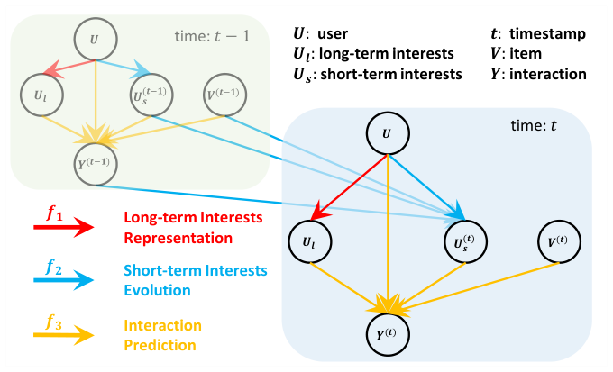
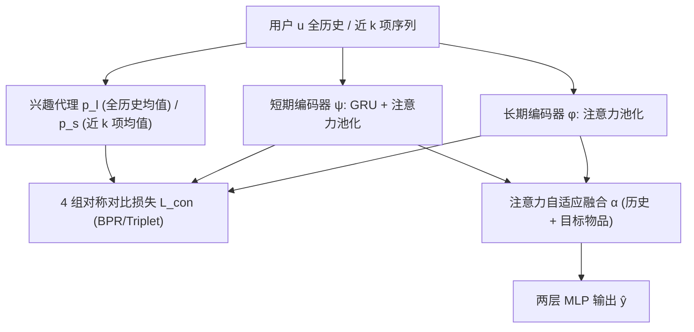
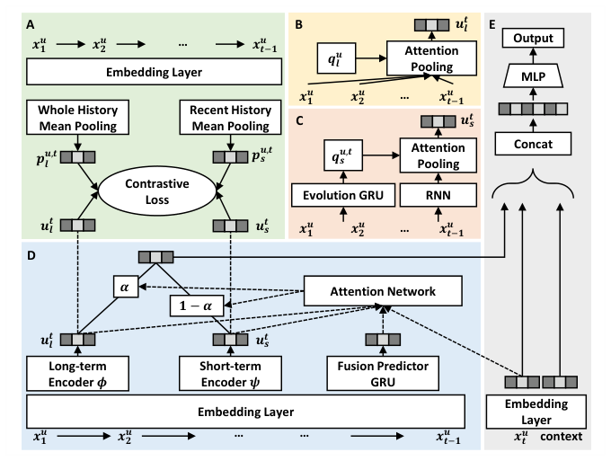

# Disentangling Long and Short-Term Interests for Recommendation (解耦长短期兴趣的推荐方法)

- **会议/期刊**: WWW 2022 (Virtual Event, Lyon)
- **作者与机构**: Yu Zheng, Chen Gao, Depeng Jin, Yong Li (清华大学电子工程系) ；Jianxin Chang, Yanan Niu, Yang Song (快手科技)
- **推荐链路定位**: 精排 (CTR/行为预估)
- **研究方向**: 序列与会话推荐 / 自监督对比学习与交互去噪
- **论文原文**: [https://arxiv.org/abs/2202.13090v1](https://arxiv.org/abs/2202.13090v1)
- **开源代码**: [https://github.com/tsinghua-fib-lab/CLSR](https://github.com/tsinghua-fib-lab/CLSR)

## TL;DR (1分钟核心速览)

现有长短期兴趣 (LS-term) 建模只用两个独立编码器却**没有任何显式监督**，学到的表征彼此纠缠（线性反例：融合权重 0.8/0.2 时实际注入 0.56 长期 + 0.44 短期），既损害精度又不可解释。CLSR 从交互序列中直接构造"长期=全历史均值、短期=近 $k$项均值"的兴趣代理作伪标签，用 4 个对称 BPR/三元组对比任务把两个编码器推向各自代理，再用目标物品感知的注意力自适应融合。在淘宝/快手两数据集上，AUC/GAUC 相对最强基线 SURGE 再提升约 0.005–0.01，NDCG@2 提升约 5%，反事实实验显示$\alpha$ 随行为成本（点击 vs 购买/点赞）单调变化，证明解耦生效。

## Background & Motivation (背景与核心矛盾)

- **主流范式**: CF 类（NCF/DIN/LightGCN）抓稳定长期偏好但无时序；序列类（GRU4REC/DIEN/SASRec/SURGE）抓短期演化但记忆短；SLi-Rec 等用两个模型拼接长短两端。
- **前人局限**: (1) 这些方法对"哪部分是长期、哪部分是短期"**不加任何监督**，两个表征互相泄漏，作者用线性玩具例子证明融合权重会失效；(2) 简单 sum/concat 融合假设两端贡献固定，与"连续浏览同类目时短期主导、跨类目跳转时长期主导"的真实分布不符。
- **核心洞察 (Key Insight)**: 兴趣虽无人工标注，但**序列本身自带时间尺度语义**——全历史均值天然对应稳定偏好，近 $k$ 项均值天然对应动态偏好，可直接充当伪标签；且长短兴趣允许部分重叠（只在单一类目消费的用户两端一致），故不能用 InfoNCE 式的强独立性约束。
- **本文切入点**: 将"解耦"重构为**表征—代理的对比对齐**，把无监督的隐式分工改为自监督的显式分工。

<figure class="paper-figure" markdown="span">
  <figcaption>图1：用户兴趣建模𝜁（彩色查看效果最佳），包含三种机制：长期兴趣表示（红色边）、短期兴趣演化（蓝色边）和交互预测（黄色边）。</figcaption>
</figure>

## Method (核心方法设计)

### 1. 整体框架 (Overall Architecture)

把每次交互分解为三机制 $\zeta=\{U_l=f_1(U),\ U^{(t)}_s=f_2(U^{(t-1)}_s,V^{(t-1)},Y^{(t-1)},U),\ Y^{(t)}=f_3(U_l,U^{(t)}_s,V^{(t)},U)\}$：长期编码器$\phi$用 target-aware 注意力池化压缩全历史，短期编码器$\psi$在 GRU 输出上做注意力池化捕捉近期演化；两者查询向量$\boldsymbol{q}^u_l=\text{Embed}(u)$、$\boldsymbol{q}^{u,t}_s=\text{GRU}(\cdot)$均落在**同一物品嵌入空间**（这是能对比的前提）。训练时主任务 NLL 与对比任务多任务联合优化；推理时由目标物品与历史共同决定权重$\alpha$ 融合后过两层 MLP 打分。

<figure class="paper-figure" markdown="span">
  <figcaption>图2：我们提出的基于自监督学习的CLSR框架。A）对长短期兴趣的表示与代理之间的相似性执行对比任务，以增强解耦；B）长期兴趣编码器𝜙；C）短期兴趣编码器𝜓；D）基于目标物品和历史交互的注意力对长短期兴趣进行自适应融合；E）交互预测网络。其中𝑈′</figcaption>
</figure>

### 2. 关键设计拆解 (Key Designs)

1. **兴趣代理构造（把序列变成伪标签）**：痛点是 LS-term 无标注。取全历史与最近 $k$项的物品嵌入均值作代理，仅在序列长度超过阈值$l_t$时计算（过短序列无区分必要）：$\boldsymbol{p}^{u,t}_{l}=\frac{1}{t}\sum_{j=1}^{t}\boldsymbol{E}(x^u_j)$，$\boldsymbol{p}^{u,t}_{s}=\frac{1}{k}\sum_{j=1}^{k}\boldsymbol{E}(x^u_{t-j+1})$。直觉：均值池化抹去顺序信息，恰好只保留"尺度"语义——全历史均值 = 稳定偏好，近$k$ 均值 = 瞬时偏好。

2. **对称四元对比解耦（本方法核心）**：痛点是两个编码器即使分开也会互相泄漏。设计 4 个对称约束，既要求"表征靠近自己代理、远离对方代理"，也要求"代理靠近自己表征、远离对方表征"：$\mathcal{L}^{u,t}_{con}=f(\boldsymbol{u}_l,\boldsymbol{p}_l,\boldsymbol{p}_s)+f(\boldsymbol{p}_l,\boldsymbol{u}_l,\boldsymbol{u}_s)+f(\boldsymbol{u}_s,\boldsymbol{p}_s,\boldsymbol{p}_l)+f(\boldsymbol{p}_s,\boldsymbol{u}_s,\boldsymbol{u}_l)$，其中$f$可为 BPR 形式$\mathcal{L}_{bpr}(a,p,q)=\sigma(\langle a,q\rangle-\langle a,p\rangle)$或三元组$\max\{d(a,p)-d(a,q)+m,0\}$。**刻意不加独立性正则**：因长短兴趣可重叠，只做"对齐"不做"推开"，避免 InfoNCE 式过强惩罚把同质用户的两端强行分离。

3. **目标物品感知的自适应融合 + 训练目标**：$\alpha=\sigma\big(\tau_f(\boldsymbol{h}^u_t\|\boldsymbol{E}(x^u_{t+1})\|\boldsymbol{u}^t_l\|\boldsymbol{u}^t_s)\big)$，$\boldsymbol{u}^t=\alpha\boldsymbol{u}^t_l+(1-\alpha)\boldsymbol{u}^t_s$。总损失$\mathcal{L}=\sum_{u}\sum_{t}\big(\mathcal{L}^{u,t}_{rec}+\beta\mathcal{L}^{u,t}_{con}\big)+\lambda\|\Theta\|_2$，训练为 1 正 +$N-1$均匀采样负样本，$\beta$最优 0.1。复杂度$\mathcal{O}((M+N)d+Q)$，与 SLi-Rec 同级，在线推理无额外开销。

## Experimental Setup & Evaluation Protocol (实验设置与评估协议)

| 数据集 | #Users | #Items | #Interactions | 稀疏度/密度 | 特征/场景说明 |
| :--- | :---: | :---: | :---: | :---: | :--- |
| Taobao | 36,915 | 64,138 | 1,471,155 | 平均序列长 39.85 | 电商，点击 + 购买双行为 |
| Kuaishou | 60,813 | 292,286 | 14,952,659 | 平均序列长 245.88 | 短视频，点击 + 点赞双行为 |

- **数据划分与防穿越**: 沿用 SLi-Rec 的**时序 Leave-One-Out** 设置（末位交互测试、倒数第二位验证，细节见原文附录 A.1），严格按时间戳排序，无未来信息泄漏。
- **排名评测协议**: 属 **Sampled Ranking**——每个正样本配 $N-1$ 个采样负样本（非全库 Full-Ranking），指标为 AUC、GAUC（用户级分组加权）、MRR 与 NDCG@2。
- **对比基线与超参**: 长期侧 NCF / DIN / LightGCN，短期侧 Caser / GRU4REC / DIEN / SASRec / SURGE，联合侧 SLi-Rec；嵌入维度 $d$与 GRU 隐层见附录 A.2–A.3，显著性以$p<0.05$（\*）、$p<0.01$（\*\*）标注。

## Key Experimental Results (实验关键数据)

### 1. 主实验对比 (Main Results)

| 类别 | 方法 | Taobao AUC | Taobao GAUC | Taobao MRR | Taobao NDCG@2 | Kuaishou AUC | Kuaishou GAUC | Kuaishou MRR | Kuaishou NDCG@2 |
| :--- | :--- | :---: | :---: | :---: | :---: | :---: | :---: | :---: | :---: |
| 长期 | NCF | 0.7128 | 0.7221 | 0.1446 | 0.0829 | 0.5559 | 0.5531 | 0.7734 | 0.8327 |
| 长期 | DIN | 0.7637 | 0.8524 | 0.3091 | 0.2352 | 0.6160 | 0.7483 | 0.8863 | 0.9160 |
| 长期 | LightGCN | 0.7483 | 0.7513 | 0.1669 | 0.1012 | 0.6403 | 0.6407 | 0.8175 | 0.8653 |
| 短期 | GRU4REC | 0.8635 | 0.8680 | 0.3993 | 0.3422 | 0.8156 | 0.8298 | 0.9166 | 0.9384 |
| 短期 | DIEN | 0.8477 | 0.8745 | 0.4011 | 0.3404 | 0.7037 | 0.7800 | 0.9030 | 0.9284 |
| 短期 | SASRec | 0.8598 | 0.8635 | 0.3915 | 0.3340 | 0.8199 | 0.8293 | 0.9161 | 0.9380 |
| 短期 | SURGE | 0.8906 | 0.8888 | 0.4228 | 0.3625 | 0.8525 | 0.8610 | 0.9316 | 0.9495 |
| 联合 | SLi-Rec | 0.8664 | 0.8669 | 0.3617 | 0.2971 | 0.7978 | 0.8128 | 0.9075 | 0.9318 |
| 联合 | **CLSR (Ours)** | **0.8953**\*\* | **0.8936**\*\* | **0.4372**\*\* | **0.3788**\*\* | **0.8563** | **0.8718** | **0.9382**\* | **0.9544**\* |
| | *Improv. vs SURGE* | +0.53% | +0.54% | +3.41% | +4.50% | +0.45% | +1.25% | +0.71% | +0.52% |

### 2. 消融实验 (Ablation Study)

| 配置 | 关键指标 | 变化 | 说明 |
| :--- | :--- | :--- | :--- |
| CLSR 完整 | Kuaishou GAUC ≈ 0.872 | — | 主结果 |
| w/o $\mathcal{L}_{con}$ | Kuaishou GAUC 下降 > 0.01 | 显著退化 | 自监督是解耦必要项 |
| DIEN w/o $\mathcal{L}_{con}$ | 基线水平 | — | 通用框架验证 |
| DIEN **w/ $\mathcal{L}_{con}$** | 明显提升 | 正向 | 可插入任意短期编码器 |
| 固定 $\alpha$（0.1–0.9 扫描） | 两数据集均低于虚线 | 全面劣于自适应 | 静态融合不成立 |
| 仅长期 / 仅短期 / 双端 | 双端最优 | 单调提升 | 两端信息互补 |

### 3. 关键实验发现 (Key Findings)

1. **"联合建模 ≠ 更好"被证伪**：SLi-Rec 虽同时建模两端，但 Taobao 上 MRR 仅 0.3617，反而低于纯短期 GRU4REC 的 0.3993（约 −9.4%）；而解耦后的 CLSR 达到 0.4372，说明性能增益来源是"解耦"而非"堆叠两个模块"。
2. **$\alpha$的语义一致性是解耦的直接证据**：购买/点赞比点击更依赖长期兴趣，CLSR 的$\bar\alpha$在淘宝上从点击 0.3439 升到购买 0.3568（+3.75%），快手从 0.2528 升到 0.2757（+9.06%）；而 SLi-Rec 在淘宝上反而下降 −6.47%，暴露其长期表征中混入了短期信息（$\bar\alpha$ 在快手甚至高达 0.73）。
3. **反事实扰动下解耦带来鲁棒性**：Shuffle 协议破坏短期信息后，CLSR 点击 AUC 0.8413 / 购买 MRR 0.4194，显著高于 SLi-Rec 的 0.8092 / 0.3151（MRR 相对 +33%）；Truncate 协议中随可用历史长度 $k$ 增大，购买预测 AUC 快速上升而点击几乎不变，印证"长期需全历史、短期只需近窗"的假设成立。

## Highlights & Limitations (亮点、对比与审稿批判)

- **与代表作对比 (vs. Prior Work)**: 与 SLi-Rec（LSTM 变体 + 非对称 SVD，无监督分工）相比，本文把"分工"从架构先验变成**可验证的监督信号**；与 SGL/SimGCL 类序列对比学习（靠 dropout/扰动做增广）相比，本文的对比对象是**语义代理而非增强视图**，直接编码时间尺度；与 SURGE（图卷积+池化）相比，本文显式区分两种时间尺度而非统一图表征。
- **可迁移亮点**: (1) "均值池化 = 尺度语义"的代理构造极轻量，可零成本移植到任何多兴趣/多场景解耦任务（如跨域迁移中的域内/域间兴趣）；(2) 用**融合权重 $\alpha$ 的行为间相对变化**作为解耦程度的可解释诊断指标，比单纯精度对比更有说服力。
- **审稿级局限批判**: (1) 评估仅在**采样排序**下进行（1 正 + $N-1$负、NDCG@2），未做全库 Full-Ranking，且$N$的取值与负采样分布敏感性未讨论，绝对指标可能被高估；(2) 代理固定用均值池化、$k$与$l_t$为人工超参，快手平均序列长 245 与淘宝 39.85 差异巨大却共用同一套代理设计，缺少对$k$ 的敏感性分析与自适应选择机制；(3) 只做离线实验，无线上 A/B 或延迟/吞吐报告，"与 SLi-Rec 同级复杂度"的工程结论缺乏实测支撑。

## Rating (四维评分)

- **方法创新性 (Novelty)**: ⭐⭐⭐⭐ （把长短期解耦转写成"表征—代理"对称对比问题，代理构造简洁且刻意放弃独立性正则，动机清晰，但对比学习+多兴趣解耦的组合本身不算范式突破）
- **评估协议与实验扎实度 (Protocol & Experiments)**: ⭐⭐⭐⭐ （双领域大规模数据、8+ SOTA 基线、显著性检验与反事实/Shuffle/Truncate 三组扰动实验相当完整；扣分在仅采样排序、无全库排序与超参敏感性）
- **写作与数学规范度 (Clarity & Rigor)**: ⭐⭐⭐⭐⭐ （线性玩具反例直观说明纠缠危害，三机制分解与四元对称损失符号自洽，复杂度分析到位）
- **工业落地与复现价值 (Industrial & Practical Value)**: ⭐⭐⭐⭐ （代码与数据处理已开源，快手真实场景验证、推理零额外开销、框架可套用任意短期编码器；缺线上指标与部署细节）

