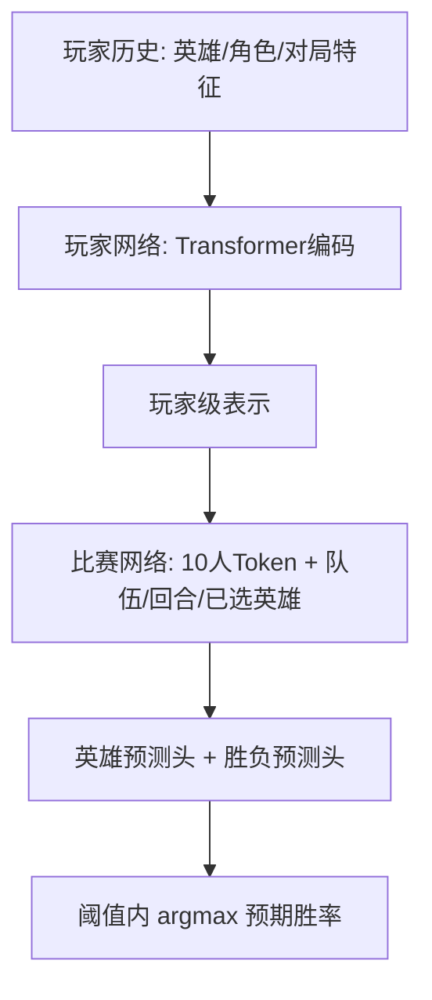
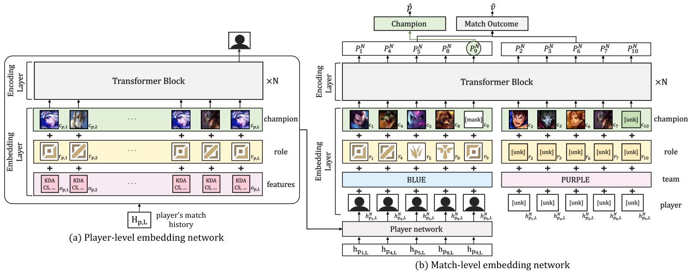
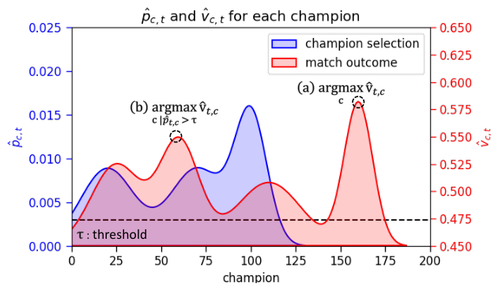

# DraftRec: Personalized Draft Recommendation for Winning in Multi-Player Online Battle Arena Games (MOBA 选人阶段个性化推荐)

- **会议/期刊**: WWW 2022
- **作者与机构**: Hojoon Lee, Dongyoon Hwang, Hyunseung Kim, Byungkun Lee, Jaegul Choo (KAIST)
- **推荐链路定位**: 端到端草稿阶段推荐/决策辅助
- **研究方向**: 序列与会话推荐 / 多任务学习
- **论文原文**: [https://arxiv.org/abs/2204.12750v1](https://arxiv.org/abs/2204.12750v1)
- **开源代码**: [https://github.com/dojeon-ai/DraftRec](https://github.com/dojeon-ai/DraftRec)

## TL;DR (1分钟核心速览)

MOBA 选人阶段既要考虑玩家个人英雄偏好，又要考虑队伍协同与克制，组合空间指数爆炸且对手信息不可见。DraftRec 用“玩家网络 + 比赛网络”的分层 Transformer 编码玩家历史与 10 人选人状态，联合预测英雄与胜负，并在偏好概率阈值内最大化预期胜率。按时间戳切分、全英雄 softmax 排序下，LOL HR@1 较 SASRec 提升 12.1%，Win@3 达 54.12%。

## Background & Motivation (背景与核心矛盾)

- **主流范式**: 序列推荐用 Transformer 编码用户历史；MOBA 胜负预测/选人研究多用队伍英雄协同、克制与对局特征建模。
- **前人局限**: ① 既有 MOBA 推荐只追求胜率，忽略玩家个人英雄偏好；② 选人状态部分可观测、队伍交互复杂，扁平序列难以同时刻画“人—英雄—队伍”关系。
- **核心洞察 (Key Insight)**: 玩家近期英雄、角色与对局特征可表征偏好；比赛级自注意力可整合队友/对手与已选英雄，且注意力会自发学到 Top-Jungle、Mid-Jungle、AD-Support 等真实联动。
- **本文切入点**: 两级分层 Transformer + 联合胜负预测 + 偏好阈值约束的胜率最大化推荐。

## Method (核心方法设计)

### 1. 整体框架 (Overall Architecture)

输入为待推荐玩家及其队友的最近 $L$场历史，每场含英雄、角色、对局特征；玩家网络共享 Transformer 编码每人历史，取末位表示作为玩家级偏好向量。比赛网络将 10 名玩家作为 token，拼接其当前英雄/角色/队伍/回合嵌入与玩家级表示，经 Transformer 融合后输出英雄分布与胜负概率。训练时对每个 turn 的可见状态做联合监督；推理时对被 ban 英雄屏蔽，并在偏好概率超过阈值$\tau$ 的候选内选预期胜率最高者。整体见图2。

<figure class="paper-figure" markdown="span">
  <figcaption>图2：(a) 编码玩家比赛历史的玩家级嵌入网络；(b) 比赛级嵌入网络</figcaption>
</figure>

### 2. 关键设计拆解 (Key Designs)

1. **玩家级动态偏好编码**：痛点是把所有历史压成静态 ID 会丢失近期英雄偏好。对第 $l$场历史做嵌入相加$\mathbf{h}^0_{p,l}=\mathbf{c}^0_{p,l}+\mathbf{r}^0_{p,l}+\mathbf{ftr}^0_{p,l}+\mathbf{pos}^0_l$，经$N$层 Transformer 后取末位$\mathbf{h}^N_{p,L}$ 作为玩家表示。直觉是末位状态聚合了近期选择与角色/表现上下文。
2. **比赛级部分可观测交互建模**：痛点是选人时只看得到己方与已选英雄，且队伍协同不是简单平均。将不可见对手置 `[unk]`、待预测位置 `[mask]`，每个玩家 token 为 $\mathbf{p}^0_k=\mathbf{c}^0_k+\mathbf{r}^0_k+\mathbf{team}^0_k+\mathbf{turn}^0_k+\mathbf{h}^N_{p_k,L}$，再用比赛 Transformer 得到$\mathbf{p}^N_t$。英雄头为$\hat{\mathbf{p}}_t=\mathrm{softmax}(\mathrm{GELU}(\mathbf{p}^N_t W_P+b_P)E_C^\top+b_C)$，胜负头用两队池化表示差$\hat{v}_t=\sigma(((T_1-T_2)W_O+b_O)W_V+b_V)$。
3. **阈值约束的胜率推荐**：单纯按 $\hat{v}_{t,c}$排序会把 OOD 状态误判为高胜率。最终策略为$\hat{c}=\arg\max_{c|\hat{p}_{t,c}>\tau}\hat{v}_{t,c}$，即只在玩家可能选择的英雄内最大化胜率，兼顾偏好与胜率。见图3。

<figure class="paper-figure" markdown="span">
  <figcaption>图3：不同策略的示意图。(a) 表示胜率最高的英雄；(b) 表示</figcaption>
</figure>

**训练目标、负采样与推理效率**：总损失 $\mathcal{L}=\frac{1}{T}\sum_{t=1}^T[\lambda\mathcal{L}_p(\hat{\mathbf{p}}_t,c_t)+(1-\lambda)\mathcal{L}_v(\hat{v}_t,o_t)]+c\|\theta\|_2^2$，原文两项均用 BCE。英雄头对全部英雄做 softmax，ban 位屏蔽，无采样负例；推理需对候选英雄逐一改写状态并估计$\hat{v}_{t,c}$，复杂度随英雄数增长，是潜在线上瓶颈。

## Experimental Setup & Evaluation Protocol (实验设置与评估协议)

- **数据集与预处理**:

| 数据集 | #Users | #Items | #Interactions(#Matches) | 平均历史长度 | 稀疏度/场景说明 |
| :--- | :---: | :---: | :---: | :---: | :--- |
| LOL | 62,466 | 156 | 279,893 | 66.38 | 顶级0.1%排位，含角色特征 |
| Dota2 | 140,931 | 111 | 50,000 | 2.12 | 公开数据，无角色，历史极稀疏 |

- **数据划分与防穿越**: 按时间戳排序后 `85% / 5% / 10%` 切分训练/验证/测试，属全局时间切分，避免未来对局穿越。
- **排名评测协议**: 全英雄候选 softmax 排序，banned 英雄屏蔽；非采样排序。每个 turn 的状态分别评估，报告 HR@1/5/10、NG@5/10；胜负任务报告 ACC、MAE。
- **对比基线与超参**: 推荐基线 POP、NCF、DMF、S-POP、SASRec；胜负基线 MC、LR、NN、HOI、OptMatch、NeuralAC。$N=2$，$d\in\{64,128,256\}$，Adam，历史长度$L\in\{0,1,10,20,50,100\}$；显著性$p<0.01$。

## Key Experimental Results (实验关键数据)

### 1. 主实验对比 (Main Results)

**英雄推荐（部分列）**：

| 模型 | LOL HR@1 | LOL HR@5 | LOL NG@10 | Dota2 HR@1 | Dota2 NG@10 |
| :--- | ---: | ---: | ---: | ---: | ---: |
| POP | 0.3212 | 0.5646 | 0.4792 | 0.0508 | 0.0989 |
| NCF | 0.1376 | 0.4219 | 0.3367 | 0.0403 | 0.1226 |
| DMF | 0.3243 | 0.5758 | 0.4887 | **0.0562** | 0.1290 |
| S-POP | 0.4135 | 0.7404 | 0.6213 | 0.0554 | 0.1004 |
| SASRec | 0.4497 | 0.7430 | 0.6368 | 0.0449 | 0.1296 |
| DraftRec-no-history | 0.1456 | 0.3950 | 0.3268 | 0.0403 | 0.1239 |
| **DraftRec** | **0.5042** | **0.8025** | **0.6618** | 0.0434 | **0.1496** |
| **Improv. vs SASRec** | **+12.1%** | **+8.0%** | **+3.9%** | −3.3% | **+15.4%** |

**胜负预测（ACC / MAE）**：DraftRec 在 LOL 达 **0.5535 / 0.4842**，优于 OptMatch 0.5411 / 0.4944；Dota2 达 **0.5755 / 0.4782**，MAE 优于 LR 0.4819，ACC 略高于 LR 0.5750。

### 2. 消融实验 (Ablation Study)

| 设置 | LOL HR@1 | LOL HR@10 | LOL ACC | Win@3 |
| :--- | ---: | ---: | ---: | ---: |
| DraftRec 完整 | **0.5042** | **0.8836** | **0.5535** | — |
| w/o 玩家历史 | 0.1456 | 0.5675 | 0.5284 | — |
| 仅偏好策略 $\hat{p}$ | — | 0.8836 | — | 52.72 |
| 仅胜率策略 $\hat{v}$ | — | 0.2051 | — | 51.34 |
| 阈值联合 $\hat{p}+\hat{v}$ | — | 0.8495 | — | **54.12** |

### 3. 关键实验发现 (Key Findings)

1. **玩家历史是主增益来源**：去掉历史后 LOL HR@1 从 0.5042 暴跌至 0.1456、ACC 降至 0.5284，说明个性化偏好编码是推荐与胜负预测的共同底座。
2. **阈值联合策略显著抬升预期胜率**：Win@3 由仅偏好 52.72%、仅胜率 51.34% 提升到 54.12%；但 HR@10 从 0.8836 降至 0.8495，体现“胜率—偏好”存在可调 trade-off。
3. **Dota2 稀疏场景暴露边界**：平均历史仅 2.12，DraftRec HR@1 0.0434 低于 DMF 0.0562；而 NG@10 仍较 SASRec 提升 15.4%，说明长尾排名收益与 top-1 偏好建模对数据密度敏感。

## Highlights & Limitations (亮点、对比与审稿批判)

- **与代表作对比 (vs. Prior Work)**: SASRec 只建模单用户序列，无法利用队友/对手；OptMatch、NeuralAC 重队伍协同与胜负，却不显式建模个人偏好和部分可观测选人状态。DraftRec 首次把“玩家级偏好 + 比赛级交互 + 胜率决策”统一进分层 Transformer。
- **可迁移亮点**: 两级 Transformer 适合多智能体、部分可观测的序列推荐；阈值约束 argmax 可迁移到“效用预测 + 用户偏好”并存的推荐场景，降低 OOD 效用误判。
- **审稿级局限批判**: ① 推理需对每个候选英雄估计胜率，$O(|C|)$前向开销大，论文未给延迟；② Dota2 历史极稀疏导致 top-1 不如 DMF，离线策略评估依赖 OptMatch 代理模型，用户调研$N=84$ 且非线上 A/B；③ 对局特征仅取单玩家视角，未融合队友表现。

## Rating (四维评分)

- **方法创新性 (Novelty)**: ⭐⭐⭐⭐ （分层玩家—比赛 Transformer 与阈值胜率策略组合新颖，但单模块多为已有结构迁移）
- **评估协议与实验扎实度 (Protocol & Experiments)**: ⭐⭐⭐⭐ （双数据集时间切分、10 随机种子、显著性检验与用户调研齐全；缺线上 A/B 与延迟分析）
- **写作与数学规范度 (Clarity & Rigor)**: ⭐⭐⭐⭐ （状态定义、公式与任务分解清晰，部分损失表述为 BCE 与 softmax 的细节略含混）
- **工业落地与复现价值 (Industrial & Practical Value)**: ⭐⭐⭐ （代码数据开源、游戏场景明确；候选逐一前向的成本与英雄池扩展是部署短板）

