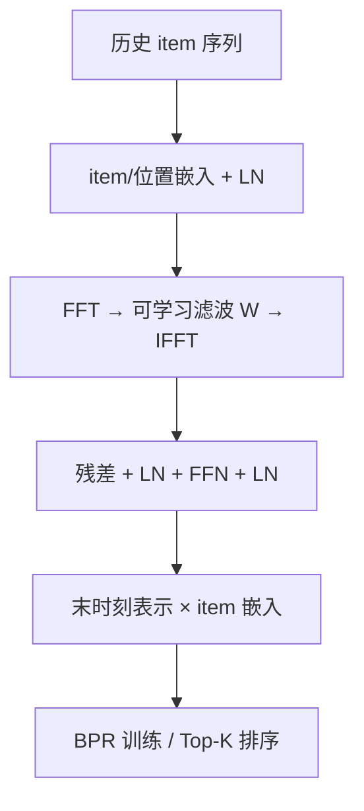
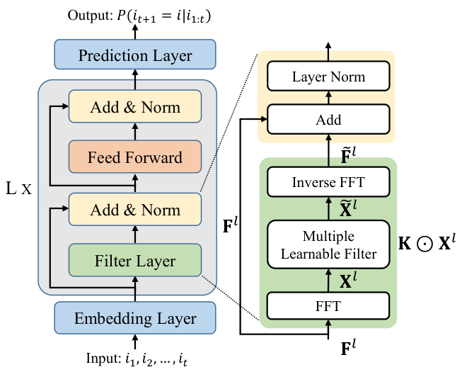

# Filter-enhanced MLP is All You Need for Sequential Recommendation (滤波增强 MLP 足以胜任序列推荐)

- **会议/期刊**: WWW 2022
- **作者与机构**: Kun Zhou, Hui Yu, Wayne Xin Zhao, Ji-Rong Wen；中国人民大学等
- **推荐链路定位**: 召回 / 精排（Next-Item 排序）
- **研究方向**: 序列与会话推荐 / 自监督对比学习与交互去噪
- **论文原文**: [https://arxiv.org/abs/2202.13556v1](https://arxiv.org/abs/2202.13556v1)
- **开源代码**: [https://github.com/RUCAIBox/FMLP-Rec](https://github.com/RUCAIBox/FMLP-Rec)

## TL;DR (1分钟核心速览)

针对序列推荐日志噪声与 Transformer 过参数化，本文提出全 MLP 模型 FMLP-Rec：用 FFT 将序列表示转入频域，乘可学习滤波器衰减噪声，再 IFFT 回时域。理论上该操作等价于循环卷积，感受野覆盖全序列且复杂度仅 $O(n\log n)$。在 8 个数据集、1:99 负采样排序下，Beauty/Sports/Toys/Yelp 的 NDCG@10 较最佳基线提升 4.5%–7.4%。

## Background & Motivation (背景与核心矛盾)

- **主流范式**: SASRec/BERT4Rec 等堆叠多头自注意力建模 item 转移，RNN/CNN/GNN 亦被广泛用于序列推荐。
- **前人局限**: 日志行为天然含噪，深度模型易过拟合；自注意力对所有 item 成对建模，既 $O(n^2)$ 又可能放大噪声。
- **核心洞察 (Key Insight)**: 经验实验发现，在嵌入层后加低通/带阻滤波可稳定提升 GRU4Rec 与 SASRec；更关键的是，去掉自注意力、仅保留 all-MLP 加简单滤波，性能可反超 SASRec。
- **本文切入点**: 用可学习频域滤波器替代人工阈值滤波与自注意力，让模型自适应决定衰减哪些频带。

## Method (核心方法设计)

### 1. 整体框架 (Overall Architecture)

输入为用户历史 item 序列，经 item 嵌入与可学习位置嵌入相加，做 LayerNorm 与 Dropout 得 $\mathbf{F}^{0}$。随后堆叠$L$个可学习滤波块：每块先沿序列维做 FFT，在频域与可学习复滤波器$\mathbf{W}$逐元素相乘，再 IFFT 回时域；经残差、LayerNorm、FFN 与残差归一化输出。最后一时刻表示与 item 嵌入内积打分，用 BPR 训练。推理时对候选 item 打分排序，FFT/IFFT 使每层开销为$O(n\log n)$。

<figure class="paper-figure" markdown="span">
  <figcaption>图2：我们的 FMLP-Rec 概览，这是一种堆叠多个可学习滤波器增强块的 all-MLP 模型。</figcaption>
</figure>
图2：FMLP-Rec 整体架构：FFT→可学习滤波→IFFT 堆叠全 MLP 块。

### 2. 关键设计拆解 (Key Designs)

1. **可学习频域滤波层**：固定 LPF/BSF 需人工设阈值且最优滤波器随模型变化。本文对第 $l$层表示做$\mathbf{X}^{l}=\mathcal{F}(\mathbf{F}^{l})$、$\tilde{\mathbf{X}}^{l}=\mathbf{W}\odot\mathbf{X}^{l}$、$\tilde{\mathbf{F}}^{l}=\mathcal{F}^{-1}(\tilde{\mathbf{X}}^{l})$。$\mathbf{W}\in\mathbb{C}^{n\times d}$ 由 SGD 学习，可逐维自适应压低噪声频带、保留周期信号。
2. **循环卷积等价与大感受野**：由卷积定理，频域逐点乘等价于时域循环卷积 $y^{(t)}_{n}=\sum_{m=0}^{N-1}h^{(t)}_{m}f^{(t)}_{(n-m)\mathrm{mod}N}$。因此滤波块不建 item 对关系却能覆盖全序列，捕获用户行为的周期模式；相较 SASRec 的$O(n^2)$，复杂度降为$O(n\log n)$。
3. **训练目标、负采样与推理效率**：训练为每个正样本随机采 1 个负样本，优化 $\mathcal{L}=-\sum_{u\in\mathcal{U}}\sum_{t=1}^{n}\log\sigma\big(P(i_{t+1}|i_{1:t})-P(i^{-}_{t+1}|i_{1:t})\big)$。无需 in-batch 或 hard negative；推理仅做逐层 FFT/IFFT 与 MLP，参数与延迟低于 Transformer。

## Experimental Setup & Evaluation Protocol (实验设置与评估协议)

- **数据集与预处理**: 8 个真实数据集，均过滤交互少于 5 的用户/物品（5-core）；交易数据含 Beauty/Sports/Toys/Yelp，点击会话含 Nowplaying/Retailrocket/Tmall/Yoochoose。

| 数据集 | #Sequences | #Items | #Actions | 稀疏度 | 场景 |
| :--- | :---: | :---: | :---: | :---: | :--- |
| Beauty | 22,363 | 12,101 | 198,502 | 99.93% | Amazon 交易 |
| Sports | 25,598 | 18,357 | 296,337 | 99.95% | Amazon 交易 |
| Toys | 19,412 | 11,924 | 167,597 | 99.93% | Amazon 交易 |
| Yelp | 30,431 | 20,033 | 316,354 | 99.95% | 商户交易 |
| Nowplaying | 145,612 | 59,593 | 1,085,410 | 99.99% | 音乐点击 |
| Retailrocket | 321,032 | 51,428 | 871,637 | 99.99% | 电商点击 |
| Tmall | 66,909 | 37,367 | 427,797 | 99.98% | 电商点击 |
| Yoochoose | 470,477 | 19,690 | 1,434,349 | 99.98% | 会话点击 |

- **数据划分与防穿越**: 按用户/会话分组并按时间升序构造 next-item 预测；主文未显式展开 LOO/比例切分细节，评测目标为第 $n+1$ 个 item。
- **排名评测协议**: 主表为 `Sampled Ranking`，每个正样本配 99 个随机未交互负样本；补充材料报告 `Full-Ranking`。指标为 HR@{1,5,10}、NDCG@{5,10}、MRR。
- **对比基线与超参**: 覆盖非序列 PopRec/FM/AutoInt，RNN GRU4Rec/RepeatNet，CNN Caser，GNN SRGNN/GCSAN，Transformer SASRec/BERT4Rec，去噪 CLEA 与门控 HGN。原文正文未统一给出 $d$ 与显著性检验，主表沿用各基线默认超参。

## Key Experimental Results (实验关键数据)

### 1. 主实验对比 (Main Results)

| Method | Beauty HR@10 | Beauty NDCG@10 | Sports HR@10 | Sports NDCG@10 | Toys HR@10 | Toys NDCG@10 | Yelp HR@10 | Yelp NDCG@10 |
| :--- | :---: | :---: | :---: | :---: | :---: | :---: | :---: | :---: |
| GRU4Rec | 0.4106 | 0.2584 | 0.4299 | 0.2527 | 0.3896 | 0.2274 | 0.7265 | 0.4375 |
| Caser | 0.3942 | 0.2512 | 0.4014 | 0.2390 | 0.3540 | 0.2183 | 0.6661 | 0.4198 |
| HGN | 0.4503 | 0.2965 | 0.4551 | 0.2806 | 0.4211 | 0.2724 | 0.7411 | 0.4695 |
| CLEA | 0.4426 | 0.2715 | 0.4274 | 0.2493 | 0.4207 | 0.2473 | 0.7473 | 0.4527 |
| SASRec | 0.4696 | 0.3156 | 0.4622 | 0.2869 | 0.4663 | 0.3136 | 0.7373 | 0.4642 |
| BERT4Rec | 0.4739 | 0.2975 | 0.4722 | 0.2775 | 0.4493 | 0.2698 | 0.7597 | 0.4778 |
| SRGNN | 0.4484 | 0.2971 | 0.4545 | 0.2799 | 0.4413 | 0.2857 | 0.7096 | 0.4395 |
| GCSAN | 0.4542 | 0.3143 | 0.4737 | 0.3029 | 0.4509 | 0.3125 | 0.7371 | 0.4696 |
| **FMLP-Rec** | **0.4998** | **0.3385** | **0.5059** | **0.3165** | **0.5062** | **0.3368** | **0.7720** | **0.5024** |
| Improv. vs best | +5.46% | +7.26% | +6.80% | +4.49% | +8.56% | +7.40% | +1.62% | +5.15% |

### 2. 消融实验 (Ablation Study)

| Setting | Beauty HR@10 | Beauty NDCG@10 | Sports HR@10 | Sports NDCG@10 |
| :--- | :---: | :---: | :---: | :---: |
| **FMLP-Rec** | **0.4998** | **0.3385** | **0.5059** | **0.3165** |
| w/o Filter Layer | 0.4317 | 0.2914 | 0.4243 | 0.2604 |
| w/o FFN | 0.4607 | 0.3067 | 0.4594 | 0.2838 |
| w/o Add & Norm | 0.4654 | 0.2919 | 0.4831 | 0.2860 |
| +HPF | 0.4567 | 0.3034 | 0.4595 | 0.2810 |
| +LPF | 0.4847 | 0.3233 | 0.4949 | 0.3093 |
| +BSF | 0.4822 | 0.3207 | 0.4835 | 0.2977 |

### 3. 关键实验发现 (Key Findings)

1. 滤波层是性能核心：移除后 Beauty NDCG@10 从 0.3385 降至 0.2914（-13.9%），Sports 从 0.3165 降至 0.2604（-17.7%）；固定 LPF/BSF 仍低于可学习滤波，说明自适应频带比人工阈值更有效。
2. FMLP-Rec 在四个交易数据集全面最优：Beauty/Sports/Toys/Yelp 的 NDCG@10 分别较最佳基线提升 7.26%/4.49%/7.40%/5.15%；会话数据 Tmall HR@10 达 0.7206，较 GCSAN 0.6591 提升 9.3%。
3. 频域滤波并非全场景碾压：Nowplaying NDCG@10 0.6360 较 SASRec 0.6113 提升 4.0%，但 Yoochoose NDCG@10 0.8588 略低于 GCSAN 0.8616，收益依赖序列中的周期性与噪声结构。

## Highlights & Limitations (亮点、对比与审稿批判)

- **与代表作对比 (vs. Prior Work)**: 相比 SASRec/BERT4Rec，本文彻底移除自注意力，以频域滤波实现全序列感受野并把复杂度降到 $O(n\log n)$；相比 Caser 的时域局部卷积，循环卷积覆盖全序列；相比 CLEA 的物品级对比去噪，本文在表示层做无标签频域滤波，更轻量且可插拔。
- **可迁移亮点**: 可学习滤波层可作为前置去噪模块插入 GRU4Rec/Caser/SASRec/GCSAN，原文图3显示均有提升；FFT 滤波块也适合其他长序列周期建模任务。
- **审稿级局限批判**: 主表采用 1:99 负采样排序，虽补充 Full-Ranking，但主文结论可能偏乐观；可学习滤波器为复数且逐层逐维存储，短序列或非周期行为上收益有限，GPU 上小序列 FFT 的实际延迟也需线上验证。此外，原文未报告显著性检验与统一 $d$，复现公平性略弱。

## Rating (四维评分)

- **方法创新性 (Novelty)**: ⭐⭐⭐⭐ （频域可学习滤波替代自注意力，循环卷积等价与全序列感受野提供理论支撑）
- **评估协议与实验扎实度 (Protocol & Experiments)**: ⭐⭐⭐⭐ （8 数据集、12 类基线、消融与迁移实验完整；但主表采样排序且无显著性检验）
- **写作与数学规范度 (Clarity & Rigor)**: ⭐⭐⭐⭐ （卷积定理推导清晰、复杂度分析直观；复数滤波实现与切分细节略简）
- **工业落地与复现价值 (Industrial & Practical Value)**: ⭐⭐⭐⭐ （开源、全 MLP 轻量、$O(n\log n)$ 可部署；线上 FFT 延迟与滤波稳定性仍需工程验证）

