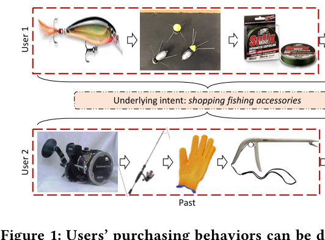
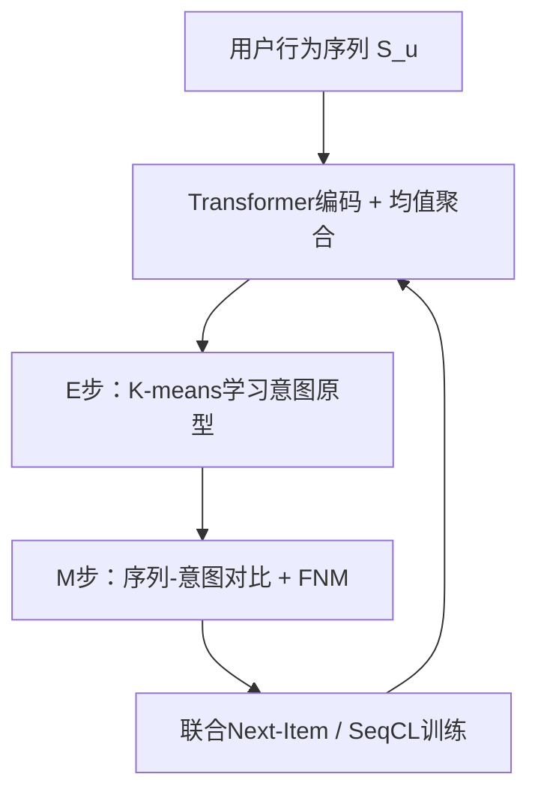
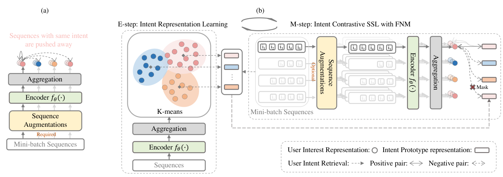

# Intent Contrastive Learning for Sequential Recommendation (面向序列推荐的意图对比学习)

- **会议/期刊**: WWW 2022
- **作者与机构**: Yongjun Chen, Zhiwei Liu, Jia Li, Caiming Xiong (Salesforce Research); Julian McAuley (UCSD)
- **推荐链路定位**: 召回/排序（Next-Item Full-Ranking）
- **研究方向**: 序列与会话推荐 / 自监督对比学习与交互去噪
- **论文原文**: [https://arxiv.org/abs/2202.02519v1](https://arxiv.org/abs/2202.02519v1)
- **开源代码**: [https://github.com/salesforce/ICLRec](https://github.com/salesforce/ICLRec)

## TL;DR (1分钟核心速览)

针对序列推荐中用户潜在意图不可观测、短序列与噪声交互导致表征不稳的问题，ICL将意图视为隐变量，在广义EM中交替执行K-means意图聚类与“序列—意图原型”对比学习，并用FNM剔除批内同意图假负例。四个Amazon/Yelp数据集按`5-core`、留一法、全库排序评估，HR/NDCG较最强基线提升7.47%–33.33%。

## Background & Motivation (背景与核心矛盾)

- **主流范式**: SASRec/BERT4Rec以Transformer编码行为序列做下一物品预测；CL4SRec进一步用裁剪、掩码、重排构造序列视图做实例级对比学习。
- **前人局限**: 意图建模方法多依赖动作类型/品类等侧信息；DSSRec只从单条序列推断意图，忽略跨用户意图共享；实例级对比依赖增广视图，短序列或噪声下增广可能破坏原序列语义。
- **核心洞察 (Key Insight)**: 不同用户的行为序列可对应同一潜在意图（如“钓鱼用品采购”），因此由全体用户序列聚类得到的意图原型，是比随机增广更稳定的正视图。
- **本文切入点**: 用隐变量$c$表示意图，在EM框架下先从全局序列分布学习$Q(c)$，再以意图对比损失将$c$注入序列编码器。

<figure class="paper-figure" markdown="span">
  <figcaption>图1：用户的购买行为可能由未被观测到的潜在意图驱动。</figcaption>
</figure>

## Method (核心方法设计)

### 1. 整体框架 (Overall Architecture)

ICLRec先用Transformer编码用户序列并对时间步均值聚合，得到序列表示。E步对全体用户序列表示做K-means，得到$K$个意图原型；M步将序列及其增广视图对齐到对应意图原型，并联合优化下一物品预测、意图对比与序列级对比三个任务。E/M交替进行，推理阶段不再执行聚类与对比分支，仅保留序列编码器与物品打分。

<figure class="paper-figure" markdown="span">
  <figcaption>图2：ICL 概览。(a) 面向 SR 的个体序列级 SSL。(b) 所提出的面向 SR 的 ICL。它在广义 EM 框架内，交替执行意图表示学习与结合 FNM 的意图对比 SSL，以最大化行为序列与其对应意图原型之间的互信息（MIM）。</figcaption>
</figure>

### 2. 关键设计拆解 (Key Designs)

1. **隐意图的EM学习**：意图不可观测导致“无$c$难学$\theta$、无$\theta$难推$c$”。ICL构造对数似然下界，并令$Q(c_i)=P_\theta(c_i|S_u)=\mathbb{I}[S_u\in\mathrm{cluster}_i]$，以聚类质心$\mathbf{c}_i$作为意图原型。这样把个体序列监督扩展为全局协同结构监督。
2. **意图对比学习与FNM**：将$P_\theta(S_u,c_i)$写成归一化指数形式后，最大化下界等价于最小化$-\log\frac{\exp(\mathrm{sim}(\mathbf{h}_u,\mathbf{c}_u))}{\sum_{j=1}^{K}\exp(\mathrm{sim}(\mathbf{h}_u,\mathbf{c}_j))}$。由于批内同意图用户会被误当负例，FNM改为$-\log\frac{\exp(\mathrm{sim}(\tilde{\mathbf{h}}_u,\mathbf{c}_u))}{\sum_{v=1}^{N}\mathbb{I}_{v\notin\mathcal{F}}\exp(\mathrm{sim}(\tilde{\mathbf{h}}_u,\mathbf{c}_v))}$，其中$\mathcal{F}$为同意图用户集合。
3. **训练目标、负采样与推理效率**：总损失$\mathcal{L}=\mathcal{L}_{\mathrm{NextItem}}+\lambda\mathcal{L}_{\mathrm{ICL}}+\beta\mathcal{L}_{\mathrm{SeqCL}}$；下一物品任务采用每时间步随机1个负样本的sampled softmax，评估时全库排序。E步复杂度$O(|U|mKd)$，M步约$O(3(|U|^2d+|U|d^2))$；训练约11.75 s/epoch（SASRec 3.59、CL4SRec 6.52），推理复杂度与SASRec同阶。

## Experimental Setup & Evaluation Protocol (实验设置与评估协议)

- **数据集与预处理**: 四个公开数据集均保留`5-core`，即用户和物品至少5次交互：

| 数据集 | #Users | #Items | #Interactions | 稀疏度/密度 | 特征/场景说明 |
| :--- | :---: | :---: | :---: | :---: | :--- |
| Sports | 35,598 | 18,357 | 296,337 | ≈0.045% | Amazon运动子类 |
| Beauty | 22,363 | 12,101 | 198,502 | ≈0.073% | Amazon美妆子类 |
| Toys | 19,412 | 11,924 | 167,597 | ≈0.072% | Amazon玩具子类 |
| Yelp | 30,431 | 20,033 | 316,354 | ≈0.052% | 本地商户评论 |

- **数据划分与防穿越 (Splitting Strategy)**: 遵循S3-Rec/CL4SRec的`Leave-One-Out`：每用户最后1个物品测试、倒数第2个验证，其余训练；序列截断至最近50个物品。
- **排名评测协议 (Ranking Protocol)**: 无偏`Full-Ranking`，在完整物品集上排序，不采样负候选；报告HR@5/20、NDCG@5/20。
- **对比基线与超参设置**: 覆盖BPR-MF、GRU4Rec、Caser、SASRec、DSSRec、BERT4Rec、CL4SRec等；$d=64$、2层自注意力、2头、Adam学习率$10^{-3}$、batch size 256。$K$在$\{8,\ldots,2048\}$调优，Yelp最优$K=512$、$\lambda=0.5$。原文报告多次运行标准差，未给出$p$值显著性检验。

## Key Experimental Results (实验关键数据)

### 1. 主实验对比 (Main Results)

| 模型 | Sports HR@5 | Sports NDCG@20 | Beauty HR@5 | Beauty NDCG@20 | Toys HR@5 | Toys NDCG@20 | Yelp HR@5 | Yelp NDCG@20 |
| :--- | :---: | :---: | :---: | :---: | :---: | :---: | :---: | :---: |
| BPR-MF | 0.0141 | 0.0142 | 0.0212 | 0.0236 | 0.0120 | 0.0136 | 0.0127 | 0.0143 |
| GRU4Rec | 0.0162 | 0.0186 | 0.0111 | 0.0104 | 0.0097 | 0.0116 | 0.0152 | 0.0145 |
| Caser | 0.0154 | 0.0178 | 0.0251 | 0.0298 | 0.0166 | 0.0179 | 0.0142 | 0.0156 |
| SASRec | 0.0206 | 0.0216 | 0.0374 | 0.0387 | 0.0463 | 0.0441 | 0.0160 | 0.0179 |
| DSSRec | 0.0214 | 0.0220 | 0.0410 | 0.0403 | 0.0502 | 0.0471 | 0.0171 | 0.0193 |
| BERT4Rec | 0.0217 | 0.0251 | 0.0360 | 0.0391 | 0.0274 | 0.0291 | 0.0196 | 0.0223 |
| CL4SRec | 0.0217 | 0.0227 | 0.0423 | 0.0441 | 0.0526 | 0.0506 | 0.0229 | 0.0256 |
| **ICLRec** | **0.0283** | **0.0284** | **0.0493** | **0.0489** | **0.0590** | **0.0560** | **0.0257** | **0.0279** |
| **Improv.%** | **30.48** | **24.89** | **16.43** | **10.90** | **12.07** | **10.57** | **12.23** | **8.98** |

### 2. 消融实验 (Ablation Study)

| 变体 (NDCG@20) | Sports | Beauty | Toys | Yelp |
| :--- | :---: | :---: | :---: | :---: |
| (A) ICLRec 完整 | **0.0287** | **0.0480** | **0.0554** | **0.0283** |
| (B) w/o FNM | 0.0283 | 0.0465 | 0.0524 | 0.0266 |
| (C) only ICL | 0.0263 | 0.0429 | 0.0488 | 0.0267 |
| (D) w/o ICL | 0.0238 | 0.0428 | 0.0505 | 0.0258 |
| (E) only ICL，w/o SeqAug | 0.0242 | 0.0414 | 0.0488 | 0.0213 |
| (F) SASRec | 0.0216 | 0.0387 | 0.0441 | 0.0179 |

### 3. 关键实验发现 (Key Findings)

1. **全局意图原型是主要增益源**：移除ICL后，Sports/Beauty/Toys/Yelp的NDCG@20分别由0.0287/0.0480/0.0554/0.0283降至0.0238/0.0428/0.0505/0.0258，下降约17.1%/10.8%/8.8%/8.8%，说明跨用户意图监督比单纯实例增广更有效。
2. **FNM对高意图重叠数据更关键**：去掉FNM后Yelp与Toys分别下降6.0%与5.4%，高于Sports的1.4%，表明批内同意图用户越多，假负例污染越严重。
3. **短序列与噪声场景更稳**：ICLRec在各交互频次分组均优于SASRec；Sports测试集加入15%噪声时仍超过CL4SRec无噪声结果，且CL4SRec在Beauty/Yelp短序列组会退化，而ICLRec保持增益。

## Highlights & Limitations (亮点、对比与审稿批判)

- **与代表作对比 (vs. Prior Work)**: 相比CL4SRec对齐两个随机增广视图，ICL对齐“序列—全局意图原型”，抗短序列和噪声扰动更强；相比DSSRec只在单用户序列内推意图，ICL利用全体用户共享意图；相比ASLI需动作类型侧信息，ICL仅用交互序列。
- **可迁移亮点**: “K-means原型 + 对比对齐 + 同簇负例剔除”可低成本迁移到图推荐、跨域序列推荐；FNM可直接用于任何批内存在同标签/同簇的对比学习任务。
- **审稿级局限批判**: ①每轮E步需对全体用户表示聚类，用户规模大时存储与聚类开销明显，训练约为SASRec的3.3倍；②$K$与$\lambda$较敏感，Yelp最优$K=512$，不同数据需重调；③仅离线全库排序评测，且未报告显著性检验，意图原型的语义可解释性与时间漂移建模仍不足。

## Rating (四维评分)

- **方法创新性 (Novelty)**: ⭐⭐⭐⭐ （将隐意图、EM与意图级对比学习结合，FNM针对性强，但仍是K-means+InfoNCE的有机组合）
- **评估协议与实验扎实度 (Protocol & Experiments)**: ⭐⭐⭐⭐ （四数据集、全库排序、消融与鲁棒性分析完整；缺少显著性检验与线上验证）
- **写作与数学规范度 (Clarity & Rigor)**: ⭐⭐⭐⭐ （EM下界推导清晰，复杂度与收敛性有交代；意图分布采用硬聚类假设较简化）
- **工业落地与复现价值 (Industrial & Practical Value)**: ⭐⭐⭐⭐ （代码开源、推理零额外开销，训练聚类成本与$K$调参是主要落地门槛）

