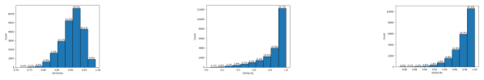
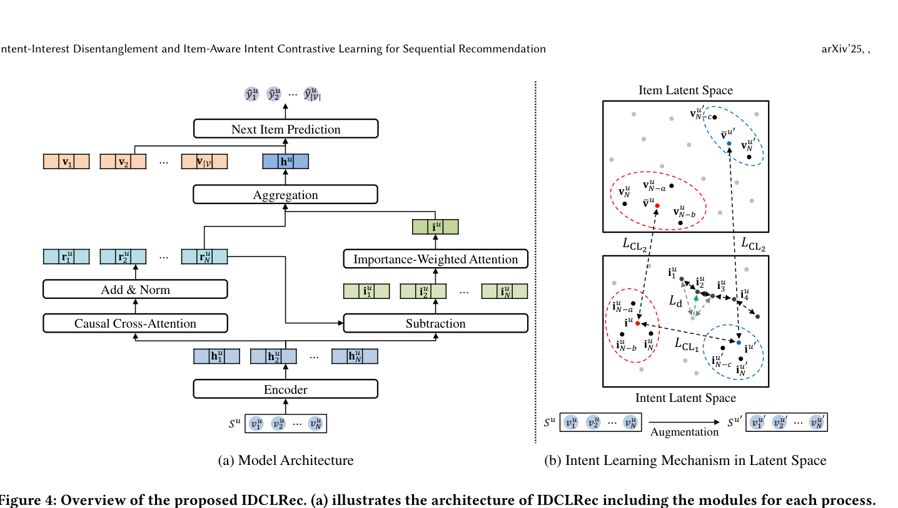
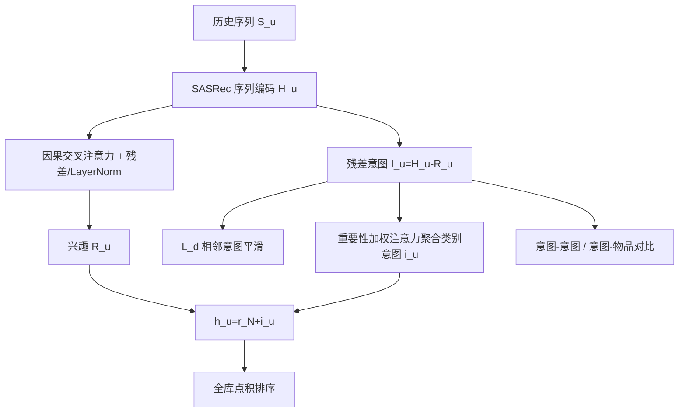

# Intent-Interest Disentanglement and Item-Aware Intent Contrastive Learning for Sequential Recommendation (面向序列推荐的意图-兴趣解耦与物品感知意图对比学习)

- **会议/期刊**: arXiv preprint (2025)
- **作者与机构**: Yijin Choi, Chiehyeon Lim；UNIST
- **推荐链路定位**: 精排 / Next-Item 排序
- **研究方向**: 序列与会话推荐 / 自监督对比学习
- **论文原文**: [https://arxiv.org/abs/2501.07096v1](https://arxiv.org/abs/2501.07096v1)
- **开源代码**: 暂未开源

## TL;DR (1分钟核心速览)

现有意图序列推荐只建模“动态意图”，忽略用户稳定兴趣，且固定意图类别数 $K$聚类边界模糊、对比学习未利用交互物品。IDCLRec 将行为解耦为稳定兴趣与残差意图，用因果交叉注意力提兴趣、相似度调整损失保意图时序平滑、重要性加权注意力做无$K$ 的用户级意图聚合，并用意图-意图、意图-物品组合双对比增强。Amazon 三域 Leave-One-Out 全库排序下，HR@20 较最佳基线 ICSRec 提升 8.96%–14.62%。

## Background & Motivation (背景与核心矛盾)

- **主流范式**: 以 SASRec 类编码器得到序列表示，再将整段序列解释为意图；ICLRec/ICSRec 等用 $K$-means 将全体用户意图聚成固定$K$ 类并做对比学习。
- **前人局限**: ①仅看意图，忽略跨时间稳定的个人兴趣，行为理解不完整；②固定 $K$ 的意图类别数与真实分布不匹配，聚类内相似度差异大且跨簇相似度也高；③意图对比只对齐聚类/增广表示，忽略唯一显式信号——交互物品。
- **核心洞察 (Key Insight)**: 对 ICSRec 的意图分析显示，同一簇内意图与质心相似度波动明显，且多数意图与“非所属簇”高度相似；但同簇意图对应的物品组合重叠度显著更高。即意图类别边界不宜硬聚类，物品组合是意图的可靠锚点。
- **本文切入点**: 放弃全局固定 $K$ 聚类，在用户级用相似意图聚合类别意图，并把物品组合纳入意图对比学习。

图2：意图表示相似度分布——簇内差异大、跨簇相似高，说明固定 $K$ 聚类边界模糊。
<figure class="paper-figure" markdown="span">
  <figcaption>图2：意图表示之间的相似度分布。</figcaption>
</figure>

## Method (核心方法设计)

### 1. 整体框架 (Overall Architecture)

输入用户历史序列，经 SASRec 得到行为表示 $\mathbf{H}_u$；因果交叉注意力只聚合当前步之前的一致行为，经残差与 LayerNorm 得兴趣$\mathbf{R}_u$，行为减兴趣得意图$\mathbf{I}_u=\mathbf{H}_u-\mathbf{R}_u$。$\mathcal{L}_d$约束相邻意图平滑变化；重要性加权注意力从最近意图的相似意图集合聚合出用户级类别意图$\mathbf{i}_u$。两条对比损失分别对齐同目标物品序列的意图、对齐意图与对应物品组合中心。最终$\mathbf{h}_u=\mathbf{r}^u_N+\mathbf{i}_u$ 与物品点积全库打分。

图4：IDCLRec 整体架构与意图学习损失示意。
<figure class="paper-figure" markdown="span">
  <figcaption>图4：所提出的IDCLRec的概览。(a) 展示IDCLRec的架构，包括各过程的模块。(b) 展示专为意图表示学习设计的训练损失函数机制。</figcaption>
</figure>

### 2. 关键设计拆解 (Key Designs)

1. **因果交叉注意力解耦稳定兴趣**：自注意力会让当前行为关注自身，放大瞬时意图、淹没历史一致模式。本文令 Query 为当前行为、Key/Value 为前序行为：$\hat{\mathbf{R}}_u=\mathrm{softmax}(\mathbf{Q}_1\mathbf{K}_1^\top/\sqrt{d}+\mathbf{M})\mathbf{V}_1$，其中$M_{ij}=0$若$i\ge j$，否则$-\infty$；再做$\mathbf{R}_u=\mathrm{LayerNorm}(\hat{\mathbf{R}}_u+\mathbf{H}_u)$。交叉注意力避免自关注偏差，LayerNorm 抑制当前行为独有噪声，使兴趣表征跨时间一致。

2. **无预设 $K$的用户级类别意图**：固定$K$聚类不稳健。先取与最近意图$\mathbf{i}^u_N$相似度超过$\delta$的意图集合（含自身），用$\mathbf{S}=\mathrm{sigmoid}(\mathbf{Q}_2\mathbf{K}_2^\top/\sqrt{d})$度量两两相关；排除自环后按行和 softmax 得重要性$\beta_i$，再$\mathbf{i}_u=\sum_i\beta_i\tilde{\mathbf{i}}^u_i$。sigmoid 保留绝对相关度，重要性权重自动压低边缘意图，避免人为指定类别数。

3. **物品感知意图对比与训练**：$\mathcal{L}_{CL1}$将同一目标物品的两条序列意图拉近，并剔除批次内同目标物品的假负例；$\mathcal{L}_{CL2}$将意图与对应物品组合中心$\bar{\mathbf{v}}_u=\frac{1}{|\mathcal{V}^u_{sim}|}\sum\mathbf{v}^u_t$对齐，不剔除假负例。总损失$\mathcal{L}=\mathcal{L}_{rec}+\lambda_d\mathcal{L}_d+\lambda_{CL1}\mathcal{L}_{CL1}+\lambda_{CL2}\mathcal{L}_{CL2}$。推荐损失为全物品 softmax，无需负采样；对比用 in-batch 负例；推理仅一次编码与$O(|\mathcal{V}|d)$ 点积。

## Experimental Setup & Evaluation Protocol (实验设置与评估协议)

- **数据集与预处理**: Amazon Review 三子域，保留 `5-core`，隐式反馈；序列按时间排序，长度截断/填充至 $N=50$。

| 数据集 | #Users | #Items | #Interactions | 平均长度 | 稀疏度 |
| :--- | :---: | :---: | :---: | :---: | :---: |
| Sports | 35,598 | 18,357 | 296,337 | 8.3 | 99.95% |
| Beauty | 22,363 | 12,101 | 198,502 | 8.9 | 99.93% |
| Toys | 19,412 | 11,924 | 167,597 | 8.6 | 99.93% |

- **数据划分与防穿越**: `Leave-One-Out`：末位物品测试、倒数第二验证、其余训练；并用子序列切分做数据增强。
- **排名评测协议**: 无偏 `Full-Ranking`，对全物品打分，不采样负例；报告 HR@5/10/20、NDCG@5/10/20。
- **对比基线与超参**: GRU4Rec、SASRec、BERT4Rec、S3-RecMIP、CL4SRec、CoSeRec、DuoRec、DSSRec、ICLRec、IOCRec、ICSRec；SASRec 2 层 2 头，$d=64$，dropout 0.5，$\tau=1$，Adam lr$10^{-3}$，batch 256，早停；三随机种子平均。

## Key Experimental Results (实验关键数据)

### 1. 主实验对比 (Main Results)

| 数据集 | 指标 | GRU4Rec | SASRec | CL4SRec | CoSeRec | DuoRec | ICLRec | ICSRec | IDCLRec | Impr.% vs ICSRec |
| :--- | :---: | :---: | :---: | :---: | :---: | :---: | :---: | :---: | :---: | :---: |
| Sports | HR@20 | 0.0293 | 0.0462 | 0.0596 | 0.0599 | 0.0744 | 0.0640 | 0.0766 | **0.0878** | +14.62 |
| Sports | NDCG@20 | 0.0117 | 0.0201 | 0.0260 | 0.0275 | 0.0310 | 0.0281 | 0.0378 | **0.0426** | +12.70 |
| Beauty | HR@20 | 0.0487 | 0.0843 | 0.0950 | 0.1032 | 0.1243 | 0.1055 | 0.1284 | **0.1399** | +8.96 |
| Beauty | NDCG@20 | 0.0193 | 0.0361 | 0.0410 | 0.0473 | 0.0548 | 0.0485 | 0.0655 | **0.0701** | +7.02 |
| Toys | HR@20 | 0.0491 | 0.0918 | 0.0913 | 0.1089 | 0.1307 | 0.1134 | 0.1348 | **0.1498** | +11.13 |
| Toys | NDCG@20 | 0.0197 | 0.0426 | 0.0419 | 0.0540 | 0.0578 | 0.0551 | 0.0726 | **0.0784** | +7.99 |

### 2. 消融实验 (Ablation Study)

| 模型 | Sports HR/NDCG | Beauty HR/NDCG | Toys HR/NDCG |
| :--- | :---: | :---: | :---: |
| IDCLRec | **0.0878 / 0.0426** | **0.1399 / 0.0701** | **0.1498 / 0.0784** |
| (A) w/o $\mathcal{L}_d$ | 0.0867 / 0.0425 | 0.1386 / 0.0695 | 0.1476 / 0.0776 |
| (B) w/o $\mathcal{L}_{CL1}$ | 0.0837 / 0.0407 | 0.1377 / 0.0693 | 0.1457 / 0.0766 |
| (C) w/o $\mathcal{L}_{CL2}$ | 0.0852 / 0.0410 | 0.1361 / 0.0684 | 0.1427 / 0.0758 |
| (D) w/o 全部辅助损失 | 0.0806 / 0.0379 | 0.1347 / 0.0664 | 0.1386 / 0.0712 |
| (E) w/o 意图-兴趣解耦 | 0.0778 / 0.0355 | 0.1325 / 0.0633 | 0.1335 / 0.0656 |
| (F) w/o 意图类别聚合 | 0.0799 / 0.0394 | 0.1309 / 0.0669 | 0.1401 / 0.0749 |
| (G) w/o 重要性加权 | 0.0859 / 0.0418 | 0.1368 / 0.0691 | 0.1474 / 0.0776 |

### 3. 关键实验发现 (Key Findings)

- **解耦是最大收益源**：移除意图-兴趣解耦 (E) 后 Sports HR@20 由 0.0878 降至 0.0778（-11.4%），Beauty/Toys 也分别降至 0.1325/0.1335，说明“兴趣+意图”比纯意图建模更完整。
- **两类对比互补且品类相关**：Beauty/Toys 上去掉 $\mathcal{L}_{CL2}$比去掉$\mathcal{L}_{CL1}$降得更多（$0.1361<0.1377$，$0.1427<0.1457$），物品组合对齐更关键；Sports 上则$\mathcal{L}_{CL1}$更关键（$0.0837<0.0852$），单物品与意图关联更强。
- **架构保召回、损失保排序**：去掉所有辅助损失 (D) 的 HR@20 仍高于 ICSRec（Sports 0.0806 vs 0.0766），但 NDCG@20 优势有限；加入三项损失后 NDCG@20 显著升至 0.0426/0.0701/0.0784，说明对比与平滑损失主要提升排序精度。

## Highlights & Limitations (亮点、对比与审稿批判)

- **与代表作对比 (vs. Prior Work)**: 相较 ICLRec/ICSRec 的全局固定 $K$ 聚类，本文在用户级按相似度动态聚合意图，无需预设类别数；相较 DuoRec 的序列增广，本文以同目标物品序列与物品组合为对比锚点，更贴近 next-item 任务。
- **可迁移亮点**: “因果交叉注意力提稳定成分 + 残差取动态成分”可迁移到长短期兴趣解耦；用相似意图集合的重要性加权替代 $K$-means，可迁移到会话意图聚类和冷启动用户画像。
- **审稿级局限批判**: 最终用户表示采用 $\mathbf{h}_u=\mathbf{r}^u_N+\mathbf{i}_u$等权相加，未学习兴趣/意图门控；$\lambda_{CL2}$对性能高度敏感（最优仅 0.1，增大显著下降），且阈值$\delta$ 虽稳定但增加调参项；仅 Amazon 三域离线全库评测，未报告训练/推理时延与显著性检验。

## Rating (四维评分)

- **方法创新性 (Novelty)**: ⭐⭐⭐⭐ （意图-兴趣残差解耦与无 $K$ 用户级意图聚合组合新颖，动机分析扎实）
- **评估协议与实验扎实度 (Protocol & Experiments)**: ⭐⭐⭐⭐ （三域 5-core、Leave-One-Out 全库排序、11 个基线、7 组消融，但缺显著性检验与效率实验）
- **写作与数学规范度 (Clarity & Rigor)**: ⭐⭐⭐⭐ （公式与模块串联清晰，重要性权重和假负例处理交代充分，部分符号略密）
- **工业落地与复现价值 (Industrial & Practical Value)**: ⭐⭐⭐ （推理仅 SASRec+点积、易部署，但训练含双对比与阈值调参，且暂未开源）

