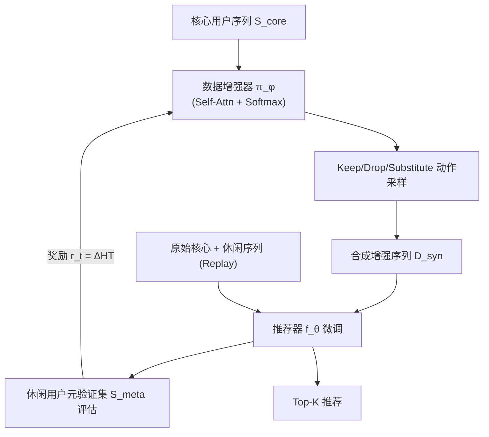
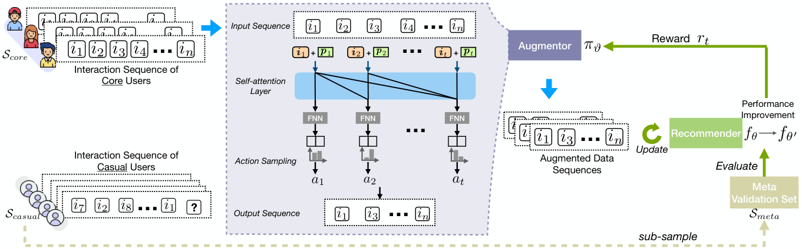

# Learning to Augment for Casual User Recommendation (面向休闲用户推荐的学习式数据增强)

- **会议/期刊**: WWW 2022 (The Web Conference)
- **作者与机构**: Jianling Wang (Texas A&M University, 实习于 Google), Ya Le, Bo Chang, Yuyan Wang, Ed H. Chi, Minmin Chen (Google)
- **推荐链路定位**: 召回（序列下次物品预测，跨模型通用）
- **研究方向**: 序列与会话推荐 / 冷启动与长尾推荐
- **论文原文**: [论文原文链接](https://arxiv.org/abs/2204.00926v1)
- **开源代码**: 暂未开源（依赖的 GRU4Rec / SASRec / NextItNet 官方实现已公开）

## TL;DR (1分钟核心速览)

核心用户（高频、行为连续）主导了序列推荐模型的训练数据，导致休闲用户（低频、兴趣分散）的推荐性能始终显著落后。本文提出与模型无关的 L2Aug 框架：用 REINFORCE 训练一个序列增强器，对核心用户序列逐项决策 Keep/Drop/Substitute，合成更贴近休闲用户行为的增强序列；把推荐器在休闲用户元验证集上的提升作为延迟奖励回传。在 4 个 Amazon/Goodreads 数据集、3 种序列模型（GRU4Rec/NextItNet/SASRec）上，休闲用户 NDCG@5 相较最优处理基线提升 6.6%–9.9%，核心用户性能同步保留。

## Background & Motivation (背景与核心矛盾)

- **主流范式**：以 GRU4Rec、SASRec、NextItNet 为代表的序列推荐在全量交互日志上端到端训练，忽略用户活跃度异质性。
- **前人局限**：① 核心用户交互几乎全落在训练集中，休闲用户数据稀薄；② 二者转移模式不同——图 1(a) 显示休闲用户相邻物品余弦相似度显著低于核心用户。图 1(b) 进一步证实，即便 SASRec 在混合数据上训练，同一序列长度下休闲用户的 Hit Rate@20 依然全面低于核心用户。
- **核心洞察 (Key Insight)**：图 1(c) 的初步实验发现，随机丢弃部分核心用户交互即可提升休闲用户性能，但丢弃比例过高（信息损失）则反而下降——说明存在“细粒度、可控”的编辑空间，等待被学习而非手工设定。
- **本文切入点**：把“序列编辑”建模为离散策略，用推荐器在休闲用户元验证集上的性能增益作为奖励，端到端地学出增强策略。

## Method (核心方法设计)

### 1. 整体框架 (Overall Architecture)

L2Aug 由两个交替优化的组件构成：(i) 数据增强器 $\pi_\varphi$——以 Self-Attention 编码核心用户序列前缀并按策略采样编辑动作，生成合成序列；(ii) 目标推荐器$f_\theta$——用合成序列微调，并在留出的休闲用户元验证集$S_{meta}$上评估增益作为奖励，回传更新增强器。为避免遗忘核心用户，每$\kappa$ 步以原始核心+休闲数据做一次 Replay 更新。推理阶段只保留推荐器，在线开销与原模型一致。

<figure class="paper-figure" markdown="span">
  <figcaption>图2：所提出的模型无关“Learning to Augment”框架——L2Aug。数据增强器对输入序列执行一系列增强动作以生成合成数据序列。同时，推荐器由合成数据序列更新；其在元验证集上的性能提升作为奖励，用于指导增强器的训练。这两个组件相互增强，并逐步提升数据增强和推荐质量。</figcaption>
</figure>

### 2. 关键设计拆解 (Key Designs)

**1) 序列策略增强器 (Sequential Policy Augmentor)**：图像增强算子（旋转/裁剪）不适用离散 item ID 序列。逐项决策的算子设计如下：状态用 Self-Attention 编码前缀 $S_{[1:k]}$得$\boldsymbol{h}_k=\sum_{j\le k}\sigma_{kj}W_V\boldsymbol{e}_j$，其中$\sigma_{kj}=\frac{S(W_Q\boldsymbol{e}_k, W_K\boldsymbol{e}_j)}{\sum_{j'\le k}S(W_Q\boldsymbol{e}_k, W_K\boldsymbol{e}_{j'})}$；策略为
$$\pi_\varphi(a_{u,k}|\boldsymbol{h}_k)=\mathrm{Softmax}(W_A\boldsymbol{h}_k),\quad a_{u,k}\in\{keep, drop\}$$
按概率采样即得合成序列。直觉：逐项决策允许“按需保留核心用户的高价值转移、丢弃冗余高频消费”，从而把序列的连续物品相似度分布从核心用户一端向休闲用户一端平滑迁移（作者在图 1(a) 用可视化验证增强序列分布确实落在二者之间）。

**2) 基于元验证奖励的 REINFORCE 优化**：增强动作不可微。用休闲用户中随机抽取 $M\ll N$个（实验中 10%）构造$S_{meta}$；每次用合成数据微调得$f_{\theta'}$ 后，奖励定义为
$$r_t=\mathrm{HT}(f_{\theta'}, S_{meta})-\mathrm{HT}(f_\theta, S_{meta})$$
并用策略梯度更新：
$$\nabla_\varphi\tilde{J}(\varphi)=r_t\!\!\sum_{u\in S_B}\sum_{k=1}^{|S_u|}\nabla_\varphi\log\pi_\varphi(a_{u,k}|\boldsymbol{h}_k)$$
同一 batch 内所有动作共享延迟奖励。为什么有效：奖励直接锚定休闲用户目标，而非代理指标，策略因此学到哪些交互应“压缩”以适配休闲用户稀疏、分散的兴趣。

**3) 训练目标、Replay 与推理**：推荐器侧沿用标准 cross-entropy，每步采样 1 个负例；L2Aug 每 $\kappa=5$ 步追加原始核心+休闲数据做一轮 Replay，防止灾难性遗忘核心用户。增强器在部署时被丢弃，在线只运行推荐器。

## Experimental Setup & Evaluation Protocol (实验设置与评估协议)

- **数据集与预处理**（4 个公开集，用户按平均连续交互间隔 < 30 天划为核心，其余为休闲）：

| 数据集 | #Items | #Casual Users | #Core Users | 平均交互数 | 场景说明 |
| :--- | :---: | :---: | :---: | :---: | :--- |
| Amazon_CDs | 22,685 | 2,176 | 1,022 | 23.75 | CDs & Vinyl 评论 |
| Amazon_Books | 17,443 | 11,083 | 3,457 | 31.71 | Books 评论 |
| Amazon_Movies | 11,079 | 10,020 | 2,808 | 14.06 | Movies 评论 |
| Goodreads | 65,864 | 11,836 | 5,017 | 130.03 | 读书点评社区 |

- **数据划分与防穿越**：Leave-One-Out 风格——每用户在测试集中仅保留 1 个真实交互作为目标，取历史为其输入序列。
- **排名评测协议**：**Full-Ranking 全库排序**（基于 $\hat{y}_u\in\mathbb{R}^{|I|}$对所有候选打分并取$r_u$ 排名）；因每用户仅 1 个正例，HT@K 等价 Recall@K；报告 K=5/10 的 HT 与 NDCG。训练侧每步采样 1 个负例。
- **对比基线与超参**：3 种代表性序列模型（GRU4Rec / NextItNet / SASRec）+ 4 种模型无关处理方案（Random 随机丢弃、Focused Learning 只看休闲用户细调正则、Adversarial Reweighting 对抗重加权、L2Aug）。嵌入维度 $d=100$，最大序列长 200，batch 512，Adam，$\kappa=5$，$M/N=10\%$；每个配置重复 10 次报告均值±方差。

## Key Experimental Results (实验关键数据)

### 1. 主实验对比 (Main Results)

SASRec 为骨干（GRU/NextItNet 见消融表），4 数据集休闲用户性能：

| 处理方法 (SASRec) | CDs NDCG@5 | CDs HT@5 | Books NDCG@5 | Books HT@5 | Movies NDCG@5 | Movies HT@5 | Goodreads NDCG@5 | Goodreads HT@5 |
| :--- | :---: | :---: | :---: | :---: | :---: | :---: | :---: | :---: |
| 原始 SASRec | 1.83 | 2.77 | 1.13 | 1.78 | 1.72 | 2.71 | 2.29 | 3.49 |
| w/ Random | 1.85 | 2.81 | 1.21 | 1.86 | 1.76 | 2.73 | 2.36 | 3.54 |
| w/ Focused | 1.88 | 2.90 | 1.24 | 1.94 | 1.81 | 2.83 | 2.42 | 3.60 |
| w/ Adversarial | 1.92 | 3.03 | 1.23 | 1.93 | 1.88 | 2.86 | 2.45 | 3.72 |
| **w/ L2Aug** | **2.11** | **3.26** | **1.31** | **1.99** | **1.95** | **3.00** | **2.71** | **3.93** |
| **Improv. vs 最优基线** | +9.90% | +7.6% | +5.6% | +2.6% | +3.7% | +4.9% | +10.6% | +5.6% |

### 2. 跨骨干一致性分析 (Cross-Backbone Ablation)

L2Aug 在 3 种风格迥异的序列骨干 × 4 数据集下，NDCG@5 相对各数据集最优处理基线的提升（%）：

| 数据集 | GRU4Rec | NextItNet | SASRec |
| :--- | :---: | :---: | :---: |
| Amazon_CDs | +9.59% | +6.58% | +9.90% |
| Amazon_Books | +1.35% | +7.83% | +5.65% |
| Amazon_Movies | +6.72% | +8.23% | +3.72% |
| Goodreads | +4.79% | +3.72% | +10.61% |

此外，在 NDCG@10 上 Goodreads 的 SASRec 由对抗重加权 3.15 提升到 3.32，且在核心用户上 L2Aug 相比原始 SASRec 未退化（图 3/图 8 中保持最高 NDCG@5），在线仿真（MovieLens-100K、list size 1/4、DQN/LIRD，图 5）亦一致提升。

### 3. 关键实验发现 (Key Findings)

1. **“学习式”编辑显著优于手工丢弃与用户加权**：Random 与 Focused 在 CDs 上仅贡献 1.85/1.88 的 NDCG@5，而对核心+休闲两侧都优化梯度的 Adversarial 达 1.92；L2Aug 进一步到 2.11（+9.90%），说明仅靠重加权无法刻画休闲用户序列形态，需要显式的序列结构编辑。
2. **动作空间可平滑扩展且收益可叠加**：在 Keep/Drop 基础上加入 Substitute（用逆用户频率相关物品替换）后，休闲用户测试 NDCG@5 持续上升（图 4），代价仅是收敛所需 epoch 更多，验证框架对 reorder/insert 等动作的可扩展性。
3. **元验证奖励信号有效且鲁棒**：在 10% 休闲用户作为 $S_{meta}$的设置下，模型训练稳定；图 6 的$M/N$ 扫描显示性能对比例不敏感，说明框架并非依赖过多样本的重奖励工程。合成的增强用户序列的连续物品相似度分布（图 1(a)）恰好落在核心与休闲用户之间，佐证策略习得了“适度编辑”而非“过度丢弃”。

## Highlights & Limitations (亮点、对比与审稿批判)

- **与代表作对比 (vs. Prior Work)**：对比 Focused Learning（按用户组做正则/超参搜索）与 Adversarial Reweighting（按误差重加权）——本文既不改损失权重也不改模型结构，而是直接改“训练数据分布”，且与骨干解耦（GRU4Rec/NextItNet/SASRec 全适配）。对比 CL4Rec 等序列对比学习增广——它们做“同序列派生多个视图”，本文是“跨用户群形态迁移”（核心 → 休闲）。
- **可迁移亮点**：① 用元验证集性能增益作为不可微增强策略的奖励，可直接迁移到推荐其他增强/重加权策略学习；② 用平均交互间隔定义用户活跃度分组，是工业场景下划分核心/休闲用户的可落地口径。
- **审稿级局限批判**：① “核心/休闲”划分阈值（30 天）较启发式，且未对阈值敏感性做系统性分析；② 增强器训练需多轮“微调推荐器 + 评估”的交替过程，论文未给出训练 FLOPs 对比；③ 在线仿真虽使用真实评分模型，但仍为环境模拟而非真实用户 A/B，线上收益幅度存疑；④ 两动作 Keep/Drop 之外的 Substitute 需预先定义物品相似度，扩展性受限于相似度估计质量。

## Rating (四维评分)

- **方法创新性 (Novelty)**: ⭐⭐⭐⭐ （将序列数据增强建模为策略学习并用元验证奖励闭环，思路新颖，是对 AutoAugment 在离散用户行为序列上的合理外推）
- **评估协议与实验扎实度 (Protocol & Experiments)**: ⭐⭐⭐ （4 数据集 × 3 骨干 × 10 次重复 + 在线仿真较完整，但评估依赖 Leave-One-Out 单正例的 Full-Ranking，未做稀疏度分桶与显著性检验）
- **写作与数学规范度 (Clarity & Rigor)**: ⭐⭐⭐⭐ （公式定义清晰、状态/动作/奖励的 MDP 化严谨，Self-Attention 与 policy 公式书写规范）
- **工业落地与复现价值 (Industrial & Practical Value)**: ⭐⭐⭐⭐ （框架与骨干无关、推理阶段无额外开销，Replay 机制保证核心用户性能不退化，对活跃度分层平台有直接借鉴意义；但官方未开源，复现需自建增强器）

