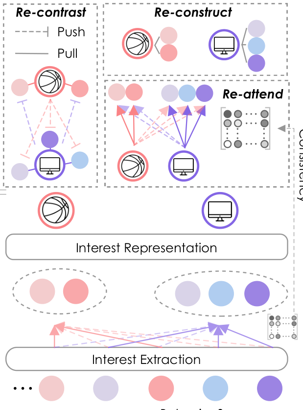
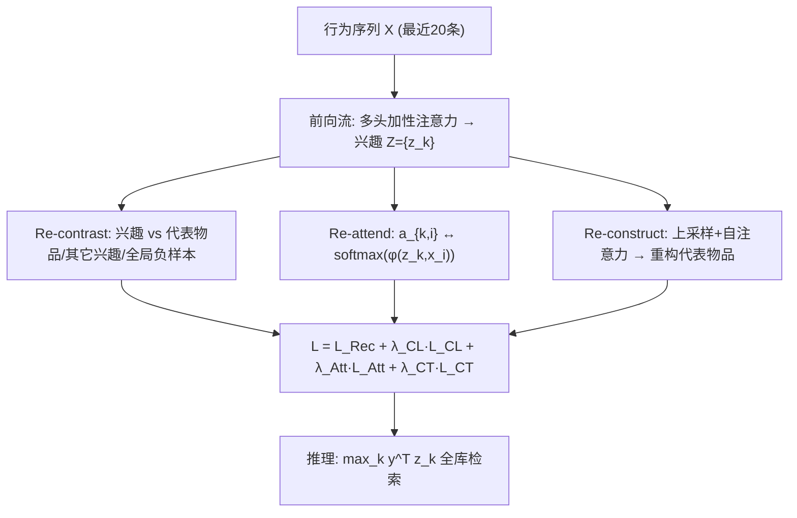

# Re4: Learning to Re-contrast, Re-attend, Re-construct for Multi-interest Recommendation (Re4：以重对比、重注意、重构学习多兴趣推荐)

- **会议/期刊**: WWW 2022 (Virtual Event, Lyon)
- **作者与机构**: Shengyu Zhang, Lingxiao Yang, Dong Yao, Yujie Lu, Fuli Feng, Zhou Zhao, Tat-seng Chua, Fei Wu（浙江大学、ZJU 上海高等研究院、上海AI Lab、中科大、NUS、UCSB）
- **推荐链路定位**: 召回（深度候选生成 / 多兴趣双塔匹配）
- **研究方向**: 序列与会话推荐 / 协同过滤与双塔召回
- **论文原文**: [arxiv.org/abs/2208.08011v2](https://arxiv.org/abs/2208.08011v2)
- **开源代码**: [DeerSheep0314/Re4](https://github.com/DeerSheep0314/Re4-Learning-to-Re-contrast-Re-attend-Re-construct-for-Multi-interest-Recommendation)

## TL;DR (1分钟核心速览)

多兴趣召回（ComiRec-SA 等）只用「物品→兴趣」前向流，多头注意力仅带来随机性而非多样性，兴趣向量既可能彼此近似，也可能与代表物品语义脱节，注意力权重与线上点积打分准则也不一致。作者在 ComiRec-SA 上补齐「兴趣→物品」反向流：Re-contrast（兴趣间对比拉开差异）、Re-attend（注意力权重对齐点积打分）、Re-construct（由兴趣重构代表物品）。沿用 ComiRec 全库排序协议，在 Amazon Book / MovieLens-1M / Gowalla 上 NDCG@20 相对最强基线提升 42.05% / 15.36% / 12.06%，且推理阶段零额外开销。

## Background & Motivation (背景与核心矛盾)

- **主流范式**: 序列召回用用户行为序列编码用户向量，YoutubeDNN 做均值池化，MIND 用动态胶囊路由、ComiRec-SA 用多头自注意力抽取 $N_z$个兴趣向量，线上以$\max_k \mathbf{y}^\top \mathbf{z}_k$ 检索。
- **前人局限 1**: 多头参数 $w_k$与注意力权重$a_{k,i}$无显式约束，不同头之间只保证"随机不同"，模型易收敛到所有兴趣向量在物品空间彼此接近的平凡解；兴趣数$N_z$ 增大时收益迅速饱和。
- **前人局限 2**: 注意力权重被解释为"物品-兴趣相关性"，但最终召回用点积/余弦度量相关性，二者度量空间不一致；且没有任何机制要求 $z_k$ 的语义能"代表"其高权重物品（仅粗粒度相关，不是细粒度内容理解）。
- **核心洞察 (Key Insight)**: 表征学习缺少「输出→输入」的校验通路。若把每个兴趣当作锚点、把它的代表物品当作正样本反向回看，就能同时施加"互异性""度量一致性""语义可解释"三重约束。
- **本文切入点**: 不改前向编码器结构，只加三条反向流正则，训练期生效、推理期零成本。

## Method (核心方法设计)

### 1. 整体框架 (Overall Architecture)

前向流沿用 ComiRec-SA：行为序列 $\mathbf{X}\in\mathbb{R}^{N_x\times d}$经加性注意力得权重$a_{k,i}=\mathrm{softmax}_i\!\left(\mathbf{w}_k^\top\tanh(\mathbf{W}_1\mathbf{x}_i)\right)$，加权求和得第$k$个兴趣$\mathbf{z}_k=\sum_j a_{k,j}\mathbf{W}_2\mathbf{x}_j$。随后三条反向流各自从$\{\mathbf{z}_k\}$出发回看物品/其它兴趣：Re-contrast 构造正负样本做 InfoNCE；Re-attend 令注意力分布逼近点积打分分布；Re-construct 用自注意力解码器重构代表物品。训练把四项损失加权求和，推理仍按式$\max_k \mathbf{y}^\top\mathbf{z}_k$ 取 top-N，架构与 ComiRec 完全兼容。

<figure class="paper-figure" markdown="span">
  <figcaption>图 1：利用反向流进行多兴趣表示学习的示意图。(a) 传统前向流，对物品聚类并提取多兴趣。(b) 所提出的反向流，即 Re-contrast，学习互不相同的多兴趣；Re-construct，使兴趣能够对代表性物品进行语义反映；Re-attend，确保前向流中的注意力权重与推荐相关性之间的一致性。</figcaption>
</figure>

### 2. 关键设计拆解 (Key Designs)

1. **Re-contrast（兴趣互异对比）**：痛点是多头注意力不保证兴趣分离。以硬阈值取代表物品作正样本 $\mathcal{P}_k=\{x_j\,|\,a_{k,j}>\gamma_c\}$（$\gamma_c$自适应取$1/N_x$），负样本为$\mathcal{N}_k=\bar{\mathcal{N}}_k\cup(\mathcal{Z}\setminus\{z_k\})\cup\tilde{\mathcal{N}}_k$——即"序列内非代表物品 + 其它兴趣 + 序列外随机物品"，第三项提供全局判别性、第二项直接惩罚兴趣间共线。损失为$\mathcal{L}_{CL}=-\sum_i\log\frac{\exp(\bar{\mathbf{z}}_k\cdot\bar{\mathbf{z}}^+_{k,i}/\tau)}{\exp(\bar{\mathbf{z}}_k\cdot\bar{\mathbf{z}}^+_{k,i}/\tau)+\sum_j\exp(\bar{\mathbf{z}}_k\cdot\bar{\mathbf{z}}^-_{k,j}/\tau)}$，$\tau=0.02$。把"兴趣"当锚点而非把"物品"当锚点，是兴趣去冗余的关键。
2. **Re-attend（度量一致性）**：痛点是注意力权重（softmax over 物品）与召回打分（点积）不同源。定义 $\tilde{a}_{k,i}=\mathrm{softmax}_i\,\phi(\mathbf{z}_k,\mathbf{x}_i)$，用交叉熵拉齐两个分布：$\mathcal{L}_{Att}=\sum_k\sum_i\mathrm{CE}(a_{k,i},\tilde{a}_{k,i})$。这相当于让"训练时聚类物品的准则"就是"线上排序的准则"，避免优化目标与 serving 目标错位。
3. **Re-construct（语义可解释）**：痛点是对齐了相关度却未对齐内容。将 $\mathbf{z}_k$线性上采样为$N_x$个 slot 矩阵$\mathbf{C}_k$，经自注意力（$\bar{\mathbf{W}}_3,\bar{\mathbf{w}}_j$）解码得$\hat{\mathbf{x}}_{k,j}$，仅对代表物品回归：$\mathcal{L}_{CT}=\sum_k\sum_j\mathbb{I}(x_j\in\mathcal{P}_k)\,\|\hat{\mathbf{x}}_{k,j}-\mathbf{x}_j\|_F^2$。只重构代表物品而非全部输入，迫使每个兴趣成为其簇的"语义摘要"。
4. **训练目标、负采样与推理效率**: 总损失 $\mathcal{L}_{Re4}=\mathcal{L}_{Rec}+\lambda_{CL}\mathcal{L}_{CL}+\lambda_{Att}\mathcal{L}_{Att}+\lambda_{CT}\mathcal{L}_{CT}$；召回项用 sampled softmax（随机负采样，负样本数按 ComiRec 设置）。$d=64$、$d_h=256$、$d_b=32$、$N_z=8$、$\lambda$在$\{0.01,0.1,1,10\}$ 搜。三条反向流仅在训练期计算，推理与 ComiRec 完全一致，无可测延迟增量。

## Experimental Setup & Evaluation Protocol (实验设置与评估协议)

- **数据集与预处理**: Amazon Book 取每用户最近 20 条行为构造序列；Gowalla 采用 `10-core` 过滤；MovieLens-1M 原样使用。

| 数据集 | #Users | #Items | #Interactions | 稀疏度/密度 | 特征/场景说明 |
| :--- | :---: | :---: | :---: | :---: | :--- |
| Amazon Book | 603,668 | 367,982 | 8,898,041 | 0.00004 | 电商图书，物品海量、兴趣最发散 |
| MovieLens-1M | 6,040 | 3,707 | 1,000,209 | 0.04467 | 电影评分，物品池小、密度高 |
| Gowalla | 29,858 | 40,981 | 1,027,370 | 0.00084 | LBS 签到，`10-core` 过滤 |

- **数据划分与防穿越 (Splitting Strategy)**: 严格沿用 ComiRec 评测框架，按时间切分序列：序列前缀训练、最后若干条为验证/测试目标，测试阶段考察训练期**未见过的用户行为序列**（unseen sequence），属于时序 + 序列外推划分，非随机比例划分。
- **排名评测协议 (Ranking Protocol)**: 无偏 `Full-Ranking`（对全物品库打分排序，非采样排序；每用户可有多个正例，故 HR@20 > Recall@20）。指标 Recall / NDCG / HR @20、@50，NDCG 的 IDCG 按被召回正例计（为与 ComiRec 可比而沿用其实现）。
- **对比基线与超参设置**: POP、Y-DNN、GRU4Rec（单向量序列模型）、MIND（胶囊路由多兴趣）、ComiRec-DR / ComiRec-SA（SOTA 多兴趣，后者为本文 base）。所有模型 $d=64$；未报告显著性检验，提升幅度以相对值 `Improv.` 给出。

## Key Experimental Results (实验关键数据)

### 1. 主实验对比 (Main Results)

| 数据集 | 指标 | POP | Y-DNN | GRU4Rec | MIND | ComiRec-SA | ComiRec-DR | Re4 | Improv. |
| :--- | :--- | :---: | :---: | :---: | :---: | :---: | :---: | :---: | :---: |
| Amazon | R@20 | 0.0137 | 0.0457 | 0.0406 | 0.0486 | 0.0549 | 0.0531 | **0.0771** | +40.44% |
| Amazon | NDCG@20 | 0.0226 | 0.0767 | 0.0680 | 0.0793 | 0.0899 | 0.0918 | **0.1304** | +42.05% |
| Amazon | NDCG@50 | 0.0394 | 0.1208 | 0.1037 | 0.1223 | 0.1356 | 0.1352 | **0.1883** | +38.86% |
| Amazon | HR@20 | 0.0302 | 0.1029 | 0.0894 | 0.1062 | 0.1140 | 0.1201 | **0.1627** | +35.47% |
| MovieLens | R@20 | 0.0006 | 0.1115 | **0.1286** | 0.1033 | 0.1189 | 0.1223 | 0.1117 | -13.14% |
| MovieLens | NDCG@20 | 0.0057 | 0.3671 | 0.3971 | 0.3325 | 0.3131 | 0.3913 | **0.4581** | +15.36% |
| MovieLens | NDCG@50 | 0.0135 | 0.4035 | 0.4157 | 0.3683 | 0.3396 | 0.4039 | **0.6067** | +45.95% |
| MovieLens | HR@20 | 0.0186 | 0.7318 | 0.7831 | 0.7020 | 0.7550 | 0.7714 | **0.8048** | +2.77% |
| Gowalla | R@20 | 0.0028 | 0.1127 | 0.1273 | 0.1218 | 0.1277 | 0.1153 | **0.1386** | +8.54% |
| Gowalla | NDCG@20 | 0.0073 | 0.2378 | 0.2803 | 0.2565 | 0.2736 | 0.2534 | **0.3141** | +12.06% |
| Gowalla | NDCG@50 | 0.0135 | 0.3638 | 0.4002 | 0.3888 | 0.4019 | 0.3621 | **0.4412** | +9.78% |
| Gowalla | HR@20 | 0.0104 | 0.3443 | 0.3814 | 0.3627 | 0.3838 | 0.3429 | **0.4206** | +9.59% |

### 2. 消融实验 (Ablation Study)

Gowalla 上逐步累加三条反向流（Base = ComiRec-SA）：

| 模型 | R@20 | NDCG@20 | HR@20 | R@50 | NDCG@50 | HR@50 |
| :--- | :---: | :---: | :---: | :---: | :---: | :---: |
| Base | 0.1277 | 0.2736 | 0.3838 | 0.207 | 0.402 | 0.529 |
| + $\mathcal{L}_{Att}$ | 0.133 | 0.287 | 0.400 | 0.220 | 0.427 | 0.573 |
| + $\mathcal{L}_{CL}$ | 0.135 | 0.296 | 0.412 | 0.222 | 0.433 | 0.575 |
| + $\mathcal{L}_{CT}$ (Re4) | **0.139** | **0.314** | **0.421** | 0.220 | **0.441** | 0.570 |

### 3. 关键实验发现 (Key Findings)

1. **收益随物品库规模放大**：Amazon（36.8 万物品）NDCG@20 从最强基线 0.0918 提到 0.1304（+42.05%），而小库 MovieLens 仅 +15.36% 且 Recall@20 反降 13.14%（0.1286→0.1117）——反向流优化的是排序精度与兴趣区分度，在少量物品上会牺牲召回覆盖。
2. **三流互补且重构最"值钱"**：累加消融中 NDCG@20 依次 +0.013/+0.009/+0.018，$\mathcal{L}_{CT}$单独贡献最大（0.296→0.314），且其增益在 @20 大于 @50，说明细粒度语义重构主要改善头部排序；注意力数$N_z$从 2 增至 8 时 Amazon 单调上涨（NDCG@20 0.1239→0.1304），而 MovieLens 在$N_z=4$ 后饱和，印证"兴趣数需求由物品多样性决定"。
3. **表征可分性被量化验证**：K-means++ 聚类下，正例落入其对应兴趣簇的比例 INTER 由 26.91 升至 32.98，用户内部各兴趣分簇比例 INTRA 由 35.80 升至 38.65；t-SNE 中 base 常出现"两兴趣几乎重合"或"某兴趣远离其物品"，Re4 则呈两个互斥细粒度簇。阈值 $\gamma_c=1/N_x$自适选择优于固定$1/16$（NDCG@20 0.314 vs 0.291），损失系数整体不敏感，唯$\lambda_{Att}=1$ 会因过度约束注意力而掉点。

## Highlights & Limitations (亮点、对比与审稿批判)

- **与代表作对比 (vs. Prior Work)**: 相比 MIND 的胶囊路由与 ComiRec-SA 的多头注意力，本文不改前向结构而补反向校验，是"正则层"而非"新编码器"；相比 AutoRec/双学习的重构思想，本文只重构代表物品子集，把重构从"复原输入"转为"提炼语义摘要"；相比 SGL/SimGCL 类对比学习在序列上做增广，本文把对比锚点换成**兴趣向量本身**，正负样本由注意力权重动态生成。
- **可迁移亮点**: ①"打分函数与注意力对齐"的 $\mathcal{L}_{Att}$ 可直接搬到任何带注意力解释的粗排/召回模型（如多向量召回、标签注意力）；②"兴趣作锚点 + 其它兴趣作负样本"的去冗余思路可用于多向量/多表征检索与语义 ID 码本分离。
- **审稿级局限批判**: ①代表物品正样本依赖阈值 $\gamma_c$与当前注意力状态，训练早期正样本噪声大，存在自举（bootstrapping）风险，论文未讨论收敛性；②评估仅有离线全库指标、无采样排序与显著性检验，MovieLens 召回下降被轻描淡写；Re-construct 引入额外解码器使训练开销明显上升（论文未给训练耗时/显存数据），线上多兴趣数$N_z$ 增大时检索与存储成本亦未分析。

## Rating (四维评分)

- **方法创新性 (Novelty)**: ⭐⭐⭐⭐ （"前向-反向"多兴趣范式清晰，三流各有明确物理直觉，但组件均为已有技术的新组合）
- **评估协议与实验扎实度 (Protocol & Experiments)**: ⭐⭐⭐⭐ （三数据集 + 全库排序 + 累加消融 + 聚类定量分析较完整，缺显著性检验与效率评测）
- **写作与数学规范度 (Clarity & Rigor)**: ⭐⭐⭐⭐ （公式与符号定义清楚、模块动机自洽，Re-attend 的分布归一化与正样本构造细节略欠严谨）
- **工业落地与复现价值 (Industrial & Practical Value)**: ⭐⭐⭐⭐⭐ （即插即用于 ComiRec 类召回、推理零开销、代码开源，工程迁移门槛极低）

