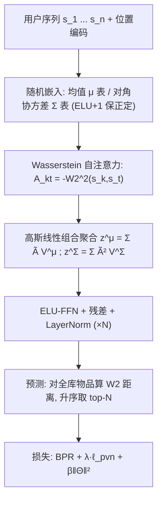
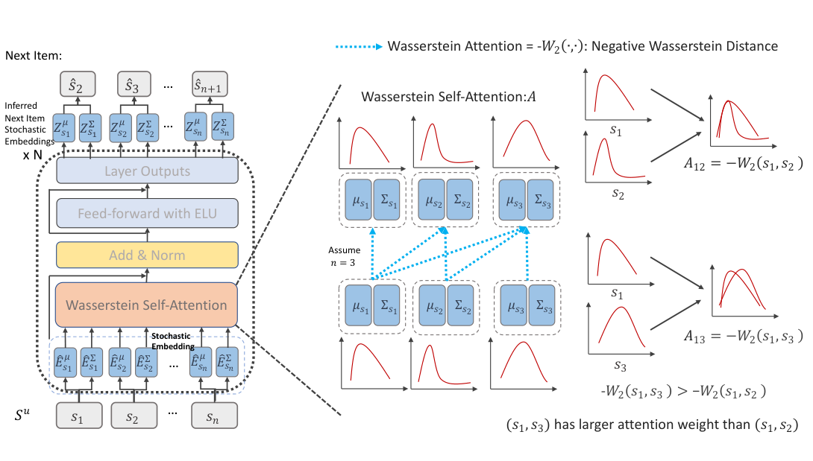
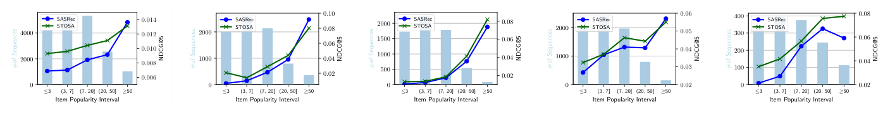

# Sequential Recommendation via Stochastic Self-Attention (基于随机自注意力的序列推荐)

- **会议/期刊**: WWW 2022 (The Web Conference)
- **作者与机构**: Ziwei Fan, Zhiwei Liu, Philip S. Yu (UIC) ; Alice Wang, Zahra Nazari (Spotify) ; Lei Zheng (Pinterest) ; Hao Peng (北航)
- **推荐链路定位**: 召回（下一物品预测 / Next-Item Retrieval）
- **研究方向**: 序列与会话推荐 / 冷启动与长尾推荐
- **论文原文**: [https://arxiv.org/abs/2201.06035v2](https://arxiv.org/abs/2201.06035v2)
- **开源代码**: [https://github.com/zfan20/STOSA](https://github.com/zfan20/STOSA)

## TL;DR (1分钟核心速览)

现有 Transformer 序列推荐把物品压成确定性向量、用点积度量物品转移关系，既无法表达用户兴趣的**动态不确定性**，也无法满足三角不等式从而丢失**协同传递性**（对冷启动物品致命）。本文提出 STOSA：物品以对角高斯分布 $(\mu,\Sigma)$ 嵌入，用负平方 2-Wasserstein 距离作自注意力权重与预测打分，并在 BPR 上追加正负样本距离铰链正则。在 5 个 Amazon 数据集、`5-core` + `Leave-One-Out` + **全库 Full-Ranking** 协议下，Recall@1 相对最优基线提升 3.16%–35.11%，冷启动物品增益最大。

## Background & Motivation (背景与核心矛盾)

- **主流范式**: SASRec/BERT4Rec 以自注意力编码序列，TiSASRec/SSE-PT 追加时间间隔与用户正则，DT4SR 虽引入均值-协方差分布，但仍沿用点积注意力。
- **前人局限一（确定性假设）**: 用户兴趣被压成固定向量；兴趣漂移大、跨品类跳转多的用户（如同时看科幻、言情、传记）被过度简化，模型欠拟合其真实不确定性。
- **前人局限二（无传递性）**: 点积不满足三角不等式。取 $i_x=[0,2], i_y=[1,1], i_z=[2,0]$，点积$i_x{\cdot}i_y=i_y{\cdot}i_z=2$却$i_x{\cdot}i_z=0$——未观测的$(i_x,i_z)$ 转移对无法被推断出来，长尾物品协同邻居因此稀疏。
- **核心洞察 (Key Insight)**: 距离度量天然满足 $d(i_x,i_z)\le d(i_x,i_y)+d(i_y,i_z)$，可作为归纳偏置把共现链条上的"传递相似"补出来；Wasserstein 距离既度量分布差异，又满足三角不等式，且在分布不重叠时仍给出平滑值（KL 会发散）。
- **本文切入点**: 用"高斯随机嵌入 + Wasserstein 自注意力"一次性把不确定性建模与协同传递性统一到同一个注意力算子中。

## Method (核心方法设计)

### 1. 整体框架 (Overall Architecture)

输入用户定长序列，每个物品同时查均值表 $\mathbf{M}_\mu$与协方差表$\mathbf{M}_\Sigma$（各自独立的可学习位置编码），得到$\mathcal{N}(\mu_{s_i}, \Sigma_{s_i}=\mathrm{diag}(\cdot))$。核心的 Wasserstein 自注意力层用**负平方 2-Wasserstein 距离**替代$QK^\top/\sqrt{d}$生成注意力权重，再按高斯线性组合性质分别聚合均值与方差（方差用权重平方加权），经 ELU 前馈、残差与 LayerNorm 得到上文的随机表示；预测层对候选物品计算$W_2$距离并**升序**排序输出 top-N。整个堆叠与 SASRec 同构，只是把每层的"点积 + 加权和"换成"距离 + 分布聚合"，因此可直接沿用因果掩码与共享嵌入。训练用 BPR 加本文的$\ell_{pvn}$ 铰链正则。

<figure class="paper-figure" markdown="span">
  <figcaption>图 1：所提 STOSA 的模型架构。𝑠𝑖 表示位置 𝑖 的物品，ˆ𝑠𝑖+1 表示在 (𝑖+1) 位置推断出的下一物品输出。我们提出随机嵌入以考虑动态不确定性信息，并引入一种新的 Wasserstein 自注意力层来捕获协同传递信号。我们引入采用 ELU 激活的前馈网络，并保证协方差的正定性。</figcaption>
</figure>

### 2. 关键设计拆解 (Key Designs)

1. **随机嵌入与 Wasserstein 注意力（把"内积相关性"换成"分布距离"）**：点积只作用于单点向量，无法表达不确定性且不满足三角不等式。本文把注意力权重改写为
$A_{kt}=-\big(\|\mu_{s_k}-\mu_{s_t}\|_2^2+\|\Sigma_{s_k}^{1/2}-\Sigma_{s_t}^{1/2}\|_F^2\big)$，
其中协方差经 $\mathrm{ELU}(\cdot)+1$映射保证正定（对照实验中 KL 散度既发散又破坏三角不等式）。直觉上：两个兴趣"弥散"的物品距离自然被拉大，注意力自动按不确定性折扣；而三角不等式让$i_x\!\to\!i_y\!\to\!i_z$链条上的$i_x,i_z$ 也被拉近，等价于免费的协同邻居增广。
2. **分布感知的聚合（注意力权重的二阶传播）**：均值与协方差的聚合规则不同，方差按权重**平方**加权
$z^{\mu}_{s_t}=\sum_{k\le t}\tilde{A}_{kt}V^{\mu}_{k},\quad z^{\Sigma}_{s_t}=\sum_{k\le t}\tilde{A}_{kt}^{2}V^{\Sigma}_{k}$，
这正是高斯线性组合的闭式结果；若沿用一次权重会造成方差被系统性高估，使预测分布过度平滑。整体堆叠后仍以共享嵌入表打分，控制参数量。
3. **训练目标、负采样与推理效率**：负样本为**均匀采样**用户未交互物品。总损失
$\mathcal{L}=\sum_{t}-\log\sigma(d_{s_t,j^-}-d_{s_t,j^+})+\lambda\big[d_{s_t,j^+}-d_{j^+,j^-}\big]_{+}+\beta\|\Theta\|_2^2$，
第二项要求"正样本到负样本的距离"不小于"预测点到正样本的距离"，修正 BPR 完全不约束 $d_{j^+,j^-}$的缺陷。复杂度上因$\Sigma$为对角阵，$\mathrm{trace}(\cdot)=\|\Sigma_{s_t}^{1/2}-\Sigma_{s_k}^{1/2}\|_F^2$可用批量矩阵乘实现，总体$O(n^2d+nd^2)$，与 SASRec 同阶（总维度$d$均分给$\mu,\Sigma$，各$d/2$）。

## Experimental Setup & Evaluation Protocol (实验设置与评估协议)

- **数据集与预处理**: 5 个 Amazon 域（Home/Beauty/Toys/Tools/Office），过滤方式 `5-core`（交互数 <5 的用户剔除），时间戳排序构序列。

| 数据集 | #Users | #Items | #Interactions | 稀疏度/密度 | 特征/场景说明 |
| :--- | :---: | :---: | :---: | :---: | :--- |
| Home | 66,519 | 28,237 | 551,682 | 0.03% | 家居，平均序列 8.3 |
| Beauty | 22,363 | 12,101 | 198,502 | 0.05% | 美妆，平均序列 8.3 |
| Toys | 19,412 | 11,924 | 167,597 | 0.07% | 玩具，平均序列 8.6 |
| Tools | 16,638 | 10,217 | 134,476 | 0.08% | 工具，平均序列 8.1 |
| Office | 4,905 | 2,420 | 53,258 | 0.44% | 办公用品，平均序列 10.8 |

- **数据划分与防穿越 (Splitting Strategy)**: `Leave-One-Out` —— 每用户最后一条交互作测试、倒数第二条作验证，其余为训练；序列超过 $n$ 则截断最早项，不足补 0，严格因果掩码。
- **排名评测协议 (Ranking Protocol)**: 无偏 `Full-Ranking`（对全库未交互物品打分，明确拒绝采样评测），指标 Recall@{1,5}、NDCG@5、MRR；因用距离打分，按**升序**取 top-N。
- **对比基线与超参设置**: 三组基线——静态（BPRMF、LightGCN）、度量学习（CML、SML）、序列（TransRec、Caser、SASRec、DT4SR、BERT4Rec）。基线 $d\in\{64,128\}$，STOSA 取$d_\mu=d_\Sigma\in\{32,64\}$以保证参数量可比；层数$\{1,2,3\}$、头数$\{1,2,4\}$、dropout$\{0.3,0.5,0.7\}$，验证 MRR 50 轮不升即早停。**未报告显著性检验**。

## Key Experimental Results (实验关键数据)

### 1. 主实验对比 (Main Results)

NDCG@5（全库排序，最优加粗，`Improv.` 相对次优基线）：

| 方法 | Home | Beauty | Tools | Toys | Office |
| :--- | :---: | :---: | :---: | :---: | :---: |
| BPRMF | 0.0062 | 0.0189 | 0.0139 | 0.0194 | 0.0144 |
| LightGCN | 0.0060 | 0.0174 | 0.0152 | 0.0173 | 0.0157 |
| CML | 0.0059 | 0.0184 | 0.0096 | 0.0154 | 0.0172 |
| TransRec | 0.0040 | 0.0204 | 0.0134 | 0.0143 | 0.0219 |
| Caser | OOM | 0.0214 | 0.0091 | 0.0210 | 0.0186 |
| SASRec | 0.0087 | 0.0274 | 0.0194 | 0.0377 | 0.0428 |
| DT4SR | 0.0082 | 0.0296 | 0.0196 | 0.0360 | 0.0421 |
| BERT4Rec | 0.0067 | 0.0257 | 0.0123 | 0.0206 | 0.0309 |
| **STOSA** | **0.0093** | **0.0351** | **0.0217** | **0.0412** | **0.0461** |
| Improv. | +6.76% | +18.45% | +11.04% | +9.45% | +7.71% |

Recall@1 提升 3.16%–35.11%（Beauty 最大 +35.11%），MRR 提升 5.68%–11.54%，提升幅度随指标截断位置变短而放大，说明收益集中在 top 位置。

### 2. 消融实验 (Ablation Study)

原文以 $\lambda$ 敏感性 + 与"分布+点积"基线对照完成组件归因（MRR）：

| 变体 | Home | Beauty | Tools | Toys | Office |
| :--- | :---: | :---: | :---: | :---: | :---: |
| 确定性嵌入 + 点积 (SASRec) | 0.0094 | 0.0291 | 0.0207 | 0.0385 | 0.0457 |
| 分布嵌入 + 点积 (DT4SR) | 0.0093 | 0.0323 | 0.0206 | 0.0387 | 0.0475 |
| 分布 + Wasserstein，$\lambda=0$ | — 仅优于 SASRec（Tools 除外，原文未给数值） | | | | |
| **完整 STOSA** | **0.0100** | **0.0360** | **0.0226** | **0.0415** | **0.0502** |

### 3. 关键实验发现 (Key Findings)

- **替换注意力算子比替换嵌入更值钱**：DT4SR 已有分布嵌入，仅把点积换成 Wasserstein 就把 MRR 再抬 5.7%–11.5%，证明三角不等式带来的协同传递性才是主增益来源，而非"分布"本身。
- **收益精准落在冷启动物品与长序列用户**：流行度 $\le 3$的物品 NDCG@5 增益最大；训练序列长度$\ge 20$ 的用户区间相对提升 9.70%–54.45%，与"兴趣越漂移、不确定性建模越有用"的假设一致。案例中 STOSA 的 rank-1 是 WF-7620 Printer（freq=3）而 SASRec 给出 Wraparound Labels（freq=12），印证其不再被热度绑架。
- **代价是热门物品与噪声邻居**：Beauty/Toys 上热门物品（freq>20）性能反降，作者归因于随机表征把大量近邻纳入注意力导致"噪声邻居"；$\lambda$ 过大会因负样本并非真负样本而掉点，需逐数据集调参。

<figure class="paper-figure" markdown="span">
  <figcaption>图 4：所有数据集上不同物品流行度（即物品训练交互数）下的 NDCG@5 性能。</figcaption>
</figure>

## Highlights & Limitations (亮点、对比与审稿批判)

- **与代表作对比 (vs. Prior Work)**: vs. SASRec——同为因果自注意力堆叠，但把确定性内积换成分布距离，冷启动友好；vs. DT4SR——同样建分布，却仍用点积注意力，缺少动态不确定性与传递性；vs. SML/CML——度量学习只保证三角不等式，无序列建模与不确定性。
- **可迁移亮点**: (1) 注意力 logits 用"负距离"替代内积，可零成本接入任何 Transformer 序列表，只需升序排序；(2) $\ell_{pvn}$ 那种"正样本与负样本必须拉开"的铰链正则，可直接加到任何 BPR/InfoNCE 训练中。
- **审稿级局限批判**: (1) 对角协方差假设割裂了维度间相关性，且 $d$ 劈半后有效容量下降，784 维以上多模态特征难直接套用；(2) 全部结论基于 5 个 Amazon `5-core` 单一域 + 单次 `Leave-One-Out`，**无显著性检验、无方差报告、无线上 A/B**；(3) 距离打分无法用 MIPS/ANN 内积索引加速，全库 Wasserstein 排序在千万级候选上推理成本高，工业部署需专门近似最近邻方案。

## Rating (四维评分)

- **方法创新性 (Novelty)**: ⭐⭐⭐⭐ （把"负距离即注意力"这一稀疏归纳偏置与高斯随机嵌入组合，几何直觉清晰，但 Wasserstein/分布嵌入在 DVNE、TIGER 中已有前身，属稳健组合创新）
- **评估协议与实验扎实度 (Protocol & Experiments)**: ⭐⭐⭐⭐ （坚持无偏 Full-Ranking + 5 数据集 + 冷启/长尾分桶分析，诚意足；但缺显著性检验与多次重复实验，$\lambda=0$ 消融未给具体数值）
- **写作与数学规范度 (Clarity & Rigor)**: ⭐⭐⭐⭐ （Wasserstein 闭式、正定性处理与复杂度分析交代完整，可批量矩阵乘实现；Eq.(5) 的"负距离 vs 负平方距离"表述略含混，需靠 Appendix Eq.(13) 才能对齐）
- **工业落地与复现价值 (Industrial & Practical Value)**: ⭐⭐⭐⭐ （代码开源、与 SASRec 同阶复杂度、可直接替换现有序列召回模型；但距离检索无法复用内积 ANN 索引，超参 $\lambda$ 需逐域调优，规模化召回仍需工程改造）

