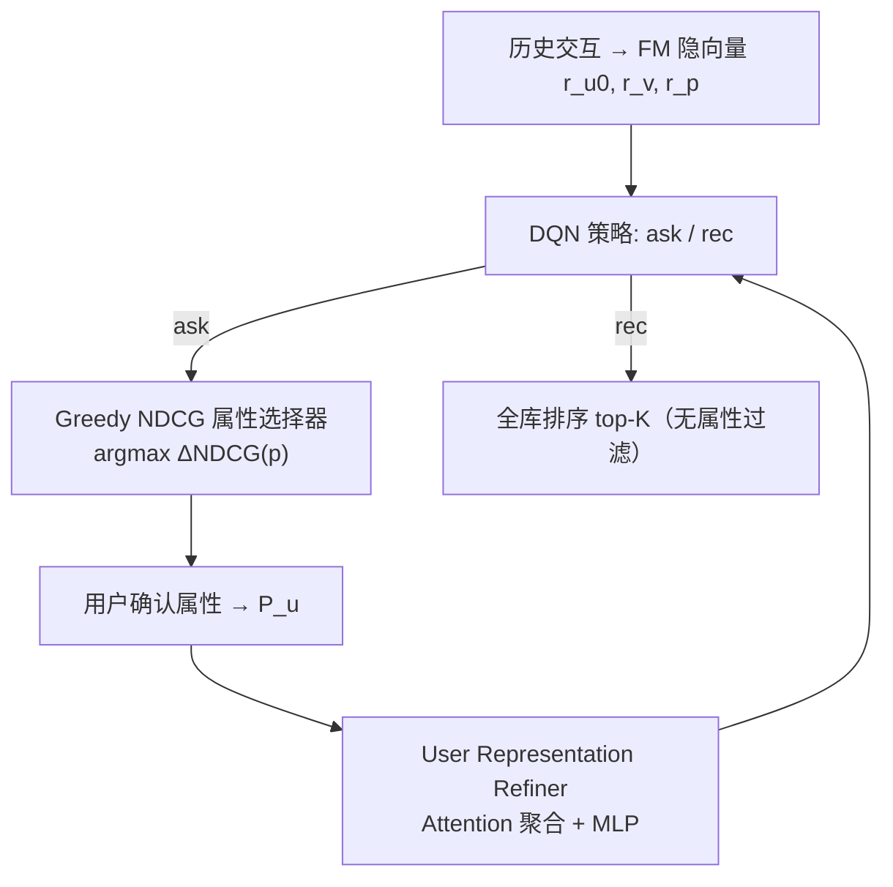

# Enhancing User Personalization in Conversational Recommenders (增强对话推荐系统中的用户个性化)

- **会议/期刊**: WWW 2023 (The Web Conference)
- **作者与机构**: Allen Lin, Jianling Wang, James Caverlee (Texas A&M University)；Ziwei Zhu (George Mason University)
- **推荐链路定位**: 在线多轮交互式召回（属性问询 + 候选集排序）
- **研究方向**: 对话推荐与智能体仿真 / 协同过滤（FM 隐语义预估）
- **论文原文**: [论文原文链接](https://arxiv.org/abs/2302.06656v1)
- **开源代码**: 暂未开源

## TL;DR (1分钟核心速览)

多轮对话推荐（MCR）普遍假设"用户只有一个目标物品"，并用熵最大化选属性、用硬属性过滤融合反馈，导致问询低效、真实目标被误杀。本文提出更现实的 MGMCR 设定与 UpsRec：用"预期 NDCG 增益"贪心挑选最能把用户区分开的属性，并用注意力+MLP 的用户表征精炼器把已确认属性融合进用户向量，从而放弃硬过滤。四个数据集全库排序下，NDCG@10 较最强基线 UNICORN 提升 23.6%–58.6%，平均轮次从 6.8–12.9 降至 5.7–6.6。

## Background & Motivation (背景与核心矛盾)

- **主流范式**: CRM/EAR/SCPR/UNICORN 一类工作把 CRS 拆成"对话组件（RL 策略决定问/推）+ 推荐组件（FM 学用户-物品-属性隐向量）"，每轮用**熵（含加权熵）**挑一个属性问用户，再把被接受的属性并进偏好集 $P_u$，最后在"完全匹配$P_u$的候选集$V_{\text{cand}}$"内排序 top-$K$。
- **前人局限（一）**: 熵只衡量属性在全集上的分布离散度，与"该用户此刻想要什么"无关；在偏好空间更宽的 MGMCR 下，高频问的属性（如 *Restaurant*、*affordable*）对排序几乎零信息量，问 8–13 轮仍收敛缓慢。
- **前人局限（二）**: 属性硬过滤把"未含已确认属性"的物品一律判为不匹配。用户同时喜欢 *Top Gun* 与 *Despicable Me*，一旦确认 *comedy*，前者被直接剔除；且忽略"同一确认对老用户/新用户信号强度不同"的个性化差异。
- **核心洞察 (Key Insight)**: 一个属性是否值得问，应等价于"知道它之后推荐质量（NDCG）能涨多少"；而用户反馈的正确用法不是做集合过滤，而是**改写用户表征**，让排序在全库上进行。
- **本文切入点**: 把属性选择变成"预算内 NDCG 增益最大化"的贪心决策，把反馈融合变成"用户向量迭代精炼"，二者共用同一个 FM 空间闭环。

## Method (核心方法设计)

### 1. 整体框架 (Overall Architecture)

离线阶段用加权 BPR 的 FM 学出用户/物品/属性隐向量 $\mathbf{R}_U,\mathbf{R}_V,\mathbf{R}_P$；进入会话后，用户给出初始属性$p_0$，策略网络（两层 MLP + DQN，动作空间缩为$\{a_{\text{ask}},a_{\text{rec}}\}$，状态$\mathbf{s}_t=\mathbf{r}_u^0\oplus\mathbf{s}_{\text{his}}^t$）决定问还是推。若问，则由贪心 NDCG 选择器从"用户已交互物品的相邻未问属性"$P_{\text{cand}}$中挑出$p_{\text{ask}}$；用户确认则写入$P_u$并触发表征精炼器更新$\mathbf{r}_u^t$；若推，则在**全候选集**（不再做属性过滤）上排序 top-$K$，被拒则从候选集剔除后继续。

### 2. 关键设计拆解 (Key Designs)

1. **Greedy NDCG 属性选择器（把"问什么"变成排序收益预估）**：痛点是用熵选属性与推荐目标脱钩 $\to$对每个候选$p$ 先假设其被接受，模拟精炼后的用户向量，再用验证集上前后 NDCG 之差作为该属性的期望收益，取最大者问：
$p_{\text{ask}}=\arg\max_{p\in P_{\text{cand}}}\big[\mathrm{NDCG}(\mathcal{F}(\mathbf{r}_u^0,P_u\cup\{p\}))-\mathrm{NDCG}(\mathbf{r}_u^{t})\big]$直觉：NDCG 直接对"把真实目标排到前面"负责，故被选属性天然是"最能区分该用户正负样本"的属性；且$P_{\text{cand}}$ 限定为相邻属性，把搜索空间从全属性压到个位数量级。

2. **User Representation Refiner（用注意力替代硬过滤）**：痛点是把 $P_u$当过滤条件会误杀多目标$\to$对$P_u$对应属性向量矩阵$\mathbf{R}_{p_u}$先做自注意力编码上下文一致性，再以$\mathbf{r}_u^0$ 为 query 做加权求和：
$\hat{\mathbf{R}}_{p_u}=\mathrm{softmax}\!\left(\frac{\mathbf{R}_{p_u}\mathbf{W}_q(\mathbf{R}_{p_u}\mathbf{W}_k)^{\top}}{\sqrt{d}}\right)\mathbf{R}_{p_u}\mathbf{W}_v,\quad \alpha_i=\frac{\exp(\mathbf{r}_u^{0\top}\tanh(\mathbf{W}_c\hat{\mathbf{r}}_{p_i}+\mathbf{b}_1))}{\sum_{n}\exp(\cdot)}$随后$\hat{\mathbf{r}}_u=\mathbf{W}(\mathbf{z}_{p_u}\oplus\mathbf{r}_u^0)+\mathbf{b}_2$拼接"过去兴趣 + 当前反馈"。用$\mathbf{r}_u^0$ 做 query 是关键：同一属性对不同历史用户权重不同（少看恐怖片的人确认 horror 应获更大权重），这正是硬过滤无法表达的个人化。

3. **训练目标、负采样与推理开销**：(a) 预估模型用加权 BPR，按交互频次 $f_i$ 缩放样本权重与正则，
$\mathcal{L}=\tfrac{1}{e^{n_1 f_i}}\big[-\ln\sigma(y(u,v,P_u)-y(u,v',P_u))\big]+e^{n_2 f_i}\|\mathbf{v}\|^2+\lambda\|\hat{\theta}\|^2$缓解热门物品主导；(b) 精炼器用标准 BPR，打分$\hat{y}=\mathcal{F}(\mathbf{r}_u^0,P_u)^{\top}\mathbf{v}$，因属性信息已进入$\hat{\mathbf{r}}_u$故去掉属性亲和项；(c) 构造正样本时随机采 1 个交互物品、从其属性中随机保留$n\in[1,T-1]$个作$P_u$（模拟对话中途状态），负样本取与$P_u$**Jaccard 相似度低**（阈值 0.33）的未交互物品，属"难负样本"式采样；每用户 1.5 万条 pair。推理侧每轮需对$|P_{\text{cand}}|$ 个候选各跑一次精炼 + 一次验证集 NDCG 估计，是主要在线开销来源。

## Experimental Setup & Evaluation Protocol (实验设置与评估协议)

- **数据集与预处理**（均为隐式二值反馈，保留 ≥10 次交互用户）：

| 数据集 | #Users | #Items | #Interactions | #Attributes | 说明 |
| :--- | :---: | :---: | :---: | :---: | :--- |
| Lastfm | 1,801 | 7,432 | 76,693 | 33 | 音乐人推荐，人工归并的粗粒度属性 |
| Lastfm* | 1,801 | 7,432 | 76,693 | 8,432 | 原始细粒度属性，极稀疏属性空间 |
| Yelp | 27,675 | 70,311 | 1,368,606 | 29 | 商户推荐，两层分类归并 |
| Yelp* | 27,675 | 70,311 | 1,368,606 | 590 | 原始属性 |

- **数据划分与防穿越**: 用户-物品交互按 **7:2:1 比例划分** train/val/test；属性选择器计算 NDCG 增益时只使用**验证集**标签，测试集不参与任何决策，避免信息泄漏。
- **排名评测协议**: **Full-Ranking（全库未交互排序）**，不做负采样打分；$K=10$、最大轮次$T=15$。指标为 HT@10（单目标 SR 的多目标推广：推荐列表中命中真实物品的比例）、NDCG@10 与平均轮次 AT；MGMCR 下每个用户只生成一次会话（而非每个 user-item 对一次），用户对属性回答依据其**全部**真实物品所带属性。
- **对比基线与超参**: MF（静态推荐下界）、MaxEnt（熵规则）、CRM、EAR、SCPR、UNICORN（SOTA，加权动态图 + 加权熵）。所有基线在 MGMCR 下重训对话组件并统一采用 NDCG 导向奖励，保证公平。隐向量维度 $d=64$，SGD 优化加权 BPR（$n_1=7,n_2=8,\lambda=10^{-3}$），Adam 优化精炼器（$\lambda=2\times10^{-3}$），DQN 经验池 5 万、batch 256、$\gamma=0.95$；显著性标准$\rho<0.01$。

## Key Experimental Results (实验关键数据)

### 1. 主实验对比 (Main Results)

| 模型 | Lastfm NDCG | Lastfm HT | Lastfm AT | Lastfm* NDCG | Lastfm* HT | Lastfm* AT | Yelp NDCG | Yelp HT | Yelp AT | Yelp* NDCG | Yelp* HT | Yelp* AT |
| :--- | :---: | :---: | :---: | :---: | :---: | :---: | :---: | :---: | :---: | :---: | :---: | :---: |
| MF | .0415 | .0684 | – | .0392 | .0679 | – | .0199 | .0419 | – | .0165 | .0305 | – |
| MaxEnt | .1033 | .1289 | 12.80 | .1819 | .2253 | 8.36 | .2668 | .2870 | 8.44 | .1694 | .2041 | 13.10 |
| CRM | .1359 | .2006 | 11.13 | .1710 | .2237 | 7.60 | .2422 | .2920 | 7.24 | .1072 | .1289 | 13.69 |
| EAR | .1455 | .2111 | 10.75 | .1765 | .2283 | 7.55 | .2503 | .3012 | 7.11 | .1095 | .1307 | 13.71 |
| SCPR | .1671 | .2407 | 9.94 | .2079 | .2752 | 6.90 | .2529 | .3016 | 7.09 | .3031 | .2924 | 12.77 |
| UNICORN | .1982 | .2808 | 8.95 | .2239 | .2818 | 6.84 | .2557 | .3041 | 6.99 | .3118 | .2977 | 12.92 |
| **UpsRec** | **.3144** | **.3358** | **5.99** | **.3278** | **.3437** | **5.89** | **.3631** | **.3805** | **5.72** | **.3853** | **.3754** | **6.57** |
| Improv. (vs UNICORN) | +58.6% | +19.6% | −33.1% | +46.4% | +22.0% | −13.9% | +42.0% | +25.1% | −18.2% | +23.6% | +26.1% | −49.1% |

### 2. 消融实验 (Ablation Study)

原文未给标准 `w/o` 消融表，而以 RQ2/RQ3 的受控分析替代（分别隔离"属性选择器"与"表征精炼器"的贡献）：

| 分析维度 | 对照组 | 关键观测 |
| :--- | :--- | :--- |
| 问询效率（Fig.1） | UpsRec vs 全部基线 | UpsRec 问 4 个属性即达最优性能约 80%(Lastfm*)/90%(Yelp*)；基线前几轮增益近乎持平 |
| 问询似然校准（Fig.2） | UNICORN vs UpsRec | UNICORN 对 Top-40 高频属性的平均"预测相关用户比例"高达约 0.7，系统性高估属性价值 |
| 用户表征质量（Fig.3 左） | GT item AUC | UNICORN 全程恒定，UpsRec 逐轮上升并在第 1 轮后反超 |
| 用户表征质量（Fig.3 右） | GT attribute AUC | 同上，UpsRec 随轮次持续拉开差距 |

### 3. 关键实验发现 (Key Findings)

1. **增益主要来自"排序质量"而非"命中率"**：基线的 NDCG@10 显著低于 HT@10（Lastfm 上 UNICORN 为 .1982 vs .2808），说明它们能推中但排不前，根因是用户向量学完就冻结、只靠过滤收缩候选；UpsRec 两指标几乎持平（.3144 vs .3358），证明迭代精炼真正改善了排序而非仅仅缩小搜索空间。
2. **属性选择器是效率杠杆**：AT 从 8.95/6.84/6.99/12.92 降到 5.99/5.89/5.72/6.57，在属性空间最庞大的 Yelp*（590 属性）上轮次近乎腰斩（−49.1%），说明 NDCG 增益排序在属性空间膨胀时优势更明显，而熵类方法随属性增多而退化。
3. **无过滤策略在稀疏/多目标下更稳健**：Yelp* 上 EAR 类硬过滤方法 NDCG 仅 .1095–.1307，而 UNICORN（.3118）与 UpsRec（.3853）远高，说明"是否做属性过滤"比"用哪种熵"影响更大；UpsRec 进一步把优势推到 +23.6%，且其收敛在第 4–5 轮，用户耐心窗口内即可完成。

## Highlights & Limitations (亮点、对比与审稿批判)

- **与代表作对比 (vs. Prior Work)**: 相比 EAR（加权 BPR 提升嵌入丰富度）与 SCPR（知识图谱缩减属性搜索空间），本文不动嵌入也不建图，而是**更换属性选择的目标函数**（熵 → NDCG 增益）；相比 UNICORN（加权熵 + 动态加权图联合训练），本文的关键差异是**取消属性硬过滤**，把反馈注入用户向量，这解释了为何它在 Lastfm 等 NDCG/HT 差距大的数据集上收益最大。
- **可迁移亮点**: (1) "以下游排序指标的预期增量作为交互动作的贪心准则"可迁移到主动学习式画像补全、冷启动问卷设计；(2) 用初始用户向量作为注意力 query 做个性化加权聚合，可用于会话式重排或标签融合模块； (3) 正样本属性随机子集 + 低 Jaccard 负样本的构造方式，是训练"部分反馈融合器"的通用技巧。
- **审稿级局限批判**: (1) **推理开销未量化**：每轮需对 $|P_{\text{cand}}|$个候选各做一次精炼与一次验证集全库 NDCG 估计，属性空间大时在线延迟可能不可接受，论文未给时延/FLOPs；(2) **用户模拟器过于理想**：属性回答严格由真实物品属性决定、无噪声与模糊表达，且"每用户一次会话"的 MGMCR 协议与真实多会话场景仍有距离；此外贪心选择器依赖验证集标签质量，val 稀疏时估计方差大，超参$n_1,n_2$ 与 Jaccard 阈值 0.33 的敏感性也未做扫描。

## Rating (四维评分)

- **方法创新性 (Novelty)**: ⭐⭐⭐⭐ （用"预期 NDCG 增益"统一问询与推荐目标、以表征精炼替代硬过滤，思路干净有效；但组件本身（注意力聚合、DQN 策略）均为成熟积木，创新偏组合式）
- **评估协议与实验扎实度 (Protocol & Experiments)**: ⭐⭐⭐⭐ （四数据集 × 两套属性粒度、全库排序、基线统一重训并加显著性检验，说服力强；不足是缺标准逐组件消融与方差/多次运行报告）
- **写作与数学规范度 (Clarity & Rigor)**: ⭐⭐⭐⭐ （MGMCR 重定义交代清楚、算法伪代码完整；但式 (2) 加权 BPR 存在笔误，且 NDCG 增益的期望估计未给方差或理论界分析）
- **工业落地与复现价值 (Industrial & Practical Value)**: ⭐⭐⭐ （无需图神经网络、FM+MLP 结构轻量、易接入现有属性体系；但贪心评估的在线计算成本与冷启动属性覆盖问题需要工程侧额外优化，且未开源）

