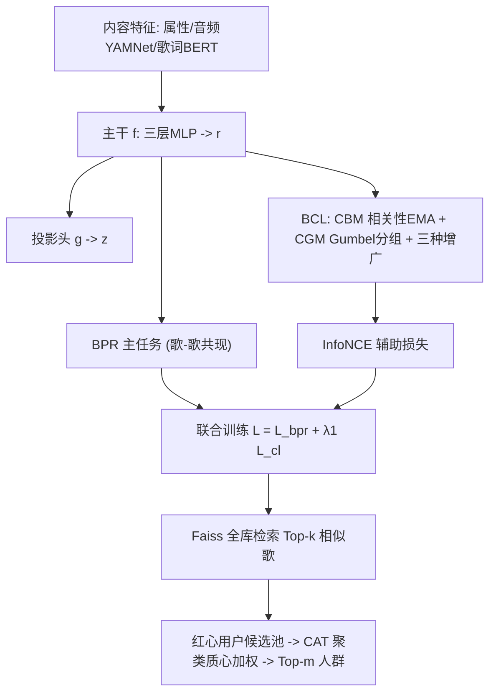
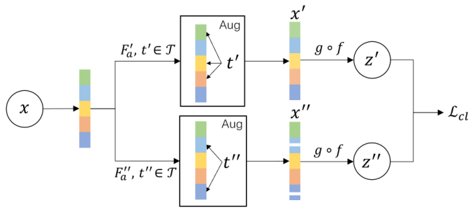
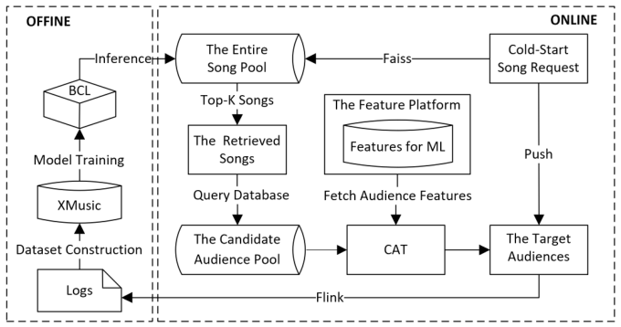

# Bootstrapping Contrastive Learning Enhanced Music Cold-Start Matching (自举对比学习增强的音乐冷启动匹配)

- **会议/期刊**: WWW 2023 (Companion, 5-page short paper)
- **作者与机构**: Xinping Zhao, Yingchun Yang (浙江大学); Ying Zhang, Qiang Xiao, Yuming Ren (网易云音乐)
- **推荐链路定位**: 召回（歌-歌相似召回 + 人群定向投放）
- **研究方向**: 冷启动与长尾推荐 / 自监督对比学习
- **论文原文**: [https://arxiv.org/abs/2308.02844v1](https://arxiv.org/abs/2308.02844v1)
- **开源代码**: 暂未开源（作者称后续释放，XMusic 数据集因版权不公开）

## TL;DR (1分钟核心速览)

本文形式化了一个新的工业任务 **Music Cold-Start Matching**：冷启新歌无任何交互，需先检索"听众高度重叠"的相似老歌，再把这些老歌的近期红心用户作为候选人群，最后筛出高置信目标人群完成冷启加热。作者发现监督信号（歌-歌共现对）服从幂律分布导致表征学习偏斜，提出 **BCL**：用距离相关矩阵的自举 EMA 更新 + Gumbel-Max 相关性分组 + 三种特征级掩码/加噪增广，对主干表征施加对比正则；线上再以 **CAT**（K-means 聚类质心 + bagging 加权打分）精筛人群。在自建 XMusic（318K 歌 / 5.4M 共现对）上做**全库排序**，Recall@50/NDCG@50 相对最强基线 CFM 提升 4.74%/8.74%（仅用 10% 数据时提升 12.89%/15.26%）；网易云音乐线上 A/B 有效播放量 +38.47%，已全量部署。

## Background & Motivation (背景与核心矛盾)

- **主流范式**: 冷启物品通常走"内容→协同"路线（CB2CF 思路），用音频/元数据/文本等内容特征学表征，再以 BPR 类 pairwise 损失对齐协同共现信号；对比学习（SimCLR/InfoNCE 系）被广泛用作辅助正则。
- **前人局限**: 其一，音乐场景的共现监督极度**幂律偏斜**，长尾歌曲监督信号不足，表征严重欠学习；其二，CV/RS 常用的对比增广（随机 dropout、全局正交正则、静态相关性掩码 CFM）**只依赖训练前的固定特征相关性**，而训练中特征分布会漂移，静态掩码很快失配。
- **核心洞察 (Key Insight)**: 异构内容特征（属性/音频/歌词）之间的相关性并非恒定，若能让"相关性矩阵"随训练在线自举更新，就能持续挖出**有意义且有难度**的特征依赖模式，使对比任务始终提供非平凡梯度。
- **本文切入点**: 以 slow-moving average 动态维护距离相关矩阵 $\mathbf{C}$ 来驱动**分组式**特征掩码，配合聚类人群定向，形成"离线表征—在线人群"的完整冷启加热闭环。

## Method (核心方法设计)

### 1. 整体框架 (Overall Architecture)

离线：属性特征过 embedding 得 $\boldsymbol{a}\in\mathbb{R}^{n_a\times d}$，音频经 YAMNet、歌词经 BERT[CLS] 各得$\boldsymbol{o},\boldsymbol{l}\in\mathbb{R}^{d}$，拼接为$\boldsymbol{x}=[\boldsymbol{a},\boldsymbol{o},\boldsymbol{l}]\in\mathbb{R}^{k\times d}$（$k=n_a+2$），三层 MLP 主干$f(\cdot)$输出歌曲表征$\boldsymbol{r}$，再经一层 MLP 投影头$g(\cdot)$得$\boldsymbol{z}$；主任务 BPR + 辅助 InfoNCE 联合优化。线上：冷启歌推理表征后用 Faiss 检索 Top-$k$相似歌 → 取这些歌近期"红心"用户构成候选人群池 → CAT 用 K-means 质心加权打分筛出 Top-$m$ 目标人群，完成快速加热。

<figure class="paper-figure" markdown="span">
  <figcaption>图1：BCL 的整体工作流程。</figcaption>
</figure>

<figure class="paper-figure" markdown="span">
  <figcaption>图5：Music Cold-Start Matching 的流程。左侧为离线阶段，右侧为在线阶段。</figcaption>
</figure>

### 2. 关键设计拆解 (Key Designs)

1. **CBM 相关性自举（让增广难度随训练自适应）**：痛点是用训练前一次性算出的相关性做掩码，分布漂移后失效。本文以**距离相关**衡量任意两个特征矩阵的线性+非线性关系 $C_{i,j}=\frac{dCov(X^{(i)},X^{(j)})}{\sqrt{dVar(X^{(i)})\cdot dVar(X^{(j)})}}$，并每$k$步用当前数据统计量$\mathbf{S}$做慢速滑动平均$\mathbf{C}=\alpha\mathbf{C}+(1-\alpha)\mathbf{S}$。直觉：$\alpha$ 提供记忆惯性，使相关性估计既跟上分布漂移又不被单个 batch 噪声带偏。

2. **CGM 相关性分组 + 特征级增广（制造"难负例式"的硬对比）**：先均匀采样种子特征 $f_s$，再用 Gumbel-Max 按与种子的相关性采样$n=\lfloor (k-1)/2\rfloor$个特征构成增强组$F'_a$，其余为$F''_a$：$\arg\max_i \left(\log C_{s,i}-\log(-\log \pi_i)\right)$。即**高相关特征更可能被分到同组并被一起扰动**，迫使模型不能靠"相关特征互相兜底"走捷径。随后对组内特征施加 Random Mask / Span Mask / Uniform Noise 三种算子（掩码率$\rho$、噪声强度$\epsilon$），每个训练步重采种子，保证模式多样。

3. **训练目标、负采样与推理效率**：总损失 $\mathcal{L}=\mathcal{L}_{bpr}+\lambda_1\mathcal{L}_{cl}+\lambda_2\|\Theta\|_2^2$，其中$\mathcal{L}_{cl}=\sum_{i=1}^{N}-\log\frac{\exp(\mathrm{sim}(\boldsymbol{z}'_i,\boldsymbol{z}''_i)/\tau)}{\sum_{k=1}^{N}\mathbb{I}_{[k\neq i]}\exp(\mathrm{sim}(\boldsymbol{z}'_i,\boldsymbol{z}''_k)/\tau)}$，负样本为**同 batch 内其他歌曲的增广视图**（in-batch negatives，免额外负采样器）；主任务 BPR 负例从非共现歌对$\mathcal{D}^-$采样。推理阶段对比分支与投影头全部丢弃，仅用$f(\cdot)$ 表征 + Faiss ANN 检索，**在线零额外开销**。

## Experimental Setup & Evaluation Protocol (实验设置与评估协议)

- **数据集与预处理**: 自建 XMusic，采集 90 天内多场景（DailySong、FM 等）十亿级行为，按用户行为序列统计**歌-歌共现**（播放 + 红心 + 收藏），阈值过滤保留高置信歌对；歌对即"监督样本"，非传统 user-item：

| 数据集 | #Items(歌曲) | #交互(歌-歌高置信共现对) | 平均交互/歌 | 密度 | 特征/场景说明 |
| :--- | :---: | :---: | :---: | :---: | :--- |
| XMusic | 318K | 5.4M | 17.26 | 0.005% | 属性 embedding + YAMNet 音频 + BERT 歌词；图像特征经实验剔除 |

- **数据划分与防穿越 (Splitting Strategy)**: 原文**未明确披露**训练/测试切分细则（只说 90 天行为窗口 + 阈值过滤），另设 `10% 下采样训练 / 全量测试` 的稀疏场景，用于模拟冷启低监督条件——这是评估透明度上的明显短板。
- **排名评测协议 (Ranking Protocol)**: 无偏 **Full-Ranking**，在**整个歌曲池**上排序，报告 Recall@50 与 NDCG@50（非采样排序，指标可信度较高）。
- **对比基线与超参设置**: Base（纯 BPR 主干）、FD（特征 dropout）、GOR（全局正交正则）、CFM（静态相关特征掩码）；统一 Xavier 初始化、Adam、lr=1e-3、batch=1024、$d=128$、$\lambda_2=1e-4$，其余网格搜索取最优。主干为三层 MLP、投影头一层 MLP，刻意不引入重型结构以隔离方法本身贡献。

## Key Experimental Results (实验关键数据)

### 1. 主实验对比 (Main Results)

| 方法 | 10% 数据 Recall@50 | 10% NDCG@50 | 全量 Recall@50 | 全量 NDCG@50 |
| :--- | :---: | :---: | :---: | :---: |
| Base (BPR) | 0.0477 | 0.0288 | 0.0619 | 0.0407 |
| FD (特征 dropout) | 0.0478 | 0.0284 | 0.0622 | 0.0392 |
| GOR (全局正交正则) | 0.0494 | 0.0292 | 0.0646 | 0.0411 |
| CFM (静态相关掩码) | 0.0543 | 0.0308 | 0.0696 | 0.0435 |
| **BCL (本文)** | **0.0613** | **0.0355** | **0.0729** | **0.0473** |
| Improv.% (vs CFM) | +12.89% | +15.26% | +4.74% | +8.74% |

**线上 A/B（网易云音乐，2022-07-04～07-10，vs Base）**：有效播放量 **+38.47%**，全播率 +1.42%，有效红心率 +1.95%。

### 2. 消融实验 (Ablation Study)

原文**未提供显式 `w/o CBM`、`w/o CGM`、`w/o CAT` 的逐组件定量消融**，仅有基线级对照与定性可视化，下表按原文信息重建（诚实标注）：

| 配置 | 对照的模块 | 全量 Recall@50 | 全量 NDCG@50 |
| :--- | :--- | :---: | :---: |
| Base | 仅监督学习，无对比正则 | 0.0619 | 0.0407 |
| FD | 无相关性建模的随机增广 | 0.0622 | 0.0392 |
| GOR | 全局正交约束（无分组） | 0.0646 | 0.0411 |
| CFM | 分组+掩码，但相关性**静态** | 0.0696 | 0.0435 |
| BCL | 分组+掩码+相关性**自举动态** | **0.0729** | **0.0473** |
| `w/o CAT` | 候选池直接投放（仅线上可测） | — | — |

### 3. 关键实验发现 (Key Findings)

1. **收益随监督稀疏度放大**：10% 数据下 BCL 相对 CFM 提升 +12.89%/+15.26%，全量数据下仅 +4.74%/+8.74%——对比正则本质是在补偿幂律偏斜造成的监督缺口，因此正是冷启/长尾场景收益最高，与论文动机自洽。
2. **"动态"是核心增量而非"分组"本身**：无 CL 的 Base 与 FD 在 10% 数据下几乎同分（0.0477 vs 0.0478，NDCG 甚至从 0.0288 掉到 0.0284），说明纯 dropout 式正则在幂律分布下失效；CFM 的静态相关掩码已把 Recall 推到 0.0543，BCL 仅靠把 $\mathbf{C}$ 改成 EMA 自举就再涨 +0.0070/+0.0047，量化了 CBM 的独立价值。
3. **人群精筛不以体验为代价**：线上有效播放量暴涨 +38.47% 的同时，全播率 +1.42%、有效红心率 +1.95% 双双微升，说明 CAT 的聚类质心加权（按簇规模加权聚合余弦相关）确实滤掉了低相关用户，而非用曝光换量；图 4 的 t-SNE 亦显示 BCL 表征类内更紧、类间更可分。

## Highlights & Limitations (亮点、对比与审稿批判)

- **与代表作对比 (vs. Prior Work)**: 相比 **CFM**，本文把"相关性掩码"从静态升级为慢速自举动态，并用 Gumbel-Max 显式控制采样随机性；相比 **GOR** 的全局正交约束，本文是特征依赖感知的局部扰动，粒度高一个层级；相比通用 SimCLR 式序列/图增广，本文是**特征维度级掩码**，天然适配异构内容特征拼接的输入形态。
- **可迁移亮点**: ①"距离相关矩阵 + EMA 自举"可作为任何多模态特征拼接模型的通用增广调度器，成本仅为每 $k$ 步一次协方差统计；②CAT 的"K-means 质心 + 按簇规模加权 + bagging 集成"是极轻量的候选人群降噪范式，可迁移到 push/短信触达等投放场景。
- **审稿级局限批判**: ①**评估透明度不足**：未交代训练/测试切分与 BPR 负例采样分布，XMusic 与代码均不可得，外部无法复现，"CB2CF 式共现"标签本身的构建阈值也未公开；②**缺乏组件级消融**：CBM/CGM 各自的贡献只能从与 CFM 的差值间接推断，CAT 仅有线上指标、无离线对照，且线上 A/B 仅 7 天、未报告置信区间与新奇性/多样性指标，长期留存影响未知。

## Rating (四维评分)

- **方法创新性 (Novelty)**: ⭐⭐⭐ （"相关性自举驱动特征分组增广"是有巧思的工程化组合创新，但 InfoNCE/BPR/掩码增广均为成熟组件的重组，缺少理论刻画）
- **评估协议与实验扎实度 (Protocol & Experiments)**: ⭐⭐⭐ （采用全库 Full-Ranking 与真实线上 A/B 值得肯定，但仅 4 个基线、无显式消融、切分与负采样细节缺失）
- **写作与数学规范度 (Clarity & Rigor)**: ⭐⭐⭐⭐ （5 页短文把问题形式化、四个公式与两阶段流程讲得干净，符号统一、无冗余推导）
- **工业落地与复现价值 (Industrial & Practical Value)**: ⭐⭐⭐⭐⭐ （千万级用户线上全量部署、有效播放 +38.47%，推理阶段零额外开销，是冷启加热的高参考价值范式；扣分项在于数据与代码均未开放）

