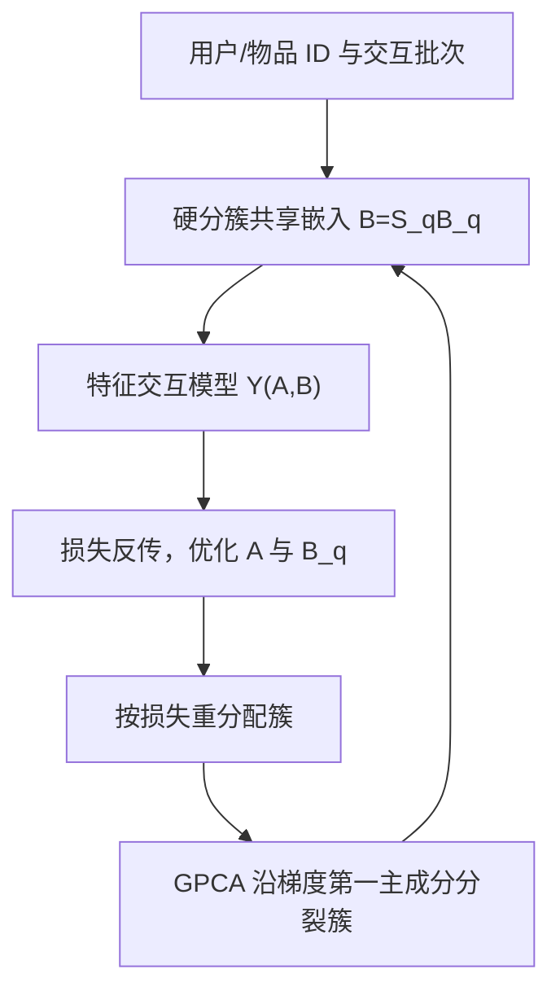
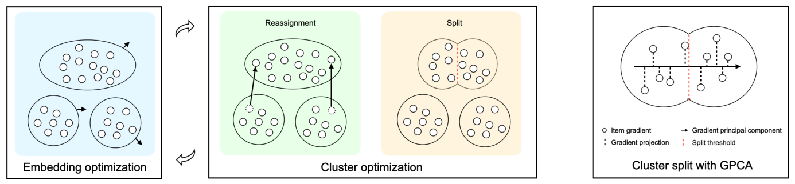

# Clustered Embedding Learning for Recommender Systems (分簇嵌入学习推荐系统)

- **会议/期刊**: WWW 2023
- **作者与机构**: Yizhou Chen, Guangda Huzhang, Anxiang Zeng 等；Shopee、NTU、上海财经大学
- **推荐链路定位**: 精排特征嵌入层（可插拔）
- **研究方向**: 冷启动与长尾推荐 / CTR 特征交互
- **论文原文**: [论文原文链接](https://arxiv.org/abs/2302.01478v2)
- **开源代码**: [Alibaba DeepRec](https://github.com/alibaba/DeepRec)（论文另给出 Zenodo 代码）

## TL;DR (1分钟核心速览)

针对全量嵌入表在冷物品上泛化差、在亿级 ID 上内存爆炸的痛点，本文提出即插即用的 CEL：把用户/物品嵌入表示为硬分簇共享嵌入 $B=S_qB_q$，交替执行嵌入优化、按梯度第一主成分 GPCA 分裂簇、按损失重分配簇；CEL-Lite 用经验回放与局部重分配把复杂度压到$O(DR)$。MovieLens/Amazon/Shopee 上，5% 压缩下 ML-1m MSE 0.7784 优于 PreHash 0.7958，Shopee 线上 AUC 87.70（+0.61）且嵌入表小 2650 倍。

## Background & Motivation (背景与核心矛盾)

- **主流范式**: 推荐系统通常为每个用户/物品学习独立全量嵌入，再输入 NMF、DeepFM、DIN 等特征交互模型；为降内存，常用哈希共享或预定义聚类正则。
- **前人局限**: eTree/JNKM 依赖预定义聚类结构且训练时仍需全量嵌入，内存收益不彻底；Modulo/BH/AE 哈希近似随机，HashGNN 需预训练哈希函数，PreHash 绑定最热用户且冷物品仅由热簇加权表示。
- **核心洞察 (Key Insight)**: 同一簇内实体共享嵌入时，虽无法用嵌入区分彼此，但各自对共享嵌入的梯度指向不同优化方向；沿梯度第一主成分分裂，可把“想往不同方向更新”的实体分开。
- **本文切入点**: 用自上而下分裂式聚类统一解决冷启动与内存问题，并让簇数、簇分配随数据自动增长/调整。

## Method (核心方法设计)

### 1. 整体框架 (Overall Architecture)

CEL 将物品嵌入矩阵分解为 $B=S_qB_q$，$S_q\in\{0,1\}^{M\times M_q}$为硬分配矩阵，$B_q$为簇嵌入；用户侧同理。训练交替进行两步：固定$S_q$优化$A,B_q$；再固定嵌入做簇重分配与簇分裂。初始仅一个簇，所有实体共享信息；随交互增多，按 GPCA 选择簇分裂，新簇继承父簇嵌入以保持原解最优性。推理时按实体所属簇查表，不增加额外检索结构；CEL-Lite 进一步支持流式增量更新。

<figure class="paper-figure" markdown="span">
  <figcaption>图 2：(a) CEL 的概览：它交替执行嵌入优化和聚类优化。(b) GPCA 的图示：它沿物品梯度的第一主成分划分簇。</figcaption>
</figure>

### 2. 关键设计拆解 (Key Designs)

1. **分簇嵌入参数化与交替优化**：全量嵌入内存随 ID 数线性增长，冷 ID 独立嵌入欠拟合。CEL 用 $B=S_qB_q$让同簇实体共享嵌入，整体目标为$\min_{A,B_q,S_q}\mathcal{L}=\|\mathbf{W}\odot(\mathbf{X}-Y(A,S_qB_q))\|_F^2$；固定$S_q$ 时各簇损失可分开优化，冷物品通过簇共享获得统计借力。
2. **GPCA 分裂与损失重分配**：簇内嵌入相同，无法用嵌入区分实体。CEL 取簇内物品梯度 $G=[\dots,g_j,\dots]^\top$，求第一主成分$\boldsymbol{p}=\arg\max_{\|\boldsymbol{p}\|_2=1}\boldsymbol{p}^\top G^\top G\boldsymbol{p}$，再按$g_j^\top\boldsymbol{p}<\delta$分到原簇/新簇；重分配则对每个物品枚举簇并最小化$\|\mathbf{W}(:,j)\odot(\mathbf{X}(:,j)-Y(A,S_q(j,:)B_q))\|_F^2$。直觉是：梯度主方向刻画了实体“希望嵌入往哪走”，沿其分裂比随机分裂或普通 2-Means 更贴合优化目标。
3. **训练目标、负采样与推理效率**：主损失为观测交互重构误差；可选个性化项 $\frac{\lambda_p}{2}\sum_j\|B(j,:)-S_q(j,:)B_q\|_2^2$在解绑后微调。无负采样，评分任务用全部观测评分，转化任务以评分$\ge 4$为正样本。CEL-Lite 为每个用户/物品缓存最多$n$条最新交互做经验回放，重分配只采样$m$个候选簇并仅处理当前批次实体；分裂用交互数阈值$d$控制簇规模，总复杂度$O(DR)$。推理仅一次簇嵌入查表，适合在线更新。

## Experimental Setup & Evaluation Protocol (实验设置与评估协议)

- **数据集与预处理**:

| 数据集 | #Users | #Items | #Interactions | 密度 | 特征/场景说明 |
| :--- | ---: | ---: | ---: | ---: | :--- |
| MovieLens-1m | 6,040 | 3,952 | 1,000,209 | 4.19% | 电影评分 1–5 |
| Video Games | 826,767 | 50,210 | 1,324,753 | ≈0.0032% | Amazon 评论 |
| Electronics | 4,201,696 | 476,002 | 7,824,482 | ≈0.00039% | Amazon 评论 |
| One-day Sales | ≈13m | ≈40m | ≈700m | ≈0.00013% | Shopee 电商一日成交 |

- **数据划分与防穿越 (Splitting Strategy)**: MovieLens 采用 5 折交叉验证；Amazon/Shopee 在线实验按数据流式到达增量训练，未使用 Leave-One-Out；另构造 dense（>100 交互过滤）与 sparse（随机丢 50% 交互）MovieLens 做稀疏性分析。
- **排名评测协议 (Ranking Protocol)**: 非 Full-Ranking/采样排序；评分任务用测试 MSE，转化任务用 AUC 点式评估，正样本为评分 $\ge 4$，其余为负样本。
- **对比基线与超参设置**: 对比全量嵌入、eTree、JNKM、Modulo、BH、AE、HashGNN、PreHash；特征交互模型含 NMF、DeepFM、DIN 与 Shopee 业务模型。MovieLens $R=64$，在线$R=8$；CEL 取$t_1=40,t_2=10$，CEL-Lite 取$b=2000$或$256$、$n=20$、$m=10$或$50$。未报告显著性检验，图表给 5 次运行标准误。

## Key Experimental Results (实验关键数据)

### 1. 主实验对比 (Main Results)

下表为 5% 压缩率下结果；Full embedding 为 100% 参考。

| 方法 | ML-1m NMF MSE↓ | ML-1m DIN MSE↓ | Video Games DeepFM AUC↑ | Electronics DeepFM AUC↑ |
| :--- | ---: | ---: | ---: | ---: |
| Full embedding (100%) | 0.8357 | 0.7903 | 68.19 | 66.95 |
| eTree | 0.8399 | 0.8306 | — | — |
| JNKM | 0.8903 | 0.8868 | — | — |
| Modulo | 1.0227 | 1.0206 | 58.81 | 54.54 |
| HashGNN | 0.8491 | 0.8467 | 64.43 | 61.41 |
| PreHash ($K=M_q$) | 0.7958 | 0.7871 | 66.21 | 67.18 |
| CEL | **0.7784** | **0.7718** | — | — |
| CEL-Lite | 0.7820 | 0.7766 | **70.21** | **68.69** |

相对最佳基线 PreHash，CEL 在 ML-1m 上 MSE 降低 2.18%/1.94%，CEL-Lite 在 Amazon 两集上 AUC 相对提升 6.04%/2.25%。Shopee 一日成交上，CEL-Lite 仅用 10k 嵌入实体即达 AUC 87.70，较全量业务模型 87.09 提升 0.61，嵌入表缩小 2650 倍。

### 2. 消融实验 (Ablation Study)

| 变体（1% 压缩） | ML-100k MSE↓ | ML-1m MSE↓ |
| :--- | ---: | ---: |
| Random Split（w/o GPCA） | 0.9392 | 0.8516 |
| User-Inspired + Bisecting 2-Means | 0.9245 | 0.8355 |
| Gradient + Bisecting 2-Means | 0.8847 | 0.8186 |
| Gradient + Random Projection | 0.9201 | 0.8269 |
| CEL（GPCA） | **0.8707** | **0.7858** |

### 3. 关键实验发现 (Key Findings)

- **GPCA 是性能主来源**：ML-1m 上把 GPCA 换成随机分裂，MSE 从 0.7858 升至 0.8516（相对恶化 8.4%）；即便用梯度做 2-Means 或随机投影，仍分别差 4.2%/5.2%，说明“梯度第一主方向”比普通距离聚类更贴近嵌入优化方向。
- **压缩-效果帕累托明显**：5% 压缩下 CEL 的 ML-1m NMF/DIN MSE 为 0.7784/0.7718，均优于 PreHash 的 0.7958/0.7871；线上 Shopee 以 10k 实体达到 87.70 AUC，超过全量嵌入 87.09，打破“压嵌入必掉点”的惯例。
- **冷热与稀疏性存在边界**：CEL 在冷物品上显著优于 PreHash；个性化会提升热物品（>20 交互）约 1.2% MSE，但会损害冷物品。稀疏 MovieLens 上最优压缩率约 2%，继续分裂反而退化，说明簇数并非越多越好。

## Highlights & Limitations (亮点、对比与审稿批判)

- **与代表作对比 (vs. Prior Work)**: eTree/JNKM 预定义聚类且训练需全量嵌入；哈希类方法分配随机或依赖预训练/热用户绑定；CEL 不预设簇结构、训练即压缩、支持增量，冷物品不再只由热簇加权表示。
- **可迁移亮点**: 用“梯度第一主成分”分裂共享参数簇，可迁移到多值类别特征、卖家/店铺 ID、地理位置等嵌入压缩；CEL-Lite 的“缓存近期交互 + 局部重分配”适合流式精排。
- **审稿级局限批判**: 理论仅覆盖 NMF 可识别性，未证明深层特征交互模型下最优簇数；GPCA 需算簇内梯度协方差，工程上仍有分裂触发与阈值 $d,\delta$ 调参成本；评估以 MSE/AUC 点式指标为主，缺少全库排序与显著性检验，在线基线还允许预看全量数据，公平性可进一步加强。

## Rating (四维评分)

- **方法创新性 (Novelty)**: ⭐⭐⭐⭐ （分簇共享嵌入并不新，但“梯度主成分分裂 + 动态重分配 + NMF 可识别性证明”组合有辨识度）
- **评估协议与实验扎实度 (Protocol & Experiments)**: ⭐⭐⭐⭐ （三个公开集 + Shopee 工业集，5 折/在线增量与冷热分桶较完整；但缺全库排序和显著性检验）
- **写作与数学规范度 (Clarity & Rigor)**: ⭐⭐⭐⭐ （交替优化、复杂度和命题陈述清楚；部分符号复用 $M_q$，深层模型理论留白）
- **工业落地与复现价值 (Industrial & Practical Value)**: ⭐⭐⭐⭐⭐ （$O(DR)$ 在线更新、AUC +0.61 且嵌入表小 2650 倍，附 DeepRec/Zenodo 代码，落地信号强）

