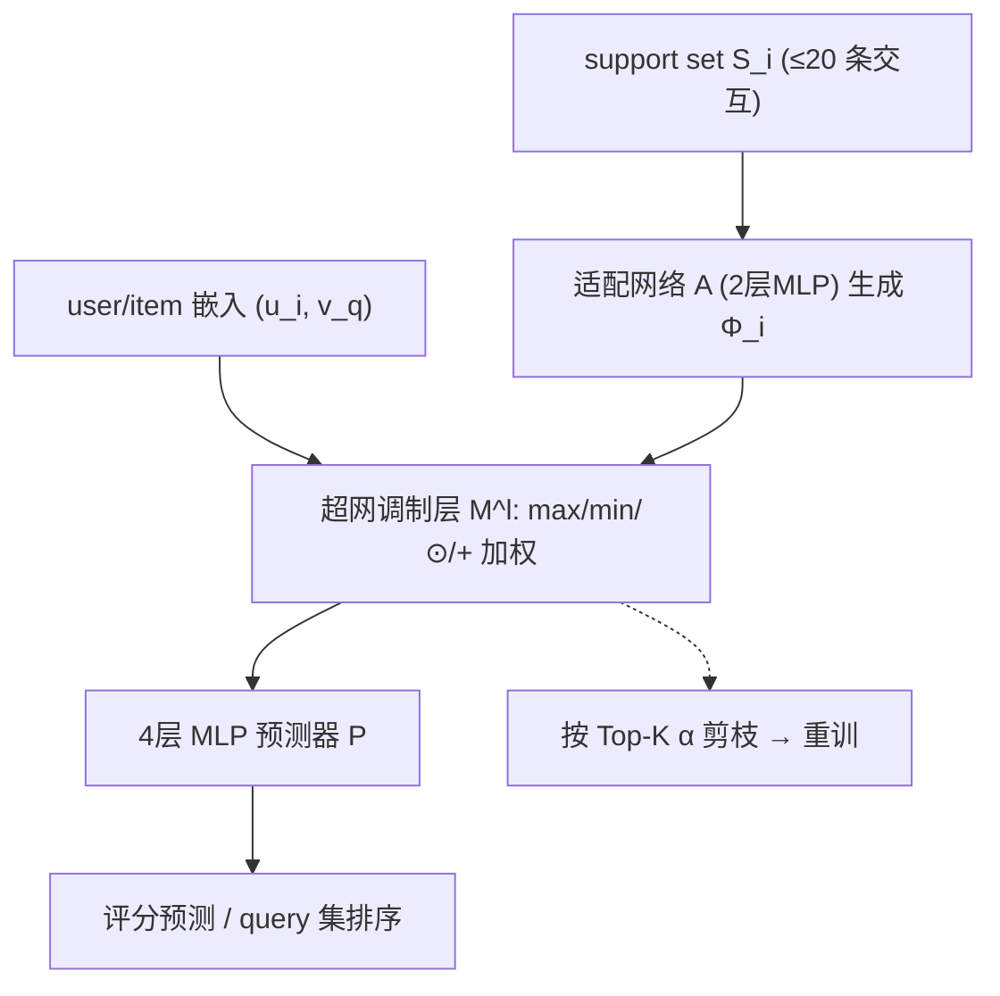
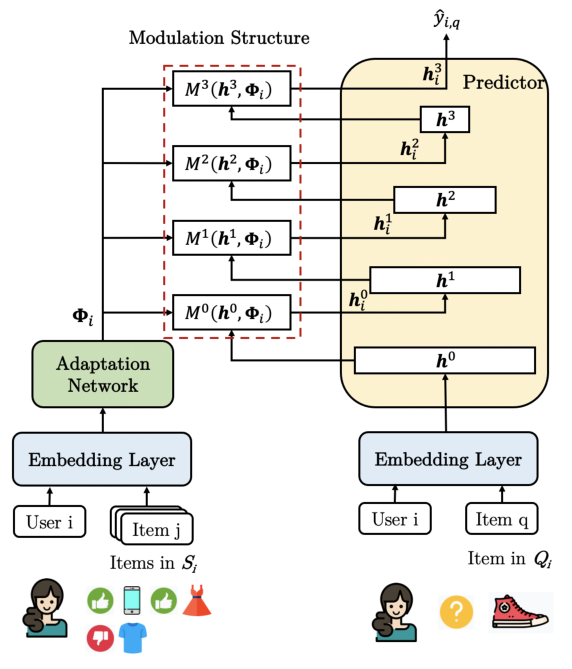
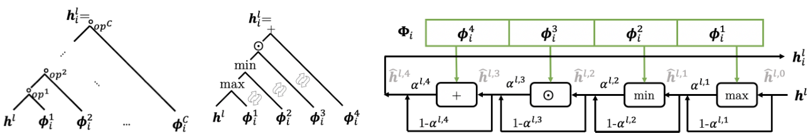

# ColdNAS: Search to Modulate for User Cold-Start Recommendation (面向用户冷启动推荐的调制结构搜索)

- **会议/期刊**: WWW 2023 (The ACM Web Conference)
- **作者与机构**: Shiguang Wu, Quanming Yao (清华大学电子工程系)；Yaqing Wang, Qinghe Jing, Daxiang Dong, Dejing Dou (百度)
- **推荐链路定位**: 精排（冷启动用户的评分预测/排序打分）
- **研究方向**: 冷启动与长尾推荐 / 元学习与小样本适配
- **论文原文**: [https://arxiv.org/abs/2306.03387v1](https://arxiv.org/abs/2306.03387v1)
- **开源代码**: [https://github.com/LARS-research/ColdNAS](https://github.com/LARS-research/ColdNAS)

## TL;DR (1分钟核心速览)

冷启动用户交互极少，现有超网络方法（TaNP 等）**固定**用 FiLM（逐特征缩放+平移）把用户历史映射成个性化参数去调制预测器，但"缩放/平移"在推荐数据上的物理含义模糊，调制位置全靠人工经验。本文提出 ColdNAS，把"用什么调制函数、在哪一层调制"整体形式化为 NAS 问题：设计覆盖 max/min/⊙/÷/+/− 六种算子的调制搜索空间，并**理论证明**该空间可等价变换为固定大小 $2^{4L}$ 的小空间，从而用 one-shot 可微搜索高效求解。在 MovieLens / BookCrossing / Last.fm 三个基准上，MSE 相对最强基线 TaNP 分别再降 1.29% / 4.07% / 3.11%，Last.fm 的 nDCG@3 提升 2.18%。

## Background & Motivation (背景与核心矛盾)

- **主流范式**: 用户冷启动被建模为 few-shot 任务（support set = 少量交互，query set = 待预测交互）。两条路线：(i) MAML 系梯度元学习（MeLU、MetaHIN、MAMO、PAML），(ii) 超网络系调制（TaNP），由适配网络 $A$输出用户专属参数$\boldsymbol{\Phi}_i=A(\mathcal{S}_i;\boldsymbol{\theta}_A)$ 直接调制预测器，无测试时梯度更新。
- **前人局限**: MAML 系需在测试阶段做局部梯度更新，推理慢且对优化步长/学习率高度敏感、易过拟合；超网络系虽快，但**调制函数被硬编码为 FiLM**（$\boldsymbol{h}^l_i=\boldsymbol{h}^l\odot\boldsymbol{\phi}^1_i+\boldsymbol{\phi}^2_i$），调制位置也靠经验（TaNP 全层、PNMTA 仅末层），不同数据集上并无普适最优。
- **核心洞察 (Key Insight)**: 推荐中"用户偏好如何作用于物品表征"本身是多样的——内积与求和都被用来度量偏好；而 max/min/加/乘等简单保维二元算子已足以表达丰富的逐维条件变换。因此调制函数应当**被搜索而非被指定**，且必须限制在简单算子内以避免冷启动场景下的小样本过拟合。
- **本文切入点**: 用 NAS 在"算子 × 层位置"空间上搜索调制结构，并用等价空间变换把搜索代价压到可控，使 one-shot 可微搜索成为可能。

## Method (核心方法设计)

### 1. 整体框架 (Overall Architecture)

模型沿用"嵌入层 $E$→ 适配网络$A$→ 预测器$P$"三段式。用户$u_i$的 support set$\mathcal{S}_i$经两层 MLP 的$A$生成参数组$\boldsymbol{\Phi}_i=\{\boldsymbol{\phi}^k_i\}_{k=1}^{C}$；$P$为$L=4$层 MLP，每层中间表征先经调制函数$M^l$个性化，再过线性层 + ReLU；最终以 query 集上的 MSE 训练。核心改动是把每层红色虚线处的$M^l$替换为一个含 4 个待选算子、由结构参数$\alpha_{l,k}$加权的**超网**，先端到端优化超网，再按 Top-$K$的$\alpha$ 剪出确定结构并从头重训，推理时对新用户只做一次前向即可得到个性化预测。

<figure class="paper-figure" markdown="span">
  <figcaption>图1：用户冷启动模型所用架构，由嵌入层、适配网络和预测器组成。红色虚线表示的调制结构是本文的搜索目标。</figcaption>
</figure>

### 2. 关键设计拆解 (Key Designs)

**创新设计一：算子级调制搜索空间（Modulation Search Space）**
痛点：FiLM 的缩放/平移只是众多可行变换之一，人工指定会在某些数据上失配。做法：将第 $l$层调制写成算子链$\boldsymbol{h}^l_i=\boldsymbol{h}^l\circ_{op_1}\boldsymbol{\phi}^1_i\circ_{op_2}\cdots\circ_{op_C}\boldsymbol{\phi}^C_i$，其中$\circ_{op}\in\{\max,\min,\odot,/\,,+,-\}$，$C$为算子个数。整空间大小为$6^{C\times L}$，$C$ 越大表达力越强但越难搜。直觉：这些算子都是逐维、保维、单调/线性组合，天然对应"取上界/取下界/按比例缩放/平移"这类可解释的偏好调节，且复杂度低，不易在 20 条交互上过拟合。

**创新设计二：等价空间变换（Proposition 3.1）与超网可微搜索**
痛点：$6^{C\times L}$空间对可微 NAS 而言过大且脆弱。作者把六个算子按代数性质分为四组$G_1=\{\max\},G_2=\{\min\},G_3=\{+,-\},G_4=\{\odot,/\}$，证明**组内可结合、组间可交换**（依赖$A$ 表达力足够的假设），于是任意长的算子链都能反复交换/结合、归约为固定四算子形式：

$$\boldsymbol{h}^l_i=\min\!\big(\max(\boldsymbol{h}^l,\hat{\boldsymbol{\phi}}^1_i),\hat{\boldsymbol{\phi}}^2_i\big)\odot\hat{\boldsymbol{\phi}}^3_i+\hat{\boldsymbol{\phi}}^4_i$$

其中 $\hat{\boldsymbol{\phi}}^k_i$仍是$\mathcal{S}_i$的（可微）函数，只是由$A$重新参数化。空间从$6^{C\times L}$缩到$2^{4L}$且**与$C$无关**（$L=4,C=4$时压缩$4.3\times10^{7}$倍）。超网对每层每算子引入权重$\alpha_{l,k+1}$ 做软选择：

$$\hat{\boldsymbol{h}}^{l,k+1}=\alpha_{l,k+1}\big(\hat{\boldsymbol{h}}^{l,k}\circ_{op_{k+1}}\boldsymbol{\phi}^{k+1}_i\big)+(1-\alpha_{l,k+1})\hat{\boldsymbol{h}}^{l,k}$$

由于四算子顺序无关，只需 $4L$ 个结构参数，可直接对训练损失做单层（而非双层）梯度下降，比 bilevel 搜索更快（图3）。

<figure class="paper-figure" markdown="span">
  <figcaption>图2：命题3.1的示意图，以及在约简空间上进行搜索的超网络结构。</figcaption>
</figure>

**训练目标、负采样与推理效率**: 损失为 query 集上的 MSE $\mathcal{L}_i=\frac{1}{M}\sum_{j=1}^{M}(y_{i,j}-\hat{y}_{i,j})^2$，按 episode（每用户一任务）累加求平均；无显式负采样（回归式评分预测），仅 Last.fm 的 query 集按 Lin et al. 生成负样本用于排序评估。搜索阶段耗时 16.2/45.5/3.9 分钟（MovieLens/BookCrossing/Last.fm），仅比直接重训（12.7/35.5/3.5 分钟）高约 10%–28%，推理与 TaNP 同量级（单次前向，无梯度更新）。

## Experimental Setup & Evaluation Protocol (实验设置与评估协议)

- **数据集与预处理**: 沿用 TaNP 的用户级 few-shot 构造，MovieLens/Last.fm 保留交互长度 $\in[40,200]$的用户；BookCrossing 长尾严重，训练任务取$[50,1000)$的用户，冷用户取$[2,50)$ 并按 7:1:2 分入 train/val/test。

| 数据集 | #Users (冷用户占比) | #Items | #Interactions | 用户/物品特征 | 场景说明 |
| :--- | :---: | :---: | :---: | :---: | :--- |
| MovieLens | 6,040 (52.3%) | 3,706 | 1,000,209 | 4 / 5 | 电影评分，含性别/年龄/职业/类型等 |
| BookCrossing | 278,858 (18.6%) | 271,379 | 1,149,780 | 2 / 3 | 图书评分，长尾极重 |
| Last.fm | 1,872 (15.3%) | 3,846 | 42,346 | 1 / 1 | 仅 ID 特征，纯协同信号 |

- **数据划分与防穿越**: 按**用户（task）级**划分 $\mathcal{T}_{train}:\mathcal{T}_{val}:\mathcal{T}_{test}=7:1:2$，三者**用户完全不重叠**，杜绝同一用户跨集合泄漏；每任务 support set 取$N=20$ 条（MovieLens/Last.fm）或随机一半历史（BookCrossing），剩余为 query set。
- **排名评测协议**: 非全库 `Full-Ranking`，而是在**每用户 query 集内部**对预测打分排序后计算 nDCG@3/@5（Last.fm 的 query 集含生成的负样本），同时用 MSE/MAE 度量评分回归误差；指标为 5 次运行均值（括号内为标准差）。
- **对比基线与超参**: 基线含 DropoutNet（非元学习深度冷启动）、MeLU/MetaCS/MetaHIN/MAMO（MAML 系）、TaNP（超网络+固定 FiLM），以及消融变体 ColdNAS-Fixed。预测器 4 层 MLP，适配网络 2 层 MLP，$C$隐含于变换后空间，$K$（保留算子数）与层数$L$ 做敏感性分析；结果报告均值±方差。

## Key Experimental Results (实验关键数据)

### 1. 主实验对比 (Main Results)

| 数据集 | 指标 | DropoutNet | MeLU | MetaHIN | MAMO | TaNP | **ColdNAS** | Improv. vs TaNP |
| :--- | :--- | :---: | :---: | :---: | :---: | :---: | :---: | :---: |
| MovieLens | MSE↓ | 100.90 | 95.02 | 91.89 | 90.20 | 89.11 | **87.96** | 1.29% |
| | MAE↓ | 85.71 | 77.38 | 75.79 | 75.34 | 74.78 | **74.29** | 0.66% |
| | nDCG@3↑ | 69.21 | 74.43 | 74.69 | 74.95 | 75.60 | **76.16** | 0.74% |
| | nDCG@5↑ | 68.43 | 73.52 | 73.63 | 73.84 | 74.29 | **74.74** | 0.61% |
| BookCrossing | MSE↓ | 15.38 | 15.15 | 14.76 | 14.82 | 14.75 | **14.15** | 4.07% |
| | MAE↓ | 3.75 | 3.68 | 3.50 | 3.51 | 3.48 | **3.40** | 2.30% |
| | nDCG@3↑ | 77.66 | 77.69 | 77.66 | 77.68 | 77.48 | **77.83** | 0.45% |
| | nDCG@5↑ | 80.87 | 81.10 | 80.95 | 81.01 | 81.16 | **81.32** | 0.20% |
| Last.fm | MSE↓ | 21.91 | 21.69 | 21.43 | 21.64 | 21.58 | **20.91** | 3.11% |
| | MAE↓ | 43.02 | 42.28 | 42.07 | 42.30 | 42.15 | **41.78** | 0.88% |
| | nDCG@3↑ | 75.13 | 80.15 | 82.01 | 80.73 | 81.03 | **82.80** | 2.18% |
| | nDCG@5↑ | 69.03 | 75.03 | 75.98 | 75.45 | 75.98 | **76.77** | 1.04% |

（ColdNAS 在三个数据集、四个指标上全部最优；Last.fm 的 MAE 量纲与其余数据集不同，按原文报告。）

### 2. 消融实验 (Ablation Study)

| 变体 | ML MSE↓ | BC MSE↓ | LF MSE↓ | LF nDCG@3↑ | 说明 |
| :--- | :---: | :---: | :---: | :---: | :--- |
| ColdNAS-Fixed（全层 FiLM） | 91.05 | 14.44 | 21.62 | 80.77 | 等价于 TaNP 式固定调制 |
| **ColdNAS（搜索后）** | **87.96** | **14.15** | **20.91** | **82.80** | 数据集自适应结构 |
| 相对变化 | −3.4% | −2.0% | −3.3% | +2.03 pt | 搜索显著有效 |
| Random (原始空间, $C=4$) | 更差且更慢 | 更差 | 更差 | — | 空间过大导致随机搜索失效 |
| ColdNAS-Bilevel（双层目标） | 与 ColdNAS 相当 | 相当 | 相当 | — | 但收敛更慢 |

搜索到的调制结构（$M^0\!-\!M^3$，$h^3$ 层均不调制）：

| 数据集 | $M^0$|$M^1$|$M^2$|$M^3$ |
| :--- | :--- | :--- | :--- | :--- |
| MovieLens | $\min(\max(h^0,\phi^{0,1}_i),\phi^{0,2}_i)+\phi^{0,3}_i$|$h^1+\phi^{1,1}_i$|$h^2$|$h^3$ |
| BookCrossing | $\min(h^0,\phi^{0,1}_i)$|$h^1+\phi^{1,1}_i$|$h^2\odot\phi^{2,1}_i+\phi^{2,2}_i$|$h^3$ |
| Last.fm | $h^0+\phi^{0,1}_i$|$h^1+\phi^{1,1}_i$|$\max(h^2,\phi^{2,1}_i)+\phi^{2,2}_i$|$h^3$ |

### 3. 关键实验发现 (Key Findings)

1. **最优调制结构确实随数据集而变，且末层一律不调制**：MovieLens 偏好 max/min 型"区间截断"，BookCrossing 只需最小/平移，Last.fm 几乎全靠加法平移；三个数据集在 $M^3$ 层都选择恒等。这说明在最末层直接注入用户向量会把 20 条交互的噪声放大成过拟合，早/中层调制才是收益来源。相对固定 FiLM，搜索带来的 MSE 降幅（3.3%–3.4%）甚至大于其相对 TaNP 的全部提升幅度，验证"搜索"本身是主要增益。
2. **空间变换是可行性的关键**：$L=4$时压缩比随$C$指数增长（$C=2$: 26×,$C=4$:$4.3\times10^{7}$×,$C=6$:$7.2\times10^{13}$×）。原始空间上 Random($C=4$) 既慢又差，而变换空间上即便随机搜索 Random(T) 也优于它，ColdNAS 更进一步且最快；此外$C$过小（如$C=1$）调制缺乏灵活性、$C$ 过大则随机搜索不可行，等价变换恰好把这一权衡消解掉。
3. **超参鲁棒、代价可接受**：$L$在 3–5 层内变化对 MSE 影响很小（$L=4$已足够），$K$ 取中间值时最优（过小欠拟合用户偏好、过大过拟合）；support set 越长预测越准，说明方法能随交互增长平滑获益。搜索时间仅比重训多 10%–28%（如 MovieLens 16.2 vs 12.7 分钟），一次性离线成本可接受。

## Highlights & Limitations (亮点、对比与审稿批判)

- **与代表作对比**: vs **TaNP**：同样用超网络生成参数，但 TaNP 固定全层 FiLM，ColdNAS 让"函数+位置"可学，且证明 FiLM 只是其 $G_3/G_4$ 组合的特例。vs **MeLU / MetaHIN / MAMO**：MAML 系需测试时梯度更新且对优化超参敏感，ColdNAS 推理是一次前向；MetaHIN 还需异构信息网络等额外结构。vs **通用 NAS（AutoCF/AutoFIS）**：那些方法搜索的是交互/特征交叉函数，搜索空间不可迁移到冷启动的调制问题。
- **可迁移亮点**: (i) "组内可结合 + 组间可交换" 的算子代数等价性论证，可复用到任何"算子链"式搜索空间（如特征交叉、序列池化）以把指数空间压成常数空间；(ii) 用超网 $\alpha$的 Top-$K$ 剪枝 + 重训的两阶段流程，可直接嵌入现有超网络冷启动模型作为即插即用增强。
- **审稿级局限批判**: (i) 等价性依赖"适配网络 $A$表达力足够"的假设，虽用 2 层 MLP 经验验证，但缺乏对近似误差的定量界，若$A$ 受限则变换只是近似；(ii) 任务定义要求 support set 固定为 20 条/一半历史，与线上"1–5 条交互即冷启动"的真实分布有差距，且评估是 query 集内排序而非全库 Full-Ranking，未报告与工业召回链路的对接成本；(iii) 搜索需为每个数据集重跑一次超网，跨域迁移/一次搜索多域共享未被讨论。

## Rating (四维评分)

- **方法创新性 (Novelty)**: ⭐⭐⭐⭐ （首次把调制函数与位置统一纳入 NAS，并给出算子等价性的可证空间变换，理论增量清晰但本质仍是 FiLM 家族的结构化扩展）
- **评估协议与实验扎实度 (Protocol & Experiments)**: ⭐⭐⭐⭐ （三数据集 + 4 指标 + 5 次运行方差 + 用户级无重叠划分较严谨，但排序评估限于 query 集内部而非全库 Full-Ranking）
- **写作与数学规范度 (Clarity & Rigor)**: ⭐⭐⭐⭐ （命题陈述、分组直觉与两个 Remark 例子交代清楚，压缩比表格直观；等价性证明置于附录、假设的紧致性略欠讨论）
- **工业落地与复现价值 (Industrial & Practical Value)**: ⭐⭐⭐⭐ （代码开源，搜索开销仅为重训的 1.1–1.3 倍且推理无梯度更新，易嵌入现有超网络冷启动架构；但需按业务数据周期性重搜）

