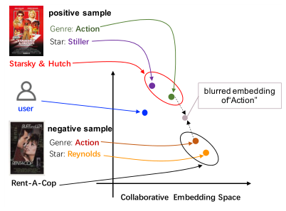
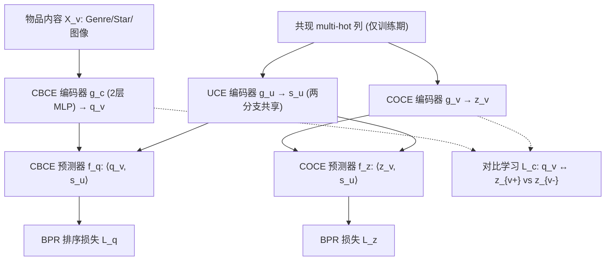
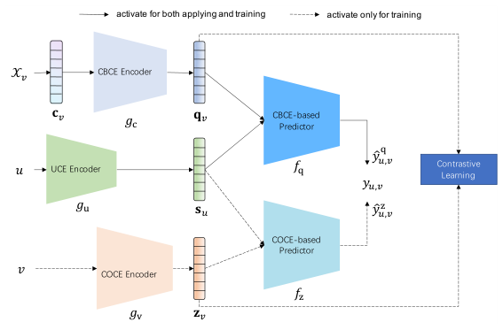

# Contrastive Collaborative Filtering for Cold-Start Item Recommendation (面向冷启动物品推荐的对比协同过滤)

- **会议/期刊**: WWW 2023 (The ACM Web Conference)
- **作者与机构**: Zhihui Zhou, Lilin Zhang, Ning Yang（四川大学计算机学院，Ning Yang 通讯作者）
- **推荐链路定位**: 召回（冷启动物品的协同表征生成）
- **研究方向**: 冷启动与长尾推荐 / 自监督对比学习
- **论文原文**: [https://arxiv.org/abs/2302.02151v2](https://arxiv.org/abs/2302.02151v2)
- **开源代码**: [https://github.com/zzhin/CCFCRec](https://github.com/zzhin/CCFCRec)

## TL;DR (1分钟核心速览)

冷启动推荐的主流做法是"用内容生成协同嵌入"，但训练时把暖物品的交互抹掉来模拟冷启动，会让属性嵌入在正负样本间来回拉扯而变得**模糊（blurry）**，用户真实偏好被平均掉。本文提出 CCFCRec：内容 CF 分支产出 CBCE、共现 CF 分支产出 COCE，二者在"被同一用户共同交互"的**二阶邻居**上做 InfoNCE 对比，把共现协同信号间接蒸馏进内容编码器；应用期 COCE 不可得，但内容分支已"记住"该相关性，可隐式矫正模糊嵌入。在 ML-20M / Amazon-VG 的 item→user 全库排序协议下，HR@5 相对最强基线提升 6.06% / 29.75%，并配信息论下界证明。

## Background & Motivation (背景与核心矛盾)

- **主流范式**: 内容生成式方法（DropoutNet、MWUF、LARA、CVAR、MTPR）把冷启动物品的属性/文本/图像投影到暖物品 ID 嵌入空间，从而让 CF 可用。
- **前人局限**: ① 训练期必须"去掉暖物品交互"来伪造冷启动，属性嵌入缺乏可区分的协同监督，同一属性（如 Genre=Action）在正样本与负样本间被反复拉扯成均值，即**协同嵌入模糊**；② 暖数据中富集的**共现协同信号**（同用户共同观看的模式）恰被上述模拟过程丢弃，冷启动模型无处可补。
- **核心洞察 (Key Insight)**: 模糊源于"负样本带来的噪声干扰属性语义"——若能把共现信号（正物品应比负物品更靠近用户嵌入）注入 CBCE，模糊即可被矫正；但冷启动物品在应用期根本没有共现，只能**在训练期把该知识压进内容分支参数里**，应用期"回忆"而非"计算"。
- **本文切入点**: 把 CBCE 与 COCE 视为同一物品的内容视图与行为视图，用对比互信息最大化建立 $c_v \leftrightarrow q_v \leftrightarrow z_v$ 三元相关，使内容分支在训练中被 COCE "教"会如何在推理时自我矫正。

<figure class="paper-figure" markdown="span">
  <figcaption>图1：模糊协同嵌入示意图。</figcaption>
</figure>

## Method (核心方法设计)

### 1. 整体框架 (Overall Architecture)

输入为物品属性集 $X_v$（one-hot / multi-hot 查表、图像经 VGG）拼接成$c_v$，内容编码器$g_c$（两层 MLP + LeakyReLU）输出 CBCE$\mathbf{q}_v$；共现编码器$g_v$与用户编码器$g_u$以交互矩阵的多热列向量线性查表得到 COCE$\mathbf{z}_v$与 UCE$\mathbf{s}_u$。训练期双分支同时用内积预测器打分，各自接 BPR 损失，并共享$\mathbf{s}_u$、共享同一监督信号做多任务联合训练；同时$g_c$与$g_v$之间做对比学习，把共现知识迁移进内容分支。应用期**虚线路径全部关闭**：仅保留$X_v \to g_c \to \mathbf{q}_v$，与$\mathbf{s}_u$ 内积排序，因此冷启动物品零交互可用。

<figure class="paper-figure" markdown="span">
  <figcaption>图2：所提出模型 CCFCRec 的概览。</figcaption>
</figure>

### 2. 关键设计拆解 (Key Designs)

1. **二阶邻居对比的协同过滤（CCFCRec 的核心增量）**：CLCRec 之类把对比限制在"同一物品的自身视图"，正样本面过窄、稀疏时几乎无信号。本文把正样本集扩展为 $\mathcal{N}^{+}_{v}=\{v^{+}:\mathcal{U}_v\cap\mathcal{U}_{v^{+}}\neq\varnothing\}$，即与$v$被同一用户共同交互过的物品，负样本取$\mathcal{V}\setminus\mathcal{N}^{+}_{v}$，用跨视图 InfoNCE：
$$\mathcal{L}_{c}=-\mathbb{E}_{v\in\mathcal{D},v^{+}\in\mathcal{N}^{+}_{v}}\ln\frac{\exp(\langle\mathbf{q}_{v},\mathbf{z}_{v^{+}}\rangle/\tau)}{\exp(\langle\mathbf{q}_{v},\mathbf{z}_{v^{+}}\rangle/\tau)+\sum_{v^{-}\in\mathcal{N}^{-}_{v}}\exp(\langle\mathbf{q}_{v},\mathbf{z}_{v^{-}}\rangle/\tau)}$$
直觉上，$\mathbf{q}_v$被迫与"该用户也看过的物品"的行为嵌入对齐、与共现之外的物品分离，等价于把$c_v \to z_v$的间接相关性刻进$g_c$；由于该式可改写为带标签指示$\mathbb{I}(\mathcal{U}_v\cap\mathcal{U}_{v'}\neq\varnothing)$ 的**监督对比**形式，共现标签本身充当了视图选择的监督。

2. **双 CF 模块共享 UCE 的多任务联合训练**：若各自独立训练，共现分支退化为普通 MF 且与内容分支"两张皮"。本文令两预测器共享 $\mathbf{s}_u$：
$$\hat{y}^{q}_{u,v}=\langle\mathbf{q}_{v},\mathbf{s}_{u}\rangle,\quad \hat{y}^{z}_{u,v}=\langle\mathbf{z}_{v},\mathbf{s}_{u}\rangle$$
并以同一 $(v,u^{+},u^{-})$三元组各自接 BPR 损失$\mathcal{L}_{q},\mathcal{L}_{z}$。共享用户嵌入使两分支的排序目标"对齐"，从而保证负迁移风险下的正向迁移；消融显示，把$\mathbf{z}_v$预训练后固定（CCFCRec-pretrain）会因误差传播掉点，说明必须让$\mathbf{z}_v$ 随排序监督同步调整。

3. **训练目标、负采样与推理效率**：总目标 $\mathcal{L}=\mathcal{L}_{q}+\mathcal{L}_{z}+\lambda\mathcal{L}_{c}+\|\Theta\|_{2}^{2}$，$\tau=0.1$，$\lambda$在 ML-20M / Amazon-VG 取 0.5 / 0.6，Adam 优化。对比侧为加速采用采样（每物品 10 正 × 40 负 = 400 对；Amazon-VG 为 5 正 × 40 负 = 200 对），BPR 侧每个正用户配 1 个均匀采样负用户。推理仅前向一次 2 层 MLP，相比主流程无额外开销，但训练期需要$W_v\in\mathbb{R}^{d\times|\mathcal{U}|}$ 的巨型 ID 表与对比采样开销。

4. **理论支撑（信息论下界）**：将模型视为马尔可夫链 $U_e\to C\xrightarrow{g}Q\xrightarrow{f}\hat{U}$，噪声标签下优化的是上界$I(\hat{U},U_e)=I(\hat{U},U)+I(\hat{U},E)$；由于模糊噪声$E$由负样本统计造成，由数据处理不等式$I(\hat{U},E)\le I(\hat{U},Z^{-})$，故最小化对比损失即最小化$I(\hat{U},Z^{-})$，从而最大化真实互信息的下界$I(\hat{U},U)\ge I(\hat{U},U_e)-I(\hat{U},Z^{-})$。

## Experimental Setup & Evaluation Protocol (实验设置与评估协议)

| 数据集 | #Users | #Items | #Interactions | 稀疏度 | 特征/场景说明 |
| :--- | :---: | :---: | :---: | :---: | :--- |
| ML-20M | 138,493 | 24,003 | 19,904,260 | 0.598% | 电影；Genre/Star 多热 + 海报 VGG 向量 |
| Amazon-VG | 52,965 | 35,322 | 475,952 | 0.025% | 视频游戏；类别/品牌属性，极稀疏 |

- **数据划分与防穿越**: 随机 `70%/15%/15%` 训练/验证/测试**比例划分**（未做全局时间戳切分）；测试物品的交互记录在输入侧被整体移除（仅留内容），以此模拟"冷启动物品"。
- **排名评测协议**: 采用 item→user 的 **Full-Ranking（对全部用户排序，无负采样候选）**，指标为 HR@$\{5,10,20\}$与 NDCG@$\{5,10,20\}$，即对每个测试物品生成用户排名列表$l_v$，统计真实交互用户是否落入 Top-$k$。
- **对比基线**: NFM（特征交叉）、LARA（GAN 生成虚拟用户）、MTPR（反事实双表征）、CVAR（隐变量内容生成）、MvDGAE（异构图去噪自编码）、CLCRec（对比冷启动 SOTA）；基线超参在验证集各自调至最优。
- **超参**: $d=128$（ML-20M）/$256$（Amazon-VG）；batch 1024；初始学习率 5e-6 / 1e-4；显著性$p<0.01$。

## Key Experimental Results (实验关键数据)

### 1. 主实验对比 (Main Results)

| 数据集 | 方法 | HR@5 | HR@10 | HR@20 | NDCG@5 | NDCG@10 | NDCG@20 |
| :--- | :--- | :---: | :---: | :---: | :---: | :---: | :---: |
| ML-20M | NFM | 0.2119 | 0.1822 | 0.1531 | 0.3683 | 0.3842 | 0.3921 |
| ML-20M | LARA | 0.2425 | 0.2165 | 0.1829 | 0.4595 | 0.4541 | 0.4580 |
| ML-20M | MTPR | 0.2701 | 0.2393 | 0.2064 | 0.4504 | 0.4588 | 0.4721 |
| ML-20M | CVAR | 0.2363 | 0.2188 | 0.1877 | 0.4301 | 0.4359 | 0.4448 |
| ML-20M | MvDGAE | 0.2789 | 0.2453 | 0.2128 | 0.4586 | 0.4660 | 0.4720 |
| ML-20M | CLCRec | 0.2677 | 0.2371 | 0.1971 | 0.4695 | 0.4820 | 0.4873 |
| ML-20M | **CCFCRec** | **0.2969** | **0.2592** | **0.2230** | **0.4798** | **0.4933** | **0.4962** |
| ML-20M | Improv. | +6.06% | +5.36% | +4.57% | +2.15% | +2.29% | +1.79% |
| Amazon-VG | NFM | 0.0162 | 0.0116 | 0.0089 | 0.0462 | 0.0532 | 0.0612 |
| Amazon-VG | LARA | 0.0140 | 0.0074 | 0.0044 | 0.0370 | 0.0381 | 0.0400 |
| Amazon-VG | MTPR | 0.0161 | 0.0112 | 0.0083 | 0.0457 | 0.0518 | 0.0587 |
| Amazon-VG | CVAR | 0.0149 | 0.0109 | 0.0078 | 0.0405 | 0.0481 | 0.0547 |
| Amazon-VG | MvDGAE | 0.0161 | 0.0126 | 0.0089 | 0.0456 | 0.0539 | 0.0604 |
| Amazon-VG | CLCRec | 0.0229 | 0.0189 | 0.0150 | 0.0646 | 0.0769 | 0.0879 |
| Amazon-VG | **CCFCRec** | **0.0326** | **0.0260** | **0.0201** | **0.0916** | **0.1074** | **0.1202** |
| Amazon-VG | Improv. | +29.75% | +27.30% | +25.37% | +29.48% | +28.40% | +26.87% |

（全部指标在 $p<0.01$ 下显著；Improvement 相对最强基线。）

### 2. 消融实验 (Ablation Study)

原文仅以图 3 给出 HR/NDCG 曲线（无数值表），故此处给趋势 + 可量化的距离证据：

| 变体/度量 | 结果（相对 CCFCRec 完整模型） | 说明 |
| :--- | :--- | :--- |
| CCFCRec-Co（去 $\mathcal{L}_{z}$与$\mathcal{L}_{c}$） | HR@K、NDCG@K 全面下降，Amazon-VG 跌幅最大 | 对比项 + 共现分支同时缺失 |
| CCFCRec-pretrain（MF 预训练并固定 $\mathbf{z}_v$） | 亦下降，但跌幅小于 -Co | 联合训练优于"固定教师"，避免误差传播 |
| 距离差 $d_- - d_+$（User 10430, G2） | w/o-Co:$-93.57$→ w-Co:$+134.01$ | 负样本曾比正样本更近，矫正后翻转 |
| 距离差（User 350, G2） | w/o-Co: $-108.43$→ w-Co:$+100.62$ | 同上，正负排序恢复 |
| 距离差（User A1, G3 / A16, G5） | w/o-Co: $-174.26 / -147.91$→ w-Co:$+145.42 / +110.78$ | 极稀疏集上矫正幅度更大 |

### 3. 关键实验发现 (Key Findings)

1. **收益与稀疏度强相关**：ML-20M 密度 0.598% 时提升仅 1.79%–6.06%，而在 0.025% 的 Amazon-VG 上提升 25%–30%，说明二阶邻居对比扩大的正样本面恰好补偿了共现信号最稀缺的场景，是"稀疏友好"而非"稠密友好"的机制。
2. **对比项是关键增量而非装饰**：去掉 $\mathcal{L}_c$与共现分支后不仅均值指标下滑，Table 3 的 5 组正负样本对中有 4 组出现$d_- - d_+ < 0$（负样本反而更靠近用户），定量复现了 §1 的"模糊嵌入"病理；加入对比后全部翻正，最小也达$+1.45$（User A16, G4）。
3. **超参存在明确拐点**：$\lambda$ 在 0.5 / 0.6 处峰值，再大则共现信号过强、内容 CF 监督被压制；正/负样本数（10 正、40 负上界）先升后降，过量正负对引发过拟合，说明对比的"广度"并非越多越好。

## Highlights & Limitations (亮点、对比与审稿批判)

- **与代表作对比 (vs. Prior Work)**: 相较 DropoutNet/MTPR 的"抹掉行为 + 重建"，本文不丢弃暖数据共现信号而是主动蒸馏；相较 CLCRec 只做"同一物品的 content-behavior 双视图"对比，本文将视图扩展到**二阶共现邻域**，正样本面从 1 扩到 $\mathcal{U}_v$ 的邻域；相较 LARA/CVAR 的生成式映射，本文无需生成器即可在推理期隐式矫正。
- **可迁移亮点**: ① "训练期有、推理期无"的辅助信号可统一用跨视图对比蒸馏（如曝光日志、多模态特征缺失场景）；② 共享 UCE + 双 BPR 的联合训练范式可套用于任何"主分支 + 仅训练可用分支"的架构，避免预训练-固定的误差传播。
- **审稿级局限批判**: ① **评测协议偏移**：实际冷启动物品服务是按用户对物品排序，而本文按物品对**全部用户**排序，候选空间与线上几何不一致，且正例只取交互用户，规模随活跃度分布偏斜；② **划分不可靠**：70/15/15 随机划分未做时间切分，测试物品的交互虽在输入侧移除，但其属性-交互关联可能已被同期训练样本泄露；③ **成本与偏置**：训练需 $d\times|\mathcal{U}|$ 级 ID 表与每物品 400 组对比采样，且二阶正样本由共现定义，天然偏向热门物品，可能放大流行度偏置；④ 在稠密集上增益仅约 2%，工程性价比需按稀疏度评估。

## Rating (四维评分)

- **方法创新性 (Novelty)**: ⭐⭐⭐⭐ （将冷启动的"模糊嵌入"病理形式化，并用二阶邻居跨视图对比 + 信息论下界给出机制性解释，思路干净且非简单堆叠）
- **评估协议与实验扎实度 (Protocol & Experiments)**: ⭐⭐⭐ （两数据集 + 6 基线 + $p<0.01$ 显著性与消融/超参/可视化齐全，但 item→user 全库排序偏离真实服务形态，划分未时间切分，消融仅给曲线无表值）
- **写作与数学规范度 (Clarity & Rigor)**: ⭐⭐⭐⭐ （符号体系连贯、BPR/InfoNCE 到 SCL 的改写清晰、下界证明链条完整；不足在于对比采样近似的偏差未展开讨论）
- **工业落地与复现价值 (Industrial & Practical Value)**: ⭐⭐⭐⭐ （推理仅一次两层 MLP，冷启动物品零交互即可打分；代码与数据均已开源；但训练期 ID 表与对比采样开销大，需按场景裁剪）

