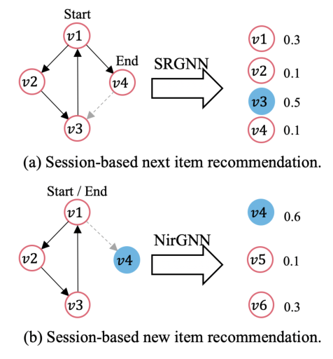
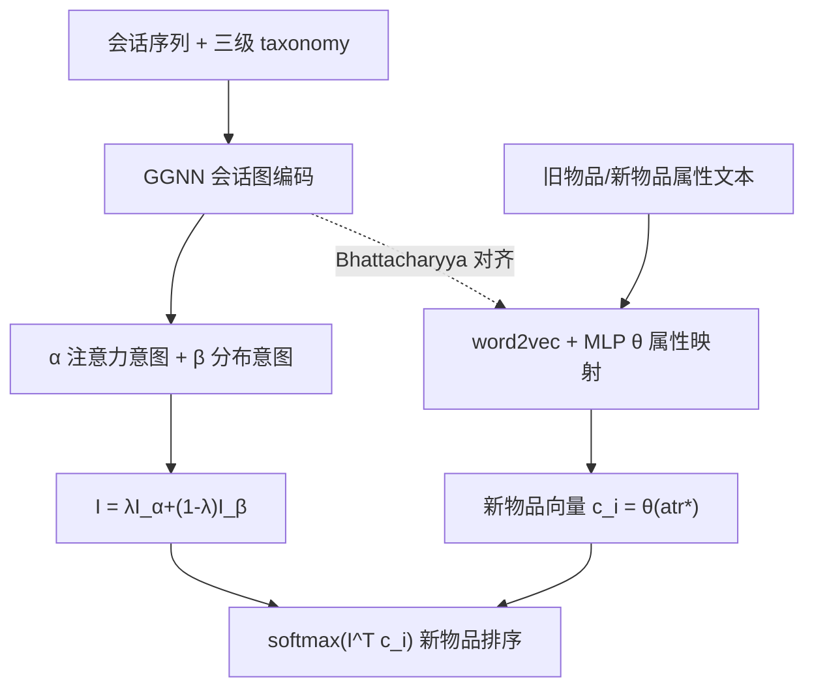
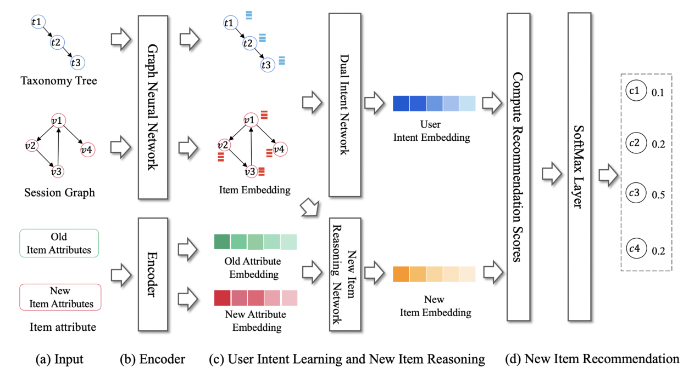

# Dual Intent Enhanced Graph Neural Network for Session-based New Item Recommendation (双意图增强图神经网络用于会话式新物品推荐)

- **会议/期刊**: WWW 2023 (The Web Conference)
- **作者与机构**: Di Jin, Luzhi Wang (天津大学), Yizhen Zheng, Shirui Pan (Monash/Griffith), Guojie Song (北大), Fei Jiang 等 (美团)
- **推荐链路定位**: 召回（会话级候选新物品重打分）
- **研究方向**: 冷启动与长尾推荐 / 序列与会话推荐
- **论文原文**: [https://arxiv.org/abs/2305.05848v1](https://arxiv.org/abs/2305.05848v1)
- **开源代码**: [https://github.com/Ee1s/NirGNN](https://github.com/Ee1s/NirGNN)

## TL;DR (1分钟核心速览)

现有 GNN 会话推荐（SR-GNN/GC-SAN/GCE-GNN）的输出空间被强行限制在会话内已交互的旧物品上，无交互记录的新物品既进不了会话图、也学不到 embedding，形成信息茧房。本文定义 **GSNIR**（GNN Session-based New Item Recommendation）新任务：输入历史会话、输出候选**新物品**排序。NirGNN 用「注意力 α 意图 + β 分布意图」模拟用户"选品类还是选单品"的决策，并用零样本学习由物品属性 MLP 推理出 GNN 空间中的新物品向量。在自建的 Amazon G&GF 与 Yelpsmall 上，P@20 相对最优基线提升 19.33%、MRR@20 提升 3.28%（Yelpsmall MRR@20 +38.40%）。

## Background & Motivation (背景与核心矛盾)

- **主流范式**: 会话推荐普遍把 session 建成有向图，用 GGNN/自注意力编码物品与用户偏好，再对**会话内出现过的物品**打分（SR-GNN 输入 $v_1..v_4$就只输出$v_1..v_4$ 的概率）。
- **前人局限**: ① 输出空间被会话物品锁死，无法推荐新物品，用户体验收敛为信息茧房；② 新物品在会话图中无节点、无连边，GNN 的拓扑传播机制直接失效，无法生成 embedding。
- **核心洞察 (Key Insight)**: 用户面对新物品时并非无迹可循——他要么在同品类（taxonomy 子树）中找替代品（可口可乐→椰汁），要么在同类单品中找替代品（可口可乐→百事）。因此意图需在「物品本体」与「品类」两个粒度上同时刻画；而新物品虽无交互，却有属性（品牌、价格）可做零样本语义桥接。
- **本文切入点**: 把"新物品推荐"重构为「双粒度意图估计 + 属性→embedding 空间映射」两段式问题，从而绕开会话图不可包含新节点的结构性障碍。

<figure class="paper-figure" markdown="span">
  <figcaption>图1：基于会话的下一物品推荐与GSNIR的区别。虚线指向真实物品。在(a)中，会话为 𝑣1 →𝑣2 →𝑣3 →𝑣1 →𝑣4，且 𝑣3 是真实物品。SR-GNN计算每个物品被用户喜欢的概率。在(b)中，𝑣1、𝑣2、𝑣3 是旧物品，𝑣4、𝑣5、𝑣6 是候选新物品，其中 𝑣4 是真实新物品。NirGNN计算用户对每个候选新物品的选择概率。</figcaption>
</figure>

## Method (核心方法设计)

### 1. 整体框架 (Overall Architecture)

模型双流并行：**流一（图侧）** 将会话构造成出入度归一化的邻接矩阵（同 SR-GNN），每个物品额外拼接三级 taxonomy 嵌入 $t_i=W(t_{i1},t_{i2},t_{i3})$，经 GGNN 编码得到物品向量$v_i$；随后 α 意图（软注意力）与 β 意图（Beta 分布采样加权重标定）按$\lambda$加权融合为用户总意图$I$。**流二（语义侧）** 将旧物品与新物品的属性文本经 word2vec 编码为$atr_i$，用共享 MLP$\theta$学习"属性空间→图嵌入空间"的映射，并以 Bhattacharyya 距离约束$\theta(atr_i)\approx v_i$，从而推理出新物品向量$c_i=\theta(atr_i^*)$。最终以$I^\top c_i$ 打分排序候选新物品，端到端训练。

<figure class="paper-figure" markdown="span">
  <figcaption>图3：NirGNN概览。在输入的第一部分(a)中，每个物品的分类树和会话图被输入GNN编码器(b)以获得表示，随后(c)从注意力和数据分布的角度学习用户的双重意图。在输入的第二部分(a)中，会话图中物品的属性和新物品属性被输入词嵌入编码器(b)。然后，可学习每个物品的语义信息。通过新物品推理网络(c)，学习到的语义信息被用于推断新物品嵌入</figcaption>
</figure>

### 2. 关键设计拆解 (Key Designs)

1. **双意图网络（α 注意力意图 + β 分布意图）**：单一注意力易被"最近重复购买"带偏、且 taxonomy/属性常缺失，仅靠注意力意图不足以覆盖行为多样性。α 意图在拼接 taxonomy 后做软注意力，并把最后交互物品 $v_n$ 作为查询先验注入：
$I_\alpha=\sum_{i=1}^{n}\sigma\big((v_i\oplus t_i)W_1+(v_n\oplus t_n)W_2\big)(v_i\oplus t_i)$；
β 意图则把 $v_i$与$t_i$视为一对二项似然的共轭先验，用 Beta 分布采样出"用户偏好单品还是偏好品类"的概率$b_i$，再按$v_i'=b_i(v_i\oplus t_i)+b_n(v_n\oplus t_n)$重加权并重新标准化为$\beta_i$，得到$I_\beta=\sum_i (v_i\oplus t_i)\beta_i$。直觉：α 抓"最近+品类"的显式偏好方向，β 用共轭后验在信息不完整时给出概率化的粒度选择，两者互补。

2. **零样本新物品推理（属性→图空间映射）**：新物品不在会话图内，无法用拓扑编码，故借鉴 ZSL 学习跨空间变换 $\theta$（MLP），并以改进 Bhattacharyya 距离约束语义推理向量与原图嵌入的一致性：
$L_{zero}(v_i,v_i^*)=-\log\sqrt{v_i\cdot v_i^*}$（当$v_i\cdot v_i^*\neq\varnothing$）。
该距离给出两离散分布可分性的最小错误率上界，故用它对齐比 MSE/余弦更贴合"分布可分"的排序目标。

3. **训练目标、负采样与推理效率**：总损失
$\mathcal{L}=\gamma\mathcal{L}_{ce}(Z,\hat{Z})+(1-\gamma)\sum_{i=1}^{n}L_{zero}(v_i,\theta(atr_i))$，
其中 $\hat{Z}_i=\mathrm{softmax}(I^\top c_i)$。候选集即新物品集合，采用 softmax 全候选择优（无显式负采样）；新物品向量推理只需一次 MLP 前向，无需重训图编码器，故新物品上架可实时接入。

## Experimental Setup & Evaluation Protocol (实验设置与评估协议)

- **数据集与预处理**: 作者自建两个面向 GSNIR 的数据集（Amazon 2018 子集含层级 taxonomy；Yelp 的 taxonomy 是用 word2vec + K-Means++ 三级聚类**人工合成**的）：

| 数据集 | #Items | #Train Sessions | #Test Sessions | 平均会话长度 | 特征/场景说明 |
| :--- | :---: | :---: | :---: | :---: | :--- |
| Amazon G&GF | 18,889 | 51,958 | 37,813 | 8.394 | 食品杂货，含品牌/价格属性与原生三级 taxonomy |
| Yelpsmall | 14,726 | 19,035 | 2,311 | 4.666 | 6,000 用户 2016 年点评，taxonomy 由聚类生成 |

- **数据划分与防穿越 (Splitting Strategy)**: **全局时间戳切分**——7 天前的会话为训练集、7 天后的会话为测试集；并采用「末位物品作为 ground-truth 新物品、从会话中删除并按时间重连」的构造，保证该物品对用户首次出现（严格零交互）。
- **排名评测协议 (Ranking Protocol)**: 候选集为**候选新物品集合**（非会话内旧物品），输出 Top-$k$排序；报告$P@10/P@20/MRR@10/MRR@20$（百分数），并给出 5 次运行的$\pm$ 标准差。**未明确报告候选集规模与是否采样**，属于协议披露不足。
- **对比基线与超参设置**: 5 个 SOTA：SR-GNN、SR-GNN-ATT、GC-SAN、GCE-GNN、COTREC（均在"新物品候选集"上重打分）；关键超参 $\lambda$（双意图权重）与$\gamma$（CE 与$L_{zero}$权重），敏感性实验显示$\gamma=0.3$最优，$\lambda$ 在 0.1–0.9 间波动但组合恒优于单意图。未报告显著性检验。

## Key Experimental Results (实验关键数据)

### 1. 主实验对比 (Main Results)

| 方法 | Ama. P@20 | Ama. MRR@20 | Ama. P@10 | Ama. MRR@10 | Yelp P@20 | Yelp MRR@20 | Yelp P@10 | Yelp MRR@10 |
| :--- | :---: | :---: | :---: | :---: | :---: | :---: | :---: | :---: |
| SR-GNN | 1.438 | 0.336 | 0.086 | 0.297 | 0.764 | 0.192 | 0.476 | 0.180 |
| SR-GNN-ATT | 0.678 | 0.157 | 0.375 | 0.136 | 1.631 | 0.410 | 0.989 | 0.366 |
| GC-SAN | 2.028 | 0.580 | 1.288 | 0.529 | 0.793 | 0.174 | 0.418 | 0.165 |
| GCE-GNN | 1.650 | 0.478 | 1.053 | 0.441 | 1.702 | 0.789 | 1.428 | 0.776 |
| COTREC | 1.681 | 0.434 | 1.078 | 0.393 | 0.833 | 0.256 | 1.021 | 0.269 |
| **NirGNN** | **2.420** | **0.599** | **1.578** | **0.543** | **1.817** | **1.092** | 0.779 | 0.299 |
| Improv. | +19.33% | +3.28% | +22.52% | +2.65% | +6.75% | +38.40% | — | — |

### 2. 消融实验 (Ablation Study)

| 变体 (Amazon G&GF) | P@20 | MRR@20 | P@10 | MRR@10 |
| :--- | :---: | :---: | :---: | :---: |
| NirGNN 全模型 | **2.420** | **0.599** | 1.578 | **0.543** |
| w/o α intent | 2.410 | 0.596 | 1.508 | 0.538 |
| w/o β intent | 2.375 | 0.589 | 1.512 | 0.538 |
| w/o $L_{zero}$ | 2.237 | 0.598 | **1.599** | 0.541 |

### 3. 关键实验发现 (Key Findings)

1. **零样本推理损失是主引擎**：去掉 $L_{zero}$ 后 P@20 从 2.420 掉到 2.237（-7.6%），但 P@10 反而微升（1.599），说明属性对齐主要改善 Top-10 之后"语义合理但拓扑无关"的新物品排序，而 Top-10 头部仍由双意图主导——两者分工明确。
2. **β 分布意图贡献大于 α 注意力意图**：单去 β 掉 1.9%（2.375），单去 α 仅掉 0.4%（2.410），且 $\lambda$ 扫描全程波动却始终劣于组合，印证"单品粒度 vs 品类粒度"是互补而非冗余信号，共轭先验在 taxonomy 不完整时提供了注意力拿不到的分布视角。
3. **稀疏短会话放大收益、也放大绝对值困境**：Yelpsmall 平均长度仅 4.67，MRR@20 提升 38.40%（0.789→1.092）远高于 P@20 的 6.75%，说明短会话下模型能把真值推得更靠前但 Top-20 命中率本身极低（全场 P@20 ≈ 2.4%），任务仍远未解决；同时 $\pm$ 标准差（如 SR-GNN ±0.534）显示基线在候选新物品上的方差极大，单次跑分易受随机性干扰。

## Highlights & Limitations (亮点、对比与审稿批判)

- **与代表作对比 (vs. Prior Work)**: 与 SR-GNN / GC-SAN / GCE-GNN 的本质差异在于**输出空间重定义**——它们只在会话内旧物品上做 softmax，本文把候选集替换为新物品并额外注入属性语义流；与 COTREC 的对比则是自监督增广解决的是稀疏性，而非"图不可编码"的结构性缺失。相对冷启动元学习路线（如 Zhu 等的 meta scaling/shifting 需少量交互 warm-up），本文是**严格零交互**的 ZSL 设定，更贴近新品上架首日场景。
- **可迁移亮点**: ① 用 Beta 共轭后验对"本体 vs 上位概念"两个粒度做概率化重加权，可迁移到品类/品牌级多粒度召回；② 以 Bhattacharyya 距离作为跨空间嵌入对齐损失（替代 MSE），在需要保持分布可分性的零样本映射任务中更合适。
- **审稿级局限批判**: ① **评估协议披露不完整**——候选集 $C$规模、是否为全库未交互物品、是否采样均未说明，各基线在新候选集上的重打分实现细节缺失，横向可比性存疑；② β 分布的引入以"用户日行为是二项分布"作类比，公式（3）缺少推导与消融上的必要性论证，$\lambda/\gamma$ 双超参敏感且组合增益仅 1–2 个百分点；③ 两个数据集均为自建（Yelp taxonomy 由 K-Means 合成），无公开 benchmark、无显著性检验，且线上仅做了单会话 case study 而非 A/B，工业价值仍待验证。

## Rating (四维评分)

- **方法创新性 (Novelty)**: ⭐⭐⭐⭐ （首次形式化 GSNIR 任务，双粒度意图 + ZSL 属性推理的组合有新意，但 β 分布的理论动机偏"类比式"论述）
- **评估协议与实验扎实度 (Protocol & Experiments)**: ⭐⭐ （自建两数据集、时序切分合理且给出标准差，但候选集与打分协议未明、缺显著性检验与公开基准）
- **写作与数学规范度 (Clarity & Rigor)**: ⭐⭐⭐ （整体框架图清晰、公式齐全，但 β 分布相关公式符号略含混、近似 Bhattacharyya 距离的 $\varnothing$ 条件写法欠严谨）
- **工业落地与复现价值 (Industrial & Practical Value)**: ⭐⭐⭐ （代码开源、新物品推理仅一次 MLP 前向可实时接入，但依赖高质量三级 taxonomy 与属性，且线上验证仅单例 case study）

