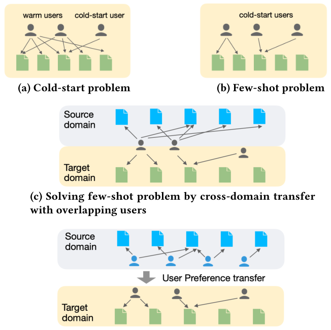
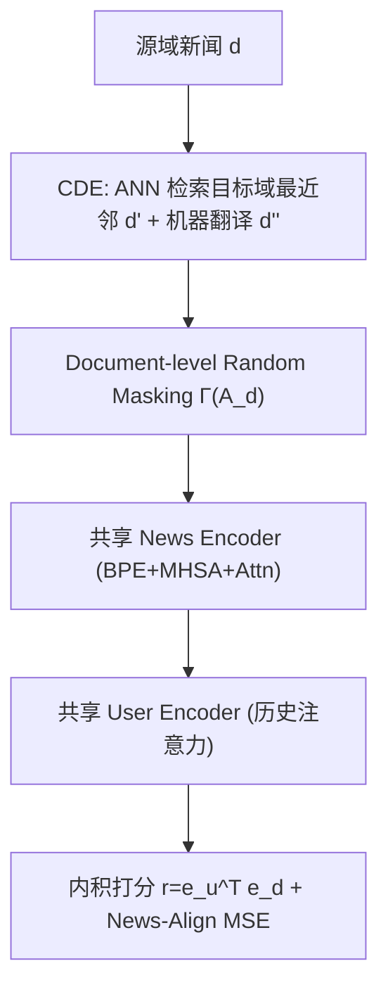
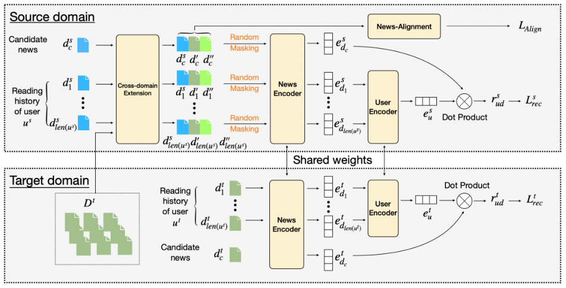

# Few-shot News Recommendation via Cross-lingual Transfer (跨语言迁移的少样本新闻推荐)

- **会议/期刊**: WWW 2023 (The ACM Web Conference)
- **作者与机构**: Taicheng Guo, Lu Yu, Basem Shihada, Xiangliang Zhang (University of Notre Dame / Ant Group / KAUST)
- **推荐链路定位**: 召回—候选新闻偏好打分（新闻表征 + 用户表征双塔内积）
- **研究方向**: 冷启动与长尾推荐 / 跨域与多场景推荐
- **论文原文**: [https://arxiv.org/abs/2207.14370v2](https://arxiv.org/abs/2207.14370v2)
- **开源代码**: [https://github.com/taichengguo/Few-shot-NewsRec](https://github.com/taichengguo/Few-shot-NewsRec)

## TL;DR (1分钟核心速览)

本文瞄准比常规冷启动更极端的 **few-shot 场景**：目标域没有任何暖用户，全部 200 个用户每人只有 2–4 条交互，且源域与目标域 **无重叠用户、无重叠新闻、语言不同**（英语 MIND ↔ 挪威语 Adressa）。作者以 NRMS 为基座，用"跨域扩展（检索目标域相似新闻 + 机器翻译）、文档级随机掩码、新闻表征对齐 MSE"三招把两域压进同一表征空间，迁移用户主题偏好。在 1 正 + 4 负的 AUC 评估下，MIND→Adressa 的 0/2/4-shot 相对最强基线提升 4.69% / 3.90% / 7.69%。

## Background & Motivation (背景与核心矛盾)

- **主流范式**: 冷启动推荐普遍"借暖用户推冷用户"；元学习（MAML 类）或跨域迁移则假设两域存在重叠用户/物品作为知识桥梁。
- **前人局限**: ① 无暖用户时（全站早期平台）前两类方法直接失效；② 无重叠用户时跨域迁移无从搭桥；③ TDAR 等域适应方法需要两域都数据充足且主题高度重叠，而 MIND(2020) 与 Adressa(2017) 存在显著时间与内容漂移。
- **核心洞察 (Key Insight)**: 多语言 PLM 只在 token 级对齐文本，编码出的新闻只反映"内容"，不反映"被用户点击的吸引力"；因此真正的桥不是文本，而是**共享主题下的用户偏好模式**——两域新闻类目确有重叠（general/financial/home），偏好可跨语言迁移。
- **本文切入点**: 不用重叠用户，而是用"跨域新闻增广 + 共享编码器"在训练时**伪造源域用户在目标域的交互**，从而对齐用户表征而非仅仅对齐文本。

<figure class="paper-figure" markdown="span">
  <figcaption>图 1：问题定义与解决方案示意图。(a) 冷启动问题：系统中存在大量暖用户时，预测冷启动用户的偏好。(b) 少样本问题：没有暖用户可用时，预测冷启动用户的偏好。(c)/(d) 在两个域之间有/无重叠用户的情况下，通过跨域迁移解决少样本问题。</figcaption>
</figure>

## Method (核心方法设计)

### 1. 整体框架 (Overall Architecture)

源域新闻 $d\in D_s$先经 CDE 模块离线扩充为$A_d=\{d,d',d''\}$（$d'$为目标域语义最近邻新闻，$d''$为译为目标语言的版本）；训练时 Document-level Random Masking 从$A_d$中随机保留一条送入 **两域共享**的多语言 News Encoder（BPE + MHSA + Attention），再由共享 User Encoder 对（被同样掩码过的）阅读历史做注意力聚合成$e_u$；打分用$r_{ud}=e_u^{\top}e_d$，并叠加 News-Alignment 的 MSE 约束。源/目标域推荐损失与对齐损失联合训练，推理阶段仅保留共享双塔，无额外开销。

<figure class="paper-figure" markdown="span">
  <figcaption>图 3：我们提出方法的框架。</figcaption>
</figure>

### 2. 关键设计拆解 (Key Designs)

1. **Cross-domain Extension（CDE，造桥）**: 痛点是无重叠新闻导致两域毫无锚点。做法：用多语言 DistilBERT 句向量 + Hnswlib 近似最近邻，为每条源新闻检索目标域最相似新闻，并设相似度阈值 $\tau$过滤无关项；再用 Google Translate 得到目标语言改写。$\mathcal{A}_d=\{d,\ d'=\mathrm{ANN}(d,D_t),\ d''=\mathrm{Translate}(d)\}$。直觉：把**真实目标域新闻**（含其被点击语义）注入源域训练样本，弱化语言偏移与内容偏移双重 gap。

2. **Document-level Random Masking（RM，混合双域交互）**: 痛点是若只用 $d$训练，编码器永远只见过源域分布。做法：每次迭代对样本中**每条新闻（历史与候选都算）**从$A_d$随机保留一条，$e_d=\phi(\Gamma(\mathcal{A}_d))$，$e_u=\mathrm{Attention}([\phi(\Gamma(\mathcal{A}_{d_1})),\dots])$。这是类比 code-switch 的"文档级"操作：不删任何原始交互（无偏好失真），却让源域用户虚拟地读到目标域新闻，反向也把目标域用户拉近到源域新闻。

3. **News-Alignment 与训练目标**: 翻译噪声会让 $d''$偏离，故显式拉近三者：$\mathcal{L}_{Align}=\sum_{d\in D_s}\mathrm{MSE}(e_d,e_{d'})+\mathrm{MSE}(e_d,e_{d''})$。总损失$\mathcal{L}=\alpha\mathcal{L}_{Align}+\beta\mathcal{L}_{s,rec}+\mathcal{L}_{t,rec}$，其中$\mathcal{L}_{rec}=-\sum_{(u,C)}\sum_{i\in C^{+}}\log\frac{\exp(r^{+}_{ui})}{\exp(r^{+}_{ui})+\sum_{j=1}^{4}\exp(r^{-}_{uj})}$（每条正样本配 4 个均匀随机负样本，免硬负采样）。$\alpha=1,\beta=0.2$；零样本时置$\mathcal{L}_{t,rec}=0$，框架天然兼容 zero/few-shot。

## Experimental Setup & Evaluation Protocol (实验设置与评估协议)

- **数据集与预处理**:

| 域 | #Users | #Items(News) | #Interactions | 密度 | 说明 |
| :--- | :---: | :---: | :---: | :---: | :--- |
| MIND (源, 英) | 10,000 | 31,099 | 1,083,619 | ~0.35% | MSN 2020，主题广（体育/综合为主） |
| Adressa (源, 挪) | 10,000 | 2,097 | 22,700 | ~0.11% | Adresseavisen 2017，本地新闻占多数 |
| 目标域 few-shot 训练 | 200 | — | 400 (2-shot) / 800 (4-shot) | — | 随机抽 200 用户各 2 或 4 条交互 |
| 目标域测试 | 837–2194 | — | 1,278–4,674 | — | Adressa 取 1/7 当日，MIND 取 dev |

- **数据划分与防穿越**: 双向迁移（MIND→Adressa 与 Adressa→MIND）；目标域按**用户比例划分**（40% 验证 / 60% 测试，Adressa 以 2017-01-07 单日交互为池），并强制 few-shot 训练样本中的新闻**发布时间早于测试集日期**，避免时间穿越。
- **排名评测协议**: 主要指标 **AUC**（点式打分，正样本 vs. 随机负样本的 pairwise 排序正确率），另在附录报告 MRR/NDCG@5/NDCG@10；**未使用 Full-Ranking 全库排序**，训练与评测负样本均为随机采样。
- **对比基线与超参**: 基线含 NRMS（仅目标域）、ZERO-SHOT(Source+Target)、Trans.-Align(Trans.+Target)、Trans.-Align(Source+Trans.)、Bilingual(Source+Trans.+Target)、TDAR；$d=300$，batch=80，Adam，20 epoch，学习率 3e-4（M→A）/1e-4（A→M），$\alpha,\beta$ 网格搜索，各实验 5 次取 mean±std。

## Key Experimental Results (实验关键数据)

### 1. 主实验对比 (Main Results)

| 方法 (AUC) | M→A 0-shot | M→A 2-shot | M→A 4-shot | A→M 0-shot | A→M 2-shot | A→M 4-shot |
| :--- | :---: | :---: | :---: | :---: | :---: | :---: |
| NRMS (Only Target) | 0.482 | **0.564** | 0.542 | 0.506 | 0.507 | 0.490 |
| ZERO-SHOT (Src+Tgt) | 0.512 | 0.549 | 0.529 | 0.522 | 0.528 | 0.520 |
| Trans.-Align (Trans.+Tgt) | 0.504 | 0.551 | 0.538 | **0.523** | 0.533 | 0.509 |
| Trans.-Align (Src+Trans.) | 0.495 | 0.529 | 0.534 | 0.522 | **0.533** | 0.526 |
| Bilingual (Src+Trans.+Tgt) | 0.505 | 0.539 | **0.546** | 0.518 | 0.528 | 0.513 |
| TDAR | — | 0.509 | 0.507 | — | 0.498 | 0.515 |
| **Ours (RM)** | 0.521 | 0.570 | 0.574 | **0.542** | 0.535 | **0.532** |
| **Ours (RM + News-Align)** | **0.536** | **0.586** | **0.588** | 0.540 | **0.537** | 0.531 |
| **Improv.% (vs. best base)** | **+4.69%** | **+3.90%** | **+7.69%** | **+3.63%** | **+0.75%** | **+1.14%** |

### 2. 消融实验 (Ablation Study)

| 组件组合 (MIND→Adressa 4-shot, AUC) | 无目标域新闻 $d'$| 有目标域新闻$d'$ |
| :--- | :---: | :---: |
| 最佳基线 Bilingual | \multicolumn{2}{c}{0.546} |
| + Random Masking | 0.558 | 0.574 |
| + News-Alignment | 0.559 | 0.559 |
| + RM + News-Alignment | 0.569 | **0.588** |

### 3. 关键实验发现 (Key Findings)

1. **源域知识量决定迁移上限**：MIND→Adressa 增益（4.69%/3.90%/7.69%）远高于反向（3.63%/0.75%/1.14%）。源域 1.08M 交互、31k 新闻、主题覆盖广，才撑得起对齐；反向仅 22.7k 交互、2.1k 本地新闻，可迁移的偏好模式本就稀薄。
2. **$d'$是真正的桥，NA 依赖它**：有$d'$时 RM+NA 从 0.569 升至 0.588（+3.3%）；无$d'$ 时单加 News-Alignment 仅 0.559，几乎与基线持平——说明仅对"翻译文本"做对齐收益有限，必须引入**真实目标域新闻**参与交互模拟。UMAP 可视化亦显示本文把两域用户嵌入显著拉近。
3. **增益随目标域数据量单调衰减**：目标域训练用户从 500→4500 时，优势在 500/1500/2500 区间最大，用户数上升后基线追赶（域迁移边际收益递减的经典曲线）；换 MultilingualBERT 编码器后基线提升更多，本文仍全面领先，说明收益来自域对齐策略而非编码器容量。

## Highlights & Limitations (亮点、对比与审稿批判)

- **与代表作对比**: 相对 ZERO-SHOT / Translate-then-align / Bilingual 等"翻译改写 + 文本级对齐"路线，本文在**文档级**混合双域新闻并显式对齐**用户偏好表征**，把对齐对象从文本搬到用户；相对 TDAR，无需两域数据充足或主题强重叠。
- **可迁移亮点**: ① "增广集 + 随机替换输入"的文档级掩码可直接搬到跨域序列推荐/多语言 CTR，实现零额外推理开销的域混合；② 用 ANN 检索同义物品作为跨域锚点，可替代对重叠用户的依赖。
- **审稿级局限批判**: ① 评测仅用 **1 正 + 4 随机负的 AUC**，未做 Full-Ranking，负样本分布与候选规模未统一，绝对数值（多处 <0.6）说服力受限；② 离线依赖 Google Translate + 多语言 DistilBERT + Hnswlib，翻译质量与阈值 $\tau$的影响未量化（仅附录曲线），且$\alpha,\beta$ 网格搜索成本高；③ few-shot 仅固定 200 用户，2-shot→4-shot 在 A→M 上反而下降，shot 数敏感性未被充分解释；④ 对两域均未出现过的突发新闻无解。

## Rating (四维评分)

- **方法创新性 (Novelty)**: ⭐⭐⭐⭐ （首次在无重叠用户/新闻的跨语言设定下解 few-shot 新闻推荐，"文档级随机掩码 + 跨域新闻检索"思路简洁且非平凡）
- **评估协议与实验扎实度 (Protocol & Experiments)**: ⭐⭐⭐ （双向迁移 + 5 次重复 ± std + 消融较完整，但仅 AUC/采样负样本评估、few-shot 规模单一，说服力打折）
- **写作与数学规范度 (Clarity & Rigor)**: ⭐⭐⭐⭐ （问题定义与三模块动机链条清晰、公式紧凑；部分模块符号复用 $e'_d$/$e''_d$与$d'$/$d''$ 略有错位）
- **工业落地与复现价值 (Industrial & Practical Value)**: ⭐⭐⭐⭐ （代码开源、CDE 全离线预处理、推理零额外开销，对小语种/早期平台冷启动极具实用价值，但强依赖翻译服务）

