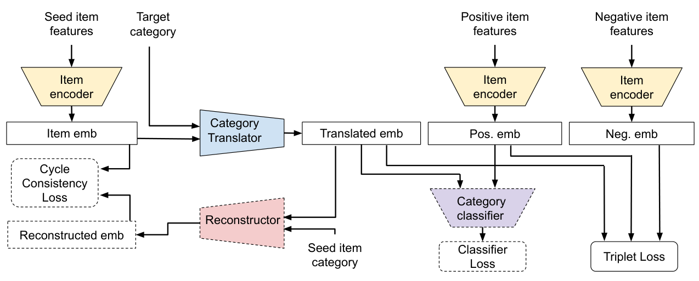
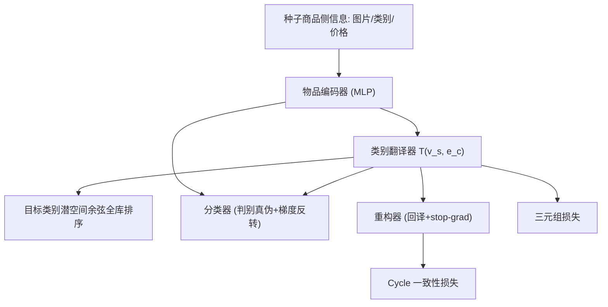
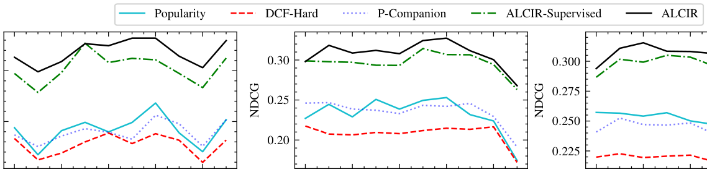

# Semi-supervised Adversarial Learning for Complementary Item Recommendation (面向互补商品推荐的半监督对抗学习)

- **会议/期刊**: The Web Conference 2023 (WWW '23)
- **作者与机构**: Koby Bibas (Meta)、Oren Sar Shalom (Amazon)、Dietmar Jannach (University of Klagenfurt)
- **推荐链路定位**: 召回（商品详情页互补品候选生成）
- **研究方向**: 冷启动与长尾推荐 / 多模态推荐
- **论文原文**: [https://arxiv.org/abs/2303.05812v1](https://arxiv.org/abs/2303.05812v1)
- **开源代码**: [https://fb.me/cgan_ccomplementary_item_recommendation](https://fb.me/cgan_ccomplementary_item_recommendation)

## TL;DR (1分钟核心速览)

在 eBay/Facebook Shops 这类商品目录极度易变的场景中，新上架种子商品（seed item）没有共购统计，无法用协同信号做"搭配购买"推荐。本文提出 ALCIR：为**每个商品类别维护一个独立潜空间**，用三元组损失学习把种子商品表示"翻译"到目标类别的潜空间，再用 CycleGAN 式的分类器 + 重构器做**半监督对抗训练**，从而在只有少量标注互补对、甚至稀有类别完全无标签时仍能学到有效翻译。三个 Amazon 子集上，类别已知时 NDCG 相对最强基线提升 24%–33%，类别未知时提升更显著（+28%–44%）。

## Background & Motivation (背景与核心矛盾)

- **主流范式**: 电商互补品推荐（"Frequently bought together"）依赖共购/共浏览统计做 item-based 或双塔式相似度估计；冷启动场景则退回用商品侧信息（标题、图片、价格、类目）学习相似度函数，代表作 DCF 与 P-Companion。
- **前人局限 1**: DCF 把种子与目标商品送进**同一个编码器**并输出标量相似度，模型无法区分"互补（裤子配衬衫）"与"替代（另一件衬衫）"，且不控制推荐商品必须来自目标类别。
- **前人局限 2**: P-Companion 只按类别重加权同一套嵌入的维度，不建立类别专属空间；两者都要求**全监督**，对稀有类别（数据仅十余件的类别对）标注稀缺直接失效，而本文数据中每类别平均仅 100–165 件商品、类别对标注高度长尾。
- **核心洞察 (Key Insight)**: 互补关系本质是一次**跨类别的域迁移**——衬衫可以没有交互数据，但"衬衫→裤子"这一类别级搭配关系可以由其他商品的标注对聚合得到；因此可把问题拆成"类别级关系（易得）+ 商品级翻译（需学）"。
- **本文切入点**: 用统一翻译网络 + 类别条件潜空间实现跨域映射，并引入 CycleGAN 的双向一致性约束，让**无标注商品**也参与训练。

## Method (核心方法设计)

### 1. 整体框架 (Overall Architecture)

输入种子商品 $s$及其目标类别$c$：物品编码器把图片（ResNet152 冻结特征）、类别特征、分箱后的价格等拼接后经 MLP 得到$v_s$；类别翻译器把$v_s$与目标类别嵌入$e_c$拼接再经 MLP 得到$v_s^c$，即"在裤子空间里造出的伪裤子"。推荐时只在目标类别$I_c$内按余弦相似度排序。训练侧有两路：三元组监督损失拉动$v_s^c$靠近正样本、推远同类别负样本；对抗侧由分类器判别"该向量是否真的是类别$c$的商品表示"、重构器把$v_s^c$ 译回原类别以保风格/价位等性状。两者加权联合端到端训练，推理时对抗分支完全丢弃。

<figure class="paper-figure" markdown="span">
  <figcaption>图1：所提出模型的架构。带虚线的元素是对抗学习网络的一部分。</figcaption>
</figure>

### 2. 关键设计拆解 (Key Designs)

1. **类别专属潜空间 + 条件翻译器**：解决"同空间编码无法区分互补与替代"。为每类别 $c$保一套嵌入，翻译器$T$接收$(v_s, e_c)$输出$v_s^c$，检索时$\hat{i}=\arg\max_{i\in I_c}\cos(v_s^c, v_i)$。由于候选集被限制在由类别级标注对聚合得到的互补类别集合内，既排除同类别替代品，又把全库排序压缩到单类别（推理成本近似线性于类别规模）。关键在于**同一商品在不同目标类别下有不同表示**，从结构上而非损失上约束"跨类别"性质。
2. **CycleGAN 式半监督对抗分支**：解决稀有类别标注稀缺。分类器以 $v$预测类别，$\mathcal{L}_{cls}=-\log p(c\mid v)$；重构器$R(\cdot)$把$v_i^c$译回原类别得$v_i'$，$\mathcal{L}_{cyc}=\|v_i-\mathrm{sg}(v_i')\|_2^2$（对$v_i$ 停梯度，避免编码器与翻译器串谋坍缩到常数解）。两个工程细节决定成败：分类器对真实编码输出的梯度**不回流编码器**（否则编码器退化为直接输出类别嵌入）；对翻译输出则接**梯度反转层**，翻译器"骗"分类器、分类器反向对抗。直觉：分类器只保证"看起来像裤子"，重构器才保证"还是那件衬衫的风格"。
3. **训练目标、负采样与推理**：三元组损失 $\mathcal{L}_{tri}=\max\big(d(v_s^c,v_p)-d(v_s^c,v_n)+\alpha,0\big)$，距离$d$取负余弦，负样本与正样本同类别均匀采样（非全库采样，即隐式 hard negative）。总损失$\mathcal{L}=\mathcal{L}_{tri}+\lambda_1\mathcal{L}_{cyc}+\lambda_2\mathcal{L}_{cls}$（凸组合权重）。训练时间线性于标注对与商品-类别对数量，参数量线性于类别数；推理仅编码器 + 翻译器一次前向。

## Experimental Setup & Evaluation Protocol (实验设置与评估协议)

- **数据集与预处理**: Amazon 三个子集，剔除含商品数 < 5 的类别，价格等深分 20 箱：

| 数据集 | #Items | #Item Pairs | #Categories | #Category Pairs | 稀疏度/密度 | 特征/场景说明 |
| :--- | :---: | :---: | :---: | :---: | :---: | :--- |
| Clothing | 14,591 | 53,375 | 126 | 4,621 | 标注对/商品≈3.7 | 服装鞋饰，视觉风格主导 |
| Toys | 20,510 | 112,964 | 124 | 5,734 | ≈5.5 | 玩具游戏，类别内商品极不均衡（最大 2,558） |
| Home | 29,258 | 162,497 | 286 | 18,999 | ≈5.6 | 家居家装，类目最细最多 |

- **标注构造**: 由 "frequently bought together" 列表剔除同类别项得到互补对 $(s,r_i)$，允许非对称（笔记本→充电器成立，反向不成立）。
- **数据划分与防穿越 (Splitting Strategy)**: **冷启动划分**——80%/10%/10% 随机划分，且强制验证集与测试集的种子商品**不出现在训练集中**，直接模拟新上架商品。
- **排名评测协议 (Ranking Protocol)**: 类别感知设定下为目标类别内 **Full-Ranking（全类别商品排序，非采样）**；另设"类别未知"设定，在各互补类别间轮询取 top-k 拼成列表。指标 NDCG、HR@{1,5,10} 与 Catalog Coverage@10（覆盖率为提升多样性/避免只推爆款而设）。
- **对比基线**: Popularity、DCF、DCF-Hard（作者自实现的硬负采样变体）、P-Companion（去掉协同信息以适配冷启动）；嵌入维度等超参逐数据集手工调优，最优值公开于代码库。

## Key Experimental Results (实验关键数据)

### 1. 主实验对比 (Main Results)

| Dataset | Method | NDCG | HR@1 | HR@5 | HR@10 | Cov.(%) |
| :--- | :--- | :---: | :---: | :---: | :---: | :---: |
| Clothing | Popularity | 0.238 | 0.051 | 0.153 | 0.234 | 6.99 |
| Clothing | DCF | 0.211 | 0.011 | 0.059 | 0.111 | 7.24 |
| Clothing | DCF-Hard | 0.226 | 0.019 | 0.083 | 0.147 | 40.49 |
| Clothing | P-Companion | 0.238 | 0.030 | 0.102 | 0.169 | 84.59 |
| Clothing | ALCIR-Sup | 0.298 | 0.074 | 0.203 | 0.302 | 89.92 |
| Clothing | **ALCIR** | **0.316** | **0.092** | **0.233** | **0.332** | 88.50 |
| Toys | Popularity | 0.231 | 0.038 | 0.126 | 0.200 | 5.13 |
| Toys | P-Companion | 0.235 | 0.028 | 0.104 | 0.172 | 93.78 |
| Toys | ALCIR-Sup | 0.297 | 0.073 | 0.205 | 0.303 | 90.46 |
| Toys | **ALCIR** | **0.308** (+31.1% vs P-Comp) | **0.078** | **0.224** | **0.330** (+91.9%) | 82.62 |
| Home | Popularity | 0.251 | 0.048 | 0.160 | 0.255 | 8.20 |
| Home | P-Companion | 0.245 | 0.032 | 0.111 | 0.187 | 94.45 |
| Home | ALCIR-Sup | 0.296 | 0.068 | 0.197 | 0.293 | 93.44 |
| Home | **ALCIR** | **0.304** (+24.1% vs P-Comp) | **0.077** | **0.210** | **0.312** (+66.8%) | 94.38 |

类别未知设定（更接近真实详情页多类别混排）：ALCIR 的 NDCG 为 0.170 / 0.184 / 0.150（Clothing/Toys/Home），相对最强基线 DCF-Hard（0.118/0.148/0.117）提升 **+44.1% / +24.3% / +28.2%**；而 Popularity 的 HR@10 跌至 0.002–0.007，说明纯热度法在多类别混排下完全崩溃，类别条件的价值被放大。

### 2. 消融实验 (Ablation Study)

| Dataset | 变体 | NDCG (Δ vs ALCIR) | HR@10 (Δ) |
| :--- | :--- | :---: | :---: |
| Clothing | Classifier+Cycle（无标注） | 0.210 (-33.5%) | 0.114 (-65.7%) |
| Clothing | ALCIR-Sup（仅三元组） | 0.298 (-5.7%) | 0.302 (-8.9%) |
| Clothing | Triplet+Cycle | 0.311 (-1.8%) | 0.319 (-3.8%) |
| Clothing | Triplet+Classifier | 0.305 (-3.5%) | 0.306 (-7.5%) |
| Clothing | **ALCIR** | **0.316** | **0.332** |
| Toys | ALCIR-Sup / Triplet+Cycle / Triplet+Classifier | 0.297(-3.7%) / 0.294(-4.4%) / 0.298(-3.3%) | 0.303 / 0.303 / 0.309 |
| Home | ALCIR-Sup / Triplet+Cycle / Triplet+Classifier | 0.296(-2.6%) / 0.298(-2.0%) / 0.297(-2.1%) | 0.293 / 0.303 / 0.297 |

### 3. 关键实验发现 (Key Findings)

1. **对抗半监督带来的收益高度集中于稀有类别**：按"类别对标注量"十等分分箱后（图 2），ALCIR 相对 ALCIR-Sup 的优势在数据最少的前几箱最大，随标注量增加而收敛——恰好在标注最稀缺处补足，验证了 CycleGAN 分支的设计动机；在 Toys/Home 上尤为明显。
2. **两种对抗损失互补而非冗余**：去掉任一者都掉点，去掉两者（仅剩无监督）NDCG 崩至 0.21（-33.5%）；而 Triplet+Cycle 与 Triplet+Classifier 差距仅 1.8%–4.4%，说明**重构器（cycle 一致性）承担的"保性状"职责**是主要贡献，分类器提供的是类别合法性约束。
3. **精度—覆盖率的权衡被显著改善**：DCF 的覆盖率仅 5.96%–8.32%（几乎只推头部），DCF-Hard 靠类别内硬负采样拉回至 36.7%–40.5%，而 ALCIR 在 NDCG 最高的同时覆盖率 82.6%–94.4%；仅 P-Companion 覆盖率略高（Home 94.45% vs 94.38%），但 NDCG 低 0.059 绝对值。

<figure class="paper-figure" markdown="span">
  <figcaption>图2：随标注数据量变化的性能</figcaption>
</figure>

## Highlights & Limitations (亮点、对比与审稿批判)

- **与代表作对比 (vs. Prior Work)**: 与 DCF 相比，本文不再用单一编码器 + 标量相似度，而是"编码 + 类别条件翻译"分离，使互补/替代在结构上可区分；与 P-Companion 相比，本文按类别建独立潜空间而非重加权维度，且是唯一支持半监督的方案；与文献 [16] 的 GAN 式互补推荐相比，本文不生成商品、而生成**类别潜空间中的伪表示**，因此可显式控制目标类别且不需要全监督。
- **可迁移亮点**: (1) 在跨域/跨场景召回中，把"域嵌入作为条件输入给统一翻译网络"可替代 O(#域²) 的多套映射；(2) 重构损失对源表示做 **stop-gradient**、判别器梯度不回编码器，这两条"防坍缩"技巧可直接复用到任何对抗式表征对齐任务。
- **审稿级局限批判**: (1) 标注对来自共购列表，本身就偏向热销商品，冷启动种子虽无交互，但**目标类别的分布仍被热度偏置**，论文未做流行度去偏或曝光无偏估计；(2) 类别是刚性硬约束且类别翻译器统一共享，当类别数上百（Home 286 类）且类目层级粗细不一时，单一 MLP 可能欠拟合，论文未给出类别数增大的延迟/精度曲线；图像分支仅取首图 + 冻结 ResNet152，多模态融合消融缺失；三元组负采样只在同类别均匀采样，未与 batch 内负样本或课程式难负样本对比。

## Rating (四维评分)

- **方法创新性 (Novelty)**: ⭐⭐⭐⭐ （把互补推荐重构为"类别域翻译 + CycleGAN 半监督"，概念清晰且首次引入 cycle 一致性；但组件本身均为成熟模块的组合）
- **评估协议与实验扎实度 (Protocol & Experiments)**: ⭐⭐⭐⭐ （冷启动划分防泄漏、三个差异明显的 Amazon 子集、类别已知/未知双设定、覆盖率指标与数据量分箱分析齐备；缺显著性检验与多模态特征消融）
- **写作与数学规范度 (Clarity & Rigor)**: ⭐⭐⭐⭐ （损失与梯度截断/反转的动机解释到位，CycleGAN 与本文的差异逐条对照；但符号较松散，无复杂度定量分析）
- **工业落地与复现价值 (Industrial & Practical Value)**: ⭐⭐⭐⭐⭐ （训练线性于标注对、推理单次前向 + 类别级候选裁剪，与 Facebook/Instagram Shops 的类别约束实践一致，代码已开源且基线 DCF/P-Companion 复现一并放出）

