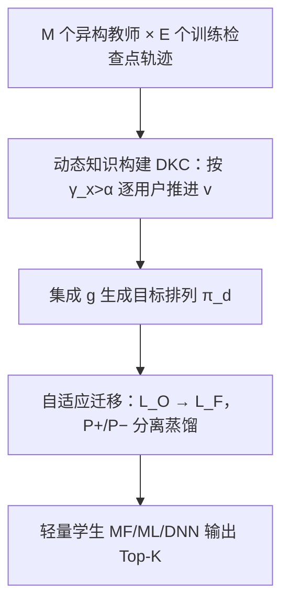

# Distillation from Heterogeneous Models for Top-K Recommendation (异构模型集成的 Top-K 推荐蒸馏)

- **会议/期刊**: WWW 2023 (The Web Conference)
- **作者与机构**: SeongKu Kang, Wonbin Kweon, Dongha Lee, Jianxun Lian, Xing Xie, Hwanjo Yu (POSTECH / 延世大学 / 微软亚洲研究院)
- **推荐链路定位**: 召回（Top-K 排序模型的推理端压缩与部署）
- **研究方向**: 协同过滤与双塔召回 / 多任务学习与列表级重排
- **论文原文**: [https://arxiv.org/abs/2303.01130v1](https://arxiv.org/abs/2303.01130v1)
- **开源代码**: [https://github.com/SeongKu-Kang/HetComp_WWW23](https://github.com/SeongKu-Kang/HetComp_WWW23)

## TL;DR (1分钟核心速览)

异构模型集成（MF/ML/DNN/GNN/AE 等多架构教师）能显著提升 Top-K 推荐精度，但推理开销随模型数线性增长，无法上线。本文发现：向异构教师做排序匹配蒸馏时，学生与教师排列的偏差（$D@K$）远大于同构蒸馏，蒸馏几乎失效；而教师训练轨迹的早期检查点恰好是"更易学的知识"。据此提出 **HetComp**：以教师轨迹为天然课程，动态构建由易到难的排列监督并按学生状态自适应切换总排序损失与观测/未观测分离损失。在 Amusic/CiteULike/Foursquare 的 MF/ML/DNN 三种学生上，R@10 相对最强基线 DCD 提升 8.1%–24.7%，参数与推理时延降低约 13–20 倍。

## Background & Motivation (背景与核心矛盾)

- **主流范式**: Top-K 推荐已从 MF 演进到 ML/DNN/GNN/AE 等异构架构；因归纳偏置不同，异构集成（Ensemble）精度远超单模型，但首个矛盾是**推理成本与模型数成正比**，实时服务不可承受。
- **前人局限**: 现有推荐蒸馏（RRD、DCD）几乎只做**同构教师**（学生与教师同类）的点式或列表式排序匹配；跨异构教师的蒸馏一旦应用，学生与教师排列的对齐度极差。
- **核心洞察 (Key Insight)**: 作者用 $D@K=1-\mathrm{NDCG}@K(\pi,\pi^t)$直接度量偏差，发现 Amusic 上异构集成蒸馏的$D@10$ 达 0.7417，而同构为 0.6640；并且**教师越训越难模仿**——教师 E1→E4 的中间检查点偏差单调增大，早期预测虽个性化弱，却已准确捕捉群体级粗粒度偏好，后期才转向用户级细粒度偏好（唯一物品数、长尾物品占比从 E1 的 0.84/0.72 升至 E4 的 1.0）。
- **本文切入点**: 把教师训练轨迹当作天然课程，先学教师早期"简单知识"，再逐步过渡到收敛集成的"难知识"，用易到难学习弥合异构鸿沟。

## Method (核心方法设计)

### 1. 整体框架 (Overall Architecture)

HetComp 分两段协同：(i) **动态知识构建（DKC）**：为 $M$个教师各保留$E=4$个检查点（25%/50%/75%/100% 训练轮次）的未观测物品排序$T_x=[\pi_{x,1},\dots,\pi_{x,E}]$，为每个用户维护一个选择向量$v_u[x]$，依学生当前偏差增长决定是否把某教师的知识推进到下一阶段，再由排序集成函数$g$合成动态目标排列$\pi_d$；(ii) **自适应知识迁移**：在学生尚未吃满全部教师最终知识时用总序损失$\mathcal{L}_O$，全部到达 E4 后切换为细粒度列表损失$\mathcal{L}_F$，并始终把"已观测物品排序$P^+$"与"头部未观测物品排序$P^-$"分开蒸馏。每$p=10$轮重建一次$\pi_d$，$P^+$ 只需由收敛教师集成一次性生成。

### 2. 关键设计拆解 (Key Designs)

1. **动态知识构建（DKC）+ 相对偏差比 $\gamma_x$**：痛点是课程难度不能靠固定轮次或绝对排名位置预先设定，而应随学生状态自适应。作者为每个教师记录"学生刚开始学$\pi_{x,v[x]}$时对下一阶段计算的初始偏差"$d[x]$（常量），当
   $\gamma_x=\dfrac{d[x]}{D@K(\pi,\pi_{x,\min(v[x]+1,E)})}>\alpha$时把$v[x]$推进一位（$\alpha\ge 1$越小过渡越快），再令$\pi_d=g(\{\pi_{x,v[x]}\})$。因为分母随学生成长而下降，$\gamma_x$ 天然衡量"下一阶段知识被解锁的程度"，且偏差对任意模型可测，故**模型无关**、可按用户个性化推进。

2. **自适应蒸馏目标与观测/未观测分离**：早期强求 $\pi_d$内部的细粒度次序既无必要也过难，故先用总序损失$\mathcal{L}_O(P,N)=-\log\prod_{k=1}^{|P|}\frac{\exp f(u,P_k)}{\exp f(u,P_k)+\sum_{l}\exp f(u,N_l)}$，只要求$P$整体高于$N$、不约束$P$内顺序；$v[x]\equiv E$后才切到完整 Plackett-Luce 列表损失$\mathcal{L}_F$。同时提出$\mathcal{L}=\mathcal{L}_{KD}(P^+,N)+\mathcal{L}_{KD}(P^-,N)$：先分别蒸馏已观测物品与头部未观测物品，**不强制$P^-$排在$P^+$ 之下**，避免 CF 损失造成的"高相关但未观测物品"被过度惩罚，使其能自然混入榜前。

3. **训练目标、负采样与推理效率**：总损失即上式两项之和，$P^-$取$\pi_d$头部若干、$N$为其余未观测物品随机子集，无需额外难负采样；学生嵌入维度$d=6$、教师$d=64$（约 1/10 参数）。推理时只跑单个学生，Amusic 上参数 5.79M→0.27M、每用户耗时 10.57s→0.82s（Foursquare 35.47s→2.12s），精度与集成持平。

## Experimental Setup & Evaluation Protocol (实验设置与评估协议)

- **数据集与预处理**: 三个真实隐式反馈集（统计量见原文附录 A.1）：

| 数据集 | #Users | #Items | #Interactions | 稀疏度/密度 | 特征/场景说明 |
| :--- | :---: | :---: | :---: | :---: | :--- |
| Amusic (Amazon-music) | — | — | — | 高稀疏 | 音乐评分转隐式反馈 |
| CiteULike | — | — | — | 高稀疏 | 学术文献收藏 |
| Foursquare | — | — | — | 高稀疏 | LBS 签到 |

- **数据划分与防穿越 (Splitting Strategy)**: 每个用户的交互随机按 **60%/20%/20% 比例划分** train/valid/test（非全局时间切分，属随机比例划分）。
- **排名评测协议 (Ranking Protocol)**: 报告 $R@K$与$N@K$（$K=10,50$），测试物品在用户未交互物品集合中排序；原文未显式声明采样负例比例，复现时需确认是否为全库 Full-Ranking。
- **对比基线与超参设置**: 教师为 MF、ML、DNN、GNN、AE、I-AE 六类异构模型（$d=64$）；学生为 MF/ML/DNN（$d=6$）；基线含 RD（点式）、RRD（排序匹配）、MTD（多教师可学习权重）、CL-DRD（按绝对位置定课程的 SOTA 检索蒸馏）、DCD（推荐域 SOTA 双校正损失）；最优值经 **paired t-test（0.05 水平）** 显著性检验。另设"泛化实验"：教师只见 80% 用户的交互，学生用全量数据蒸馏。

## Key Experimental Results (实验关键数据)

### 1. 主实验对比 (Main Results)

MF 学生（节选自原文表 2；加粗为最优）：

| 方法 | Amusic R@10 | N@10 | R@50 | N@50 | CiteULike R@10 | N@10 | R@50 | N@50 | Foursquare R@10 | N@10 | R@50 | N@50 |
| :--- | :---: | :---: | :---: | :---: | :---: | :---: | :---: | :---: | :---: | :---: | :---: | :---: |
| Best Teacher | 0.0972 | 0.0706 | 0.2475 | 0.1139 | 0.1337 | 0.0994 | 0.2844 | 0.1392 | 0.1147 | 0.1085 | 0.2723 | 0.1635 |
| Ensemble (异构) | 0.1096 | 0.0820 | 0.2719 | 0.1273 | 0.1550 | 0.1156 | 0.3144 | 0.1571 | 0.1265 | 0.1213 | 0.2910 | 0.1786 |
| w/o KD | 0.0449 | 0.0303 | 0.1451 | 0.0594 | 0.0568 | 0.0422 | 0.1372 | 0.0634 | 0.0726 | 0.0666 | 0.1806 | 0.1047 |
| RD | 0.0522 | 0.0387 | 0.1602 | 0.0693 | 0.0610 | 0.0472 | 0.1514 | 0.0725 | 0.0778 | 0.0703 | 0.1921 | 0.1153 |
| RRD | 0.0890 | 0.0659 | 0.2353 | 0.1077 | 0.0973 | 0.0740 | 0.2422 | 0.1113 | 0.0982 | 0.0905 | 0.2539 | 0.1446 |
| MTD | 0.0901 | 0.0649 | 0.2279 | 0.1043 | 0.0993 | 0.0749 | 0.2425 | 0.1118 | 0.0955 | 0.0890 | 0.2402 | 0.1394 |
| CL-DRD | 0.0883 | 0.0648 | 0.2375 | 0.1071 | 0.1033 | 0.0794 | 0.2512 | 0.1175 | 0.1001 | 0.0933 | 0.2528 | 0.1464 |
| DCD (SOTA) | 0.0956 | 0.0675 | 0.2380 | 0.1079 | 0.1106 | 0.0851 | 0.2640 | 0.1246 | 0.1034 | 0.0965 | 0.2547 | 0.1491 |
| **HetComp** | **0.1036** | **0.0747** | **0.2469** | **0.1157** | **0.1379** | **0.1031** | **0.2814** | **0.1396** | **0.1118** | **0.1036** | **0.2722** | **0.1594** |
| Improv.% vs best baseline | +8.37 | +10.67 | +3.74 | +7.23 | +24.68 | +21.15 | +6.59 | +12.04 | +8.12 | +7.36 | +6.87 | +6.91 |

其余学生上同样领先：ML 学生 CiteULike R@10 +24.73%、Foursquare +10.18%；DNN 学生 Amusic R@10 +13.71%、CiteULike R@10 +23.97%。偏差侧（表 4）$D@10$ 相对 DCD 再降 10.3%–39.2%。

### 2. 消融实验 (Ablation Study)

原文将完整消融置于附录 A.4，正文以 DKC 变体对比（Fig. 4 右）与"观测/未观测分离"设计呈现，趋势如下（原文未给逐项数值，复现需以代码为准）：

| 变体 | 关键改动 | 相对 Full HetComp 的效果 |
| :--- | :--- | :--- |
| Full HetComp | DKC + $\mathcal{L}_O\!\to\!\mathcal{L}_F$+$P^+/P^-$分离 | 最低$D@50$ 曲线，最优 R@K |
| DKC-g | 用全体用户平均的全局选择变量（不个性化） | 课程粒度变粗，收敛排列偏差高于 Full |
| DKC-e | 固定轮次间隔推进（不看学生状态） | 约第 100 轮偏差反而回升，课程失配 |
| 仅 $\mathcal{L}_F$（固定收敛集成） | 等价传统排序匹配蒸馏 | 早期偏差过大，即 DCD/RRD 档位 |
| 仅 $P^-$（丢已观测排序） | 放弃$P^+$ | 头部未观测物品被过度惩罚，精度下降 |

### 3. 关键实验发现 (Key Findings)

1. **异构性才是蒸馏失效主因，而非教师精度**：CiteULike 上 GNN 更准、AE 精度相当，但向 AE 蒸馏的偏差更大（$D@10$0.6983 vs 同构 0.6640）；HetComp 把 MF 学生$D@10$ 从 DCD 的 0.4433 压到 0.3401（−23.3%），证明课程确实在"降低模仿难度"而非提升教师质量。
2. **收益集中在头部 $K$**：MF 学生在 Amusic 上 R@10 +8.37% 而 R@50 仅 +3.74%（ML 学生 R@50 甚至只 +0.16%），说明易到难蒸馏主要修复榜单最顶端的细粒度排序，正对实时推荐"只曝光前几位"的业务形态。
3. **泛化能力显著更强**：在教师完全不了解的 $U_{g2}$用户群上（教师仅见 80% 的$U_{g1}$ 交互），HetComp 相对 DCD 的 R@10 提升达 12.4%–54.4%（CiteULike ML 学生 +54.41%），表明课程式蒸馏让学生保留了自主发现隐偏好的能力，而非机械拟合集成输出。

## Highlights & Limitations (亮点、对比与审稿批判)

- **与代表作对比 (vs. Prior Work)**: RRD/DCD 只做同构、固定收敛教师的排序匹配；CL-DRD 用**绝对排名位置**预定义课程、与模型类型和用户难度无关；MTD 用每用户可学习教师权重，在高稀疏数据上易过拟合。HetComp 的差异在于课程来自教师轨迹、难度度量 $D@K$ 模型无关、且按用户自适应推进。
- **可迁移亮点**: (i) 把"教师检查点序列"零成本地当作课程信号，可迁移到任何多模型集成压缩（含 LLM 蒸馏小模型）；(ii) $P^+/P^-$ 分离蒸馏的思路可直接复用到 BPR/BCE 训练的召回双塔蒸馏，缓解"高相关未观测物品被压分"。
- **审稿级局限批判**: (i) **存储与离线开销**未充分量化——需保存 $M\times E$个检查点的全量用户排列，教师越多、$E$越大，离线课程构建成本越高，正文仅给推理端对比；(ii) **评估覆盖有限**：仅 3 个小规模隐式反馈集、随机比例划分，未做时间切分与冷启动划分，也未声明是否 Full-Ranking，且$\alpha$、$p$、$E$ 三个超参的敏感度分析被推入附录，工业复现需重新调校。

## Rating (四维评分)

- **方法创新性 (Novelty)**: ⭐⭐⭐⭐ （首次把"教师训练轨迹即天然课程"引入推荐蒸馏，并用模型无关的偏差比 $\gamma_x$ 替代人工课程规则，思路干净且有实证支撑）
- **评估协议与实验扎实度 (Protocol & Experiments)**: ⭐⭐⭐⭐ （3 数据集 × 3 学生 × 5 基线 + 显著性检验 + 泛化实验完备，但划分方式单一、评测是否全库排序未声明、消融数值缺失）
- **写作与数学规范度 (Clarity & Rigor)**: ⭐⭐⭐⭐ （$D@K$与新损失的动机—公式链条清晰，算法伪代码完整；$\gamma_x$与$\alpha$ 的收敛性无理论分析）
- **工业落地与复现价值 (Industrial & Practical Value)**: ⭐⭐⭐⭐⭐ （代码开源，推理侧 13–20 倍加速且精度追平集成，直接对应线上"多模型集成太贵"的真实痛点）

