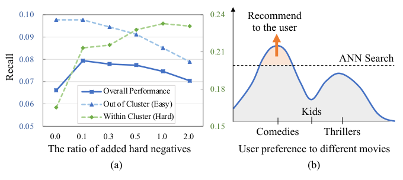
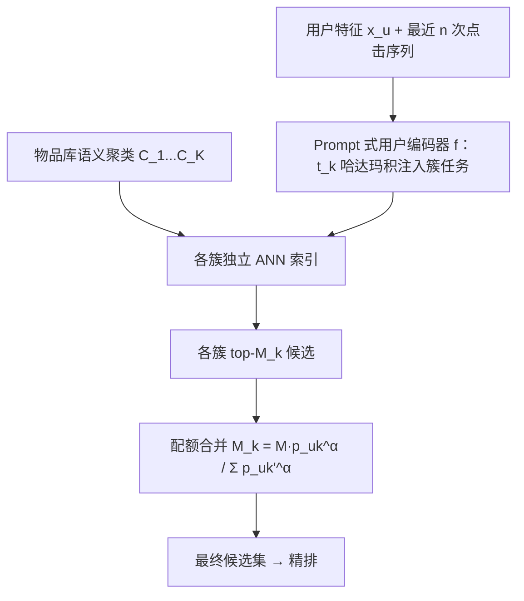

# Divide and Conquer: Towards Better Embedding-based Retrieval for Recommender Systems From a Multi-task Perspective (分而治之：从多任务视角改进推荐系统嵌入式召回)

- **会议/期刊**: WWW 2023 (Industry Track)
- **作者与机构**: Yuan Zhang, Weijie Ding, Biao Li, Peng Jiang（快手科技）；Xue Dong（山东大学，实习期间完成）；Kun Gai
- **推荐链路定位**: 召回（候选生成，EBR / 双塔 ANN 检索）
- **研究方向**: 协同过滤与双塔召回 / 多任务学习与列表级重排
- **论文原文**: [https://arxiv.org/abs/2302.02657v1](https://arxiv.org/abs/2302.02657v1)
- **开源代码**: 暂未开源

## TL;DR (1分钟核心速览)

工业级 EBR 召回面临两难：全库训练时难负例（易混但无关）与易负例的判别性能相互冲突，且 ANN 贪心检索无法控制多样性与公平性。本文提出"分而治之"：先把物品库聚成 $K$个语义簇，各簇独立建 ANN 索引并行召回，训练时只用**同簇负例**（天然难负例），再用用户意图配额$M_k$ 做可控合并；并借 Prompt 思想用哈达玛积注入簇任务标识实现轻量多任务适配。ML-1M/KuaiRand 上 Recall 较 SASRec 提升 11.3%–42.7%，快手线上 A/B 全指标显著正向。

## Background & Motivation (背景与核心矛盾)

- **主流范式**: 两阶段架构中，召回层用双塔（用户编码器 $f$、物品编码器$g$）+ 内积打分 + FAISS ANN 索引，以次线性时间从全库取 top-$M$；本文以 SASRec 为实例基座。
- **前人局限一**: 候选池 $\mathcal{I}\setminus\mathcal{I}_u$ 结构高度异质，需同时区分"完全无关（易负例）"与"相关但不竞争（难负例）"，二者判别性能常相互抵消；业界只能靠人工调"易/难负例混合比"找折衷点，而非最优点。
- **前人局限二**: ANN 只做贪心 top-$k$，用户兴趣本身是多峰多模态（爱看喜剧也偶尔看惊悚），长尾兴趣簇天然被压制，多样性与公平性完全不可控。
- **核心洞察 (Key Insight)**: 图 1(a) 显示，簇内（难）检索与簇外（易）检索的性能随难负例比例此消彼长——这说明"折衷"是**搜索空间定义**造成的结构性问题，而非模型容量问题。
- **本文切入点**: 若先把搜索空间切成簇，则簇外易负例被结构性排除，模型只需专注簇内难负例，一举解耦"难易折衷"并获得簇间配额的显式控制旋钮。

<figure class="paper-figure" markdown="span">
  <figcaption>图1：动机。(a) 以不同比例的难负例（与正例同簇的负例项目）与简单负例训练EBR模型时的检索性能。簇内和簇外分别表示真值项目与同簇所有项目、其他簇所有项目混合时的检索性能。(b) 用户偏好的多模态结构。</figcaption>
</figure>

## Method (核心方法设计)

### 1. 整体框架 (Overall Architecture)

离线阶段：物品库按语义聚成 $\mathcal{I}=\{\mathcal{C}_1,\dots,\mathcal{C}_K\}$（离线实验用 Word2Vec 物品向量 + K-means；生产用标题/剧本/封面预测的站内视频类目，兼顾冷启动与可解释性），每簇独立建 ANN 索引。训练阶段：把损失按簇拆分，正例所在的簇$\mathcal{C}_k$内采样负例，同一双塔编码器被$K$个子任务共享。服务阶段：用户编码器实时算一次$\boldsymbol{e}_u$，$K$个簇并行检索（每簇空间缩小约$K$倍，因此延迟不显著上升），再按意图配额合并为最终$M$ 个候选送入精排。

### 2. 关键设计拆解 (Key Designs)

1. **簇内难负例分治训练（Divide-and-Conquer Loss）**：把原全库 softmax/BPR 式的"跨簇易负例 + 簇内难负例混合"改写为按簇独立求和，负例期望只在同簇内采样：$\mathcal{L} = -\sum_{k=1}^{K}\sum_{u\in\mathcal{U}}\sum_{i^+\in\mathcal{I}_u\cap\mathcal{C}_k}\left[\log\sigma(r_{ui^+}) + \mathbb{E}_{i^-\sim\mathcal{C}_k\setminus\mathcal{I}_u}\log(1-\sigma(r_{ui^-}))\right]$。此式等价于训练$K$ 个"只在簇内可分"的子任务：梯度不再被大量平凡易负例稀释，簇内决策边界更精细；同时簇外误召回由"簇路由"天然拦住，故整体 Recall 反升。

2. **可控簇间配额合并（Controllable Merging）**：针对贪心 ANN 无法控制多样性的痛点，用与用户编码器同特征的意图模型预测 $p_{uk}$（用户兴趣落入簇$k$的概率），按$M_k = M\cdot\frac{(p_{uk})^{\alpha}}{\sum_{k'=1}^{K}(p_{uk'})^{\alpha}}$分配配额。$\alpha=0$退化为簇间绝对公平（每簇等额），$\alpha\to+\infty$退化为只取最相关簇；$\alpha$ 是连续的多样性/相关性调节旋钮，取代了不可控的纯向量近邻。

3. **Prompt 式任务适配（Hadamard Prompt）**：痛点起因是朴素做法——把可学习任务嵌入 $\boldsymbol{t}_k$与序列 token 拼接（$\text{Transformer}([\boldsymbol{t}_k;\boldsymbol{s}_u^1,\dots,\boldsymbol{s}_u^n])$）——虽省时但几乎不涨点；作者归因于推荐场景 Transformer 仅 2 层（远浅于 NLP），拼接式 prompt 难以通过两三层自注意力与原始输入充分交互。于是改为逐 token 显式特征交互：$\boldsymbol{e}_u = \text{Transformer}([\boldsymbol{s}_u^1\odot\boldsymbol{t}_k,\ \boldsymbol{s}_u^2\odot\boldsymbol{t}_k,\ \dots,\ \boldsymbol{s}_u^n\odot\boldsymbol{t}_k])$，即用哈达玛积在输入层直接做任务调制，仅增$K\times d$参数，与 MMoE/PLE 的多专家分支（$O(K)$ 倍计算）形成鲜明对比。

4. **训练目标与推理效率**：总损失即上述分簇损失之和，负例为**簇内均匀采样**（不使用跨批难负例挖掘）；推理时物品向量离线算好入索引，在线只跑一次用户塔 + $K$ 路并行 ANN，实测训练吞吐 25K samples/sec，与原始 SASRec 持平，而 MMoE 降至 7.2K。

## Experimental Setup & Evaluation Protocol (实验设置与评估协议)

| 数据集 | #Users | #Items | #Interactions | 稀疏度/密度 | 特征/场景说明 |
| :--- | :---: | :---: | :---: | :---: | :--- |
| ML-1M | 6,040 | 3,706 | 1,000,209 | 0.045 | 电影评分，全部观看记为相关；$K=10$ 簇 |
| KuaiRand | 25,828 | 108,025 | 20,141,835 | 0.007 | 快手短视频真实日志，仅保留主推荐场景（tab=1），物品频次 $\geq 70$、用户频次$\geq 10$；$K=15$ 簇 |

- **数据划分与防穿越**: `Leave-One-Out`——用户最后一条交互作测试、倒数第二条作验证，其余训练。
- **排名评测协议**: 检索式 `Sampled Ranking`——从**全部未见物品**中由各方法生成候选集 $M$并计算 Recall@M（ML-1M:$M\in\{20,50\}$；KuaiRand:$M\in\{500,1000\}$）。注意：文中虽称$M$为总量"5%–10%"，但$M=20/50$对 3,706 物品仅 0.5%–1.4%，实为强截断 top-$M$ 口径，并非严格 Full-Ranking。
- **对比基线**: MF、SASRec（基座，2 层 Transformer）、SASRec+（人工调优易/难负例混合比）、MIND（胶囊路由多兴趣）、ComiRec-SA（多头注意力多兴趣）、MMoE（4 专家）；显著性以线上 A/B 的 $p<0.05$ 为准，离线未报告置信区间或多次随机种子。

## Key Experimental Results (实验关键数据)

### 1. 主实验对比 (Main Results)

| Method | ML-1M R@20 | ML-1M R@50 | KuaiRand R@500 | KuaiRand R@1000 |
| :--- | :---: | :---: | :---: | :---: |
| MF | 0.120 | 0.231 | 0.086 | 0.132 |
| MIND | 0.186 | 0.343 | 0.138 | 0.201 |
| ComiRec-SA | 0.192 | 0.341 | 0.188 | 0.269 |
| SASRec | 0.183 | 0.337 | 0.178 | 0.254 |
| SASRec+ (调优混合负例) | 0.220 | 0.367 | 0.200 | 0.284 |
| w/ Naive MTL (分治无 prompt) | 0.221 | 0.366 | 0.245 | 0.344 |
| w/ MMoE | 0.224 | 0.371 | 0.239 | 0.341 |
| **Ours (D&C + Prompt)** | **0.234** | **0.375** | **0.254** | **0.359** |
| **Improv. (vs SASRec)** | **+27.9%** | **+11.3%** | **+42.7%** | **+41.3%** |

### 2. 消融实验 (Ablation Study)

簇内检索（候选集限制在真值所在簇内）与训练开销对照：

| 配置 | ML-1M R@5 | ML-1M R@20 | ML-1M R@50 | KuaiRand R@100 | KuaiRand R@500 | KuaiRand R@1000 | 吞吐 (samples/sec) |
| :--- | :---: | :---: | :---: | :---: | :---: | :---: | :---: |
| SASRec (无分治) | 0.191 | 0.424 | 0.639 | 0.172 | 0.399 | 0.543 | 25K |
| w/o Prompt (Naive MTL) | 0.217 | 0.463 | 0.674 | 0.228 | 0.502 | 0.658 | 25K |
| w/ MMoE 替代 Prompt | 0.223 | 0.482 | 0.682 | 0.218 | 0.496 | 0.655 | 7.2K |
| **Ours** | **0.235** | **0.483** | **0.682** | **0.237** | **0.522** | **0.682** | **25K** |

线上 A/B（3 天，实验组 4,000 万+ 用户，全部 $p<0.05$）：App Usage Time +0.096%、Likes +0.75%、Follows +1.01%、Shares +1.04%、Downloads +2.40%；本召回源落地物品的互动率对比 ComiRec：点击率 60.5% vs 56.1%（**+7.8%**）、关注率 0.431% vs 0.283%（**+52.3%**）、分享率 0.239% vs 0.209%（+14.4%）。

### 3. 关键实验发现 (Key Findings)

1. **收益主引擎是"簇内负采样"而非多任务结构**：仅做分治、去掉 prompt 的 Naive MTL 已把 ML-1M R@20 从 0.183 提到 0.221（+20.8%），Prompt 适配再贡献约 5.6%/4.2%（ML-1M/KuaiRand 整体降幅口径），说明搜索空间重定义比模型容量扩张更划算。
2. **人工难负例调参存在天花板**：SASRec+ 穷调混合比后 ML-1M R@20 仅 0.220、KuaiRand R@1000 仅 0.284，被 Ours 的 0.234/0.359 显著超越（KuaiRand +26.4%）；难易折衷从"超参搜索"变成"结构分解"，且规模化收益随候选池增大而放大（KuaiRand +42.7% > ML-1M +27.9%）。
3. **MMoE 属收益/开销倒挂**：其在 ML-1M 簇内 R@5 = 0.223 略胜 Naive MTL 的 0.217，却远低于 Ours 的 0.235，且训练吞吐跌 71%（25K→7.2K）；Prompt 方案以 $K\times d$ 参数量取得更优精度与零额外吞吐代价，验证了"浅层 Transformer 下输入层乘法调制优于拼接、也优于多专家分支"的工程判断。

## Highlights & Limitations (亮点、对比与审稿批判)

- **与代表作对比 (vs. Prior Work)**: 对比 SASRec+（靠人工混合比折衷难易负例）——本文用簇划分从结构上消除易负例；对比 MIND/ComiRec（多兴趣向量提升多样性）——本文不改用户塔结构，而在**候选空间侧**用配额 $M_k$与$\alpha$ 显式控制多样性/公平性，可控性与可解释性更强；对比 MMoE/PLE——以输入层哈达玛 prompt 替代专家分支，参数量与吞吐几乎不变。
- **可迁移亮点**: ①"按语义簇切分候选空间 + 簇内采样负例"可迁移到跨域/多场景召回，天然对应多任务划分；②$M_k \propto p_{uk}^{\alpha}$ 的幂律配额合并可作为通用的多路召回融合与长尾扶持旋钮；③浅层序列模型上，用哈达玛积做任务/场景调制比拼接式 prompt 更有效。
- **审稿级局限批判**: ①**评测口径偏弱**：采用 top-$M$截断 Recall（$M$仅占物品库 0.5%–1.4%），既非全库 Full-Ranking 也无 NDCG/MRR 等位置敏感指标，且离线未报告多次种子方差与显著性检验，"5%–10%"的描述与实际$M$取值自相矛盾；②**簇划分敏感性与开销未剖析**：$K$、聚类算法（K-means vs 内容类目）、簇不均衡度对收益的影响缺失分析，簇数增大时$K$ 路 ANN 与配额模型（意图模型训练成本）在极低延迟场景下的可行性未量化；③线上增益幅度较小（App Usage Time +0.096%），虽显著但缺乏与分治/配额两模块的在线归因拆分。

## Rating (四维评分)

- **方法创新性 (Novelty)**: ⭐⭐⭐⭐ （思路朴素但切中 EBR"难易负例折衷"的结构性痛点，簇内负例训练 + 幂律配额合并 + 输入层哈达玛 prompt 三者组合新颖且自洽，虽无理论谱分析支撑，但图 1(a) 的动机实验给出清晰经验依据）
- **评估协议与实验扎实度 (Protocol & Experiments)**: ⭐⭐⭐ （双数据集 + 4,000 万用户线上 A/B 颇具说服力，消融覆盖分治/prompt/MMoE 三条路径，但采用强截断 top-$M$Recall、缺少 Full-Ranking 与位置敏感指标、无方差与$K$ 敏感性分析）
- **写作与数学规范度 (Clarity & Rigor)**: ⭐⭐⭐⭐ （公式极简（3 个核心式子）、符号自洽、动机—方法—实验闭环清晰，工程实现细节（类目来源、配额公式）交代到位，遗憾是合并策略与意图模型的训练细节略简、复杂度分析缺失）
- **工业落地与复现价值 (Industrial & Practical Value)**: ⭐⭐⭐⭐⭐ （已在快手全量部署逾四月，训练吞吐零损耗、推理仅并行化既有 ANN、配额旋钮可直接调多样性，落地性与可复制性极高；仅因未开源代码扣分）

