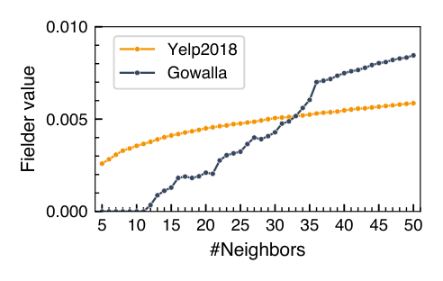
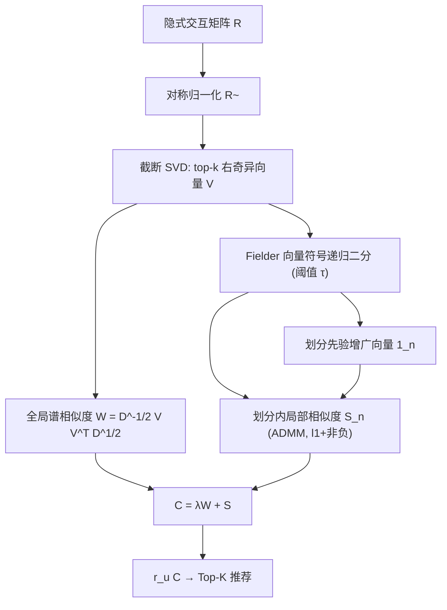
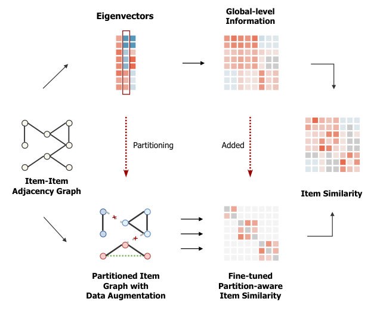

# Fine-tuning Partition-aware Item Similarities for Efficient and Scalable Recommendation (面向高效可扩展推荐的划分感知物品相似度微调)

- **会议/期刊**: WWW 2023 (The ACM Web Conference)
- **作者与机构**: Tianjun Wei, Tommy W. S. Chow (香港城市大学)；Jianghong Ma (哈尔滨工业大学(深圳))
- **推荐链路定位**: 召回（物品-物品相似度驱动的 Top-K 检索）
- **研究方向**: 协同过滤与双塔召回 / 自监督与图推荐（交叉）
- **论文原文**: [https://arxiv.org/abs/2207.05959v2](https://arxiv.org/abs/2207.05959v2)
- **开源代码**: [https://github.com/Joinn99/FPSR](https://github.com/Joinn99/FPSR)

## TL;DR (1分钟核心速览)

物品相似度模型（EASE/SLIM/BISM）在 $|\mathcal{I}|\times|\mathcal{I}|$稠密矩阵上求解，物品数增长即二次爆炸；GCN 靠小批量迭代又慢。本文发现 UltraGCN 的 top-$k$邻域采样本质是模块度最大化的局部近似，即物品集天然存在分组结构。据此提出 FPSR：用截断 SVD 的 Fielder 向量递归二分物品图，仅在划分内部微调相似度，并用全局谱信息$W$ 与划分先验增广补偿信息损失。在 4 个公开数据集上，Full-Ranking 的 Recall@20/NDCG@20 超越 UltraGCN、BISM 等 SOTA（如 Yelp2018 NDCG +4.1%），同时训练时间降约 90%、参数存储较相似度模型省 95%。

## Background & Motivation (背景与核心矛盾)

- **主流范式**: 协同过滤分三支——MF 类（BPR）、GCN 类（LightGCN/UltraGCN/SimGCL）通过多层或无穷层图卷积捕获高阶关系；相似度模型（SLIM/EASE/BISM）把交互矩阵编码成直接可查的物品-物品相似度矩阵，推理只需一次稀疏-稠密乘法。
- **前人局限**: ① GCN 需重复图卷积与迭代小批量优化，训练耗时以千秒计；② 相似度模型的参数与计算随 $|\mathcal{I}|^2$ 二次增长（EASE 在 Amazon-cds 上 1271M 参数），工业不可扩展；③ BISM/LorSLIM 虽假设块对角结构，但仍在整个物品集上建模，未真正降低规模。
- **核心洞察 (Key Insight)**: 作者测量 UltraGCN 采样后物品图的代数连通度（Fielder 值，图 1），发现邻居数降到 5–10 时 Gowalla 上 Fielder 值直接归 0，即采样本就切出了若干互不连通的物品组；进一步推导证明该采样权重 $\omega_{ij}=Q_{ij}\sqrt{p_j}/(\sqrt{p_i}(p_i-Q_{ii}))$恰是子图上模块度$M(\mathcal{G}_i)=\frac{1}{4d_i}\sum_{i,j}\omega_{ij}\mathbb{I}_{c_i=c_j}$ 的迭代最大化。**采样 = 隐式图划分**。
- **本文切入点**: 既然物品图可划分为紧致分组，就把二次规模的相似度求解拆成若干块对角子问题；划分带来的跨组信息损失，用全局谱信息与划分先验增广联合补偿。

<figure class="paper-figure" markdown="span">
  <figcaption>图1：UltraGCN 中采样物品-物品图的代数连通度（Fielder 值）。</figcaption>
</figure>

## Method (核心方法设计)

### 1. 整体框架 (Overall Architecture)

FPSR 走"先划分、再局部微调、最后全局校正"的离线一次性求解路线。输入为隐式反馈矩阵 $R$，先做对称归一化得$\tilde{R}=D_U^{-1/2}RD_I^{-1/2}$；对$\tilde{R}$（而非稠密的$\tilde{Q}=\tilde{R}^\top\tilde{R}$）做截断 SVD，取次大右奇异向量（Fielder 向量）按符号递归二分物品集，直至每个子集占比小于$\tau$；同一批 top-$k$奇异向量构成全局相似度$W$。随后在每个划分内用 ADMM 求解带$l_1$/非负/块对角约束的局部相似度$S$，并按划分先验增广项微调。最终$C=\lambda W+S$，用户打分$r_uC$取 top-$K$，推理只做一次稀疏行乘稀疏矩阵。

<figure class="paper-figure" markdown="span">
  <figcaption>图2：所提出的 FPSR 模型示意图。采用从物品-物品图分解得到的特征向量划分图并形成全局级信息。在每个划分内微调物品相似度，以结合全局信息建模物品关系。</figcaption>
</figure>

### 2. 关键设计拆解 (Key Designs)

1. **递归谱二分（Recursive Spectral Partitioning）**：稠密 $\tilde{Q}$上做特征分解不可行$\to$因$\tilde{Q}=\tilde{R}^\top\tilde{R}$，改在稀疏$\tilde{R}$上取次大右奇异向量$v$（等价$\tilde{Q}$的 Fielder 向量），按$i\in\mathcal{I}_1$若$\mathrm{sign}(v_i)=+1$否则$\mathcal{I}_2$，并在$|\mathcal{I}_n|/|\mathcal{I}|\ge\tau$时递归。直觉：Fielder 向量是模块度最大化的连续松弛，符号即二划分，$\tau$把块规模硬性封顶，从而把复杂度从$O(|\mathcal{I}|^{2.376})$压到$O(|\mathcal{I}|^{2.376}\tau^{1.376})$、存储从$O(|\mathcal{I}|^2)$压到$O(|\mathcal{I}|^2\tau)$。

2. **全局谱信息 + 划分先验增广（Global Info & Partition-aware Prior）**：纯块内建模会丢跨组关系 $\to$一方面用$W=D_I^{-1/2}VV^\top D_I^{1/2}$，其外积性质$v_1v_i>v_2v_i>0>v_3v_i>v_4v_i$保证跨划分相似度的**序关系正确**（组内序可能失真，正是局部$S$要修的部分）；另一方面构造"虚拟用户"$1_{n,i}=\mathbb{I}_{i\in\mathcal{I}_n}$ 作为交互矩阵的数据增广，把划分身份显式写进编码目标。

3. **训练目标、优化与推理**：总目标为

$$\arg\min_{S}\ \tfrac{1}{2}\|R-R(\lambda W+S)\|_F^2+\tfrac{\theta_2}{2}\|D_I^{1/2}(\lambda W+S)\|_F^2+\theta_1\|S\|_1+\sum_n\tfrac{\eta}{2}\|1_n^\top-1_n^\top(\lambda W+S)\|_F^2$$

   s.t. $\mathrm{diag}(S)=0,\ S\ge0,\ S_{ij}|_{\mathcal{G}(i)\ne\mathcal{G}(j)}=0$。块对角约束使问题按划分解耦为若干子问题，用 ADMM 闭式更新$Z_n=(\hat{Q}+\rho I)^{-1}(\hat{Q}(I-\lambda W_n)+\rho(S_n-\Phi_n)-\mathrm{diagMat}(\mu))$与软阈值$S_n=(Z_n+\Phi_n-\theta_1/\rho)_+$，其中$\hat{Q}=R_n^\top R_n+\theta_2D_I+\eta$。无需负采样（隐式 0 即负），推理仅为稀疏矩阵乘，开销$O(\mathrm{nnz}(C))$。

## Experimental Setup & Evaluation Protocol (实验设置与评估协议)

- **数据集与预处理**: 4 个公开数据集，沿用 LightGCN/UltraGCN 的标准切分与过滤：

| 数据集 | #Users | #Items | #Interactions | 密度 | 场景说明 |
| :--- | :---: | :---: | :---: | :---: | :--- |
| Amazon-cds | 43,169 | 35,648 | 777,426 | 0.051% | 亚马逊商品（CD 类） |
| Douban | 13,024 | 22,347 | 792,062 | 0.272% | 豆瓣评分（最稠密） |
| Yelp2018 | 31,668 | 38,048 | 1,561,406 | 0.130% | 本地商户 |
| Gowalla | 29,858 | 40,981 | 1,027,370 | 0.084% | LBS 签到 |

- **数据划分与防穿越 (Splitting Strategy)**: 沿用 CF 主流设定，每位用户留出最后一次交互作测试、倒数第二次作验证（`Leave-One-Out`），其余为训练集，属于用户级时序切分。
- **排名评测协议 (Ranking Protocol)**: **Full-Ranking**（对全部未交互物品排序，无负采样偏置），指标为 Recall@20 与 NDCG@20；显著性以 $p<0.01$ 标注（表中 `*`）。
- **对比基线与超参设置**: 非参数模型 ItemKNN、GF-CF；MF 模型 BPR；GCN 模型 LightGCN、UltraGCN、SimGCL；相似度模型 SLIM、EASE、BISM。全部在 RecBole 统一实现；嵌入维度 $d=64$、学习率$10^{-3}$、批大小 2048；FPSR 取$k=256$个奇异向量，$\theta_1,\theta_2\in\{0.1,\dots,5\}$，$\lambda,\tau\in[0.1,0.5]$，$\eta\in\{0.01,0.1,1\}$，5 折交叉验证选参。

## Key Experimental Results (实验关键数据)

### 1. 主实验对比 (Main Results)

| 模型 | Amazon R@20 | Amazon N@20 | Yelp R@20 | Yelp N@20 | Douban R@20 | Douban N@20 | Gowalla R@20 | Gowalla N@20 |
| :--- | :---: | :---: | :---: | :---: | :---: | :---: | :---: | :---: |
| ItemKNN | 0.1331 | 0.0756 | 0.0563 | 0.0469 | 0.1923 | 0.1686 | 0.1246 | 0.0907 |
| GF-CF | 0.1350 | 0.0725 | 0.0697 | 0.0571 | 0.1719 | 0.1365 | 0.1849 | 0.1518 |
| BPR | 0.1111 | 0.0569 | 0.0576 | 0.0468 | 0.1347 | 0.0966 | 0.1627 | 0.1378 |
| LightGCN | 0.1346 | 0.0701 | 0.0653 | 0.0532 | 0.1571 | 0.1206 | 0.1820 | 0.1547 |
| SimGCL | 0.1468 | 0.0781 | 0.0681 | 0.0556 | 0.1699 | 0.1346 | 0.1762 | 0.1495 |
| UltraGCN | 0.1487 | 0.0806 | 0.0683 | 0.0561 | 0.1925 | 0.1556 | 0.1862 | **0.1580** |
| EASE | 0.1433 | 0.0845 | 0.0657 | 0.0552 | 0.2038 | 0.1786 | 0.1765 | 0.1467 |
| BISM | 0.1541 | 0.0874 | 0.0662 | 0.0559 | **0.2158** | 0.1889 | 0.1724 | 0.1443 |
| **FPSR** | **0.1576\*** | **0.0896\*** | **0.0703\*** | **0.0584\*** | 0.2095 | **0.1950\*** | **0.1884\*** | 0.1566 |
| **Improv.** | +2.3% | +2.5% | +2.9% | +4.1% | −2.9% | +3.2% | +1.2% | −0.9% |
| #Params | \multicolumn{2}{c}{3.87M（EASE 1271M、BISM 111M）} | \multicolumn{2}{c}{3.27M} | \multicolumn{2}{c}{2.14M} | \multicolumn{2}{c}{3.44M} |
| 训练时长 | 50s（UltraGCN 3300s） | | 35s（UltraGCN 617s） | | 33s（UltraGCN 5900s） | | 87s（UltraGCN 3800s） | |

### 2. 消融实验 (Ablation Study)

| 变体 | Amazon R@20 | Amazon N@20 | Yelp R@20 | Yelp N@20 | Douban R@20 | Douban N@20 | Gowalla R@20 | Gowalla N@20 |
| :--- | :---: | :---: | :---: | :---: | :---: | :---: | :---: | :---: |
| w/o 全局谱信息 ($\lambda=0$) | 0.1542 | 0.0887 | 0.0662 | 0.0556 | 0.2085 | 0.1945 | 0.1785 | 0.1486 |
| w/o 划分先验增广 ($\eta=0$) | 0.1540 | 0.0873 | 0.0702 | 0.0582 | 0.2046 | 0.1909 | 0.1883 | 0.1566 |
| w/o 列加权 $l_2$($\theta_2=0$) | 0.1539 | 0.0870 | 0.0692 | 0.0574 | 0.2084 | 0.1943 | 0.1832 | 0.1501 |
| **FPSR (full)** | **0.1576** | **0.0896** | **0.0703** | **0.0584** | **0.2095** | **0.1950** | **0.1884** | **0.1566** |

### 3. 关键实验发现 (Key Findings)

1. **全局谱信息 $W$是性能主引擎，且数据集敏感**：去掉$W$后 Gowalla Recall 从 0.1884 崩到 0.1785（−5.3%）、Yelp 从 0.0703 到 0.0662（−5.8%），说明块内建模无法替代跨组关系；而 Douban 上去掉划分先验增广（$\eta=0$）损失最大（0.2095↔0.2046，−2.3%），稠密数据集更依赖划分身份作为噪声过滤器。
2. **划分把"性能-成本"前沿整体外推**：FPSR 在 Amazon-cds 上以 3.87M 参数（EASE 的 0.3%、BISM 的 3.5%、省 95% 存储）和 50s 训练时间（UltraGCN 3300s，约 66× 提速、省 90% 时间）取得最高 Recall；且 $\tau$ 从 0.6 降到 0.25 时训练时间显著下降而指标几乎不变，说明块规模可自由调参而不牺牲精度。
3. **跨数据集鲁棒性**：Gowalla 上 GCN 类显著强于相似度类、Amazon-cds/Douban 上反之，而 FPSR 是唯一在两大数据分布组中均列前三的模型（Gowalla Recall 反超 UltraGCN +1.2%，仅 NDCG 以 0.1566 vs 0.1580 微差居次），证明全局+局部分解能适配不同稀疏度与簇结构强度。

## Highlights & Limitations (亮点、对比与审稿批判)

- **与代表作对比 (vs. Prior Work)**: 与 **UltraGCN** 的根本区别在于，后者用 top-$k$采样"丢掉"物品间边但仍然做端到端图卷积迭代；FPSR 保留划分结构却把相似度求解改成一次性稀疏编码，速度数量级领先。与 **EASE/BISM** 相比，它把$|\mathcal{I}|\times|\mathcal{I}|$闭式逆拆成块对角并显式注入全局谱校正，参数降低 2–3 个数量级；与 **BISM** 的块对角"假设"不同，划分是谱算法真实求出的，且用$W$ 补回跨块信息。
- **可迁移亮点**: ① 用"稀疏矩阵 $\tilde{R}$的截断 SVD"替代"稠密$\tilde{Q}$ 的特征分解"来逼近图 Laplacian 谱，这套降低内存的技巧可复用于任何物品图/会话图聚类；② 把划分 ID 做成虚拟用户交互向量的数据增广，是一种零成本引入结构先验的通用手段。
- **审稿级局限批判**: ① 划分与 SVD 是离线一次性计算，物品集动态更新（新品上架）时需重跑谱分解与块内 ADMM，冷启动/增量场景缺乏机制；② $S$仍以块对角稀疏矩阵存储，单块规模随$\tau|\mathcal{I}|$二次增长，超大规模下$\tau$ 需压得很小，可能削弱局部建模优势；③ 实验仅在 Leave-One-Out + 隐式反馈设定下评估，未涉及采样排序、热度偏差与线上 A/B。

## Rating (四维评分)

- **方法创新性 (Novelty)**: ⭐⭐⭐⭐ （把 UltraGCN 采样严格推导为模块度最大化的局部近似，再由谱划分反推建模结构，"采样=划分"的洞察很有说服力）
- **评估协议与实验扎实度 (Protocol & Experiments)**: ⭐⭐⭐⭐ （4 数据集 + Full-Ranking + 9 个基线 + $p<0.01$ 显著性 + 参数/时间双维度报告，但缺采样排序与线上验证）
- **写作与数学规范度 (Clarity & Rigor)**: ⭐⭐⭐⭐ （从 Fielder 值实证到复杂度上界 $O(|\mathcal{I}|^{2.376}\tau^{1.376})$推导完整，ADMM 更新式清晰；个别符号如$\hat{Q}$ 复用略有歧义）
- **工业落地与复现价值 (Industrial & Practical Value)**: ⭐⭐⭐⭐⭐ （开源 PyTorch 实现，10× 加速 + 95% 存储节省，推理只需稀疏乘，可直接嵌入召回召回池构建）

