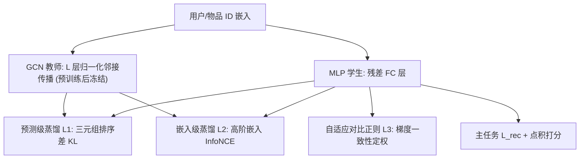

# Graph-less Collaborative Filtering (无图协同过滤)

- **会议/期刊**: WWW 2023 (ACM Web Conference)
- **作者与机构**: Lianghao Xia, Chao Huang (香港大学); Jiao Shi, Yong Xu (华南理工大学)
- **推荐链路定位**: 召回（基于用户/物品表征的向量检索）
- **研究方向**: 协同过滤与双塔召回 / 自监督对比学习与交互去噪
- **论文原文**: [https://arxiv.org/abs/2303.08537v3](https://arxiv.org/abs/2303.08537v3)
- **开源代码**: [https://github.com/HKUDS/SimRec](https://github.com/HKUDS/SimRec)

## TL;DR (1分钟核心速览)

针对 GNN-based CF 的两大痛点——低通拉普拉斯平滑带来的**过平滑/噪声放大**，以及递归邻域聚合造成的**推理不可扩展**——本文提出 SimRec：以 GCN 为教师、MLP 为学生，做**预测级 + 嵌入级双层蒸馏**，并用梯度一致性驱动的**自适应对比正则**剔除教师传播的过平滑信号。在 Gowalla/Yelp/Amazon 三数据集的 `Full-Ranking` 协议下，Recall@20 相对最强 SOTA（NCL）提升 2.1%~11.7%，Amazon 上 NDCG@20 提升 17.8%，且大图 Tmall 上单 epoch 推理耗时仅 785.1s（SGL 为 1331.8s）。

## Background & Motivation (背景与核心矛盾)

- **主流范式**: NGCF/LightGCN/GCCF 通过在用户-物品二部图上堆叠 $L$层归一化邻接传播$\mathbf{H}^{(t)}=\sum_{l=0}^{L}\mathbf{H}^{(t)}_l$ 注入高阶协同信号；SGL/NCL/HCCF 再叠加图对比学习缓解稀疏与噪声。
- **前人局限 1（过平滑）**: 低通 Laplacian 平滑算子随层数增加使节点表征趋同，用户兴趣区分度下降，且递归聚合会把误点击、流行度偏置等噪声一并“融进”表征；SSL 方法（如 SGL 的随机扰动）在高阶传播下甚至**放大**噪声。
- **前人局限 2（不可扩展）**: 推理时需对每个节点递归展开多跳邻居，全图传播代价高，工业场景只能靠子图采样妥协，精度与时延双输。
- **核心洞察 (Key Insight)**: MLP 天然不过平滑且推理廉价，但缺乏高阶协同建模能力——而这一能力**可以被“蒸馏”而非“传播”获得**。理论上作者证明：蒸馏损失的梯度与 BPR 的高阶平滑梯度形式同构，只是权重由教师模型学得而非手工启发式。
- **本文切入点**: 把“图卷积推理”改造成“教师训练一次、学生轻量前向”的离线知识压缩问题，并在蒸馏中显式**重校准**被过平滑污染的嵌入。

## Method (核心方法设计)

### 1. 整体框架 (Overall Architecture)

SimRec 采用两阶段流程：先独立训练一个 LightGCN 式教师（$L$层残差归一化邻接传播 + BPR 损失，训练至收敛后**冻结**），再联合优化 MLP 学生。学生的输入是随机初始化的用户/物品 ID 嵌入，经共享残差 FC 层（`LeakyReLU` + skip-connection）编码为$\mathbf{h}^{(s)}$，以点积打分。三个监督信号同时约束学生：$\mathcal{L}_1$对齐师生在**三元组排序差**上的输出分布、$\mathcal{L}_2$把学生嵌入拉向教师的高阶嵌入、$\mathcal{L}_3$自适应地把节点彼此推开以对抗过平滑；三者与主任务$\mathcal{L}_{rec}$ 联合训练。推理阶段**完全丢弃图结构**，仅保留 MLP 前向与点积检索。

### 2. 关键设计拆解 (Key Designs)

1. **预测级蒸馏：用“富采样三元组”替代多分类软标签**：CF 物品类别数过万，softmax 软标签几乎全为 0 而无法承载暗知识。SimRec 改为对齐**成对排序差** $z_{i,j,k}=y_{i,j}-y_{i,k}$，且$v_j,v_k$均从**全库均匀采样**（不强制一正一负），从而把每个用户的监督样本数从 1 条扩到$|\mathcal{T}_1|$条组合：$\mathcal{L}_1=\sum_{\mathcal{T}_1}-\big[\bar{z}^{(t)}\log\bar{z}^{(s)}+(1-\bar{z}^{(t)})\log(1-\bar{z}^{(s)})\big]$，其中$\bar{z}=\mathrm{sigm}(z/\tau_1)$。直觉：教师对任意物品对偏好差的相对关系，比绝对分数包含更多可迁移的协同结构。
2. **嵌入级蒸馏 + 自适应对比正则（重校准核心）**：$\mathcal{L}_2$只在**高阶层**（$l\ge 2$）上做余弦 InfoNCE，迫使学生学到 MLP 缺失的多跳协同语义：$\mathcal{L}_2=\sum_{u_i}-\log\frac{\exp(\cos(\mathbf{h}^{(s)}_i,\Vert_{l\ge2}\mathbf{h}^{(t)}_{i,l})/\tau_2)}{\sum_{u_{i'}}\exp(\cos(\mathbf{h}^{(s)}_{i'},\Vert_{l\ge2}\mathbf{h}^{(t)}_{i,l})/\tau_2)}$。但教师的高阶嵌入本身就过平滑，故加入$\mathcal{L}_3=\sum_{u_i}\omega_i\log\sum_{u_{i'}}\exp(\mathbf{h}^{(s)\top}_i\mathbf{h}^{(s)}_{i'}/\tau_3)$（含 U-U、U-I、I-I 三项），权重由**梯度一致性**决定：若蒸馏任务梯度与主任务梯度方向一致（$\nabla^{\top}_{1,2}\nabla_{rec}>\nabla_1^{\top}\nabla_2$），说明该节点未被过度平滑污染，取$\omega=1-\epsilon$；否则取$1+\epsilon$ 加以推开。这使得正则**只打击被过平滑的节点**，避免无差别推开而破坏真实近邻亲和。
3. **训练目标与推理效率**：$\mathcal{L}^{(s)}=\mathcal{L}_{rec}+\lambda_1\mathcal{L}_1+\lambda_2\mathcal{L}_2+\lambda_3\mathcal{L}_3+\lambda_4\|\bar{\mathbf{H}}^{(s)}\|_F^2$，其中$\mathcal{L}_{rec}$为 BPR 损失；负采样为标准**均匀采样**（$a_{i,j}=1,a_{i,k}=0$）。教师复杂度$O(|\mathcal{E}|\cdot L\cdot d)$，学生$O(|\mathcal{T}_2|\cdot L'\cdot d^2)$，附加蒸馏项$O(|\mathcal{T}_2|\cdot(I+J)\cdot d)$（与主流 SSL-CF 同量级），但**推理期零图采样**。

## Experimental Setup & Evaluation Protocol (实验设置与评估协议)

- **数据集与预处理**:

| 数据集 | #Users | #Items | #Interactions | 稀疏度/密度 | 特征/场景说明 |
| :--- | :---: | :---: | :---: | :---: | :--- |
| Gowalla | 25,557 | 19,747 | 294,983 | 5.85×10⁻⁴ | 2010 年 LBS 签到 |
| Yelp | 42,712 | 26,822 | 182,357 | 1.59×10⁻⁴ | 2018 年商户评分 |
| Amazon | 76,469 | 83,761 | 966,680 | 1.51×10⁻⁴ | 2013 年图书评分 |
| Tmall（扩展） | — | — | ~40M 点击 | — | 工业电商可扩展性测试 |

- **数据划分与防穿越**: 采用**比例划分** 70% : 5% : 25%（train/valid/test），非 Leave-One-Out。
- **排名评测协议**: 无偏 **Full-Ranking（全库未交互物品排序）**，指标 Recall@20/40、NDCG@20/40。
- **对比基线与超参设置**: 14 个基线覆盖四类——传统 BiasMF；非图神经 CF（NCF、AutoR）；图模型（PinSage、STGCN、GCMC、NGCF、GCCF、LightGCN）；解耦图模型 DGCF；SSL 系列（SLRec、NCL、SGL、HCCF）。对 SimRec 与最强基线（NCL、SGL）重复训练 5 次做 $p$-value 显著性检验（$p<10^{-3}$ 量级）。

## Key Experimental Results (实验关键数据)

### 1. 主实验对比 (Main Results)

| Dataset | Metric | NCF | NGCF | GCCF | LightGCN | DGCF | SGL | NCL | HCCF | **SimRec** | Improv. |
| :--- | :--- | :---: | :---: | :---: | :---: | :---: | :---: | :---: | :---: | :---: | :---: |
| Gowalla | R@20 | 0.1019 | 0.1757 | 0.2012 | 0.2230 | 0.2055 | 0.2332 | 0.2283 | 0.2293 | **0.2434** | +4.4% |
| Gowalla | N@20 | 0.0674 | 0.1135 | 0.1282 | 0.1433 | 0.1312 | 0.1509 | 0.1478 | 0.1482 | **0.1592** | +5.5% |
| Yelp | R@20 | 0.0304 | 0.0681 | 0.0742 | 0.0761 | 0.0700 | 0.0803 | 0.0806 | 0.0789 | **0.0823** | +2.1% |
| Yelp | N@20 | 0.0143 | 0.0336 | 0.0365 | 0.0373 | 0.0347 | 0.0398 | 0.0402 | 0.0391 | **0.0414** | +3.0% |
| Amazon | R@20 | 0.0367 | 0.0551 | 0.0772 | 0.0868 | 0.0617 | 0.0874 | 0.0955 | 0.0885 | **0.1067** | +11.7% |
| Amazon | N@20 | 0.0234 | 0.0353 | 0.0501 | 0.0571 | 0.0372 | 0.0569 | 0.0623 | 0.0578 | **0.0734** | +17.8% |

（`Improv.` 相对最强非 SimRec 基线；$p$-value 分别为$2.1\mathrm{e}{-8}$/$3.7\mathrm{e}{-4}$/$1.1\mathrm{e}{-10}$，均显著。）

### 2. 消融实验 (Ablation Study)

| Variant | Gowalla R@20 | Gowalla N@20 | Yelp R@20 | Amazon R@20 | Amazon N@20 |
| :--- | :---: | :---: | :---: | :---: | :---: |
| w/o $\mathcal{L}_1$（预测蒸馏） | 0.2180 | 0.1415 | 0.0756 | 0.1012 | 0.0692 |
| w/o $\mathcal{L}_2$（用户侧） | 0.2292 | 0.1493 | 0.0806 | 0.0998 | 0.0667 |
| w/o $\mathcal{L}_2$（物品侧） | 0.2266 | 0.1477 | 0.0808 | 0.0974 | 0.0649 |
| w/o $\mathcal{L}_2$（双侧） | 0.2222 | 0.1451 | 0.0787 | 0.0938 | 0.0626 |
| w/o $\mathcal{L}_3$（全部正则） | 0.2282 | 0.1480 | 0.0810 | 0.0933 | 0.0605 |
| w/o $\mathcal{L}_3$（仅 U-I 项） | 0.2330 | 0.1496 | 0.0814 | 0.0939 | 0.0607 |
| **SimRec 全模型** | **0.2434** | **0.1592** | **0.0823** | **0.1067** | **0.0734** |

### 3. 关键实验发现 (Key Findings)

1. **预测级蒸馏是最大功臣，且样本量越大越强**：去掉 $\mathcal{L}_1$使 Gowalla R@20 从 0.2434 掉到 0.2180（−10.4%），跌幅超过任何其他单模块；且$|\mathcal{T}_1|$从$10^3$增至$10^5$ 时 Recall 单调由 0.2208 升到 0.2434，验证“全库随机采样三元组”确实在过滤教师低频噪声。
2. **对比正则对稠密大数据的关键性凸显过平滑的规模依赖**：$\mathcal{L}_3$ 在 Gowalla 仅带来 +6.7% R@20 增益，但在交互最稠密的 Amazon 上去掉后从 0.1067 崩至 0.0933（−12.6%）——越大越稠密的图，无关高阶邻居越多、过平滑越严重。
3. **表征均匀性可量化验证且推理大幅加速**：MAD 指标上 SimRec 用户侧 0.8576（Gowalla）/ 0.9819（Yelp），均高于 GCCF、SGL、NCL、HCCF；在 Tmall（1.6M 边采样）上单 epoch 推理 785.1s，比 SGL 的 1331.8s 快约 1.7×，同时 R@20 反超（0.0308 vs 0.0286），证明“无图推理”在工业规模下精度与效率不互斥。

## Highlights & Limitations (亮点、对比与审稿批判)

- **与代表作对比 (vs. Prior Work)**: 与 LightGCN/GCCF 的本质差异在于**推理期不含图算子**，高阶协同信息被离线蒸馏而非在线传播；与 SGL/NCL/HCCF 的差异在于这些方法仍以 GNN 为骨干、只能“事后加正则”对抗过平滑，而 SimRec 从架构上根除过平滑来源，并把 SSL 从“数据增广”改写为“教师梯度引导的自适应重校准”。
- **可迁移亮点**: ①“梯度一致性定权”($\omega=1\pm\epsilon$) 是一套通用机制，可用于任何需要区分“有用监督 vs. 噪声蒸馏”的双模型训练；②用**全库随机采样三元组**做排序蒸馏，绕过 CF 多分类软标签退化问题，可直接用于任意排序模型的蒸馏。
- **审稿级局限批判**: ①教师需预训练至收敛且全程冻结，整体训练成本是“GCN 一轮 + KD 一轮”，论文未给出端到端总耗时对比；②性能上界受教师质量约束，若教师本身受噪声污染严重（如极高稀疏场景），蒸馏只是“优雅地传递偏见”；③$\lambda_{1,2,3}$与$\tau_{1,2,3}$共 6 个温度/权重超参需联合网格搜索，Figure 5 显示最优点尖锐（如$\lambda_2$–$\tau_2$ 组合不当即掉点），工程调参负担偏重。

## Rating (四维评分)

- **方法创新性 (Novelty)**: ⭐⭐⭐⭐ （“无图推理 + 双层蒸馏 + 梯度自适应对比正则”组合新颖，且附录从梯度形式证明蒸馏可复现高阶平滑，具备理论支撑）
- **评估协议与实验扎实度 (Protocol & Experiments)**: ⭐⭐⭐⭐⭐ （三数据集 + 14 基线的 Full-Ranking 评测、5 次重复的 $p$-value、含 Tmall 千万级工业验证与 MAD 过平滑度量，消融到子项级别）
- **写作与数学规范度 (Clarity & Rigor)**: ⭐⭐⭐⭐ （公式与复杂度分析清晰，但主表存在个别数值排版错漏如 Amazon 的 0.5690，需读者自行甄别）
- **工业落地与复现价值 (Industrial & Practical Value)**: ⭐⭐⭐⭐⭐ （代码开源，推理期无需构图与邻居采样，单 epoch 耗时优于所有 GNN 基线，对在线低延迟召回链路极具吸引力）

