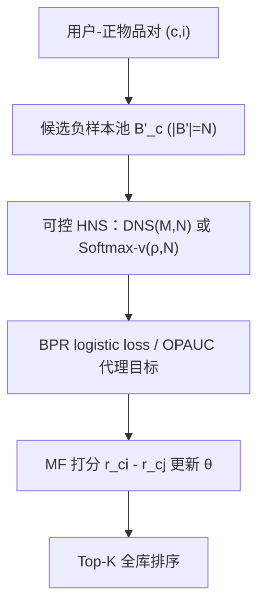
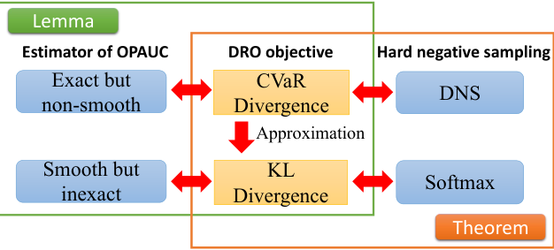

# On the Theories Behind Hard Negative Sampling for Recommendation (推荐中难负采样理论)

- **会议/期刊**: WWW 2023
- **作者与机构**: Wentao Shi, Jiawei Chen, Fuli Feng, Jizhi Zhang, Junkang Wu, Chongming Gao, Xiangnan He；USTC / ZJU
- **推荐链路定位**: 召回（MF+BPR 排序学习）
- **研究方向**: 协同过滤与双塔召回
- **论文原文**: [论文原文链接](https://arxiv.org/abs/2302.03472v2)
- **开源代码**: [开源代码仓库链接](https://github.com/swt-user/WWW_2023_code)

## TL;DR (1分钟核心速览)

针对 BPR 难负采样 (HNS) 仅被解释为“加速收敛”的理论空白，本文用 DRO 证明 BPR+HNS 等价优化 OPAUC，并证明 OPAUC 比 AUC 更贴近 Top-K。据此提出可控硬度 DNS(M,N)/Softmax-v(ρ,N)，在 Gowalla/Yelp/Amazon 全库排序、Recall@50/NDCG@50 上较 AdaSIR(P) 等显著提升。

## Background & Motivation (背景与核心矛盾)

- **主流范式**: BPR 以均匀负采样近似优化 AUC；DNS/softmax 类 HNS 则过采样高打分负样本，凭“梯度更大、收敛更快”被广泛采用。
- **前人局限**: 其一，HNS 收益若只来自收敛，全量负样本的 Non-Sampling 应更稳，但图 1 中 HNS 在三个数据集上反而明显更优；其二，DNS 的 $M$、softmax 的$\tau$ 等硬度参数缺乏理论指导，固定设置难以适配不同 Top-K 目标。
- **核心洞察 (Key Insight)**: BPR+HNS 并非在优化 AUC，而是在优化 FPR 受限的 OPAUC；OPAUC 与 Top-K 指标的相关性远强于 AUC。
- **本文切入点**: 用分布鲁棒优化 (DRO) 建立 HNS 与 OPAUC 的等价/近似关系，再以 OPAUC 为桥梁解释并指导 HNS。

## Method (核心方法设计)

### 1. 整体框架 (Overall Architecture)

输入为上下文-正物品对 $(c,i)$，先均匀抽$N$个候选负样本构成池$B'_c$，再按 DNS 或 softmax 的受控概率$p_{cij}$选难负样本；用 MF 打分差$r_{ci}-r_{cj}$代入 BPR logistic 损失更新$\theta$。训练时通过$M$、$N$、$\rho$控制采样硬度，推理时对全物品打分排序输出 Top-$K$。

<figure class="paper-figure" markdown="span">
  <figcaption>图 5：引理 1 表明 OPAUC 估计量与 DRO 目标之间的等价性。基于 DRO 目标，我们在定理 1 和定理 2 中证明 HNS 与 OPAUC 之间的等价性。</figcaption>
</figure>

### 2. 关键设计拆解 (Key Designs)

1. **HNS 与 OPAUC 的 DRO 等价性**：前人只把 HNS 当作采样技巧；本文在 CVaR 散度下令 $\beta=e^{-\rho}$，证明 DNS 的 BPR 是 OPAUC(β) 的精确估计器，且$M=n^-\beta$；softmax 采样在$\tau=\sqrt{\mathrm{Var}_j(L(c,i,j))/(-2\log\beta)}$ 时是光滑但近似的估计器。直觉是：HNS 把梯度集中到“头部负样本”，等价于只优化 ROC 曲线 FPR∈[0,β] 的区域。
2. **OPAUC 与 Top-K 的强关联**：AUC 看全排序，Top-K 只看头部；本文证明当 $\beta=K/N^-$ 时，Recall@K/Precision@K 可由 OPAUC(β) 上下界夹住，且 K 越小对应 β 越小。仿真中 OPAUC_norm(β) 与 NDCG/Precision/Recall 的峰值相关 >0.8，而 AUC(β=1) <0.4。
3. **训练目标、负采样与推理效率**：总损失为 $\mathcal{L}=\frac{1}{|B|}\sum_{(c,i)\in B}\sum_{j\in I_c^-}p_{cij}\ell(r_{ci}-r_{cj})$；DNS(M,N) 对池内 Top-$M$均匀赋权$1/M$，Softmax-v(ρ,N) 用自适应$\tau$的池内 softmax。负采样为池内难负采样而非全库均匀；每对正样本需$N$ 次打分，推理仅需 MF 全库内积排序。

## Experimental Setup & Evaluation Protocol (实验设置与评估协议)

- **数据集与预处理**: 采用 `5-core` 过滤，统计如下：

| 数据集 | #Users | #Items | #Train | #Test | 稀疏度 | 场景 |
| :--- | :---: | :---: | :---: | :---: | :---: | :--- |
| Gowalla | 29,858 | 40,988 | 822,358 | 205,106 | 99.9160% | 签到 |
| Yelp | 77,277 | 45,638 | 1,684,846 | 419,049 | 99.9403% | 商户评论 |
| Amazon | 130,380 | 128,939 | 1,934,404 | 481,246 | 99.9856% | 图书评分 |

- **数据划分与防穿越**: 每用户随机 80% 交互作训练、20% 作测试；训练集内再取 10% 作验证。
- **排名评测协议**: 全库候选排序并过滤训练集正例，报告 Recall@50、NDCG@50；主表为 K=50，敏感性实验含 K∈{5,20,50}，未采用固定负采样候选排序。
- **对比基线与超参**: 基线含 BPR、AOBPR、WARP、IRGAN、Kernel、DNS、PRIS(P)、AdaSIR(P)。MF 维度 $d=32$，Adam，batch=4096，lr=0.001，200 epochs；$M$、$\rho$、weight_decay 网格搜索；$N$=200/200/500；显著性 t-test$p<0.05$。

## Key Experimental Results (实验关键数据)

### 1. 主实验对比 (Main Results)

| 方法 | Gowalla N@50 | Gowalla R@50 | Yelp N@50 | Yelp R@50 | Amazon N@50 | Amazon R@50 |
| :--- | :---: | :---: | :---: | :---: | :---: | :---: |
| BPR | 0.1216 | 0.2048 | 0.0524 | 0.1083 | 0.0499 | 0.1171 |
| AOBPR | 0.1385 | 0.2417 | 0.0677 | 0.1346 | 0.0563 | 0.1303 |
| WARP | 0.1248 | 0.2240 | 0.0636 | 0.1332 | 0.0542 | 0.1267 |
| IRGAN | 0.1443 | 0.2242 | 0.0695 | 0.1367 | 0.0627 | 0.1395 |
| Kernel | 0.1399 | 0.2264 | 0.0658 | 0.1315 | 0.0700 | 0.1495 |
| DNS | 0.1412 | 0.1839 | 0.0693 | 0.1425 | 0.0615 | 0.1378 |
| PRIS(P) | 0.1385 | 0.2282 | 0.0673 | 0.1342 | 0.0697 | 0.1463 |
| AdaSIR(P) | 0.1519 | 0.2516 | 0.0731 | 0.1525 | 0.0740 | 0.1534 |
| DNS(M,N) | **0.1811** | **0.2989** | **0.0899** | **0.1774** | 0.1014 | 0.1833 |
| Softmax-v(ρ,N) | **0.1837** | **0.2993** | 0.0840 | 0.1690 | **0.1046** | **0.1937** |

相对最强基线 AdaSIR(P)，DNS(M,N) 的 NDCG@50 在 Gowalla/Yelp/Amazon 提升 19.2%/23.0%/37.0%，Recall@50 提升 18.8%/16.3%/19.5%；Softmax-v 在 Gowalla/Amazon 的 NDCG@50 提升 20.9%/41.4%。原文以 `**` 标注 $p<0.05$ 显著。

### 2. 消融/策略对照 (Ablation)

原文未给传统逐模块消融，下表用核心采样策略替换作对照：

| 变体 | Gowalla N@50 | Gowalla R@50 | Amazon N@50 | Amazon R@50 |
| :--- | :---: | :---: | :---: | :---: |
| w/o 可控硬度：原 DNS(M=1) | 0.1412 | 0.1839 | 0.0615 | 0.1378 |
| 可控 DNS(M,N) | 0.1811 | 0.2989 | 0.1014 | 0.1833 |
| w/o 自适应τ：IRGAN 固定 softmax | 0.1443 | 0.2242 | 0.0627 | 0.1395 |
| 自适应 Softmax-v(ρ,N) | 0.1837 | 0.2993 | 0.1046 | 0.1937 |

### 3. 关键实验发现 (Key Findings)

- 原 DNS 改为可控 DNS(M,N) 后，Gowalla NDCG@50 从 0.1412 升至 0.1811（+28.3%），Recall@50 从 0.1839 升至 0.2989（+62.5%）；Amazon NDCG@50 从 0.0615 升至 0.1014（+64.9%），说明“硬度可控”本身是独立增益。
- 与最强基线 AdaSIR(P) 比，DNS(M,N) 在 Yelp NDCG@50 提升 23.0%，Softmax-v 在 Amazon NDCG@50 提升 41.4%；理论指导的硬度调节优于启发式 softmax/importance sampling。
- 图 8–10 显示 K 越小，最优参数越“硬”：DNS 需更小 $M$、更大$N$，Softmax-v 需更大$\rho$；这与仿真中“小 K 对应小 β、OPAUC 峰值相关 >0.8”一致。

## Highlights & Limitations (亮点、对比与审稿批判)

- **与代表作对比 (vs. Prior Work)**: 原 DNS 只有经验解释，PRIS/AdaSIR 依赖固定 softmax 启发式，BPR 只对应 AUC；本文首次给出 HNS→OPAUC→Top-K 的理论链条，并把硬度变成可调超参。
- **可迁移亮点**: 用 OPAUC(β) 作为 Top-K 的代理诊断指标；按目标 K 调节负采样硬度，可迁移到双塔召回、对比学习负采样与排序蒸馏。
- **审稿级局限批判**: 理论依赖 BPR logistic 与 MF 打分，DNS 精确估计但非光滑，softmax 仅为 Taylor 近似且需估方差；未处理假阴性，也未验证工业级全库/在线延迟。

## Rating (四维评分)

- **方法创新性 (Novelty)**: ⭐⭐⭐⭐ （首次用 DRO 建立 HNS 与 OPAUC 的等价/近似关系，理论链条清晰）
- **评估协议与实验扎实度 (Protocol & Experiments)**: ⭐⭐⭐⭐ （三个真实数据集、显著性检验与参数敏感性较完整，但缺少传统模块消融）
- **写作与数学规范度 (Clarity & Rigor)**: ⭐⭐⭐⭐ （定理与证明路线清楚，softmax 近似与 β/τ 关系仍需较多推导）
- **工业落地与复现价值 (Industrial & Practical Value)**: ⭐⭐⭐ （代码开源、改动小，但池内 $N$ 次打分与方差估计带来额外开销，缺线上验证）

